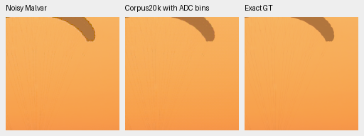
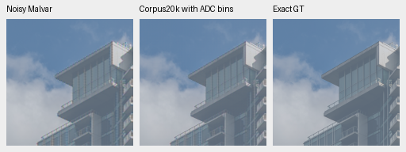

# Weak detail on 427 faint ADC-only photos

ADC-bin projection brings Corpus20k's weakest-band error from
**2.594 to 1.901 DN16 RMS**, almost equal to the projected V120's
1.900 DN16. Corpus20k with ADC bins has the highest mean rendered PSNR
on this panel. The unprojected checkpoint has higher weakest-band
error than V120. The positive-noise GFX outputs retain their earlier behavior.
[Complete measured results and provenance](results/full427-faint-adc-v1/publication.json).

## Observations and comparison

The two archived EMA checkpoints are V120
`a9d9b6b4f974e24a6b11e5e740aab32314233a7f53c056cf37c7d2aac1c589fb`
and Corpus20k
`633053370bdfb455d738ce0e3af686cb61e8dcac7c501954eb3b2293738a3795`.
The 427 held-out original scenes have zero overlap with the current
training source manifest. The simulation retains 2.5% of the
deviation from the per-channel image mean and encodes it through
a 16-bit ADC with black fraction 0.03, exposure 1 and zero shot/read.
Camera conversion and quantization use the existing CPU FP64 protocol.
All four Bayer orders are present for every source.
[Checkpoint and training details](full-corpus-control20k-review.md).

The fine-band test uses native 16×16 blocks and a DCT annulus from
1/8 to 1/3 cycles per pixel. Eligibility and contrast bins come from
the original rendered source before faint simulation. Error and
signed response compare with the exact contrast-reduced target.
The table's weakest nonquiet band uses original RMS-to-mean ratio
below 0.02, at least `1e-5` original band RMS, mean 0.02–0.9 and
unsaturated RGB. It includes 326 sources and 15,008 native blocks.
The metrics pool all four CFA observations within a source before
averaging sources equally. Rendered PSNR uses the central 240×240
crop and all 427 sources. This simulation is a separate quality panel
from the standard 427-photo scores in the PSNR history.
[Scoring protocol](../scripts/report_full_faint_photo_panel.py) ·
[Independent aggregation](results/full427-faint-adc-v1/independent-audit.json).

| EMA and ADC policy | Mean sRGB PSNR (dB) | Weakest-band error (DN16 RMS) | Weakest-band signed response |
| --- | ---: | ---: | ---: |
| V120 raw | 67.81724 | 2.40628 | 0.81173 |
| V120 exact Malvar | 68.31575 | 1.92791 | 0.97343 |
| V120 exact sites | 68.21457 | 1.89195 | 0.89421 |
| V120 ADC bins | 68.35296 | 1.90049 | 0.95772 |
| Corpus20k raw | 67.82432 | 2.59399 | 0.76129 |
| Corpus20k exact Malvar | 68.38790 | 1.93616 | 0.97688 |
| Corpus20k exact sites | 68.21658 | 1.94684 | 0.86811 |
| Corpus20k ADC bins | 68.42146 | 1.90110 | 0.95700 |

Without projection, Corpus20k gains 0.00708 dB in mean sRGB PSNR over V120
and has 7.8% higher weakest-band error. With ADC bins its mean sRGB PSNR
is 0.06850 dB above V120 with the same projection, while weakest-band RMS
differs by 0.00061 DN16. Within Corpus20k, ADC bins improve 413 of 427
source PSNRs and reduce weakest-band error on 297 of 326 sources versus
the raw prediction. V120 exact-sites reaches a slightly lower mean
weakest-band error than V120 ADC bins at lower response and lower
overall PSNR. The quiet bin represents three sources and 176 blocks.
[All source-balanced band and photo metrics](results/full427-faint-adc-v1/report.json.gz).

## Native images

The triplets show noisy Malvar, Corpus20k with ADC bins and exact faint GT.
Both use the RGGB observation, native ROI `[48,48,160,160]` and exposure 1.
All panels share the white balance, color matrix and contrast-20 display
centered on the corresponding ground-truth crop. The two cases are the
first sorted source IDs, with IDs, noise settings and checkpoints bound
in the manifest.
[Native crop provenance](images/full427-faint-adc-v1/manifest.json).

The projection restores some strands in the first case and slightly
clarifies thin lines on the building. The main GFX sky, bracing,
foliage and coarse fence retain the archived model predictions.
Both cab crops retain the earlier incomplete fine lattice. The
projection returns the original tensor for both checkpoint outputs
on all six positive-noise camera inputs underlying the eight GFX
boards. Those boards were viewed again. DSCF3880 and DSCF3835 ISO100
AHD and their low-ISO JPEG comparisons are independent qualitative
references where available, with different aperture, exposure and
subject motion.
[Main sky, building, foliage and coarse fence](full-corpus-control20k-review.md#native-images-and-both-real-fences) ·
[Fine cab mesh, both sides, profiles and JPEGs](gfx-green-mesh.md).

The archived inference took 21,488.94 seconds. Scoring took another
425.21 seconds and covers 13,664 policy rows. The reporter cross-checks
the DCT coefficient arrays with a second transform and checks that
every ADC-bin prediction re-encodes to its measured code. The independent
audit also verifies all source groupings, six exact triplet cells and
12 real model-and-input bypasses.
[Execution receipts and native viewing](results/full427-faint-adc-v1/publication.json).
