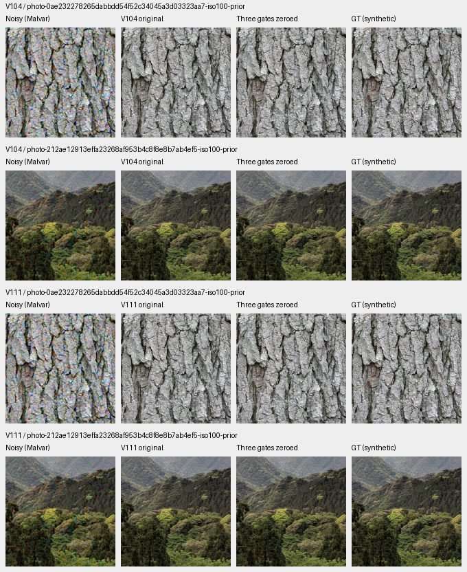
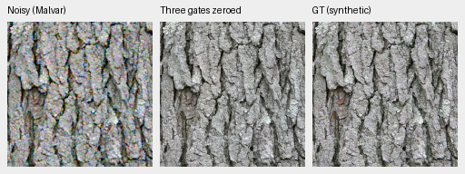
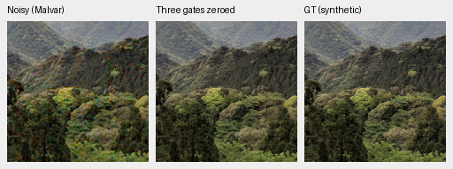
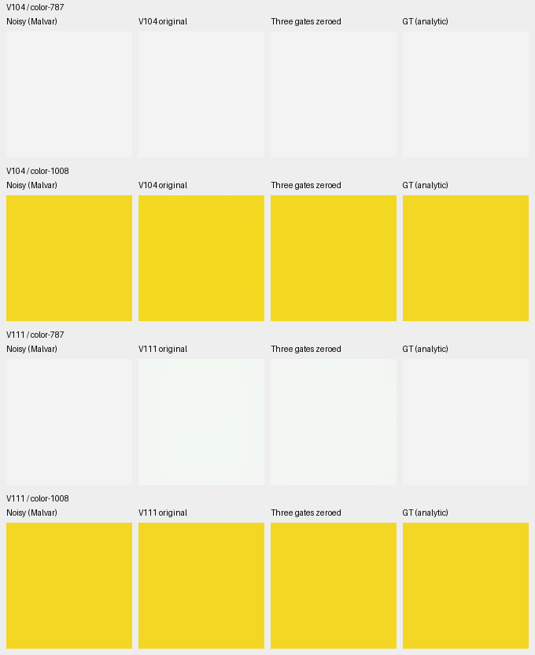

# DINO fusion in the current models

**Keep the learned fusion in V104 and V111.** Zeroing its three gates reduces
two selected worst ADC color biases, but lowers the four-photo mean in every
condition and regresses all four selected camera comparisons. Large color
errors and soft GFX foliage remain. This is a diagnostic intervention with no
training, rather than an improved model or a trained capacity comparison.

[Weights, exact intervention, retained predictions, independent arithmetic and native metadata](results/fusion-gate-ablation-CPU-v1.json).
Both original final20k checkpoints remain intact. The selector was V104 at that
recording; [V114 is now current](v114-v115-quality.md).
The frozen official DINOv3 ConvNeXt-Tiny identity is unchanged. Only
`context.gates.0/1/2` are set to zero; the other 88 EMA tensors stay exact.
The original 91 tensors are restored exactly after each diagnostic.

## Photo and camera results

The original four held-out sources, three conditions, RGGB observations and
240-pixel scoring interiors match the earlier material reports. These are
four-source means, not full427 scores.

| Parent | Condition | Original PSNR | Gates zeroed | Change, dB |
| --- | --- | ---: | ---: | ---: |
| V104 | ADC-only | 39.49290 | 39.21738 | −.27553 |
| V104 | ISO100 prior | 40.80493 | 40.79394 | −.01100 |
| V104 | ISO12800 prior | 33.49300 | 33.47827 | −.01473 |
| V111 | ADC-only | 39.74670 | 39.56135 | −.18535 |
| V111 | ISO100 prior | 40.90464 | 40.89377 | −.01087 |
| V111 | ISO12800 prior | 33.51175 | 33.49531 | −.01644 |

Nine of twelve individual photo PSNRs fall for each parent. Native bark/canopy
changes look small; high-noise fine structure remains smoothed.

[ISO12800 native comparison](images/fusion-gate-ablation/iso12800-prior.png).
Both use identical 160-pixel crops at [48,48,160,160] within native256 evaluation
contexts, display exposure ×1, WB=[2,1,1.5] and the recorded common matrix.
ISO100 uses shot .00002/read variance .0000000016; ISO12800 uses the original
prior recorded in the [board metadata](images/fusion-gate-ablation/iso12800-prior.json).

Noisy → **V104 with three gates zeroed** → exact synthetic GT, ISO100. These
two diagnostic triplets preserve the board pixels without resizing:

[Bark source/ROI/base-checkpoint/effective-state/noise/display metadata](images/fusion-gate-ablation/crop-b187e524be59f538.json) ·
[Canopy metadata](images/fusion-gate-ablation/crop-7765d3f328ce6737.json).

| Selected Canon M100 field | Parent | Change in measured-CFA PSNR, dB |
| --- | --- | ---: |
| Coulicoco | V104 | −.51852 |
| top_of_Expedit | V104 | −.47232 |
| Coulicoco | V111 | −.33079 |
| top_of_Expedit | V111 | −.51554 |

[Native camera board](images/fusion-gate-ablation/camera.png) ·
[Source/ROI/conditioning metadata](images/fusion-gate-ablation/camera.json).
Primary scores use the original 448-pixel measured-CFA interiors. Display uses
the same selected native160 ROIs and +2EV for every method. AHD RGB is auxiliary,
not exact GT. Broad colored blotches persist with the gates zeroed.

## The color tail is sensitive to fusion

The eight preselected analytic fields include the original worst ADC case for
each parent. Maximum absolute channel-mean bias, in camera RGB DN16:

| Parent | ADC field | Original | Gates zeroed |
| --- | --- | ---: | ---: |
| V104 | Gray .9, GBRG, case787 | 17.35 | 14.41 |
| V104 | Saturated yellow, RGGB, case1008 | 1,218.06 | 335.51 |
| V111 | Gray .9, GBRG, case787 | 2,142.98 | 1,505.66 |
| V111 | Saturated yellow, RGGB, case1008 | 21.57 | 23.83 |

The V111 gray field loses some of its green cast, but remains biased. Several
other sampled colors worsen. These observations establish sensitivity to the
fusion intervention; they neither isolate a unique failure cause nor establish
a repair across the full color grid. The restoration trunk and fusion have
adapted together, so this also does not compare with a model trained without DINO.

## Standing GFX scene and the next capacity test

The [V104](images/fusion-gate-ablation/gfx-V104.png) and
[V111](images/fusion-gate-ablation/gfx-V111.png) boards cover all six existing
sky/building/foliage/fence/sign/platform contexts. Changes look small, with no
compelling recovery of fine foliage or saturated-sign detail. These are native160
crops from 512-pixel contexts, shared +2EV, DSCF3879 ISO6400 input and separately
captured DSCF3880 ISO100 f/5.6 reference, **not GT**. The existing
[complete-frame gallery](gfx-qualitative.md) remains the full-resolution comparison.

The [Tiny/Small preparation](convnext-small-capacity.md) resets gates to give
the encoders a common initial function. This diagnostic shows the adaptation
cost for newer parents. Keep the useful learned-gate parent as a separately
labeled reference and compare trained endpoints with it, alongside the
matched encoder comparison. Zero-gate inference alone is not a replacement.

The run completes 74 actual CPU model/encoder forwards: 56 intervention cases
and 18 original-weight replays. Original V104 replays agree with saved controls
within 7.75e-7 camera units; V111 replays are bit-exact. Independent Torch64
checks rebuild all 424 NumPy64 score fields, with PSNR discrepancies below
1.5e-14dB. All 112 native board cells were actually viewed; PNG write/read
checks preserve every crop pixel. No CUDA, optimizer update, new RAW decode,
fitted correction or broad quality conclusion is involved.

Photo attribution: [Derek Ramsey, bark](https://commons.wikimedia.org/wiki/File:Kentucky_Coffee-tree_Gymnocladus_dioicus_3264px.jpg),
[CC BY-SA 2.5](https://creativecommons.org/licenses/by-sa/2.5/), and
[Grendelkhan, canopy](https://commons.wikimedia.org/wiki/File:Forest_covered_hills_on_Yakushima.jpg),
[CC BY-SA 4.0](https://creativecommons.org/licenses/by-sa/4.0/).
Modifications: 8× binning/cropping, synthetic noise, restoration and common
display conversion. Complete source and intervention metadata accompany the images.
