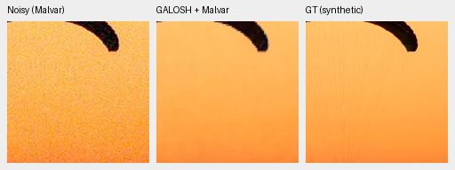
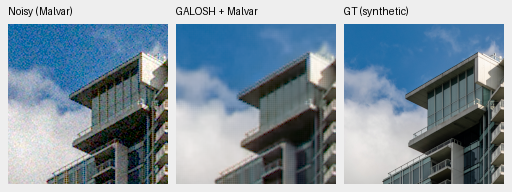
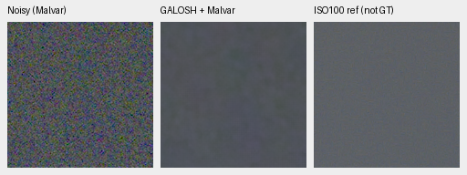
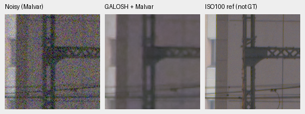
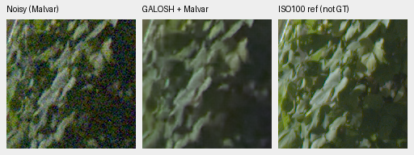
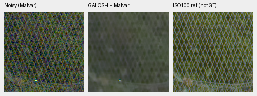

# GALOSH: small CPU reference comparison

Current architecture and recommendations: [current model guide](current-model.md).
The versioned study below retains its measured results and original protocol.

The pinned GALOSH reference removes much of the grain in the two selected
photographs and four GFX contexts, but loses fabric cords, blurs facade/leaves
and substantially weakens fence contrast. Sky retains low-frequency variation.
**No promotion or full benchmark follows from this pilot.** V43 was the reference for this study and V67 continues its separate, unchanged training experiment.

[All inputs, hashes, scores, audits and12 actual native-view receipts](results/galosh-cpu-pilot.json).

[GALOSH's July2026 paper](https://arxiv.org/abs/2607.03768) describes local
Walsh–Hadamard luminance shrinkage and luminance-guided chroma regression after
Poisson–Gaussian variance stabilization. Its
[publisher source](https://github.com/luxgrain/GALOSH/tree/11de0593cc8091933ad76d1d6d873f7dee537f15)
is Apache-2.0; [license](../third_party/galosh/LICENSE) and
[notice](../third_party/galosh/NOTICE) are retained. This is a training-free
RAW-denoising reference followed by our independent WB-aware Malvar demosaicing,
not a new trained joint model or a reproduction of the paper's benchmark scores.

## Execution and independent checks

Publisher commit `11de0593cc8091933ad76d1d6d873f7dee537f15`.
Executable SHA256:
`f2bef9c03f899ce4f076e54976ad3966edf6a25a4540ea86dd70c51ccfac0373`.
There is no checkpoint: binary/source hashes identify this method.

The original C source includes x86 intrinsic headers and two unused archived SSE
helpers, preventing an AArch64 build. The explicit local port guards those headers
and helpers; the canonical processing code is unchanged. GCC13.3, `-O3 -fopenmp
-std=gnu11 -ffp-contract=off`, no fast-math. Cross-architecture numerical identity
with the original x86/GPU executable remains unverified.

Two-thread execution initially passed saved-array/native checks but failed an
exact repeat of photo0:52,185 raw values changed, maximum2.52128e-5/RMS4.81430e-7.
That attempt and failed assertion are retained, without accepting it under a
wider tolerance. The separately rerun **single-thread** probe is used here; its
photo0 repeat is byte-identical. One repeat is not a general determinism proof.

Every input is an existing observation: no new noise draw, RAW decode, reference
fitting or training. Native signed Bayer values are interleaved exactly, then
clipped to the publisher's documented[0,1] input range. This changes the negative
tails relative to the signed neural pipeline and is explicitly part of this
cascade. Negative samples clipped: photo0 1,176/65,536; photo1 786/65,536; GFX sky
273/262,144, building1,666, foliage12,230 and fence3,445/262,144. No value exceeds1.

Both declared modes use explicit luma/chroma strength1.0, the default processing
path and single-thread OpenMP. Blind passes zero noise arguments. Supplied mode
passes the original nominal shot/read profile, retaining the publisher's internal
stabilized-sigma reestimation. It is not an oracle that perfectly characterizes
the clipped input. Settings were not selected against the target.

The independent audit checks all12 wire inputs/output arrays and command contracts,
eight PSNR fields with separate Torch64 camera/display arithmetic, and36 native
panel rerenders. Maximum PSNR arithmetic difference5.42e-7dB under the declared
3e-5 bound. Saved Bayer→Malvar RGB and all PNG rerenders are exact; noisy/reference
pixels match the original comparison panels exactly. All12 serial triplets were
actually viewed at native resolution.

| Selected source | Blind camera / sRGB PSNR | Supplied camera / sRGB PSNR |
| --- | --- | --- |
| Fabric/photo0 | 39.46292 / 34.65511 | 39.51516 / 34.36879 |
| Building and sky/photo1 | 33.16601 / 28.07418 | 33.18310 / 28.14902 |

These are two native160px ROIs from fixed CPU-noise observations, not full427
means or directly comparable to its CUDA-noise scores. No real-reference scores
are computed. Small shared-machine CPU process times do not establish full100MP
or GB10 GPU speed; the paper's speed results are not measurements of this port.

## Native exact-GT photographic triplets

Noisy Malvar → blind GALOSH+Malvar → exact simulated GT. Each panel has native
160×160 pixels at the8×-binned evaluation resolution, with no resizing. Shared
ROI[48,48,160,160], RGGB/WB[2,1,1.5], original matrix, ADC16/black.03,
shot=.00256/read variance=.0000262144, display×1. The center method clips its
input negative tails as documented above; the common noisy panel remains the
original signed observation. Every crop records source/ROI, binary hash, noise
mode, preprocessing and display exposure.

Sources: [Roy Egloff](https://commons.wikimedia.org/wiki/File:CH.VD.Villeneuve_2007-08-25_Vertigo-Swiss-Riviera_2392_3x2-R_4K.jpg)
and [Dietmar Rabich](https://commons.wikimedia.org/wiki/File:Vancouver_(BC,_Canada),_Coal_Harbour_Seaside_Park,_Blick_in_den_Himmel_--_2022_--_2158.jpg),
[CC BY-SA4.0](https://creativecommons.org/licenses/by-sa/4.0/), modified by binning,
crop, simulated noise and restoration.





## Standing GFX contexts

DSCF3879 ISO6400 f/1.7 → blind GALOSH+Malvar → DSCF3880 ISO100 f/5.6. Reference
is independently AHD demosaiced,3m38s later with different aperture/exposure time
and moving subjects: **not GT**. These160px sensor ROIs come from the original
cached512px contexts, not a new full-frame output. Shared WB/matrix/display×4
and integer source/ROI coordinates are retained; no warp/resizing. Nominal
observation shot=.0014635775921166604/read variance=.0000010715704128646712.
Blind mode fits the clipped noisy context; supplied mode uses that nominal
profile. Neither uses the ISO100 reference for calibration.









The separate nominal-mode triplets are retained in the machine receipt. Native
appearance is similar: the noise/detail tradeoff remains. The scene and siblings
stay outside training. This selected development comparison supplies neither
broad superiority nor the requested learned restoration quality.

## Reproduce the CPU probe

Use a fresh build/output path, with the publisher checkout pinned above:

```bash
source scripts/env.sh
CUDA_VISIBLE_DEVICES='' uv run --no-sync python scripts/prepare_galosh_cpu.py \
  --root /mnt/external/demosaic/references/galosh/availability-20261017-v1 \
  --output /mnt/external/demosaic/references/galosh/new-local-build
CUDA_VISIBLE_DEVICES='' uv run --no-sync python scripts/probe_galosh_cpu.py \
  --build /mnt/external/demosaic/references/galosh/new-local-build/build-receipt.json \
  --output /mnt/external/demosaic/evaluation/galosh-new-serial-probe --threads 1
CUDA_VISIBLE_DEVICES='' uv run --no-sync python scripts/audit_galosh_cpu_probe.py \
  --report /mnt/external/demosaic/evaluation/galosh-new-serial-probe/report.json \
  --output /mnt/external/demosaic/evaluation/galosh-new-serial-probe/independent-audit
```
