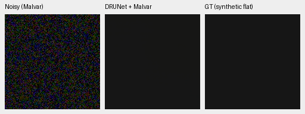
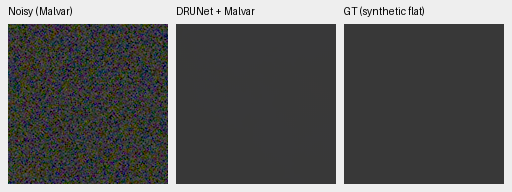

# Frozen Gaussian denoiser on physical flats

A frozen grayscale DRUNet, applied independently to the four original Bayer
phases before WB-aware Malvar interpolation, removes substantially more flat
noise than the current model. This is a diagnostic lead for a stronger learned
prior, **not a photographic quality result or a promoted joint model**.

The three exact neutral synthetic targets are levels 0.002/0.01/0.05 with the
cached GFX camera metadata, declared ISO6400 Poisson/read priors, seed 20261015,
512-pixel inputs and a 64-pixel scoring trim. They are the same observations as
the current residual-scale diagnostic. No actual GFX image pixels are fitted
or used as targets. Each phase's Gaussian sigma is estimated from its observed
mean and the known synthetic shot/read coefficients. That constant-noise
approximation is appropriate to investigate on flats; it does not supply a
heteroscedastic photographic denoising method.

| Level 0.01 camera-RGB error | V16 | RawNIND CFA-LS | DRUNet-gray + Malvar |
| --- | ---: | ---: | ---: |
| Centered residual sigma | 0.00023195 | 0.00008124 | 0.00002598 |
| 32-pixel means sigma | 0.00009647 | 0.00006251 | 0.00002258 |
| 64-pixel means sigma | 0.00006318 | 0.00005266 | 0.00002120 |
| Mean absolute channel bias | 0.00004859 | 0.00004406 | 0.00000752 |

The comparison has different model capacity, training data and denoising
representations; it is not a matched architecture ablation. A flat target
cannot test preservation of texture, edges or highlights. Those tests are
required before integrating a Gaussian prior or claiming improvement on photos.
The quality/speed goal remains open.

Native 160×160 noisy/denoised/exact-GT triplets at levels 0.002 and 0.01, with
shared +2 EV display. One sensor pixel occupies one PNG pixel; open at 100%:





[Full residual, bias, ROI, conditioning, source and weight receipts](results/gaussian-drunet-flat-probe.json).
The canonical script reproduced the prototype's complete metric rows exactly.
The output directory archives actual source, camera metadata, frozen weights
and license notices. All physical and neural operations use IEEE FP32.

Source provenance: the inspected [Noise2VST authors' repository](https://github.com/sherbret/Noise2VST)
at revision `02b839dae08e6304441ef9e5b3452262c36c4550` supplies an MIT-licensed
DRUNet implementation and links the original KAIR pretrained weights. The
32,638,656-parameter grayscale weights loaded strictly and are checksum-pinned;
[the acquisition receipt](results/noise2vst-source-and-weights.json) records
source/weight/license hashes. The source stays external with its MIT notices;
no upstream code is vendored and no new dependency was installed.

The [Noise2VST paper](https://arxiv.org/abs/2407.17399) studies adaptation of a
variance-stabilizing transform with a frozen Gaussian denoiser. This probe does
**not** execute that adaptation or reproduce its paper scores. It tests the
underlying Gaussian prior under near-constant physical noise. A next experiment
should handle signal-dependent variance and inverse-transform bias explicitly,
then evaluate native photographic crops against V16 and RawNIND.

```bash
source scripts/env.sh
uv run --no-sync python scripts/probe_gaussian_flat.py \
  --camera /path/to/cached-camera-metadata.json \
  --reference docs/results/noise2vst-source-and-weights.json \
  --output /mnt/external/demosaic/evaluation/gaussian-flat-next
```

The checked-in receipt references the locally cached source and weights. Choose
a new output directory for each run. This command makes no full-frame timing
claim; the project still needs measured final quality and 100 MP speed evidence.
