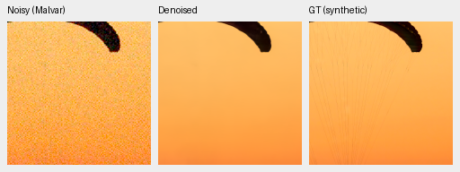
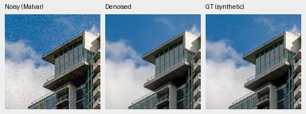
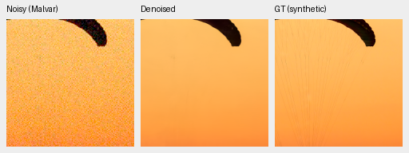
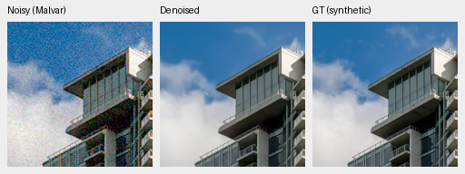
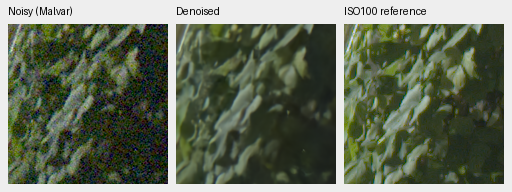
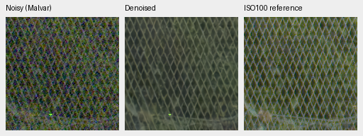
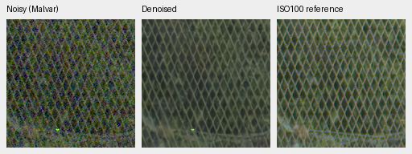

# Augmentation before final downsampling

**4× bin → geometry/PSF at twice target resolution → final area2** improves
the full427-photo synthetic-noise mean by **.50990dB** over the matched
8×-then-geometry control. Its95% source-bootstrap interval is[+.47646,+.54728].
The expanded corpus shows the same augmentation benefit, +.63571dB
[+.60200,+.67021]. This supports the new augmentation order for subsequent
trials. Real-camera gains are smaller and uncertain; fine detail remains soft.
[Complete metrics and native-crop receipt](results/geometry-corpus-v34-v36-review.json).

| First1000 arm | Commons training photos | Training augmentation | Photo PSNR | Photo SSIM | Procedural PSNR | Procedural SSIM |
| --- | ---: | --- | ---: | ---: | ---: | ---: |
| V32 | 40,170 | 8× then geometry | 33.95672 | .950119 | 33.10339 | .962757 |
| V35 | 41,978 | 8× then geometry | 33.84007 | .949812 | 33.26958 | .962639 |
| V34 | 40,170 | 4× → geometry → 2× | 34.46662 | .954201 | 33.18400 | .962951 |
| V36 | 41,978 | 4× → geometry → 2× | 34.47578 | .954526 | 32.94333 | .962483 |

All427 photographs plus16 procedural sources share seven noise/exposure cases,
four CFAs, fixed validation sources and paired noise. The111,636 rows include
four neural models, both RawNIND input-only gain calibrations and three
classical methods. The16-photo preview predicted this augmentation gain; the
completed427-photo suite confirms it. Evaluation retains the original8×
targets, so this is not a change in scoring resolution or target construction.

V36−V34 photo PSNR is only+.00916dB, interval[−.03175,+.03761], while its
procedural mean is lower. Adding these1808 Commons sources has not established
a broad gain. V34 is the next architecture pilot's parent because it combines
the augmentation improvement with the stronger procedural and unseen means.
These intervals measure evaluation-source variability, not training-seed
variability. Every arm has only one training seed.

| Noise/exposure case | V32 photo PSNR | V34 photo PSNR |
| --- | ---: | ---: |
| ADC-only | 33.33789 | 33.98692 |
| ISO100 prior | 35.01178 | 35.98548 |
| ISO1600 prior | 34.50510 | 35.26960 |
| ISO12800 prior | 32.46899 | 32.81826 |
| Shadows | 39.25216 | 39.49229 |
| Highlights | 29.33007 | 29.35610 |
| Legacy noise | 33.79105 | 34.35769 |

Both new runs use the same V30-step1000 EMA parent
`3a529117f127b2b48c203d6d23d154aeea0924f1aeb7ca649b1778ac8c0686c6`,
fresh AdamW/EMA, seed46, batch16, LR3e-5 / planned3000 schedule and stop1000.
The mix stays25% paired /25% native /50% Commons. Native4 contains exactly the
same53 captures/31 scenes as native8; only its preprocessing changes. Complete
frozen4× corpora were used, with40170/41978 training sources and identical2303
validation/2255 test memberships. Original8× validation remains fixed.

All16 logged paired observations match between V32/V34/V36; all11 logged native
observations match between V34/V36. Implementation, initializer and validation
bytes match the8× controls. The4× training source-bundle SHA
`15af15b4c3e817599e54d1e3995dbd95f9f14213dace0e3a7735985cef8300ea`
differs because that bundle includes the changed native manifest; this is not
a code change. Commons/native4 manifests are separately pinned in
[complete-corpus receipts](results/commons-four-complete.json).

First1000 checkpoint SHA256:

- V34: `4da823a0bcff4d02335ba2a9eb04ef7c54d8e2ff7d5d96c1116e9f1ce72899b7`
- V36: `e086d0e8ef2e2ea84f4b31ecc3d7eb26220f5000ae73d0935ef5af951f96fb02`

| Panel | Method | Measured-CFA PSNR | AHD RGB PSNR | AHD SSIM |
| --- | --- | ---: | ---: | ---: |
| Known4 | V32 | 54.22962 | 39.93072 | .930351 |
| Known4 | V35 | 54.25055 | 39.89707 | .930343 |
| Known4 | V34 | 54.24658 | 39.94860 | .930049 |
| Known4 | V36 | 54.24577 | 39.93673 | .930236 |
| Known4 | RawNIND channel CFA-LS | 54.08474 | 39.71710 | .928831 |
| Unseen5 | V32 | 53.76552 | 38.35791 | .917477 |
| Unseen5 | V35 | 53.80858 | 38.36566 | .919357 |
| Unseen5 | V34 | 53.78664 | 38.51133 | .921075 |
| Unseen5 | V36 | 53.77059 | 38.43188 | .919557 |
| Unseen5 | RawNIND channel CFA-LS | 53.76822 | 38.56191 | .922127 |

Known4:8 pairs/72 crops; unseen5:10 pairs/90 crops. Capture means balance within
scenes, then scenes balance. V34−V32 primary changes are+.01696dB known
[−.01325,+.06175] and+.02112dB unseen[−.02478,+.06562]. Unseen AHD RGB improves
.15341dB and SSIM+.003598, but both scene-bootstrap intervals cross zero.
RawNIND's channel calibration still leads unseen auxiliary RGB PSNR/SSIM.
Measured low-noise CFA is the primary reference; independently demosaiced AHD
RGB is **not exact RGB GT**. Both RawNIND calibrations remain in the receipt.

Noisy Malvar → restored → **exact synthetic GT**, native160×160 panels, no
resizing. RGGB/ISO12800 prior (`shot=.00256`, `read=.0000262144`), ROI
[48,48,160,160] in the same validation tile, display×1, WB[2,1,1.5] and the fixed
protocol matrix. Source/cache/checkpoint SHA, coordinates and display records
are in the receipt. PNGs are8-bit sRGB previews; metrics use unquantized output.

V34:

V36:

Fabric threads are still largely absent and cloud texture smoothed. Sources:
[Roy Egloff](https://commons.wikimedia.org/wiki/File:CH.VD.Villeneuve_2007-08-25_Vertigo-Swiss-Riviera_2392_3x2-R_4K.jpg)
and [Dietmar Rabich](https://commons.wikimedia.org/wiki/File:Vancouver_(BC,_Canada),_Coal_Harbour_Seaside_Park,_Blick_in_den_Himmel_--_2022_--_2158.jpg),
[CC BY-SA4.0](https://creativecommons.org/licenses/by-sa/4.0/). Modified by linear
binning, cropping, noise simulation, restoration and rendering; derivative
previews retain that license.

Standing GFX DSCF3879 ISO6400 → restored → separate DSCF3880 ISO100 f/5.6,
native160px foliage[8890,5570] and fence[2240,6000], reference fence x2241.
Shared display+2EV/WB/matrix and input-only noise prior
(`shot=.001463577592`, `read=.000001071570413`). Aperture, time and motion differ;
the last panel is a qualitative reference, **not GT**.

The following crops come from the blended full 102 MP output. The separate
512px-context diagnostic remains in the receipt, alongside sky/building regions
and both RawNIND calibrations.

V34:

V36:

RawNIND with input-only channel CFA-LS calibration:

The wire mesh is more legible with V34 than with RawNIND's blurred repeating
pattern. Foliage is still soft, fine mesh structure irregular and an isolated
colored point remains. These selected regions do not establish decisive
overall qualitative superiority. All native PNG hashes/dimensions, shared
source/ROI/noise/display metadata and identical noisy/reference panel bytes
were checked. The README now uses V34 full-suite/full-frame examples.

All twelve 8746×11662×3 uint16 TIFFs passed full SHA/byte-size, sample-depth,
shape/dtype and >256 sampled-code checks. All six sRGB outputs carry ICC
profiles. They reside in
`/mnt/external/demosaic/evaluation/gfx-3879-3880-geometry-corpus-v34-v36-1k-full/`,
`restored-{0,1,2,3,4,5}-{linear16,srgb16}.tiff`: V32/V35/V34/V36/RawNIND-global/
RawNIND-channel. Restoration took **36.90/36.25/37.03/35.98/18.32/18.41 seconds**,
tile512/overlap64/batch4, excluding RAW decode, model load, rendering and encoding.
These are successive shared-machine observations, not repeated idle benchmarks.
The 10-second target remains unmet. The subsequent packed-resolution pilot
waited for this entire review and verification before beginning its throughput
measurements.

Originals stay read-only and locally cached. GFX and its siblings, public RAW
quarantine and protected-final sources remain outside training; no protected
final model scoring or reference-derived transform fitting.
