# Fine green fence beside the red train

**This additional real-capture case exposes missing weak detail and sensitivity
to noise conditioning.** With the nominal ISO6400 prior, V112, V114, V115 Small
and V117 largely erase the fine green lattice while retaining broad rails.
A fixed profile from nearby DSCF3879 makes more diagonal mesh texture visible in
V114 and V115, but the fine lattice remains much weaker than the reference.
RawNIND pre-upsampled keeps more directional texture under the nominal prior,
without clearly recovering the reference lattice.
The ISO6400 camera JPEG has very faint mesh amid grain; the separate ISO100
capture makes the physical structure much clearer. This remains an adverse case;
V120's corrected-paired-data continuation also shows no clear lattice-recovery
gain at matched conditioning.

The case pairs **DSCF3842 ISO6400** with **DSCF3835 ISO100**, taken 46 seconds
earlier. Both camera JPEGs are included.
The existing DSCF3879/3880 standing scene and its six regions remain in use.

The [V131/V132 spatial-detail trial](raw-spatial-training.md) queues both fixed
mesh profiles and both native160 regions, with this corrected DSCF3835 reference
and both camera JPEGs. Model quality and actual viewing are pending.

The [V137 conditioned-global review](v137-global-conditioned-quality.md) is
complete on these two profiles/regions with corrected DSCF3835 and all three
saved controls. Stronger memory adaptation does not produce clear new lattice
recovery; the native comparisons are below.

The [V120–V125 endpoint review queues](endpoint-quality-review.md) include both
fixed noise profiles and both native160 regions, reusing saved controls.
V120/V121 mesh review is complete below, with no clear V121 lattice-recovery
gain. V120's two saved predictions were adopted without rerunning it. V122/V123
final mesh review is complete below. A separate
[V1239k midpoint](#v123-at-9000-updates) is now measured with saved controls.
V124's [14k progress review](#v124-at-14000-updates) is complete; its original
20k control continues and V125 follows.

[Fixed sources and coordinates](../configs/gfx-green-mesh-20231231.json) ·
[Native image metadata](images/gfx-green-mesh-20231231-v1/manifest.json) ·
[Completed native review and data checks](results/gfx-green-mesh-v1.json).

## V137 conditioned-global pilot

The [completed matched1k review](v137-global-conditioned-quality.md) leaves the
fine lattice largely erased under nominal conditioning. The fixed nearby3879
profile retains weak irregular diagonal texture across all four methods,
without clear new correct-lattice recovery. Both regions/profiles were actually
viewed; the left blue point persists.

Columns: noisy → V120 → V1291k → V1361k → V1371k → independent **DSCF3835
ISO100/AHD reference, not GT**. Native160px cells share768px contexts, WB/matrix
and+4EV. Aperture, exposure time and moving subjects differ; the corrected ISO100
capture is46 seconds earlier. The main3879/3880 pair remains in use.

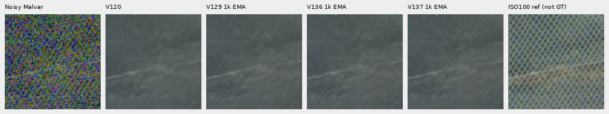

Left regions: [nominal](images/v137-global-conditioned-quality-v1/mesh-nominal-fine-green-mesh-left-comparison.png) ·
[nearby](images/v137-global-conditioned-quality-v1/mesh-profile3879-fine-green-mesh-left-comparison.png).
Nominal shot/read are`.00128`/`6.5536e−6`; nearby are
`.0014635775921166604`/`1.0715704128646712e−6`. Exactly two new root/DINO forwards
within the102-input review reuse fixed inputs and all old predictions, with no
noise sweep, RAW decode or reference fit. Both camera JPEGs remain in the
standing comparison below. [Source/ROI/all checkpoint hashes/profile/display metadata](images/v137-global-conditioned-quality-v1/manifest.json).

## V136 global-attention pilot

The [completed matched1k review](v136-global-attention-quality.md) shows no clear
new lattice recovery. Nominal conditioning still largely erases the fine mesh;
the fixed nearby3879 profile retains weak irregular diagonal texture in all
three methods. Both regions/profiles were actually viewed; the left blue point
persists.

Columns: noisy → V120 → V1291k → V1361k → independent **DSCF3835 ISO100/AHD
reference, not GT**. Native160px cells share768px contexts, WB/matrix and+4EV.
The corrected ISO100 exposure is46 seconds before DSCF3842 ISO6400, with different
aperture, exposure time and moving subjects. The main3879/3880 pair remains in use.

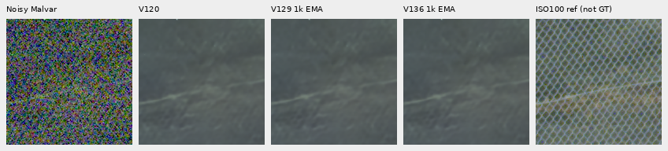

Left regions: [nominal](images/v136-global-attention-quality-v1/mesh-nominal-fine-green-mesh-left-comparison.png) ·
[nearby profile](images/v136-global-attention-quality-v1/mesh-profile3879-fine-green-mesh-left-comparison.png).
Nominal shot/read are`.00128`/`6.5536e−6`; nearby are
`.0014635775921166604`/`1.0715704128646712e−6`.
Exactly two new root/DINO forwards within the102-input review reuse both fixed
inputs and all old predictions. No RAW decoding, conditioning sweep or reference
fitting occurs. Both camera JPEGs remain available in the standing comparison
below. [Source/ROI/checkpoint/profile/display metadata](images/v136-global-attention-quality-v1/manifest.json).

## V124 at 14,000 updates

The [actual14k checkpoint review](v124-progress14000.md) leaves the lattice
largely erased under nominal conditioning. The fixed nearby3879 profile retains
weak irregular diagonal texture, without a clear correct-lattice recovery over
V120. Both regions/profiles were actually viewed; the left blue point persists.

Columns: noisy → V120 → V12414k EMA → independent **DSCF3835 ISO100/AHD reference,
not GT**. Native160px cells share768px contexts, WB/matrix and+4EV. The corrected
ISO100 capture is46 seconds before DSCF3842 ISO6400, with different aperture,
exposure time and moving subjects. The main3879/3880 pair remains in use.

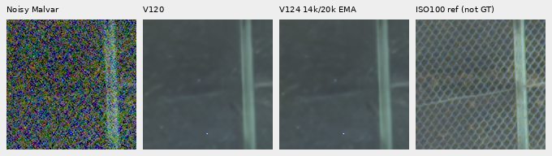

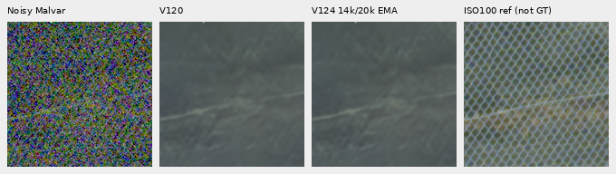

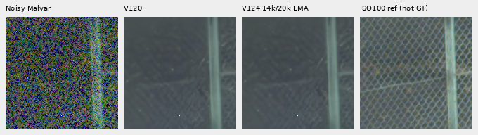

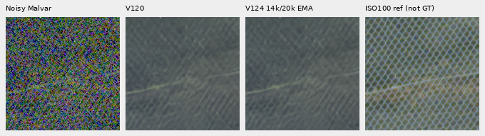

Exactly two new root/DINO forwards reused the two fixed profile inputs and
V120 predictions, without a noise sweep, RAW decoding or reference fitting.
The partial checkpoint is not a full endpoint; these tradeoffs do not change the
V120 recommendation. Both camera JPEGs and the original standing comparisons
remain available below. [Source/ROI/checkpoint/profile/display metadata](images/v124-progress14000-v1/manifest.json).

## V122/V123 completed frequency trial

The [completed20k trial](v122-v123-quality.md) leaves the fine lattice mostly
erased under nominal conditioning. The nearby3879 profile retains weak irregular
directional texture, without a clear new recovery. Both regions and profiles
were actually viewed. Four new endpoint root/encoder forwards used the existing
cached inputs; five control predictions were reused. No RAW decoding, noise
generation or profile fitting occurred.

Columns: ISO6400 camera JPEG → noisy Malvar → nominal prediction → nearby-profile
prediction → independent **DSCF3835 ISO100/AHD, not GT** → ISO100 camera JPEG.
Native160px cells share768px contexts,+4EV and WB/matrix. Aperture, exposure time
and moving subjects differ. The main DSCF3879/3880 pair remains in use.

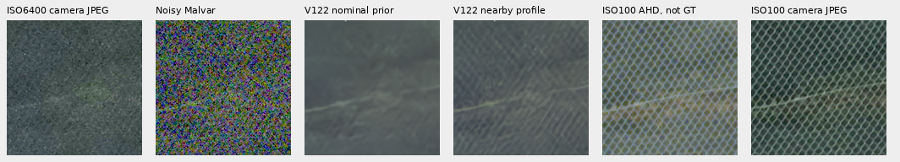

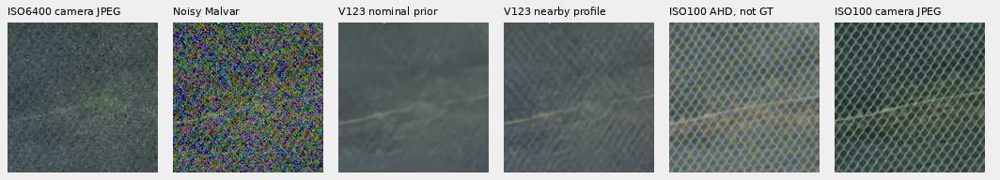

Left regions: [V122](images/v122-v123-quality-v1/V122-fine-green-mesh-left.png) ·
[V123](images/v122-v123-quality-v1/V123-fine-green-mesh-left.png).
Independent float64 display auditing checks1,843,200 RGB channels; only four
differ by one DN8 at FP32 rounding boundaries. No real-reference PSNR is used.
[Source/ROI/checkpoint/profile/display metadata](images/v122-v123-quality-v1/manifest.json).

## V130 FP32 training pilot

The [completed matched1,000-update precision trial](training-precision-pilot.md)
still mostly erases the fine lattice under nominal conditioning. The nearby3879
profile leaves weak irregular diagonal texture, without a clear improvement
over V129. Both regions/profiles were actually inspected. Native160px columns:
noisy → V120 → V129 BF16 → V130 FP32 → independent **DSCF3835 ISO100 reference,
not GT**. Shared768px contexts, WB/matrix,+4EV and fixed conditioning; no resizing.

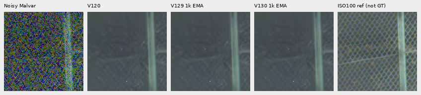

[Source/ROI/checkpoint/noise/display metadata](images/v130-fp32-pilot-quality-v1/manifest.json).
The corrected reference is DSCF3835,46 seconds earlier,ISO100 f/5.6; exposure,
aperture and moving subjects differ. The main DSCF3879/3880 pair remains in use.
Small measured gains on the separate [faint-ADC panel](faint-adc-precision.md)
do not visibly resolve this real-capture weakness.

## V129 curated-data pilot

The [completed1,000-update data pilot](reviewed-detail-training-pilot.md) still
mostly erases the fine lattice under the nominal profile. The nearby3879 profile
retains weak, irregular directional texture without a clear improvement over
V126. Both regions/profiles were actually inspected. Native160px columns:
noisy → V120 → V126 → V129 → independent **DSCF3835 ISO100 reference, not GT**.
Shared768px contexts, WB/matrix,+4EV and fixed profile; no pixel resizing.

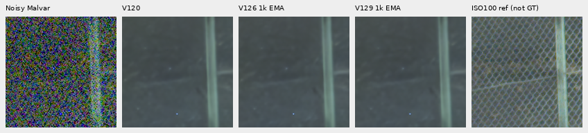

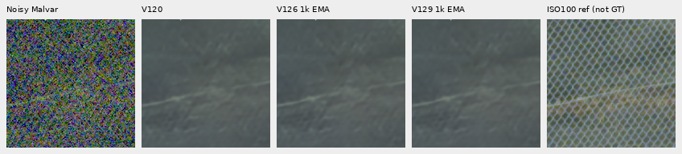

[Source/ROI/checkpoint/noise/display metadata](images/v129-data-pilot-quality-v1/manifest.json).
The [completed FP32 training trial](training-precision-pilot.md) reuses these
saved BF16-control predictions. The ISO100 aperture/exposure and moving subjects differ.

## V128 feature-loss pilot

The [completed1,000-update feature-loss pilot](v128-feature-pilot-quality.md)
shows no useful new fine-lattice recovery. Both regions were actually inspected
under both profiles. Columns: noisy → V120 → V126 control → V128 → independent
**DSCF3835 ISO100 reference, not GT**. Native160 pixels share +4EV,768px contexts,
WB/matrix and fixed conditioning. The originals and camera JPEGs stay unchanged.

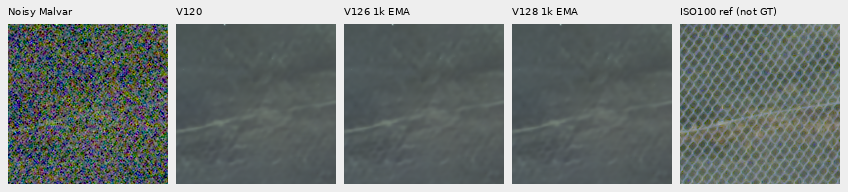

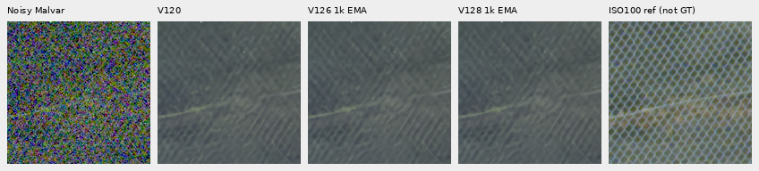

Nominal conditioning still mostly erases the mesh; the nearby profile leaves
weak/irregular diagonal texture. Left-region views:
[nominal](images/v128-feature-pilot-quality-v1/mesh-nominal-fine-green-mesh-left-comparison.png) ·
[nearby profile](images/v128-feature-pilot-quality-v1/mesh-profile3879-fine-green-mesh-left-comparison.png).
[Source/ROI/checkpoint/profile/display metadata](images/v128-feature-pilot-quality-v1/manifest.json).

## V126/V127 shadow-data pilot

**The completed matched1,000-update shadow pilot does not clearly recover the
fine green lattice.** Both regions were actually viewed under both fixed
profiles. Columns: noisy → V120 → V126 control → V127 shadow arm → independent
DSCF3835 ISO100 AHD reference, **not GT**. The native160px cells share +4EV (×16)
display, coordinates, WB/matrix and768px context. Original cached RAFs and both
camera JPEGs remain unchanged and outside training.

Nominal conditioning still largely erases the lattice; the nearby profile leaves
weak, irregular diagonal texture. The left blue point remains. Left-region
boards: [nominal](images/reviewed-shadow-pilot-quality-v1/V127-mesh-nominal-fine-green-mesh-left-comparison.png) ·
[nearby profile](images/reviewed-shadow-pilot-quality-v1/V127-mesh-profile3879-fine-green-mesh-left-comparison.png).
The two fixed priors and ROI coordinates remain those documented below.
[Completed metrics, material GT triplets and independent checks](reviewed-shadow-pilot-quality.md) ·
[Exact checkpoint/source/ROI/noise/display metadata](images/reviewed-shadow-pilot-quality-v1/manifest.json).

## V123 at 9,000 updates

**The V1239k EMA shows no clear fine-lattice recovery gain under either fixed
profile.** Both native160 regions were viewed, using two new768px contexts and
saved V115/V119/V120 controls. Nominal conditioning largely erases the mesh;
the nearby-DSCF3879 profile reveals more diagonal texture but leaves the fine
lattice weak and irregular. The blue point remains. Full20k results are now
[published](v122-v123-quality.md).

Right mesh: noisy → V115 → V119 → V120 → V1239k EMA → independent DSCF3835
ISO100 AHD reference, **not GT**. Display +4EV (×16), shared WB/matrix, fixed
nearby profile; native crop pixels are not resized.

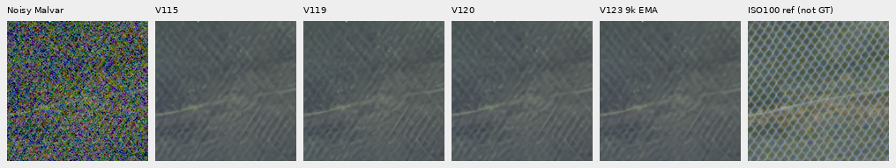

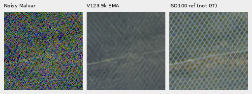

[Both profiles, both regions and material GT triplets](v123-midpoint-quality.md) ·
[Checkpoint/input/profile/ROI and verification](results/v123-mid9000-quality-pilot-v1.json).
The corrected pair is DSCF3842 ISO6400 / **DSCF3835 ISO100 f/5.6**. The main
DSCF3879/3880 scene remains in use; neither independent low-ISO capture is GT.

## V120 after correcting the paired-data mix

**V120 shows no clear fine-lattice recovery gain over V115 or V119 under either
fixed profile.** The completed20,000-update Small model restores the corrected
32-group paired set while keeping V119's Commons cohort and six photographic
regions. The nominal prior still largely erases the mesh. The nearby profile
reveals more diagonal texture, particularly on the right, but the lattice stays
soft, irregular and much weaker than the independent ISO100 reference. The blue
point remains. This case supplies no overall model ranking. The
[primary, main-scene and complete-frame V120/V121 comparisons](v120-v121-primary.md)
are now complete; V120 is the current general recommendation.

Columns below are camera JPEG, noisy Malvar, V115 Small, V119, V120, independent
ISO100 AHD and ISO100 camera JPEG. Top/bottom rows use the nominal/nearby profiles
listed below. Every cell is a native160×160 crop with the same +4EV display.
Both ISO100 columns are **qualitative references, not exact GT**.

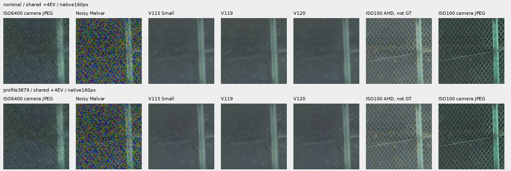

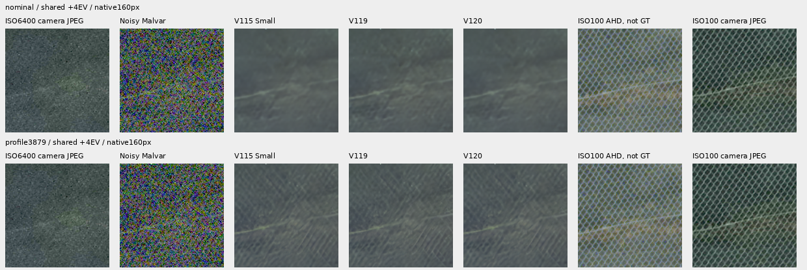

The two nearby-profile noisy/V120/independent-reference triplets retain native
pixels and the same display transform:

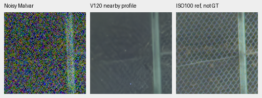

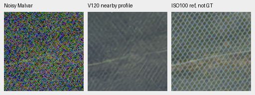

The checkpoint SHA256 is
`a9d9b6b4f974e24a6b11e5e740aab32314233a7f53c056cf37c7d2aac1c589fb`.
Exactly two new CPU IEEE-FP32 root/encoder forwards used the existing768px
context at B1; five selected parent/RawNIND predictions were reused. There was
no new RAW decode, noise generation, profile search or optimizer update.
Context coordinates are `[600,6260,768,768]`; local left/right ROIs are
`[206,229,160,160]` and `[426,189,160,160]`. Originals stayed read-only and cached.

Independent NumPy64 display arithmetic checks2,150,400 channel values in the
28 matched cells: ten differ by one DN8 from FP32 rendering; all others match.
Sixteen shared camera/noisy/reference control cells and all six triplet cells
match exactly. The actual frozen reuse path forbids model construction/calls
and reproduces the two +2EV and two +4EV boards and two triplets byte-for-byte.
The later family review checks the completed checkpoint hash before adopting
these V120 predictions and runs only V121's two new mesh forwards.

[Source/ROI/checkpoint/noise/display metadata](images/v120-green-mesh-v1/manifest.json) ·
[Execution, actual viewing, pixel verification and queue adoption](results/v120-green-mesh-v1.json) ·
[Completed training evidence](paired32-weak-detail-training.md).

## V121 after adding the fourteen-region bank

**V121 shows no clear fine-lattice recovery gain over V120 at either matched
profile.** Its original20k run uses the cleaner90787-source/fourteen-region
cohort at the same5% conditional-photo ROI quota. Nominal conditioning still
largely erases the mesh. The nearby profile exposes more diagonals, but fine
structure remains weak, soft and irregular; the left blue point persists.
This specific material-bank intervention has not solved the adverse capture.

V121 checkpoint SHA256:
`40fb6369064aaf82d513728110a6823ed72be50e79394988303c392b3a02f077`.
Two new CPU-FP32 root/encoder forwards completed, once per fixed profile.
Both V120 predictions and all five selected old controls were reused. There was
no new RAW/noise/optimizer work. Input, source, ROI and display are the same as
V120 above. Both ISO100 columns remain **independent references, not exact GT**.

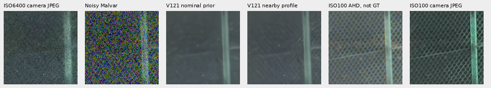

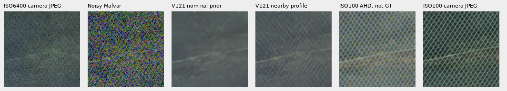

[Left native noisy/V121/independent-reference triplet](images/v120-v121-review-v1/V121-fine-green-mesh-left-triplet.png) ·
[Right triplet](images/v120-v121-review-v1/V121-fine-green-mesh-right-triplet.png) ·
[Source/ROI/checkpoint/conditioning/display metadata](images/v120-v121-review-v1/manifest.json) ·
[Completed review and independent native-pixel checks](results/v120-v121-native-review-v1.json).
Independent NumPy64 arithmetic matches921,598 of921,600 V121 board channels
exactly; two differ by one DN8 at FP32 rendering boundaries. Published PNGs
are byte-identical to the actually viewed outputs.

## V119 after cleaned-data training

V119 completed its original 20,000 updates from V115 Small on 90,791 cleaned
Commons sources and the expanded paired set. On this case it **does not clearly
recover more fine lattice than V115 at the same conditioning**. The nearby
profile reveals more diagonal texture than the nominal prior, as it does for
the parents; weak, soft and irregular mesh, grain/detail ambiguity and the blue
point remain. Cleaning plus this continuation has not solved this failure.
Its [complete numerical and main GFX review](v119-quality.md) documents a photo
gain over V115 alongside known-camera and ADC-color regressions; this mesh
observation alone does not establish an overall quality ranking.

The endpoint checkpoint is
`b3c0d43264c6ad8446dd930aafa337298e4690d0d08f2967824f03ecd844f427`.
Only two new CPU FP32 forwards were needed, one per fixed profile. All seven
earlier nominal/nearby-profile controls are reused, with no new RAW decode,
noise generation or control inference. The same noisy observation, coordinates
and display transforms apply. The nominal and nearby coefficients are listed
in the next section. These remain 768px context comparisons.

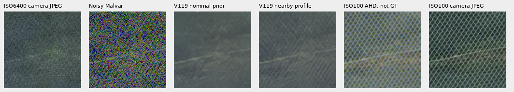

The two native noisy/V119/independent-reference triplets below use the fixed
nearby profile and the same +4EV display. DSCF3835 remains a separate-aperture,
separate-time qualitative reference, **not exact GT**.

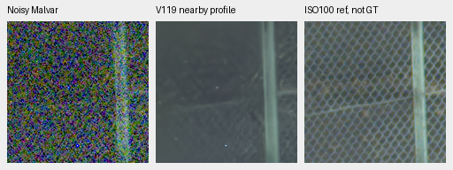

Matched method boards: [V114/V115/V119 with the nearby profile, +2EV](images/v119-green-mesh-v1/profile3879-comparison-2EV.png) ·
[all nominal controls and V119, +2EV](images/v119-green-mesh-v1/nominal-comparison-2EV.png).
[Sources/ROI/checkpoint/noise/display metadata](images/v119-green-mesh-v1/manifest.json) ·
[Completed review, failure preservation and independent pixel checks](results/v119-green-mesh-v1.json).
Independent NumPy arithmetic reproduces all 36 matched-profile board cells exactly;
all 18 triplet cells match their boards. Four parent-control PNGs remain
byte-identical to the earlier actually viewed publication.

## Fixed nearby-capture profile

The [measured-green spectral diagnostic](green-phase-spectrum.md) finds strong
matching diagonal peaks in both RAW green phases, with much less power in the
saved V115/V119 outputs at those frequencies. It supports the visible detail
loss without establishing exact recovery, a safe correction or a GT-based score.
It uses the same retained nearby-profile arrays, with no new model inference.

The same V114 and V115 checkpoints were each run once more on the stored 768px
RAW context with one unchanged **DSCF3879 ISO6400 input-only profile**. It was
already recorded on October 17, before this mesh case. No coefficient sweep or
reference/output fitting was performed. The nominal predictions are reused.

| Conditioning | Shot | Read variance |
| --- | ---: | ---: |
| Generic ISO6400 prior | .00128 | 6.5536e-6 |
| Fixed nearby DSCF3879 profile | .0014635775921166604 | 1.0715704128646712e-6 |

This changes the physical profile, including a higher shot term and lower read
term; it is not a uniform strength multiplier. All observed RAW values, WB,
matrix, CFA geometry, ROI/reference/JPEG pixels and checkpoint bytes are identical.
Only the coefficients and their variance map change. The latter's median ratio
to the nominal map is .6344 in this context.

The two **native 160px** rows below share **+4EV display**. Columns: ISO6400 camera
JPEG, noisy Malvar, V114 nominal, V114 nearby profile, independent ISO100 AHD,
ISO100 camera JPEG. Neither ISO100 column is exact GT.

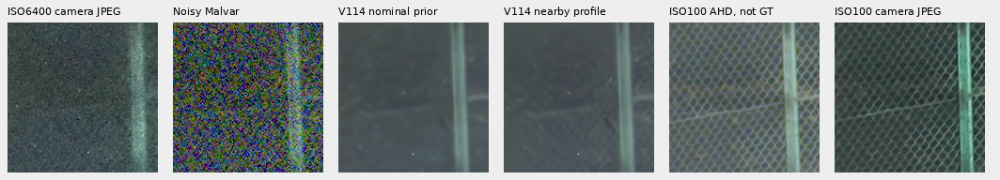

Both V114 and V115 show more diagonal structure, especially in the right crop.
The mesh remains soft, weak and irregular; grain/detail ambiguity and the small
blue point remain. This is a useful qualitative improvement in conditioning,
without establishing accurate lattice recovery or broad model superiority.

V115 matched comparisons: [left](images/gfx-green-mesh-profile-transfer-v1/V115-fine-green-mesh-left-4EV.png) ·
[right](images/gfx-green-mesh-profile-transfer-v1/V115-fine-green-mesh-right-4EV.png).
Native noisy/denoised/independent-reference triplets:
[V114 left](images/gfx-green-mesh-profile-transfer-v1/triplets/crop-4d11d77a521a9cc0.png) ·
[right](images/gfx-green-mesh-profile-transfer-v1/triplets/crop-8bcc58b8b6da3dc8.png) ·
[V115 left](images/gfx-green-mesh-profile-transfer-v1/triplets/crop-cc155f6f0840d134.png) ·
[right](images/gfx-green-mesh-profile-transfer-v1/triplets/crop-abe369d2868bd951.png).

The archived full-image DSCF3842 Haar bins have median absolute relative variance
mismatch of 15.56% with the nominal prior and .98% with the fixed nearby profile.
An [ADC-floor correction](noise-calibration-fit-support.md) additionally allows
valid negative read-noise samples in the actual mesh context: accepted patches
rise 51→2,134. Their median mismatches are 69.38%/5.81%, respectively. These are
input-only consistency diagnostics, not known camera-noise errors. The context's
intensity span is only .004957, so it remains correctly rejected for separate
shot/read fitting. Texture, correlation and selection can bias these statistics;
the transferred profile is not dedicated flat/dark calibration.

[Prospective plan, execution, actual review and independent audit](results/gfx-green-mesh-profile-transfer-v1.json) ·
[Source/ROI/checkpoint/conditioning/display metadata](images/gfx-green-mesh-profile-transfer-v1/manifest.json).
Exactly two new root/DINO forwards were executed, CPU FP32, with zero new RAW
decodes, noisy observations or training. Rendering forbids neural module calls.
Independent NumPy display arithmetic reproduces all 24 board cells exactly;
all 12 triplet cells equal their board counterparts. No full-frame, speed or
pixelwise quality claim is made.

## Nominal-prior controls

Columns: ISO6400 camera JPEG, noisy Malvar, V112, V114, V115 Small, V117,
RawNIND pre-upsampled, independent ISO100 AHD, ISO100 camera JPEG. Each cell is
an unchanged **160×160 native crop**, with shared **+2EV display**. Camera JPEGs
have their own tone, sharpening, denoising and geometric processing. The ISO100
images are independent qualitative references, **not exact GT**. No pixelwise
quality score is computed.

V114 noisy/restored/independent-reference triplets at the same native coordinates:

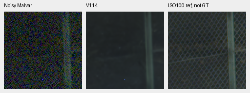

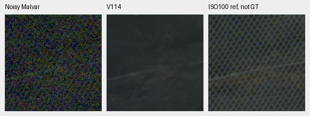

[V112 left](images/gfx-green-mesh-20231231-v1/V112-left.png) ·
[right](images/gfx-green-mesh-20231231-v1/V112-right.png) ·
[Small left](images/gfx-green-mesh-20231231-v1/V115-left.png) ·
[right](images/gfx-green-mesh-20231231-v1/V115-right.png) ·
[V117 left](images/gfx-green-mesh-20231231-v1/V117-left.png) ·
[right](images/gfx-green-mesh-20231231-v1/V117-right.png).
The model differences are small here; the large gap to the independent
ISO100 lattice should not be mistaken for an aperture-matched scoring result.

The README examples use the same retained predictions with **+4EV display** to
show these dark regions more clearly. Every panel receives the same additional
linear display gain; neither noise conditioning nor restoration is recomputed.
Camera JPEGs are decoded from sRGB before that gain. Their original camera
rendering still differs from the RAW display pipeline.

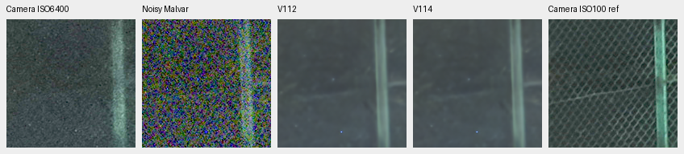

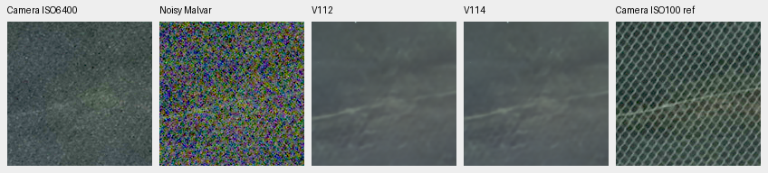

## Capture and protocol

| Capture | ISO | Aperture | Shutter | Local capture time |
| --- | ---: | ---: | --- | --- |
| DSCF3842 | 6400 | f/1.7 | 1/300s | 2023-12-31 17:07:56 |
| DSCF3835 | 100 | f/5.6 | 2.5s | 2023-12-31 17:07:10 |

Both use the GFX100S and GF55mmF1.7. The low-ISO exposure differs in aperture,
depth of field, motion and time. Original RAWs and camera JPEGs remain read-only;
the local cache avoids further source-drive reads. The earlier cached noisy
RAF is reused, with the reference RAF and both JPEGs cached under
`.cache/gfx-green-mesh-20231231/`.

The RAW context is `[600,6260,768,768]`. The two noisy RAW regions start at
`[806,6489]` and `[1026,6449]`; the independent RAW reference uses a one-pixel
left translation. JPEG field matching requires larger offsets: about 46 pixels
horizontally in this part of the frame. Input-only coarse area8 correlation
followed by native integer translation selects coordinates. Coarse binning is
only for registration analysis. The displayed pixels are never resized or warped;
residual lens/rendering differences remain.

The original nominal comparison gives all five RAW methods the same signed
black-subtracted/white-normalized observation, RGGB geometry, noisy-capture WB/matrix and nominal ISO6400 prior:
**shot .00128, read variance 6.5536e-6**. This is a disclosed generic sensor prior,
not measured camera calibration. The existing DSCF3842 input-only fit was
unreliable because of insufficient intensity span. Restoration parameters are
fixed before viewing outputs. The reference uses LibRaw AHD camera RGB calibrated
only to its own RAW capture.

The original five-method run is a **768px context comparison**, with one CPU
IEEE-FP32 forward for each of the five methods and four DINO forwards. It is separate
from the complete102MP standing-scene restorations. All predictions are retained
as FP32 arrays, and future checkpoint additions can reuse these controls without
new control inference. A retained-output integration check forbids model loading
and module calls while reproducing all ten triplets and the full board exactly.
The additional completed V119 endpoint comparison is above.

Preparation saves decoded context intermediates before alignment. Its `--decoded`
option reuses those bound intermediates for alignment-only follow-ups without
RAW re-decoding. Executed sources, input bindings and experiment receipts remain
preserved with the saved predictions.

## Held-out status

DSCF3835 and DSCF3842 identifiers are blocked even without camera metadata.
Their RAW and JPEG hashes join the protected captures; the entire GFX100S
2023-12-31 family remains excluded. The three actual V119 input manifests contain
neither these capture filenames nor their source hashes. The new case changes
no training source, recipe, checkpoint or existing evaluation queue.
