# Fine green fence beside the red train

**Review map updated November 18, 2026.** The optional adjacent-donor
fit shows both directions in the right cab ROI, with uneven contrast and
an overly regular lattice in places. The version-specific gallery below
preserves its original comparison pixels and provenance.
[Adjacent-donor comparison](donor-phase-transport.md#standing-gfx100s-review).

| Review | Relevant outcome |
| --- | --- |
| [Checked Bayer curvature](query-phase-curvature.md#standing-gfx100s-comparisons) | Independent Bayer groups support small right-cab center shifts under both priors. None of the four cab crops accepts curvature. Visual changes are slight and both references remain in the boards |
| [Sensor-anchored Bayer fits](query-frequency-consensus.md#standing-gfx100s-comparisons) | Right-cab diagonal families persist when median-pooled across nine placements. The worst shifted correction cosine rises to about 0.95 under both priors. Left crops match Corpus 100k and some right intersections remain soft |
| [Reserved Bayer query search](query-bayer-reserve.md#standing-gfx100s-comparisons) | Both directions become clearer on the right under both noise profiles with automatic local nominations. Some intersections remain soft or uneven. Both left crops match Corpus 100k. Both JPEG references viewed |
| [Narrow exterior RAW peaks](donor-peak-prominence.md#standing-gfx100s-comparisons) | Both left-cab bands have nearby exterior candidates but lose the final ranking. The right cab lacks two supporting tiles near either earlier peak. Both ROIs and priors were viewed. Crossings stay incomplete |
| [Local RAW support and exterior phase](green-gap-validation.md#standing-gfx100s-comparisons) | Automatic exterior frequencies barely change both ROIs. Previously measured cab RAW peaks make both directions visible on more of the right crop. Some crossings remain overly regular or incomplete. Both priors and JPEGs viewed |
| [Full-epoch scene run at update 2,000](scene-full-epoch.md#standing-gfx100s-at-update-2000) | Both profiles, ROIs and their JPEG references viewed for the matched spatial and local-only checkpoints. The transferred profile retains weak diagonal texture, with incomplete crossings |
| [Green alias separation and exterior RAW](quincunx-green.md#standing-gfx100s-comparisons) | Both profiles, both ROIs and the separate JPEGs were viewed for both variants. Added modulation at original strength leaves fine junctions missing |
| [Native-green innovation](green-phase-innovation.md#standing-gfx100s-comparisons) | Both ROIs, both profiles and JPEGs viewed. Crossings stay incomplete with same-phase or native-green input smoothing |
| [Surrounding RAW strength](context-strength.md#standing-gfx100s-comparisons) | Both profiles and both native ROIs were viewed. The matched and mirrored views look alike. Fine crossings remain incomplete |
| [Weak-edge teacher and measured-step gate](weak-edge-distill.md#standing-gfx100s-comparisons) | Both cab ROIs, profiles and JPEG references viewed. The transferred profile preserves faint diagonal repeats. The fine crossings remain incomplete |
| [Paired native luminance correction](paired-luminance-detail.md#standing-gfx100s-comparisons) | Both ROIs, both noise priors, ISO100 AHD and both JPEGs were viewed. Guarded output remains close to the 100k parent, with soft diagonals, mottle and incomplete crossings |
| [Exact orientation averaging](paired-head-symmetry.md#standing-gfx100s-comparisons) | All four cab boards were viewed with both JPEGs and independent AHD. The result changes little at matched correction strength and the fine crossings remain incomplete |
| [Bayer innovation smoothing](paired-feedback-paths.md#standing-gfx100s-comparisons) | Uniform and directional smoothing leave both ROIs and priors close to the 100k parent. The independent AHD and both JPEGs were viewed. Fine crossings and background mottle remain |
| [Separate quiet smoothing](paired-flat-companion.md#standing-gfx100s-comparisons) | Three single-frame policies reviewed in both ROIs and profiles with the same references. Fine crossings and mottle remain |
| [Projected repeat endpoint](paired-shape-stability.md#standing-gfx100s-comparisons) | All three heads are viewed under both profiles with matched references. The fine diagonals remain faint and crossings incomplete |
| [Standard repeat endpoint](paired-repeat-stability.md#standing-gfx100s-comparisons) | Both weights and their ordinary control are viewed in both ROIs and priors. The fine crossings remain incomplete and background mottle persists |
| [V120 baseline](#v120-after-correcting-the-paired-data-mix) | Soft/irregular lattice, strongly affected by noise conditioning |
| [V131 endpoint](v131-endpoint-quality.md), [V132 endpoint](v132-endpoint-quality.md) | Both 20k reviews complete; no clear new fine crossings |
| [Matched2k whole-scene arms](whole-scene-context-native-review.md), [64-source follow-up](whole-scene-context-development64.md), [camera panels](whole-scene-context-camera-review.md) | Same endpoints/unchanged GFX pixels; both native ROIs/profiles/JPEGs viewed. Nominal erases mesh, nearby profile soft/incomplete; no convincing new crossings. Separate camera scores now complete, photos pending |
| [Corpus control10k midpoint](full-corpus-control10k-review.md) | Both native ROIs/profiles/JPEGs viewed against matched V120; nominal mesh mostly erased, nearby lattice soft/incomplete. No convincing new crossings; completed-horizon broad scores pending |
| [Execution/raw-EMA follow-up](training-execution-quality.md) | All77-step profiles and10k raw/EMA, both ROIs/profiles/JPEGs actually viewed. Fine nominal mesh still erased; nearby lattice incomplete. No convincing new crossings |
| [Completed corpus20k](full-corpus-control20k-review.md) | Both ROIs/profiles/JPEGs actually viewed against fresh matched V120. Nominal mesh largely erased; nearby soft/incomplete. No faithful new crossings. ADC-bin diagnostic bypasses these positive-noise images identically. [Full427 and fixed camera panels](full-corpus-control20k-primary.md) are complete |
| [Disjoint RAW direction guides](scene-wave-guides.md) | Both ROIs, profiles and JPEGs viewed. Some right query-only stripes suppressed, with stronger left diagonal modulation. Fine crossings remain unresolved |
| [RAW phase profiles](guided-phase-profiles.md) | Both ROIs, noise profiles and JPEGs viewed. Additional slight diagonal modulation with the richer profile. Fine crossings remain unresolved |
| [Phase-fit shrinkage](guided-phase-fit-shrinkage.md) | Both ROIs, noise profiles and JPEGs viewed. Correction is slightly smaller with shrinkage. Faint diagonals remain and the fine crossings are unresolved |
| [Pooled RAW support](fold-support-pooling.md) | Both ROIs, profiles and JPEGs viewed. Left diagonal modulation is somewhat stronger. Both sides still lack convincing added fine crossings |
| [Phase-profile agreement](phase-profile-agreement.md) | Both ROIs, profiles and JPEGs viewed. High agreement in both fitted directions, slight attenuation of modulation, crossings still incomplete |
| [Donor subharmonics](donor-subharmonics.md) | Both ROIs and profiles match the previous pooled result exactly. Both JPEG comparisons still show missing fine crossings |
| [Long schedule at 20k](full-corpus-long20k-native.md) | Matched V120 and short schedule, both ROIs/profiles/JPEGs viewed. Fine crossings are largely erased at nominal conditioning and soft or incomplete with the transferred profile |
| [Long schedule at 50k](full-corpus-long50k-native.md) | Both ROIs, profiles and JPEGs viewed. The transferred profile retains soft diagonal repeat structure. Fine crossings remain incomplete |
| [Long schedule at 86k](full-corpus-long86k-native.md#native-gfx100s-review) | Both ROIs, profiles and JPEGs viewed against V120 and 50k. Transferred conditioning reveals soft repeat structure, particularly on the right. Fine crossings remain incomplete. [All four ADC-bin modes](full-corpus-long86k-adc.md#standing-gfx-review) bypass the saved outputs exactly |
| [Full-corpus 100k endpoint](full-corpus-long100k.md#native-gfx100s-review) | Both ROIs, profiles and both camera JPEGs viewed against V120 and 86k. The transferred profile still gives more visible repeat modulation on the right, with incomplete crossings and little visible change from 86k |
| [Matched near-ADC continuation](near-adc-bridge-training.md#standing-gfx-scenes) | Both 800-update endpoints viewed alongside V120, 100k, the ISO100 AHD and both camera JPEGs for both ROIs and profiles. Changes are subtle and fine crossings remain incomplete. Fixed measurement corrections return those outputs exactly |
| [Isolated RAW line fit](isolated-raw-line.md#native-detail-and-standing-cameras) | No eligible isolated ridge in either cab ROI or noise profile. Both fits return the local-only 2k parent. All four boards retain both camera JPEGs and the independent AHD reference |
| [Multiple RAW line guides](multiple-raw-line-guides.md#standing-gfx100s-scenes) | Both searches leave the local-only 2k output unchanged inside both displayed cab crops under both noise profiles. The shoulder check rejects all cab proposals. All eight boards retain both JPEGs and the independent AHD reference |
| [Pooled local line evidence](weak-line-pooled-evidence.md#standing-gfx100s-checks) | Three pooled fits return the local-only 2k parent in all four cab views. The exterior shoulder check supplies no guide. Both JPEGs and AHD references remain on the boards |
| [Joint mesh phase](joint-mesh-phase.md#standing-gfx100s-checks) | Exterior phase checks reject all tested pairs. Both ROIs and noise priors retain the local-only 2k parent. Fine crossings remain incomplete |
| [Localized donor mesh](local-donor-mesh.md#standing-gfx100s-checks) | Both directions improve measured RAW prediction on the left and show a faint lattice under both priors. The right returns the local-only 2k parent. The AHD and JPEG references remain qualitative |
| [Crop-placement mesh review](local-mesh-stability.md#standing-gfx100s-crops) | Sensor-anchored checks and a median across 13 placements retain the left lattice under both priors. Fine crossings remain weak and sometimes overly regular. The right keeps the local-only 2k parent. Both JPEGs and ISO100 AHD were viewed |
| [Donor perspective and short support](local-mesh-projective.md#standing-gfx100s-review) | A wider RAW donor region finds no new qualifying tiles in the fine cab views. The short support visibly fades the left lattice under both priors. Both right views keep the local-only 2k parent |
| [Audited mesh gap support](local-mesh-gap-support.md#standing-gfx100s-review) | Crossed RAW predictions preserve all four wider-donor views. The final audit alone fades part of the left lattice under the transferred profile. Both JPEGs and the ISO100 AHD were viewed |
| [Distributed Bayer gap audit](local-mesh-distributed-audit.md#standing-gfx100s-review) | Both audit layouts agree pixel for pixel on both ROIs and noise profiles. The faint left lattice remains and right crossings are incomplete. Both JPEGs and the ISO100 AHD were viewed |
| [Adjacent RAW donors](donor-phase-transport.md#standing-gfx100s-review) | The right ROI gains visible crossings under both priors. Both directions improve withheld RAW prediction at all 13 placements. The left keeps its earlier result. ISO100 AHD and both JPEGs are qualitative references |
| [Smooth RAW support](smooth-mesh-support.md#standing-gfx100s-review) | Right-cab crossings persist with lower contrast in places. Applying the mask only to the rear correction changes the crop less. The column step replay preserves both left crops exactly |
| [Side-dependent step fit](mesh-step-continuity.md#standing-gfx100s-review) | Both noise profiles and ROIs reproduce the adjacent-donor outputs, preserving the recovered right crossings. Both camera JPEGs and independent ISO100 AHD were viewed |
| [Refined foreground-edge fit](mesh-refined-edge.md#standing-gfx100s-review) | All four crops reproduce the packaged adjacent-donor pixels. The recovered right crossings, weak left lattice and background mottle remain visible under both noise priors |
| [Finite RAW support](mesh-shrunk-footprint.md#standing-gfx100s-review) | Nominal left changes by 1.80 DN16 RMS with locally faint contrast. The two right views and the transferred left match the adjacent-donor pixels |
| [Pooled and elliptical gap audits](mesh-pooled-gap-evidence.md#standing-gfx100s-review) | The pooled reserve floor keeps both right views identical to adjacent donors. The wider ellipse slightly fades some right-cab modulation while both crossing directions remain visible. Both profiles and camera JPEGs were reviewed |
| [Averaged gap proposals](mesh-averaged-gap.md#standing-gfx100s-review) | Both means and the strength replay preserve the nominal right cab exactly. The transferred right is cut less by the quarter mean, while the refit fades parts of the left lattice |
| [Signed tint from nearby RAW](mesh-donor-tint.md#standing-gfx100s-review) | Both tint fits leave the four local-audit outputs pixel-identical. The right crops retain both visible directions and darker crossings remain faint |
| [Curved foreground and affine rear](mesh-gap-information.md#standing-gfx100s-review) | Both right directions remain visible. The joint nominal right cut is smaller than the straight-step cut. Left crops barely change and the weakest crossings remain soft |
| [Off-grid footprint refinement](mesh-refined-footprint.md#standing-gfx100s-review) | The refined mean softens weak rear repeats in the left crops, with its largest change under the nominal prior. Both right directions are visible. Fine crossings remain incomplete |
| [Tapered strength refit](mesh-tapered-strength.md#independent-noise-and-standing-photos) | The nominal right reproduces adjacent donors. Tapering reduces the slight cut on both left views and transferred right compared with the uniform refit. Fine crossings remain soft |
| [Expanded scene local-only 12k](expanded-scene-local12k.md#native-crops-and-standing-gfx-scenes) | Compared with its 100k parent and V120 under both priors. The transferred prior retains soft diagonals and the fine crossings remain incomplete. Both JPEGs and the independent AHD reference were viewed |
| [Expanded scene spatial 12k](expanded-scene-spatial12k.md#matched-development-and-standing-gfx-review) | Both 12k arms viewed with V120, 100k, the independent AHD and both JPEGs. Soft diagonal modulation persists under the transferred prior. Fine crossings remain incomplete across both ROIs and profiles |
| [Localized spatial 2,400](scene-local-contrast-2400.md#first-endpoint-standing-gfx-review) | Both ROIs, both priors and both JPEGs viewed with V120, Corpus 100k, spatial 12k and independent AHD. Transferred conditioning retains the most visible diagonals. Fine crossings remain incomplete |
| [Plain local 2,400](scene-local-contrast-2400.md#plain-local-control) | Both ROIs and priors viewed with localized spatial, Corpus 100k, V120, ISO100 AHD and both camera JPEGs. Transferred conditioning retains soft diagonals and the fine crossings remain incomplete |
| [Plain spatial 2,400](scene-local-contrast-2400.md#plain-spatial-standing-gfx-review) | Compared against the byte-matched plain local training arm on both ROIs and priors. The transferred prior shows more diagonals and crossings remain incomplete. ISO100 AHD and both camera JPEGs viewed |
| [Four matched 2,400-update arms](scene-local-contrast-2400.md#matched-standing-gfx-review) | The new localized local arm resembles the plain local crop on both sides and priors. Transferred conditioning retains some repeat structure. Fine crossings remain incomplete. ISO100 AHD and both camera JPEGs viewed |
| [Preview resolution comparison](scene-preview-scale.md#standing-gfx100s-checks) | Both spatial checkpoints were viewed at 1,024, 2,048 and 3,072 plus a resampled control on both ROIs and profiles. The transferred prior retains faint repeat detail and fine crossings remain incomplete. ISO100 AHD and both JPEGs viewed |
| [Disjoint RAW patch search](natural-raw-donor-evidence.md#standing-gfx100s-scenes) | A grid of row-separated nearby RAW patches fails the coarse correspondence check on both ROIs and priors. All four views retain Corpus 100k and incomplete fine crossings. Both JPEGs and independent ISO100 AHD were viewed |
| [Local wire transmission](mesh-background-transmission.md#standing-gfx100s-checks) | Local support softens a regular stripe on the nominal views. The adjacent-donor correction shows both directions more clearly and retains incomplete fine crossings. Both ROIs, priors, JPEGs and ISO100 AHD were viewed |
| [Near-ADC residual comparison](noisy-cfa-residual.md#both-standing-gfx100s-comparisons) | Both experimental noise-weighted corrections above 86k, both ROIs, both profiles and both JPEGs viewed. Slight added grain and no convincing new fine crossings. The bounded and [coarse color corrections](coarse-adc-color.md) bypass both profiles exactly |
| [Oriented RAW support](oriented-raw-support.md) | Both rectangular footprints reviewed on both ROIs and noise profiles. Subtle changes to diagonal modulation, with no convincing additional crossings |
| [Joint Bayer phase-profile evidence](joint-phase-profile-support.md) | Both joint gates, both ROIs and both profiles viewed with the two JPEGs. The strongest change is subtle diagonal modulation on the left at the transferred prior. Fine crossings remain unresolved |
| [Donor-selected waveform harmonics](donor-phase-support.md) | Both reduced bases, both ROIs and both profiles viewed with the two JPEGs. The donor fit reduces the correction on the right under both profiles. Fine crossings remain unresolved |
| [Post-validation RAW refits](phase-refit-delivery.md) | Both refits, both ROIs and both profiles viewed alongside both JPEGs. Weighting increases residual modulation on the left, with no convincing new fine crossings |
| [Bounded guide recentering](phase-guide-recenter.md) | Both ROIs and both profiles viewed with the two JPEGs. Subtle changes to the existing diagonals, with fine crossings still unresolved |
| [Edge exclusions during guide selection](phase-guide-edge-guard.md) | Neither width activates on the cab views. Both ROIs and profiles reproduce the unguarded result, with fine crossings still unresolved |
| [Shared RAW waveform](shared-phase-shape.md) | Both ROIs, profiles and JPEGs viewed. Modulation changes slightly, with the fine lattice still incomplete |
| [Disjoint-donor waveform](donor-waveform.md) | Both ROIs, profiles and JPEGs viewed for donor and scrambled shapes. Fine crossings remain incomplete |
| [Same-side validation](phase-edge-side.md) | No activation on either side or noise profile. Both variants reproduce the guarded cab views, and fine crossings remain incomplete |
| [Bright-side cross-edge validation](asymmetric-phase-evidence.md) | Both weights reproduce the existing cab views for both crop sides and profiles. Fine crossings remain incomplete |
| [RAW guide cross-check](phase-guide-crosscheck.md) | Both ROIs and profiles viewed with both JPEGs. The left stays identical to the guarded fit. The right changes slightly, with fine crossings still incomplete |
| [RAW phase drift](phase-drift.md) | All four cab ROIs/profile combinations reproduce the prior cross-check exactly. Fine crossings remain incomplete |
| [Measured donor geometry](donor-phase-geometry.md) | Neither adjacent donor passes the transfer checks under either profile. Both sides reproduce the guarded result, with incomplete crossings |
| [Opposing RAW donors](bracket-phase-geometry.md) | All vertical checks reproduce the guarded fit. The transferred-profile left crop changes subtly with horizontal donors, with fine crossings still incomplete |
| [Screened donor search](search-donor-geometry.md) | Both ROIs, profiles and JPEGs viewed. Left-side guide-added diagonal banding declines toward V120. Selected donors include foliage and train surfaces. Fine crossings remain incomplete |
| [Whole-frame donor ranking](screened-scene-donors.md) | Full-frame context shifts both left-cab brackets toward a patch with more visible mesh. The opposite donor still covers mostly train structure. The accepted carriers are coarse, with fine crossings still missing |
| [Appearance-first donor ranking](affinity-first-donors.md) | The transferred left pair contains mesh on both sides and fails the donor check for the proposed frequencies. The fallback restores old banding. The nominal left correction remains small and fine crossings remain incomplete. Both ROIs, profiles and JPEGs viewed |
| [Localized donor validation](localized-donor-validation.md#native-gfx100s-comparisons) | V120 fallback removes diagonal banding on the transferred left crop. A small correction remains on nominal left and fine crossings are still incomplete. Both native ROIs, profiles and JPEGs viewed |
| [Full-frame window ranking](scene-window-donors.md#native-gfx100s-review) | Both full-frame ranks reproduce V120 on three crops, with subtle changes on nominal right. The selected windows still include foliage and train body. Both ROIs, profiles and JPEGs viewed, with fine crossings incomplete |
| [Two-boundary query fit](query-rail-background.md#native-gfx100s-review) | With full-frame guides, all four cab crops reproduce V120. The spectral transferred-right correction also disappears. Both profiles, ROIs and JPEGs viewed, with no convincing new fine crossings |
| [Surface-constrained phase averages](surface-phase-aggregation.md#native-gfx100s-review) | The energy-capped estimates return both ROIs and profiles to V120. Tangent averaging with its own gate adds a small spectral correction on transferred right. The JPEG and ISO100 AHD reference crossings remain largely absent from the restorations |
| [Local phase bounds](local-phase-bounds.md#native-gfx100s-review) | Both local bounds return all four cab crops to exact V120. Both ROIs, profiles and JPEGs viewed, with no convincing new fine crossings |
| [Flexible query boundaries](flexible-query-edges.md#native-gfx100s-review) | Both flexible backgrounds return all four cab crops to exact V120. Both profiles, ROIs and JPEGs viewed, with no convincing new fine crossings |
| [Nested background screening](screened-query-edges.md#native-gfx100s-review) | All four native cab crops remain exact V120 at the nominal gate. The transferred-right spectral query changes slightly outside the crop. Both profiles, ROIs and JPEGs viewed, with fine crossings incomplete |
| [Cross-color validation](cross-colour-refit.md#native-gfx100s-review) | Both cross-color gates reproduce the conditioned V120 pixels in all four cab crops with both guide families. Both ROIs, profiles, ISO100 AHD and JPEGs viewed. Fine crossings remain incomplete |
| [Uniform fundamental fit](wire-envelopes.md#native-gfx100s-review) | Both guide families reproduce the conditioned V120 pixels in all four cab crops. Both profiles, ROIs, ISO100 AHD and JPEGs viewed, with fine crossings incomplete |
| [Reserved RAW footprints](reserved-wire-footprint.md#native-gfx100s-review) | Both confirmed arms reproduce V120 with either guide family in all four native cab crops. The lower-margin spectral arm changes nominal left by 0.0013 DN16 RMS. Both ROIs, profiles, AHD and JPEGs viewed, with fine crossings incomplete |
| [Eight-knot footprint transfer](scene-wire-footprint.md#native-gfx100s-review) | Both shapes and guide families reproduce V120 in all four native crops. The companion veto selects the uniform fit. Both profiles, ROIs, AHD and JPEGs viewed, with fine crossings incomplete |
| [Wider donor frequency bank](donor-frequency-bank.md#native-gfx100s-review) | All three policies reproduce the conditioned V120 pixels on both ROIs and profiles with both guide families. AHD and both JPEGs viewed. Fine crossings remain incomplete |
| [Shared perspective](shared-projective-phase.md#native-gfx100s-review) | Planar, shared and companion-only fits all reproduce conditioned V120 on both ROIs and profiles, with both guide families. AHD and both JPEGs viewed. Fine crossings remain incomplete |
| [Narrow wire profiles](finite-wire-profiles.md#native-gfx100s-review) | Compact profiles and the focused companion fit reproduce conditioned V120 on both native ROIs and profiles. AHD and both JPEGs viewed. Fine crossings remain incomplete |
| [Localized frequency search](localized-guide-frequency.md#native-gfx100s-review) | Fixed guides and both reserve searches match conditioned V120 on both native ROIs and profiles. AHD and both JPEGs viewed. Fine crossings remain incomplete |
| [Faint ADC follow-up](full427-faint-adc.md) | Positive-noise projection returns the earlier Corpus20k and V120 output on both ROIs and profiles, verified against the inputs underlying the retained boards |
| [50k ADC follow-up](full-corpus-long50k-native.md#calibrated-adc-follow-up) | The bin projection also bypasses the original 50k outputs exactly for both positive-noise profiles |
| [Fine-frequency proposals](fine-frequency-proposals.md) | Both directions more visible, with a purple/green grid and building artifacts |
| [Joint-color support](joint-fine-colour-support.md) | Reduced cab tint with lattice retained; extra synthetic weak response lost |
| [Fresh colored-wire test](coloured-fine-wire-benchmark.md) | Small gain almost entirely neutral; signed-color weak recovery remains missing |
| [A-only innovation validation](parent-innovation-validation.md) | Both ROIs, profiles and JPEGs viewed. Slight modulation changes retain a soft lattice with incomplete crossings |
| [Spatial preview intervention](scene-context-extent.md) | Both ROIs, profiles and JPEGs viewed. Near and distant context blurs change tones slightly. Fine crossings remain incomplete |
| [Trained scene spectral gain](scene-spectral-detail.md) | Both ROIs, noise profiles and JPEGs viewed. Changes from V120 are below 0.49 DN16 RMS with no convincing new fine crossings |
| [Spectral gain follow-up](scene-spectral-gain-headroom.md) | Both camera profiles and ROIs retain soft crossings under both retunings. JPEG references viewed alongside the same native crops |

The protected pair is **DSCF3842 ISO6400 / DSCF3835 ISO100 f/5.6**, with both
camera JPEGs. The separate reference differs in aperture, exposure and moving
subjects; it is **not exact GT**. These captures and siblings remain excluded
from training. Historical progress sections below are not current job status.
[Model choices](current-model.md) · [Main GFX scene](gfx-qualitative.md).

## Historical comparisons

## V142 crossed-line data1k: fine lattice remains unresolved

The [completed V142/native/48-flat report](v142-crossed-line-pilot.md) finds
modest faint/weak-band and noisy-flat spatial gains against matched V129,
without clear new real-lattice recovery. The nominal prior largely erases the
mesh; the unchanged nearby3879 prior retains weak diagonals. Fixed-frequency
output powers change in mixed directions, without establishing correct mesh
recovery. Coarse noisy-flat error remains5.08% above V120 and selected ADC-only
DC bias worsens.

Below: noisy Malvar → V120 → V129 → V142 → DSCF3842 ISO6400 camera JPEG →
independent DSCF3835 ISO100 AHD → ISO100 camera JPEG. Native160px cells share+4EV;
aperture, exposure time and camera processing differ. Both ISO100 comparators
are **not exact GT**. Both fixed priors are included in the
[complete four-board metadata](images/v142-crossed-line-v1/camera-JPEG/manifest.json).

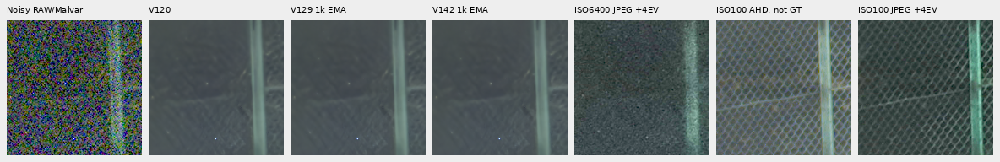

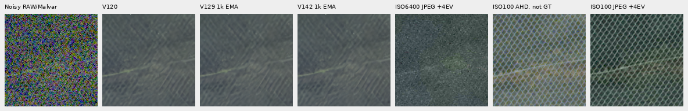

## V141 gradient-loss1k: lattice remains weak

The [completed V141/native/48-flat report](v141-gradient-epsilon-pilot.md) finds
no clear new lattice recovery at either fixed conditioning. The nominal ISO6400
prior largely erases it; the unchanged nearby3879 profile retains weak diagonals.
The small faint-score recovery over matched V129 does not establish real-mesh
recovery. Noisy-flat coarse error stays near V129 and5.75% above V120.

Below: noisy Malvar → V120 → V129 → V141 → DSCF3842 camera JPEG → independent
DSCF3835 ISO100 AHD → ISO100 camera JPEG. All cells retain native160 pixels with
shared+4EV display. Camera processing, aperture and exposure differ; both
ISO100 comparators are **not exact GT**. Both profiles are included in the
[complete four-board metadata](images/v141-gradient-epsilon-v1/camera-JPEG/manifest.json).

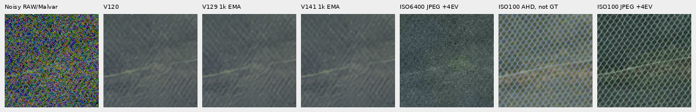

## V140 standalone1k: still missing the fine lattice

The [completed V140/native/48-flat report](v140-standalone-pilot.md) shows no
clear new lattice recovery at either fixed conditioning. V140 stays visually
near V120; the nominal prior largely erases the mesh, and the unchanged nearby3879
profile retains weak diagonal texture. No obvious new flat-region splotches
appear on the measured support, with nearly unchanged coarse flat/sky variation.

Below: noisy Malvar → V120 → V137 → V140 → DSCF3842 camera JPEG → independent
DSCF3835 ISO100 AHD → ISO100 camera JPEG. All cells retain native160 pixels with
shared+4EV display; camera processing and capture aperture/exposure differ.
Both ISO100 comparators are **not exact GT**.
[All four boards/source ROIs/checkpoint/noise/display metadata](images/v140-standalone-v1/camera-JPEG/manifest.json).

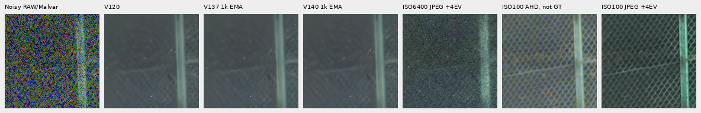

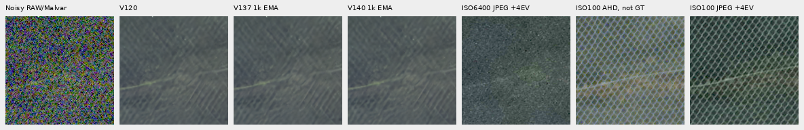

**This additional real-capture case exposes missing weak detail and sensitivity
to noise conditioning.** With the nominal ISO6400 prior, V112, V114, V115 Small
and V117 largely erase the fine green lattice while retaining broad rails.
A fixed profile from nearby DSCF3879 makes more diagonal mesh texture visible in
V114 and V115, but the fine lattice remains much weaker than the reference.
RawNIND pre-upsampled keeps more directional texture under the nominal prior,
without clearly recovering the reference lattice.
The ISO6400 camera JPEG has very faint mesh amid grain; the separate ISO100
capture makes the physical structure much clearer. This remains an adverse case;
V120's corrected-paired-data continuation also shows no clear lattice-recovery
gain at matched conditioning.

The case pairs **DSCF3842 ISO6400** with **DSCF3835 ISO100**, taken 46 seconds
earlier. Both camera JPEGs are included.
The existing DSCF3879/3880 standing scene and its six regions remain in use.

The [V131/V132 spatial-detail trial](raw-spatial-training.md) queues both fixed
mesh profiles and both native160 regions, with this corrected DSCF3835 reference
and both camera JPEGs. [V1311k progress](v131-progress1000-quality.md) is now
actually viewed and measured below, with no clear new lattice recovery;
Both20k [V131](v131-endpoint-quality.md) and [V132](v132-endpoint-quality.md)
endpoints are now actually reviewed at both profiles/ROIs with both JPEGs;
fine crossings remain missing. The [native512 nuisance ablations](neural-nuisance-context512.md)
also retain these difficult views without new crossing recovery.

The [V137 conditioned-global review](v137-global-conditioned-quality.md) is
complete on these two profiles/regions with corrected DSCF3835 and all three
saved controls. Stronger memory adaptation does not produce clear new lattice
recovery; the native comparisons are below.

The [V120–V125 endpoint review queues](endpoint-quality-review.md) include both
fixed noise profiles and both native160 regions, reusing saved controls.
V120/V121 mesh review is complete below, with no clear V121 lattice-recovery
gain. V120's two saved predictions were adopted without rerunning it. V122/V123
final mesh review is complete below. A separate
[V1239k midpoint](#v123-at-9000-updates) is now measured with saved controls.
V124's [14k progress review](v124-progress14000.md) is complete; its original
20k control has completed and V125's original20k worker stopped at the memory reserve.
The [completed V12420k native check](#v124-at20k) and [V1256k progress](#v125-at6k)
are now measured; neither shows clear new lattice recovery.

[Fixed sources and coordinates](../configs/gfx-green-mesh-20231231.json) ·
[Native image metadata](images/gfx-green-mesh-20231231-v1/manifest.json) ·
[Completed native review and data checks](results/gfx-green-mesh-v1.json).

## V124 at20k

The [completed control's native check](v124-final20000-native.md) compares noisy
RAW/Malvar → V120 → V12414k → V1256k → V12420k → DSCF3842 ISO6400 JPEG →
corrected **DSCF3835 ISO100/AHD** → ISO100 JPEG. Native160px cells retain768px
contexts, shared+4EV and the same fixed inverse-sRGB/16×/sRGB JPEG display rule.

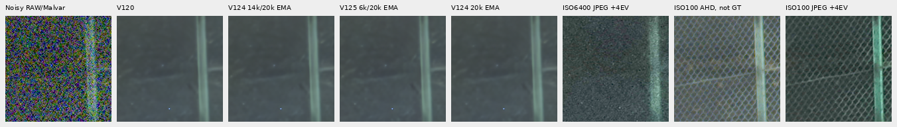

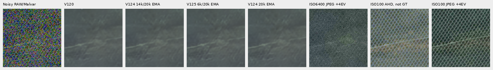

Nominal conditioning largely erases the mesh; the fixed nearby3879 profile
retains weak diagonals without clear new20k recovery:
[left](images/v124-final20000-native-v1/mesh-profile3879-fine-green-mesh-left-comparison.png),
[right](images/v124-final20000-native-v1/mesh-profile3879-fine-green-mesh-right-comparison.png).
Both profiles and regions are actually viewed. The nearby read variance is
1.0715704128646712e−6, matching the bound inputs. Separate ISO100/AHD/JPEGs
remain qualitative references, **not exact GT**; aperture/shutter/moving subjects
and camera processing differ. Originals/caches/holdouts remain preserved.
[Checkpoint/source/ROI/noise/display metadata](images/v124-final20000-native-v1/manifest-v1.json).
Completed training does not make this a full photo/camera/color/full-frame review;
the original matched endpoint pipeline remains queued.

## V125 at6k

The [latest progress review](v125-progress6000-quality.md) adds6k while reusing
V120 and V1252k/4k predictions. Columns: noisy RAW/Malvar → V120 → V1252k →
V1254k → V1256k → ISO6400 camera JPEG → corrected **DSCF3835 ISO100/AHD** →
ISO100 camera JPEG. Native160px cells retain fixed+4EV and768px contexts; both
JPEGs use the same inverse-sRGB/16×/sRGB display rule, without fitting.

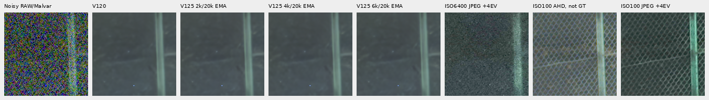

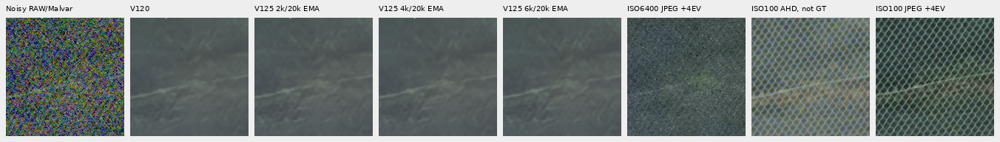

Both nominal regions remain strongly softened. Nearby3879 conditioning reveals
weak diagonal lattice, without clear additional6k recovery:
[left](images/v125-progress6000-quality-v1/mesh-profile3879-fine-green-mesh-left-comparison.png),
[right](images/v125-progress6000-quality-v1/mesh-profile3879-fine-green-mesh-right-comparison.png).
Both profiles/regions are actually viewed. ISO100 differs in aperture, shutter
time and moving subjects; AHD and camera JPEGs are qualitative comparators,
**not exact GT**. The originals/caches and training holdouts are preserved.
[Checkpoint/source/ROI/noise/display metadata](images/v125-progress6000-quality-v1/manifest-v1.json).

The [earlier4k comparison](v125-progress4000-quality.md#real-gfx-detail) and its
original images/receipts remain preserved.

## V125 at2k

The [V125 progress review](v125-progress2000-quality.md) uses the corrected
DSCF3842 ISO6400 / **DSCF3835 ISO100 f/5.6** pair and both camera JPEGs.
Columns: noisy RAW/Malvar → V120 nominal → V1252k/20k EMA nominal → ISO6400
camera JPEG → ISO100 AHD → ISO100 camera JPEG. Native160px cells share +4EV;
both JPEGs receive inverse sRGB →16× linear exposure →sRGB, with camera tone,
WB and sharpening retained. These are separate qualitative renderings, **not GT**.

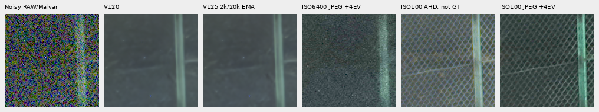

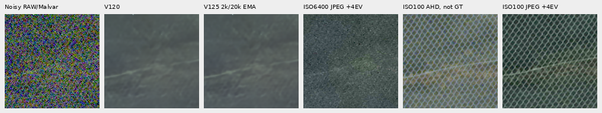

Both nominal and fixed nearby3879 profiles were actually viewed. Nominal
restoration largely erases the lattice; nearby conditioning retains weak
irregular diagonals without clear new recovery:
[left](images/v125-progress2000-quality-v1/mesh-profile3879-fine-green-mesh-left-comparison.png),
[right](images/v125-progress2000-quality-v1/mesh-profile3879-fine-green-mesh-right-comparison.png).
The left blue point persists. ISO100 is46s earlier, with different aperture,
exposure time and moving subjects. Originals remain read-only, local caches
were reused and captures/JPEGs/siblings remain outside training.
[Source/ROI/checkpoint/noise/display metadata](images/v125-progress2000-quality-v1/manifest-v1.json).

## V131 retained1k progress

The [completed progress review](v131-progress1000-quality.md) uses
**DSCF3842 ISO6400 and corrected DSCF3835 ISO100 f/5.6**, with both camera JPEGs.
The ISO100 filename is
`2023-12-31-17-07-10_DSCF3835_51f913c3376f7335d5b5f8dede720c5c73ff15ce`.
It is46 seconds earlier and differs in aperture/exposure time/moving subjects;
the separate reference is **not exact GT**. The main DSCF3879/3880 scene remains
in use, and all captures/JPEGs/siblings stay outside training.

Columns: noisy RAW/Malvar → V120 nominal → V131 progress1k/20k nominal →
ISO6400 camera JPEG → ISO100 AHD → ISO100 camera JPEG. Cells contain native160px
pixels without resizing. RAW cells share the established+4EV, WB/matrix and
nominal shot`.00128`/read`6.5536e−6`; both JPEGs receive fixed+4EV through
inverse sRGB →16× linear exposure → sRGB. Camera WB, tone and sharpening still
differ, with no fitted exposure or pixelwise scoring.

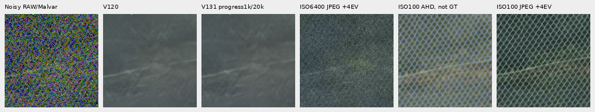

Actual viewing finds faint mesh amid grain in the ISO6400 JPEG, while nominal
restoration largely erases it. Both restored methods retain weak irregular
diagonals with fixed nearby3879 shot`.0014635775921166604` and
read`1.0715704128646712e−6`, without clear new correct-lattice recovery. The
left blue point persists. Nearby comparisons:
[left](images/v131-progress1000-quality-v1/mesh-profile3879-fine-green-mesh-left-comparison.png),
[right](images/v131-progress1000-quality-v1/mesh-profile3879-fine-green-mesh-right-comparison.png).

The original unboosted JPEG boards remain
[left](images/v131-progress1000-quality-v1/fine-green-mesh-left-nativeJPEG.png) and
[right](images/v131-progress1000-quality-v1/fine-green-mesh-right-nativeJPEG.png).
Their dark ISO6400 cells do not substantiate a clear visibility judgment; the
fixed+4EV viewing receipt corrects that initial impression. Both variants are
preserved, with independently exact pixel checks and no new neural calls.
Two new RAW model forwards were already included in the original102-input
review. V131's original20k training continues; V120 remains the general choice.
[Source/ROI/all checkpoint hashes/profile/display metadata](images/v131-progress1000-quality-v1/manifest-v2.json).

## V137 conditioned-global pilot

The [completed matched1k review](v137-global-conditioned-quality.md) leaves the
fine lattice largely erased under nominal conditioning. The fixed nearby3879
profile retains weak irregular diagonal texture across all four methods,
without clear new correct-lattice recovery. Both regions/profiles were actually
viewed; the left blue point persists.

Columns: noisy → V120 → V1291k → V1361k → V1371k → independent **DSCF3835
ISO100/AHD reference, not GT**. Native160px cells share768px contexts, WB/matrix
and+4EV. Aperture, exposure time and moving subjects differ; the corrected ISO100
capture is46 seconds earlier. The main3879/3880 pair remains in use.

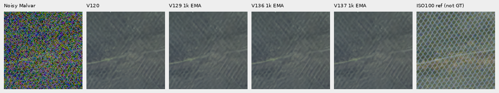

Left regions: [nominal](images/v137-global-conditioned-quality-v1/mesh-nominal-fine-green-mesh-left-comparison.png) ·
[nearby](images/v137-global-conditioned-quality-v1/mesh-profile3879-fine-green-mesh-left-comparison.png).
Nominal shot/read are`.00128`/`6.5536e−6`; nearby are
`.0014635775921166604`/`1.0715704128646712e−6`. Exactly two new root/DINO forwards
within the102-input review reuse fixed inputs and all old predictions, with no
noise sweep, RAW decode or reference fit. Both camera JPEGs remain in the
standing comparison below. [Source/ROI/all checkpoint hashes/profile/display metadata](images/v137-global-conditioned-quality-v1/manifest.json).

## V136 global-attention pilot

The [completed matched1k review](v136-global-attention-quality.md) shows no clear
new lattice recovery. Nominal conditioning still largely erases the fine mesh;
the fixed nearby3879 profile retains weak irregular diagonal texture in all
three methods. Both regions/profiles were actually viewed; the left blue point
persists.

Columns: noisy → V120 → V1291k → V1361k → independent **DSCF3835 ISO100/AHD
reference, not GT**. Native160px cells share768px contexts, WB/matrix and+4EV.
The corrected ISO100 exposure is46 seconds before DSCF3842 ISO6400, with different
aperture, exposure time and moving subjects. The main3879/3880 pair remains in use.

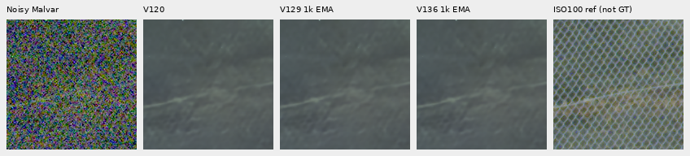

Left regions: [nominal](images/v136-global-attention-quality-v1/mesh-nominal-fine-green-mesh-left-comparison.png) ·
[nearby profile](images/v136-global-attention-quality-v1/mesh-profile3879-fine-green-mesh-left-comparison.png).
Nominal shot/read are`.00128`/`6.5536e−6`; nearby are
`.0014635775921166604`/`1.0715704128646712e−6`.
Exactly two new root/DINO forwards within the102-input review reuse both fixed
inputs and all old predictions. No RAW decoding, conditioning sweep or reference
fitting occurs. Both camera JPEGs remain available in the standing comparison
below. [Source/ROI/checkpoint/profile/display metadata](images/v136-global-attention-quality-v1/manifest.json).

The [earlier14k progress comparison](v124-progress14000.md) and original images/
receipts remain preserved; its full four-CFA scores differ from the RGGB subset
in the newer20k native check.

## V122/V123 completed frequency trial

The [completed20k trial](v122-v123-quality.md) leaves the fine lattice mostly
erased under nominal conditioning. The nearby3879 profile retains weak irregular
directional texture, without a clear new recovery. Both regions and profiles
were actually viewed. Four new endpoint root/encoder forwards used the existing
cached inputs; five control predictions were reused. No RAW decoding, noise
generation or profile fitting occurred.

Columns: ISO6400 camera JPEG → noisy Malvar → nominal prediction → nearby-profile
prediction → independent **DSCF3835 ISO100/AHD, not GT** → ISO100 camera JPEG.
Native160px cells share768px contexts,+4EV and WB/matrix. Aperture, exposure time
and moving subjects differ. The main DSCF3879/3880 pair remains in use.

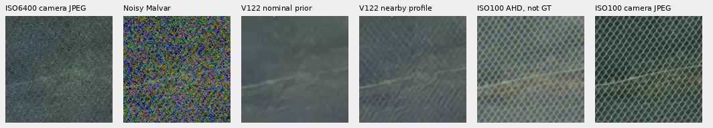

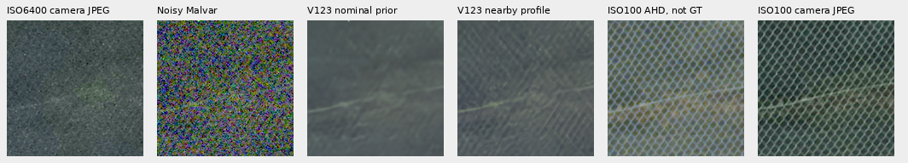

Left regions: [V122](images/v122-v123-quality-v1/V122-fine-green-mesh-left.png) ·
[V123](images/v122-v123-quality-v1/V123-fine-green-mesh-left.png).
Independent float64 display auditing checks1,843,200 RGB channels; only four
differ by one DN8 at FP32 rounding boundaries. No real-reference PSNR is used.
[Source/ROI/checkpoint/profile/display metadata](images/v122-v123-quality-v1/manifest.json).

## V130 FP32 training pilot

The [completed matched1,000-update precision trial](training-precision-pilot.md)
still mostly erases the fine lattice under nominal conditioning. The nearby3879
profile leaves weak irregular diagonal texture, without a clear improvement
over V129. Both regions/profiles were actually inspected. Native160px columns:
noisy → V120 → V129 BF16 → V130 FP32 → independent **DSCF3835 ISO100 reference,
not GT**. Shared768px contexts, WB/matrix,+4EV and fixed conditioning; no resizing.

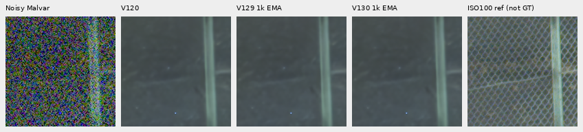

[Source/ROI/checkpoint/noise/display metadata](images/v130-fp32-pilot-quality-v1/manifest.json).
The corrected reference is DSCF3835,46 seconds earlier,ISO100 f/5.6; exposure,
aperture and moving subjects differ. The main DSCF3879/3880 pair remains in use.
Small measured gains on the separate [faint-ADC panel](faint-adc-precision.md)
do not visibly resolve this real-capture weakness.

## V129 curated-data pilot

The [completed1,000-update data pilot](reviewed-detail-training-pilot.md) still
mostly erases the fine lattice under the nominal profile. The nearby3879 profile
retains weak, irregular directional texture without a clear improvement over
V126. Both regions/profiles were actually inspected. Native160px columns:
noisy → V120 → V126 → V129 → independent **DSCF3835 ISO100 reference, not GT**.
Shared768px contexts, WB/matrix,+4EV and fixed profile; no pixel resizing.

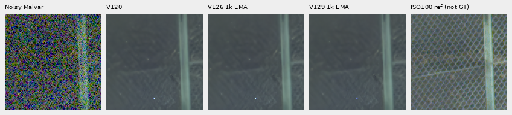

[Source/ROI/checkpoint/noise/display metadata](images/v129-data-pilot-quality-v1/manifest.json).
The [completed FP32 training trial](training-precision-pilot.md) reuses these
saved BF16-control predictions. The ISO100 aperture/exposure and moving subjects differ.

## V128 feature-loss pilot

The [completed1,000-update feature-loss pilot](v128-feature-pilot-quality.md)
shows no useful new fine-lattice recovery. Both regions were actually inspected
under both profiles. Columns: noisy → V120 → V126 control → V128 → independent
**DSCF3835 ISO100 reference, not GT**. Native160 pixels share +4EV,768px contexts,
WB/matrix and fixed conditioning. The originals and camera JPEGs stay unchanged.

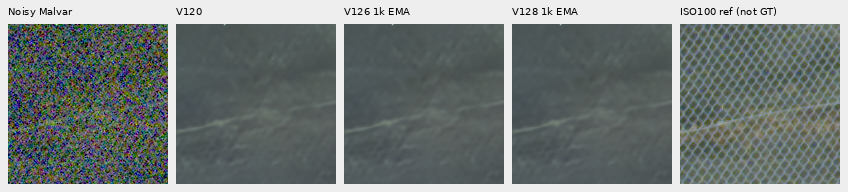

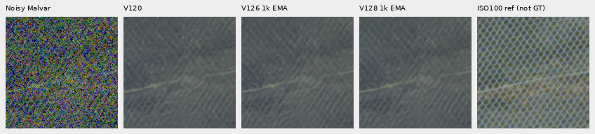

Nominal conditioning still mostly erases the mesh; the nearby profile leaves
weak/irregular diagonal texture. Left-region views:
[nominal](images/v128-feature-pilot-quality-v1/mesh-nominal-fine-green-mesh-left-comparison.png) ·
[nearby profile](images/v128-feature-pilot-quality-v1/mesh-profile3879-fine-green-mesh-left-comparison.png).
[Source/ROI/checkpoint/profile/display metadata](images/v128-feature-pilot-quality-v1/manifest.json).

## V126/V127 shadow-data pilot

**The completed matched1,000-update shadow pilot does not clearly recover the
fine green lattice.** Both regions were actually viewed under both fixed
profiles. Columns: noisy → V120 → V126 control → V127 shadow arm → independent
DSCF3835 ISO100 AHD reference, **not GT**. The native160px cells share +4EV (×16)
display, coordinates, WB/matrix and768px context. Original cached RAFs and both
camera JPEGs remain unchanged and outside training.

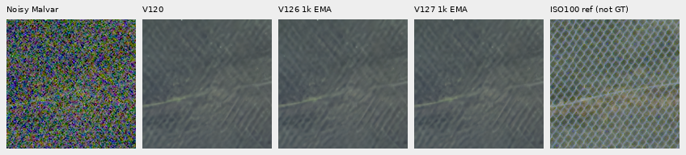

Nominal conditioning still largely erases the lattice; the nearby profile leaves
weak, irregular diagonal texture. The left blue point remains. Left-region
boards: [nominal](images/reviewed-shadow-pilot-quality-v1/V127-mesh-nominal-fine-green-mesh-left-comparison.png) ·
[nearby profile](images/reviewed-shadow-pilot-quality-v1/V127-mesh-profile3879-fine-green-mesh-left-comparison.png).
The two fixed priors and ROI coordinates remain those documented below.
[Completed metrics, material GT triplets and independent checks](reviewed-shadow-pilot-quality.md) ·
[Exact checkpoint/source/ROI/noise/display metadata](images/reviewed-shadow-pilot-quality-v1/manifest.json).

## V123 at 9,000 updates

**The V1239k EMA shows no clear fine-lattice recovery gain under either fixed
profile.** Both native160 regions were viewed, using two new768px contexts and
saved V115/V119/V120 controls. Nominal conditioning largely erases the mesh;
the nearby-DSCF3879 profile reveals more diagonal texture but leaves the fine
lattice weak and irregular. The blue point remains. Full20k results are now
[published](v122-v123-quality.md).

Right mesh: noisy → V115 → V119 → V120 → V1239k EMA → independent DSCF3835
ISO100 AHD reference, **not GT**. Display +4EV (×16), shared WB/matrix, fixed
nearby profile; native crop pixels are not resized.

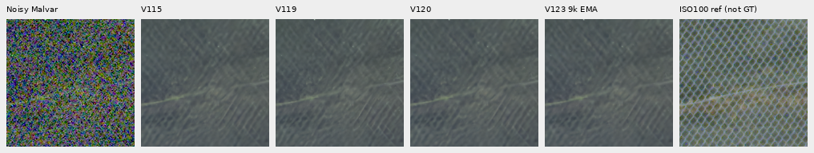

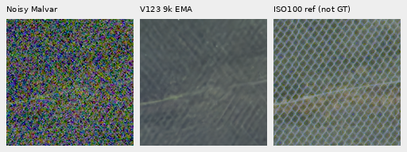

[Both profiles, both regions and material GT triplets](v123-midpoint-quality.md) ·
[Checkpoint/input/profile/ROI and verification](results/v123-mid9000-quality-pilot-v1.json).
The corrected pair is DSCF3842 ISO6400 / **DSCF3835 ISO100 f/5.6**. The main
DSCF3879/3880 scene remains in use; neither independent low-ISO capture is GT.

## V120 after correcting the paired-data mix

**V120 shows no clear fine-lattice recovery gain over V115 or V119 under either
fixed profile.** The completed20,000-update Small model restores the corrected
32-group paired set while keeping V119's Commons cohort and six photographic
regions. The nominal prior still largely erases the mesh. The nearby profile
reveals more diagonal texture, particularly on the right, but the lattice stays
soft, irregular and much weaker than the independent ISO100 reference. The blue
point remains. This case supplies no overall model ranking. The
[primary, main-scene and complete-frame V120/V121 comparisons](v120-v121-primary.md)
are now complete; V120 is the current general recommendation.

Columns below are camera JPEG, noisy Malvar, V115 Small, V119, V120, independent
ISO100 AHD and ISO100 camera JPEG. Top/bottom rows use the nominal/nearby profiles
listed below. Every cell is a native160×160 crop with the same +4EV display.
Both ISO100 columns are **qualitative references, not exact GT**.

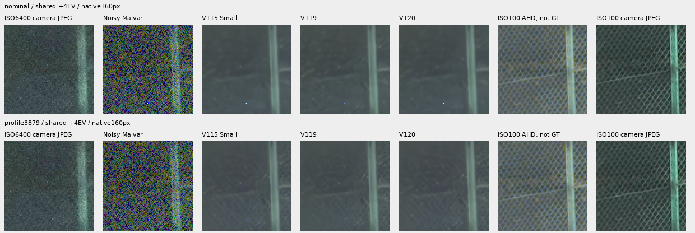

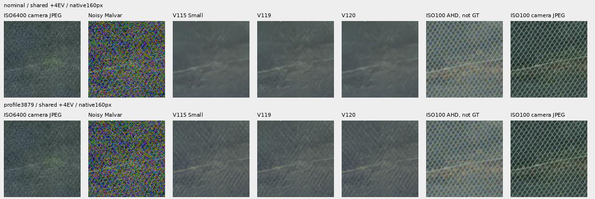

The two nearby-profile noisy/V120/independent-reference triplets retain native
pixels and the same display transform:

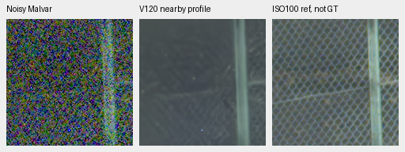

The checkpoint SHA256 is
`a9d9b6b4f974e24a6b11e5e740aab32314233a7f53c056cf37c7d2aac1c589fb`.
Exactly two new CPU IEEE-FP32 root/encoder forwards used the existing768px
context at B1; five selected parent/RawNIND predictions were reused. There was
no new RAW decode, noise generation, profile search or optimizer update.
Context coordinates are `[600,6260,768,768]`; local left/right ROIs are
`[206,229,160,160]` and `[426,189,160,160]`. Originals stayed read-only and cached.

Independent NumPy64 display arithmetic checks2,150,400 channel values in the
28 matched cells: ten differ by one DN8 from FP32 rendering; all others match.
Sixteen shared camera/noisy/reference control cells and all six triplet cells
match exactly. The actual frozen reuse path forbids model construction/calls
and reproduces the two +2EV and two +4EV boards and two triplets byte-for-byte.
The later family review checks the completed checkpoint hash before adopting
these V120 predictions and runs only V121's two new mesh forwards.

[Source/ROI/checkpoint/noise/display metadata](images/v120-green-mesh-v1/manifest.json) ·
[Execution, actual viewing, pixel verification and queue adoption](results/v120-green-mesh-v1.json) ·
[Completed training evidence](paired32-weak-detail-training.md).

## V121 after adding the fourteen-region bank

**V121 shows no clear fine-lattice recovery gain over V120 at either matched
profile.** Its original20k run uses the cleaner90787-source/fourteen-region
cohort at the same5% conditional-photo ROI quota. Nominal conditioning still
largely erases the mesh. The nearby profile exposes more diagonals, but fine
structure remains weak, soft and irregular; the left blue point persists.
This specific material-bank intervention has not solved the adverse capture.

V121 checkpoint SHA256:
`40fb6369064aaf82d513728110a6823ed72be50e79394988303c392b3a02f077`.
Two new CPU-FP32 root/encoder forwards completed, once per fixed profile.
Both V120 predictions and all five selected old controls were reused. There was
no new RAW/noise/optimizer work. Input, source, ROI and display are the same as
V120 above. Both ISO100 columns remain **independent references, not exact GT**.

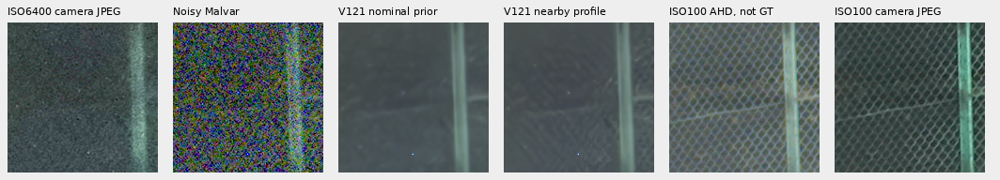

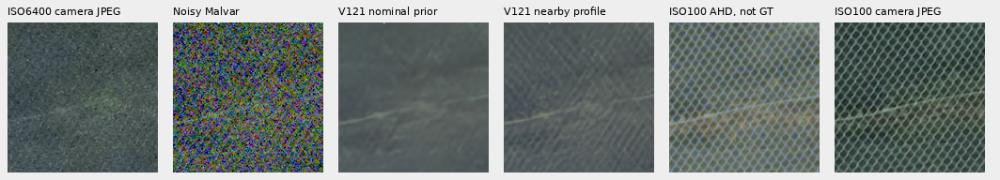

[Left native noisy/V121/independent-reference triplet](images/v120-v121-review-v1/V121-fine-green-mesh-left-triplet.png) ·
[Right triplet](images/v120-v121-review-v1/V121-fine-green-mesh-right-triplet.png) ·
[Source/ROI/checkpoint/conditioning/display metadata](images/v120-v121-review-v1/manifest.json) ·
[Completed review and independent native-pixel checks](results/v120-v121-native-review-v1.json).
Independent NumPy64 arithmetic matches921,598 of921,600 V121 board channels
exactly; two differ by one DN8 at FP32 rendering boundaries. Published PNGs
are byte-identical to the actually viewed outputs.

## V119 after cleaned-data training

V119 completed its original 20,000 updates from V115 Small on 90,791 cleaned
Commons sources and the expanded paired set. On this case it **does not clearly
recover more fine lattice than V115 at the same conditioning**. The nearby
profile reveals more diagonal texture than the nominal prior, as it does for
the parents; weak, soft and irregular mesh, grain/detail ambiguity and the blue
point remain. Cleaning plus this continuation has not solved this failure.
Its [complete numerical and main GFX review](v119-quality.md) documents a photo
gain over V115 alongside known-camera and ADC-color regressions; this mesh
observation alone does not establish an overall quality ranking.

The endpoint checkpoint is
`b3c0d43264c6ad8446dd930aafa337298e4690d0d08f2967824f03ecd844f427`.
Only two new CPU FP32 forwards were needed, one per fixed profile. All seven
earlier nominal/nearby-profile controls are reused, with no new RAW decode,
noise generation or control inference. The same noisy observation, coordinates
and display transforms apply. The nominal and nearby coefficients are listed
in the next section. These remain 768px context comparisons.

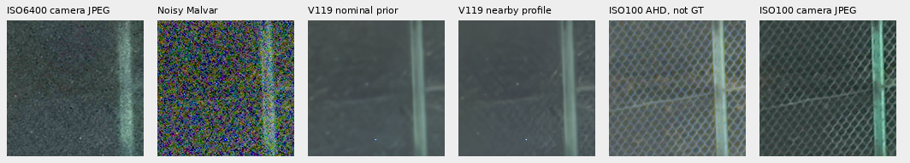

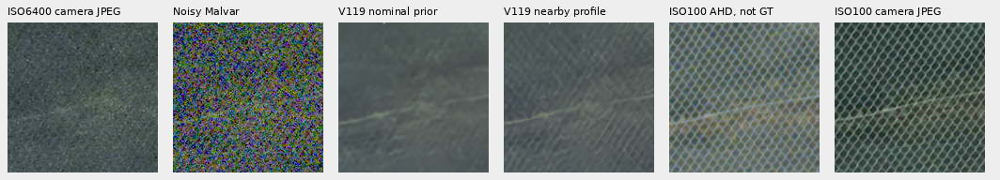

The two native noisy/V119/independent-reference triplets below use the fixed
nearby profile and the same +4EV display. DSCF3835 remains a separate-aperture,
separate-time qualitative reference, **not exact GT**.

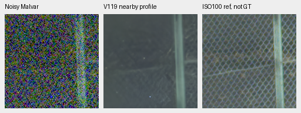

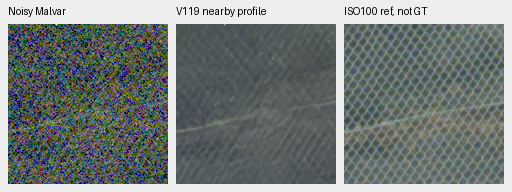

Matched method boards: [V114/V115/V119 with the nearby profile, +2EV](images/v119-green-mesh-v1/profile3879-comparison-2EV.png) ·
[all nominal controls and V119, +2EV](images/v119-green-mesh-v1/nominal-comparison-2EV.png).
[Sources/ROI/checkpoint/noise/display metadata](images/v119-green-mesh-v1/manifest.json) ·
[Completed review, failure preservation and independent pixel checks](results/v119-green-mesh-v1.json).
Independent NumPy arithmetic reproduces all 36 matched-profile board cells exactly;
all 18 triplet cells match their boards. Four parent-control PNGs remain
byte-identical to the earlier actually viewed publication.

## Fixed nearby-capture profile

The [measured-green spectral diagnostic](green-phase-spectrum.md) finds strong
matching diagonal peaks in both RAW green phases, with much less power in the
saved V115/V119 outputs at those frequencies. It supports the visible detail
loss without establishing exact recovery, a safe correction or a GT-based score.
It uses the same retained nearby-profile arrays, with no new model inference.

The same V114 and V115 checkpoints were each run once more on the stored 768px
RAW context with one unchanged **DSCF3879 ISO6400 input-only profile**. It was
already recorded on October 17, before this mesh case. No coefficient sweep or
reference/output fitting was performed. The nominal predictions are reused.

| Conditioning | Shot | Read variance |
| --- | ---: | ---: |
| Generic ISO6400 prior | .00128 | 6.5536e-6 |
| Fixed nearby DSCF3879 profile | .0014635775921166604 | 1.0715704128646712e-6 |

This changes the physical profile, including a higher shot term and lower read
term; it is not a uniform strength multiplier. All observed RAW values, WB,
matrix, CFA geometry, ROI/reference/JPEG pixels and checkpoint bytes are identical.
Only the coefficients and their variance map change. The latter's median ratio
to the nominal map is .6344 in this context.

The two **native 160px** rows below share **+4EV display**. Columns: ISO6400 camera
JPEG, noisy Malvar, V114 nominal, V114 nearby profile, independent ISO100 AHD,
ISO100 camera JPEG. Neither ISO100 column is exact GT.

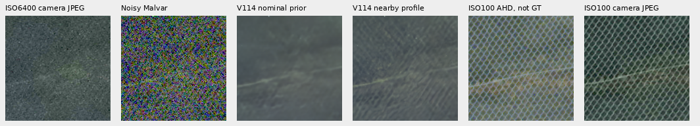

Both V114 and V115 show more diagonal structure, especially in the right crop.
The mesh remains soft, weak and irregular; grain/detail ambiguity and the small
blue point remain. This is a useful qualitative improvement in conditioning,
without establishing accurate lattice recovery or broad model superiority.

V115 matched comparisons: [left](images/gfx-green-mesh-profile-transfer-v1/V115-fine-green-mesh-left-4EV.png) ·
[right](images/gfx-green-mesh-profile-transfer-v1/V115-fine-green-mesh-right-4EV.png).
Native noisy/denoised/independent-reference triplets:
[V114 left](images/gfx-green-mesh-profile-transfer-v1/triplets/crop-4d11d77a521a9cc0.png) ·
[right](images/gfx-green-mesh-profile-transfer-v1/triplets/crop-8bcc58b8b6da3dc8.png) ·
[V115 left](images/gfx-green-mesh-profile-transfer-v1/triplets/crop-cc155f6f0840d134.png) ·
[right](images/gfx-green-mesh-profile-transfer-v1/triplets/crop-abe369d2868bd951.png).

The archived full-image DSCF3842 Haar bins have median absolute relative variance
mismatch of 15.56% with the nominal prior and .98% with the fixed nearby profile.
An [ADC-floor correction](noise-calibration-fit-support.md) additionally allows
valid negative read-noise samples in the actual mesh context: accepted patches
rise 51→2,134. Their median mismatches are 69.38%/5.81%, respectively. These are
input-only consistency diagnostics, not known camera-noise errors. The context's
intensity span is only .004957, so it remains correctly rejected for separate
shot/read fitting. Texture, correlation and selection can bias these statistics;
the transferred profile is not dedicated flat/dark calibration.

[Prospective plan, execution, actual review and independent audit](results/gfx-green-mesh-profile-transfer-v1.json) ·
[Source/ROI/checkpoint/conditioning/display metadata](images/gfx-green-mesh-profile-transfer-v1/manifest.json).
Exactly two new root/DINO forwards were executed, CPU FP32, with zero new RAW
decodes, noisy observations or training. Rendering forbids neural module calls.
Independent NumPy display arithmetic reproduces all 24 board cells exactly;
all 12 triplet cells equal their board counterparts. No full-frame, speed or
pixelwise quality claim is made.

## Nominal-prior controls

Columns: ISO6400 camera JPEG, noisy Malvar, V112, V114, V115 Small, V117,
RawNIND pre-upsampled, independent ISO100 AHD, ISO100 camera JPEG. Each cell is
an unchanged **160×160 native crop**, with shared **+2EV display**. Camera JPEGs
have their own tone, sharpening, denoising and geometric processing. The ISO100
images are independent qualitative references, **not exact GT**. No pixelwise
quality score is computed.

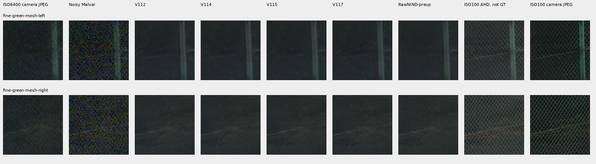

V114 noisy/restored/independent-reference triplets at the same native coordinates:

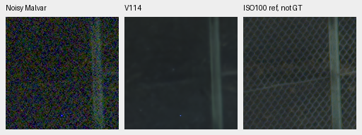

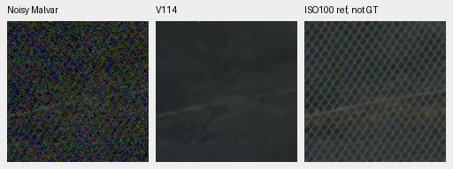

[V112 left](images/gfx-green-mesh-20231231-v1/V112-left.png) ·
[right](images/gfx-green-mesh-20231231-v1/V112-right.png) ·
[Small left](images/gfx-green-mesh-20231231-v1/V115-left.png) ·
[right](images/gfx-green-mesh-20231231-v1/V115-right.png) ·
[V117 left](images/gfx-green-mesh-20231231-v1/V117-left.png) ·
[right](images/gfx-green-mesh-20231231-v1/V117-right.png).
The model differences are small here; the large gap to the independent
ISO100 lattice should not be mistaken for an aperture-matched scoring result.

The README examples use the same retained predictions with **+4EV display** to
show these dark regions more clearly. Every panel receives the same additional
linear display gain; neither noise conditioning nor restoration is recomputed.
Camera JPEGs are decoded from sRGB before that gain. Their original camera
rendering still differs from the RAW display pipeline.

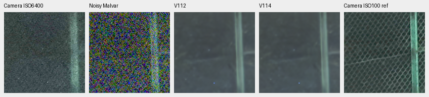

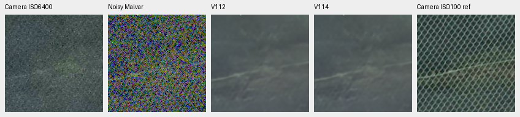

## Capture and protocol

| Capture | ISO | Aperture | Shutter | Local capture time |
| --- | ---: | ---: | --- | --- |
| DSCF3842 | 6400 | f/1.7 | 1/300s | 2023-12-31 17:07:56 |
| DSCF3835 | 100 | f/5.6 | 2.5s | 2023-12-31 17:07:10 |

Both use the GFX100S and GF55mmF1.7. The low-ISO exposure differs in aperture,
depth of field, motion and time. Original RAWs and camera JPEGs remain read-only;
the local cache avoids further source-drive reads. The earlier cached noisy
RAF is reused, with the reference RAF and both JPEGs cached under
`.cache/gfx-green-mesh-20231231/`.

The RAW context is `[600,6260,768,768]`. The two noisy RAW regions start at
`[806,6489]` and `[1026,6449]`; the independent RAW reference uses a one-pixel
left translation. JPEG field matching requires larger offsets: about 46 pixels
horizontally in this part of the frame. Input-only coarse area8 correlation
followed by native integer translation selects coordinates. Coarse binning is
only for registration analysis. The displayed pixels are never resized or warped;
residual lens/rendering differences remain.

The original nominal comparison gives all five RAW methods the same signed
black-subtracted/white-normalized observation, RGGB geometry, noisy-capture WB/matrix and nominal ISO6400 prior:
**shot .00128, read variance 6.5536e-6**. This is a disclosed generic sensor prior,
not measured camera calibration. The existing DSCF3842 input-only fit was
unreliable because of insufficient intensity span. Restoration parameters are
fixed before viewing outputs. The reference uses LibRaw AHD camera RGB calibrated
only to its own RAW capture.

The original five-method run is a **768px context comparison**, with one CPU
IEEE-FP32 forward for each of the five methods and four DINO forwards. It is separate
from the complete102MP standing-scene restorations. All predictions are retained
as FP32 arrays, and future checkpoint additions can reuse these controls without
new control inference. A retained-output integration check forbids model loading
and module calls while reproducing all ten triplets and the full board exactly.
The additional completed V119 endpoint comparison is above.

Preparation saves decoded context intermediates before alignment. Its `--decoded`
option reuses those bound intermediates for alignment-only follow-ups without
RAW re-decoding. Executed sources, input bindings and experiment receipts remain
preserved with the saved predictions.

## Held-out status

DSCF3835 and DSCF3842 identifiers are blocked even without camera metadata.
Their RAW and JPEG hashes join the protected captures; the entire GFX100S
2023-12-31 family remains excluded. The three actual V119 input manifests contain
neither these capture filenames nor their source hashes. The new case changes
no training source, recipe, checkpoint or existing evaluation queue.
