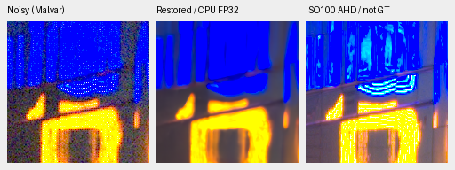
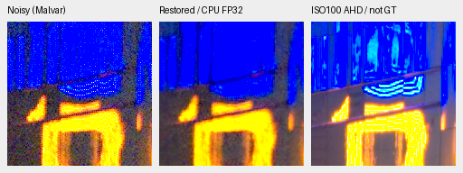
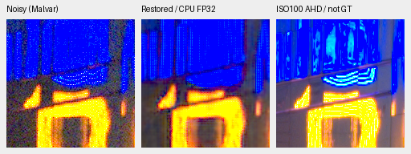
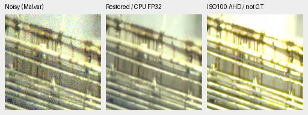
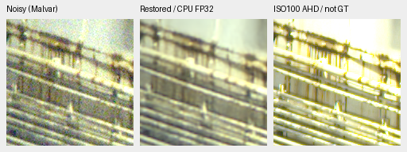

# Supplementary GFX sign and platform crops

The standing DSCF3879/DSCF3880 scene now has two additional fixed regions covering
colored lighting and a bright platform boundary. V43/V60 reduce grain more but
round edges; V67 at 2,000 updates retains more grain; RawNIND leaves visible
patterning around the neon sign. **No decisive broad advantage or promotion.**
The original sky/building/foliage/fence selection remains unchanged.

[Source, checkpoint, input, artifact and actual native-view receipts](results/gfx-highlight-CPU-comparison.json).
[Supplementary selection](../configs/gfx-qualitative-20231231-highlights.json).

Both regions were selected from the cached input/reference pair without learned
outputs. Reference translations maximize green correlation in a 512-pixel context
over integer offsets within ±8 pixels. There is no warping, resizing, brightness
fit or reference-dependent output correction. The source RAWs remain read-only;
the scene and its siblings remain excluded from training.

| Region | Noisy sensor origin | Independent reference origin | Native size | Sensor samples ≥.999 |
| --- | --- | --- | --- | --- |
| Blue/orange neon sign | (9060, 2050) | (9060, 2050) | 160×160 | 57 / 25,600 |
| Platform railing/light boundary | (10320, 4520) | (10321, 4520) | 160×160 | 0 / 25,600 |

The sign has sensor-clipped samples; the platform crop has display clipping under
the common +2 EV transform but no sensor-clipped samples. These are distinct
conditions. Sign content also changes between captures. The ISO100 f/5.6 frame
is 3m38s later than the ISO6400 f/1.7 frame, with different optics, exposure time,
lights and moving subjects. Its independent AHD demosaicing is a **qualitative
reference, not GT**. No scores against it are computed.

All methods use the same cached observation, noise conditioning
shot `0.0014635775921166604` / read variance `0.0000010715704128646712`, WB
`[1.5132450331125828,1,2.2152317880794703]`, input camera matrix and display ×4
(+2 EV). Inference is CPU FP32, contiguous, native 512-pixel context, batch 1,
two threads. Each pictured panel is an unresized native 160×160 crop.
This is context inference; it is not a new full-frame result or speed benchmark.
RawNIND uses its released weights and the disclosed input-only CFA-channel gain
adapter, with signed inputs and explicit publisher normalization.

## Neon sign

Noisy Malvar → named method → independent ISO100 AHD reference, not GT.
V43 and V60 remove much of the noise but soften the small edge shapes. V67 keeps
more grain around the edges. RawNIND leaves row/column patterning in the blue
area. The changing LED content prevents treating missing reference strokes as
restoration errors or recovered detail.

V43 step 2,000:



V60 step 4,000:


V67 step 2,000:



RawNIND, input-only CFA-channel calibration:



## Platform boundary

V43 and V60 are smooth but round the narrow railing edges; V67 retains more
grain. RawNIND is smoother here than V67 but its small edges remain soft. The
ISO100 reference is visibly sharper and brighter; aperture and exposure differences
prevent assigning that entire gap to denoising.

V43 step 2,000:



V60 step 4,000:


V67 step 2,000:


RawNIND, input-only CFA-channel calibration:



## Integrity and subsequent review

Independent checks verify packed samples directly against the cached RAW,
reference crops against a fresh AHD decode, exact variance maps and native PNG
geometry. All eight float predictions and eight triplets pass. Noisy/reference
pixels are bitwise identical across methods and to the fixed input previews.
An independent float64 display transform differs in only 11 of 1,843,200 channel
values by one 8-bit code, within the predeclared preview rounding bound. Float
arrays and source samples remain exact. All four input previews and all eight
triplets were actually viewed at native resolution.

The [completed V67 first2k performance report](raw-kernel-phase-joint-v67-first2k-review.md)
retains numerical development results and these two exact simulated-GT photo
triplets. They use the original GPU FP16/full427 protocol, distinct from this
CPU real-capture comparison; there are no new synthetic scores here.


A CPU-only follower now waits behind the exact final V67 artifact owner's
successful exit. It will restore only these two contexts from the genuine
completed step-10,000 checkpoint and independently audit their native triplets.
Owner PID 3008664 / creation 1792224033.99; workflow status:
`/mnt/external/demosaic/runs/raw-kernel-phase-joint-v67-full10k-gfx-highlights-workflow-v1.json`.
The owner is verified live and child-free at launch, output absent. The actual
pending artifact gate rejects work before output. The future completed gate,
predictions and native review remain pending; this queue adds no training budget
or automatic promotion.

To reproduce the current comparison with a new destination:

```bash
source scripts/env.sh
CUDA_VISIBLE_DEVICES='' OMP_NUM_THREADS=2 OPENBLAS_NUM_THREADS=2 HF_HUB_OFFLINE=1 \
  uv run --no-sync python scripts/evaluate_gfx_highlight_inputs.py \
  /mnt/external/demosaic/models/v43-step2000.pt \
  /mnt/external/demosaic/models/dino-convnext-palette-wide-b16-v60-step4000.pt \
  /mnt/external/demosaic/models/dino-convnext-raw-kernel-phase-joint-b16-v67-step2000.pt \
  --rawnind /mnt/external/demosaic/references/rawnind \
  --inputs /mnt/external/demosaic/evaluation/gfx-highlight-input-selection-v1/plan.json \
  --input-audit /mnt/external/demosaic/evaluation/gfx-highlight-input-selection-v1/independent-audit.json \
  --output /mnt/external/demosaic/evaluation/CHOOSE-NEW-DESTINATION
```
