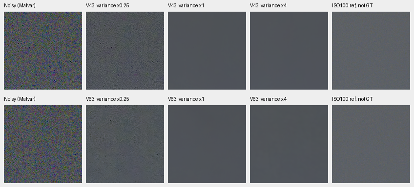
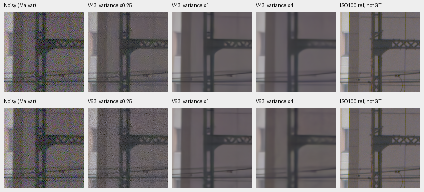
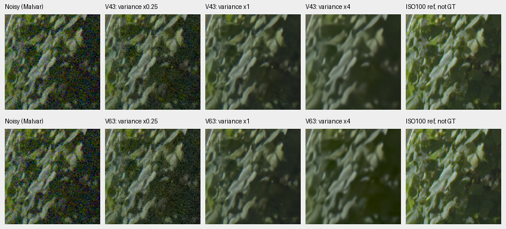
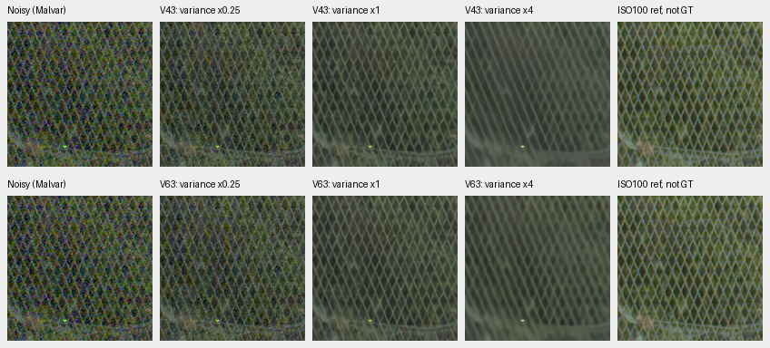
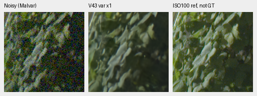
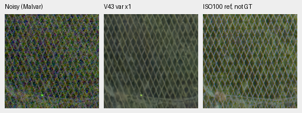

# GFX noise-conditioning sensitivity

Increasing the supplied noise variance does **not** recover missing detail in
these retained models. At 4× variance, fence intersections, leaf edges and thin
building structure soften, while the nominal sky is already smooth. At ¼×,
visible grain remains. Keep the original input-only noise profile unchanged.
This is a small qualitative sensitivity result, not an improved model or a
measurement of the camera's true noise.

[Complete response, source/checkpoint hashes and pixel audit](results/gfx-noise-conditioning-CPU-v1.json).

The experiment runs V43 step2000 and V63 step20000 EMA weights on four cached
512×512 contexts. It saves all 24 unique CPU FP32 predictions: two models,
four regions and three variance factors. Two additional nominal sky forwards
check exact repeatability after switching profiles. These models differ in
architecture, initialization and training budget; this is not a DINO ablation.
The active RAW-native 40k models are not evaluated or changed by this study.

## Fixed inputs and conditions

All methods use DSCF3879, ISO6400/f1.7/1/240s. DSCF3880 is a separate
ISO100/f5.6/3s capture taken 3m38s later, independently demosaiced and calibrated
against its own measured CFA samples. Its aperture, depth of field and moving
subjects differ; it is **not exact GT** and supplies no pixelwise score here.
Only the existing locally cached normalized RAW contexts and reference arrays
were read. The original RAFs and their siblings remain outside training.

| Region | Noisy sensor ROI, xywh | Reference sensor ROI, xywh |
| --- | --- | --- |
| Sky | `[5800,1400,160,160]` | `[5800,1400,160,160]` |
| Building | `[5790,2690,160,160]` | `[5791,2690,160,160]` |
| Foliage | `[8890,5570,160,160]` | `[8890,5570,160,160]` |
| Chain-link fence | `[2240,6000,160,160]` | `[2241,6000,160,160]` |

The original input/reference-only integer registration stays fixed. Predictions
use ROI `[176,176,160,160]` inside each context; reference arrays already contain
the selected 160×160 pixels. No crop is resized, warped or independently exposed.
Display exposure is 4 (+2EV), with the same recorded WB and camera-to-sRGB matrix
throughout. PNGs are 8-bit sRGB previews of the retained float32 arrays, with one
image pixel per PNG pixel. Open originals at 100% if the viewer scales them.

The nominal profile is shot `0.0014635775921166604` and read variance
`1.0715704128646712e-6`. Both coefficients are multiplied together by ¼, 1 or 4:
these correspond to standard-deviation factors ½, 1 and 2. Pixel measurements,
WB, matrix and weights remain fixed. The selected factor reaches both the
model's explicit physical profile and its per-pixel variance input. No profile
is fitted to the reference or output. The response includes the models'
variance-stabilizing preprocessing and the learned network's conditioning.

V43 checkpoint SHA256:
`0d74cf31fb1c7e3f97fc692c855a2ca0ee3ebf562b454e4f8b135c28fc0aa5c5`.
V63 checkpoint SHA256:
`ed70952dd33c5d7da39199bf1306b58b579862920fb0cccd6b222f19871bc9b5`.

## Native comparisons

Each grid has V43 on the top row and V63 on the bottom. Columns are noisy
Malvar, variance ¼×, nominal, variance 4×, and the independent ISO100 reference.
All four complete grids were inspected at original pixel resolution.

Sky: nominal and 4× look similarly smooth; ¼× retains grain.

Building: stronger conditioning suppresses the thin diagonal beam pattern;
lower conditioning retains visible grain.

Foliage: 4× visibly softens leaf edges and small structure.

Fence: 4× softens crossings and diagonal wires, as well as nearby vegetation.

Two compact nominal V43 triplets retain the standard noisy/restored/reference
format. Their source, ROI, hash, conditioning and display settings are those
specified above; the right panel is the independent ISO100 reference, not GT.

## Execution and limits

All model state bytes, keys and parameter identities remain unchanged. Both
nominal repeats are bitwise equal after profile switches, and CUDA is never
initialized. An independent CPU audit rechecks all 60 source/input hashes,
all saved RGB hashes/shapes/finiteness, all 72 native preview panels, and
20,717,568 values in whole-context/ROI comparisons against nominal conditioning.
Difference-reduction roundoff is at most 2.85e−14 DN16. Those differences
measure response to conditioning, not error against GT.

Nine focused tests pass, including variance-versus-standard-deviation scaling,
signed measurement preservation and invalid-profile rejection; Ruff passes.
The executed source, plan, arrays, crops and audits remain under
`/mnt/external/demosaic/benchmarks/gfx-noise-conditioning-CPU-v1/`.
The reusable driver is [probe_real_noise_conditioning.py](../scripts/probe_real_noise_conditioning.py).
It uses two CPU threads and yields to the exact owned review/timing processes
after the original training owner exits. This run completed before that handoff.

These are context predictions in CPU FP32, distinct from the historical FP16
GPU/full-frame exports. They establish no full-frame quality or timing result,
no noise calibration truth, and no general ranking across photographs/cameras.
The next quality decision still depends on the matched 40k review. The evidence
here argues against treating stronger conditioning as a solution to the missing
detail in V43/V63; it does not decide the behavior of the new RAW-native models.
