# Standing GFX pair: completed no-context model on CPU

Current architecture and recommendations: [current model guide](current-model.md).
The versioned study below retains its measured results and original protocol.

The completed fresh no-context 10k model remains close to retained V43 on the
fixed sky, building, foliage and chain-link-fence crops. Both learned models
retain more continuous fence lines than RawNIND, but fine leaf and building
detail remain soft. This check does not establish a new winner over V43 or a
broad quality/SOTA result. [All 20 new native PNGs and provenance](results/gfx-none10k-cpu-context-review.json).

This execution restores **four 512px contexts on CPU FP32**, then extracts
native 160×160 crops. It produces no new full-frame TIFF or speed result. The
original [fresh no-context/S/B trial](fresh-dino-capacity-10k.md) still must finish
S/B and its full numerical, analytic and 102 MP GFX review. V43 was the reference for this study. The two models have different histories and DINO configurations;
these examples do not isolate a training-duration or foundation-model effect.

## Same source pair and display

Only the local cached DSCF3879 (ISO6400, f/1.7, 1/240s) and DSCF3880 (ISO100,
f/5.6, 3s) were read. Their SHA256 identities match the [standing cache receipt](results/gfx-3879-3880-cache.json).
Original photo directories were not accessed or modified. This scene and its
siblings remain outside training. The captures are 3m38s apart; aperture/depth
of field, moving subjects, lights and clouds differ.

The ISO100 reference is independently LibRaw-AHD demosaiced and calibrated
against its own CFA measurements. It is **not exact GT**, receives no geometric
warping and is never used for a pixelwise quality score. Every method shares
the noisy capture's WB [1.513245033,1,2.215231788], camera matrix and display
exposure ×4 (+2 EV), without separate brightness adjustment. Photographs by
the project owner, used with permission.

| Region | ISO6400 top-left xy | ISO100 top-left xy | Noisy context xywh |
| --- | --- | --- | --- |
| Sky | [5800,1400] | [5800,1400] | [5624,1224,512,512] |
| Building | [5790,2690] | [5791,2690] | [5614,2514,512,512] |
| Foliage | [8890,5570] | [8890,5570] | [8714,5394,512,512] |
| Fence | [2240,6000] | [2241,6000] | [2064,5824,512,512] |

All ROIs and integer reference offsets are unchanged and were selected from
input/reference data before model output. The input-only Haar fit gives shot
**.0014635775921166604** and read variance **1.0715704128646712e-6**. Both learned
models receive the same conditioning. This is a scene-dependent estimate, not
dedicated sensor calibration. RawNIND global/channel adapters use the observed
noisy CFA for gain calibration and share the same publisher network weights.

## Foliage and fence

Each primary image reads **noisy → restored method → ISO100 reference (not GT)**.
PNG panels are native 160×160 with no resizing or sharpening. Their 8-bit sRGB
display does not replace the retained float32 linear outputs.

Foliage, V43:

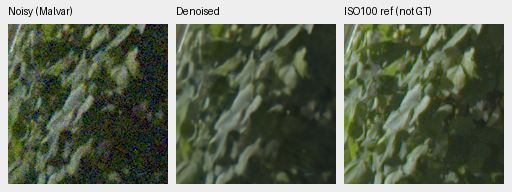

Foliage, fresh no-context 10k:


Fence, V43:

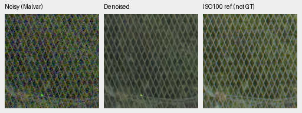

Fence, fresh no-context 10k:

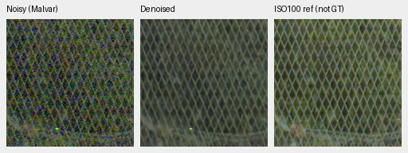

Fence, RawNIND channel calibration on the same noisy context:

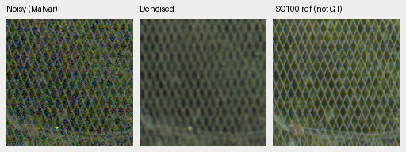

The learned fence outputs preserve more continuous mesh lines than the
RawNIND results, which show broader, less distinct crossings. V43 and the new
model remain close. Foliage is still softened; the sharper f/5.6 reference
cannot assign every capture difference to restoration.

These direct rows read **noisy → V43 → fresh no-context 10k**; neither learned
panel is GT. Their pixels are copied exactly from the primary outputs.

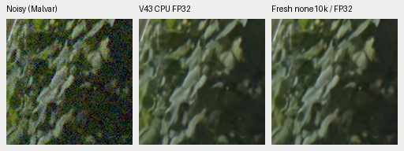

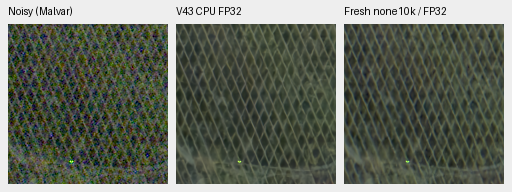

## Sky and building

All methods remove most visible sky grain. Fine bracket/truss detail remains
soft in both learned building outputs, with no clear new overall winner.

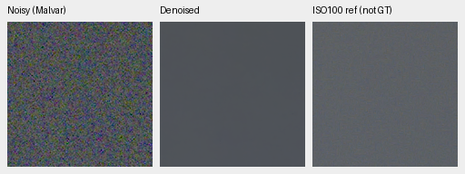

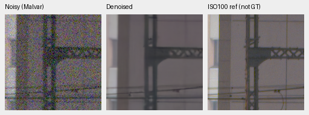

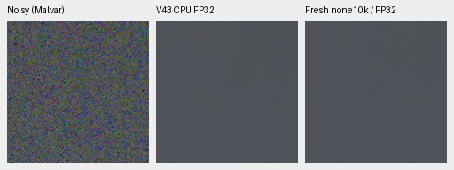

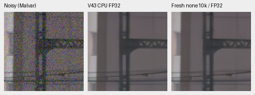

A separate input-consistency diagnostic reprojects each restored sky context
onto its four CFA phases. The largest learned-model phase-mean change relative
to the noisy 512px input is **0.5675%**. The receipt contains all observed,
predicted and residual means in normalized linear sensor units, in RGGB phase
order. This diagnostic is not a comparison to ISO100 or an image-quality score,
and no independence-based noise confidence bound is claimed. It is not used for
model selection or display adjustment.

## Exact-GT examples for these same checkpoints

The [preceding CPU review](cross-camera-none10k-cpu-review.md) already replayed
the two fixed 8×-binned Commons sources with a shared CPU-generated RGGB,
shot .00256/read .0000262144 observation and exact simulated clean target.
Those same checkpoint hashes and FP32 outputs are reused unchanged here.
They are illustrative 256px tiles with native 160px crops, not a full427 score.
The report receipt links all four learned-model triplets and their source/ROI/
conditioning/attribution records; no model inference was repeated for reuse.

Fresh no-context 10k, noisy → denoised → exact simulated GT:

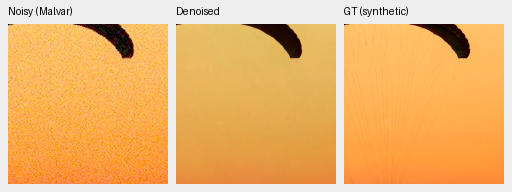

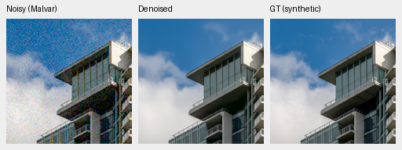

Fine cords remain absent and the fabric example has a yellow/darker cast. The
building has cleaner architectural edges than RawNIND in the earlier comparison,
with remaining cloud/detail loss. These two cases do not justify promotion.
Sources: [Roy Egloff](https://commons.wikimedia.org/wiki/File:CH.VD.Villeneuve_2007-08-25_Vertigo-Swiss-Riviera_2392_3x2-R_4K.jpg)
and [Dietmar Rabich](https://commons.wikimedia.org/wiki/File:Vancouver_(BC,_Canada),_Coal_Harbour_Seaside_Park,_Blick_in_den_Himmel_--_2022_--_2158.jpg),
[CC BY-SA 4.0](https://creativecommons.org/licenses/by-sa/4.0/), modified by
binning, cropping, camera/noise simulation and restoration; derived photographs
retain the source license. Full source fields are in the linked receipts.

## Execution checks

All **20 new native PNGs** were verified and visually inspected: 16 primary
method/reference triplets and four direct learned comparisons. All **24 float32
arrays** pass hash/shape/dtype/finite checks: four packed noisy contexts, four
independent reference crops and 16 restored RGB contexts. Rerendering reproduces
every primary panel byte exactly. Shared noisy/reference panels are byte-exact
across all methods, and direct comparisons preserve their parent panel pixels.

Both learned checkpoints use EMA inference. V43 SHA256:
`0d74cf31fb1c7e3f97fc692c855a2ca0ee3ebf562b454e4f8b135c28fc0aa5c5`.
Fresh no-context 10k SHA256:
`0df4ff404c38b8f4b42f6451486e91c97631544b1c817c126f371195942f3af4`.
RawNIND publisher weights SHA256:
`c1f7de3de24cb12f4803ee65e11cfb467e9a5b80c3cb7126746ef026106c15e0`.
Complete model snapshots, source code, float arrays and raw-source hashes are
archived with the execution. No CUDA context was initialized.

The helper now accepts `--device cpu --precision float32`. CPU half-precision
neural/refinement labels fail before input/output access. GPU remains the
default. Only context mode was exercised on CPU here; no full-frame CPU output,
new speed measurement or new CUDA validation is claimed. The production package
and the live experiment's frozen evaluation scripts are unchanged. Actual
context inference, artifact/guard checks and Ruff pass.

Reproduce from the repository after sourcing `scripts/env.sh`:

```bash
CUDA_VISIBLE_DEVICES='' OMP_NUM_THREADS=4 HF_HUB_OFFLINE=1 \
  uv run --no-sync python scripts/report_raw_pair.py \
  configs/gfx-qualitative-20231231.json \
  /mnt/external/demosaic/models/v43-step2000.pt \
  /mnt/external/demosaic/runs/control-anchored-native-fresh-b16-v45/last.pt \
  --rawnind /mnt/external/demosaic/references/rawnind \
  --rawnind-gain-modes cfa-ls cfa-channel --device cpu --precision float32 \
  --output /mnt/external/demosaic/evaluation/gfx-none10k-cpu-context-replay
```

Use the receipt's archived checkpoint snapshots for immutable replay. Complete
the original matched trial and full-frame review before selecting a new model.
