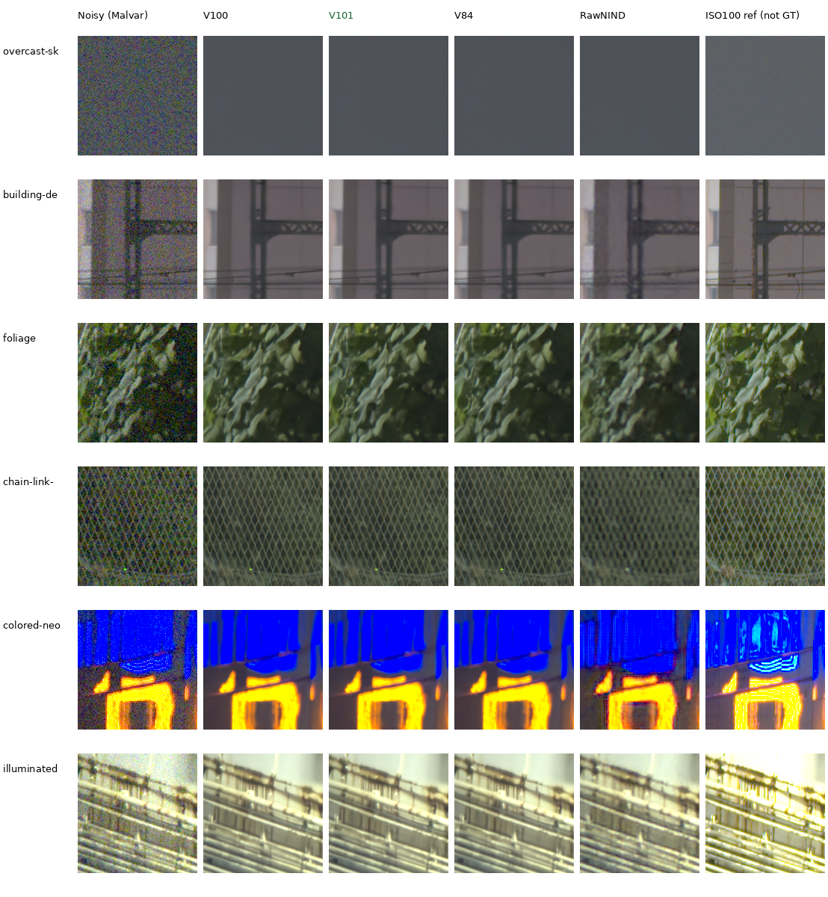

# GFX100S qualitative comparisons

**Current comparisons include V84 and both completed V100/V101 continuations**,
with RawNIND on the standing train/platform scene. V101 is the current
recommended checkpoint after its [completed photographic gain](v84-curated-quality-review.md);
these real-capture results look close across the three
learned checkpoints. They retain more coherent fence strands and cleaner
building rails than RawNIND here. Foliage remains smooth, and saturated-light
shapes/boundaries remain areas to improve.



Columns: noisy Malvar, V100, **V101**, V84, RawNIND with input-only per-CFA-channel
gain, separate ISO100 reference. Each cell is **160×160 native sensor pixels**,
never resized. Open the original PNG at100%; a browser may fit the board to its
window. These crops come from complete 101.996MP blended CUDA IEEE FP32 restorations,
with tile512/overlap64/B4, before RGB16 encoding.
Shared conditioning is shot`.0014635775921166604`, read variance
`1.0715704128646712e-6`, with display ×4(+2EV) and the noisy capture's WB/matrix.
PNG previews are8-bit sRGB; inference and saved context arrays remain FP32.
All four complete exports and eight RGB16 TIFFs have been independently verified.
The [earlier 512px CPU contexts](images/current-gfx/gfx-comparison.png) remain
available as a separate comparison.

[V101 foliage triplet and metadata](images/current-gfx-fullframe/V101-foliage.json) ·
[V101 fence triplet and metadata](images/current-gfx-fullframe/V101-chain-link-fence.json) ·
[all24triplets and source/checkpoint metadata](images/current-gfx-fullframe/manifest.json) ·
[native viewing, full-frame operation and TIFF audit](results/gfx-V84-V100-V101-fullframe-v1.json).
Every public PNG retains the original report's pixels. Source captures,
reference calibration, ROI, full checkpoint hash, noise, exposure and display
settings accompany each sidecar. All 36 native board cells were actually viewed,
and shared noisy/reference pixels match across methods with zero RGB8 tolerance.
The [CPU context report](results/gfx-current-V84-V100-V101-CPU-v1.json) separately
reproduces all 72 of its display panels from saved float contexts.

Assess these real views alongside the
[current photographic/camera results](current-model.md).
The [V43/V84/V95 comparison](images/current-quality/gfx-comparison.png)
([metadata](images/current-quality/manifest.json)) remains useful context. Its
single V95 sky noisy-preview channel differs by1RGB8 level, recorded in that
older gallery's receipt; current predictions/reference pixels are never
adjusted for presentation.
The [Q2, Sony a7RII and GFX50R comparison](cross-camera-qualitative.md) adds
V84/V100 on six low-ISO regions, without a clean reference.

## Capture and crop protocol

DSCF3879 ISO 6400 and DSCF3880 ISO 100 are cached in
`.cache/gfx-qualitative-20231231/` (230MiB). The
[cache receipt](results/gfx-3879-3880-cache.json) records original/cache paths,
matching SHA256 hashes and source metadata. Subsequent testing reads the local
cache. Originals remain read-only; the scene and its siblings stay outside
training. Private RAWs and full-resolution renders stay outside Git.

Both captures are 11662×8746 Bayer images from the GFX100S and 55mm lens:

| Capture | Time | ISO | Aperture | Shutter |
| --- | --- | ---: | ---: | ---: |
| DSCF3879 | 17:13:27 | 6400 | f/1.7 | 1/240s |
| DSCF3880 | 17:17:05 | 100 | f/5.6 | 3s |

They are 3min38s apart. Aperture, depth of field, moving subjects, clouds and
LED scan differ. The sharper ISO 100 exposure is a qualitative reference,
**not exact GT**. No pixelwise PSNR/SSIM is computed against it.

The six regions were fixed from input/reference images before this comparison.
Only integer crop offsets are used: normalized-green correlation over a 512px
context, ±12px; featureless sky uses identical coordinates. Displayed pixels
are never warped, resized, sharpened or independently exposure-adjusted.

| Region | DSCF3879 top-left (x,y) | DSCF3880 top-left (x,y) |
| --- | --- | --- |
| Overcast sky | (5800,1400) | (5800,1400) |
| Building detail | (5790,2690) | (5791,2690) |
| Foliage | (8890,5570) | (8890,5570) |
| Chain-link fence | (2240,6000) | (2241,6000) |
| Colored neon sign | (9060,2050) | (9060,2050) |
| Illuminated platform boundary | (10320,4520) | (10321,4520) |

## Isolated blue features

Two blue features noticed in a V84 overview already occur in the noisy RAW.
The first also persists in the separate ISO 100 exposure; the second is absent
at those sensor coordinates in that later capture. Neither is created solely
by restoration. This pair does not distinguish scene lights, motion and sensor
causes, so the current processing retains them.

| Sensor (x,y) | ISO 6400 blue photosite | ISO 100 blue photosite |
| --- | ---: | ---: |
| (9065,5759) | .32675 | .32808 |
| (8991,5903) | .11302 | .00169 |

Values are black-subtracted/white-normalized sensor units. These posthoc input
diagnostics use two native 160×160 crops from each RAW, separately Malvar-demosaiced
with shared WB/matrix and +2 EV. The independent ISO 100 capture is not GT. They
are source observations, rather than independent model-selection cases.
[Source, ROI, pixels and display metadata](results/gfx-blue-feature-input-reference-v1.json).


## Reproduce and extend the comparisons

Complete 101.996MP exports have finished for V84, V100, V101 and RawNIND with
CFA-channel input gain. The worker and controller exited normally. All eight
TIFFs reopen as 8746×11662×3 uint16 RGB; sRGB files carry ICC profiles. Independent
checks rehash every complete file and confirm shape/depth/tags. The writer also
compares 33 decoded full-width rows per export with supplied floats: sampled
maximum rounding error is .50194 normalized 16-bit DN. This verifies the export
path, rather than a whole-image learned-precision bound.

| Model | Full-frame inference/blending, seconds |
| --- | ---: |
| V84 | 168.47 |
| V100 | 168.21 |
| **V101** | **168.05** |
| RawNIND channel | 17.25 |

Settings: IEEE FP32, tile512/overlap64/B4, 520 tiles, channels-last. These observed
shared-machine timings exclude RAW decode, model loading and TIFF writes.
They do not meet the 100MP/10s target; quality remains the priority. Native
crops come directly from the blended float frame, before RGB16 encoding.
All six regions and four resized whole-scene overviews were inspected. The
learned outputs look close, with coherent mesh/rails but soft foliage and
lit-sign structure. The low-ISO exposure remains a nonexact reference.

Outputs: `/mnt/external/demosaic/v84-quality-fullframe-20261022-v1/`.
[Completed exports, timings, native review and independent audit](results/gfx-V84-V100-V101-fullframe-v1.json).
[Original queue and cropped CPU export smoke](results/v84-quality-fullframe-readiness-v1.json).

Rebuild the shipped gallery without inference or access to private RAWs:

```bash
source scripts/env.sh
PYTHONPATH=src:scripts uv run --no-sync python scripts/render_quality_comparisons.py \
  docs/images/current-gfx/manifest.json
```

For another checkpoint, restore the same cached contexts and preserve the
sidecar metadata:

```bash
source scripts/env.sh
uv run --no-sync python scripts/report_raw_pair.py \
  docs/images/current-gfx/selection.json \
  /mnt/external/demosaic/models/v84-original20000.pt \
  /mnt/external/demosaic/v84-curated-quality-20261022-v2/train/V100/last.pt \
  /mnt/external/demosaic/v84-curated-quality-20261022-v2/train/V101/last.pt \
  --rawnind /mnt/external/demosaic/references/rawnind \
  --rawnind-gain-modes cfa-channel \
  --device cpu --precision float32 --refinement-precision float32 \
  --output /mnt/external/demosaic/evaluation/gfx-next-review
```

Use a fresh output directory. `--full-frame` additionally restores the full
image and writes linear/sRGB16 TIFFs before cropping. Distinguish full-frame
blended results from context-only comparisons. See
[usage](usage.md) and the [16-bit/full-frame measurement record](mature-cudnn-fullframe.md).
Current image comparisons should include useful new versions as they appear;
a diagnostic tradeoff does not require keeping an older gallery indefinitely.

[Colored-light cases](gfx-highlight-qualitative.md) ·
[V84/V85 quality results](native-data-original20k-review.md) ·
[recent ADC/ISO 100 and GFX comparisons](v95-adc-training-quality-review.md).
Older [V16 full-frame evidence](results/gfx-3879-3880-v16-full.json),
[stabilized Gaussian-prior results](stabilized-gaussian-review.md) and
[V32/V33 full-frame results](low-lr-paired-v32-v33-review.md) retain their original
measurements. The timestamped [diary](../diary/index.md) records their history;
this page presents the current useful comparisons. The crops use the user's
own photographs with permission recorded in `PROMPT.md`.
