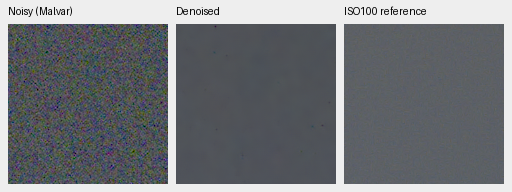
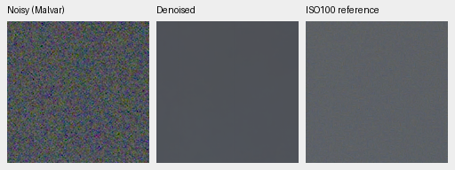
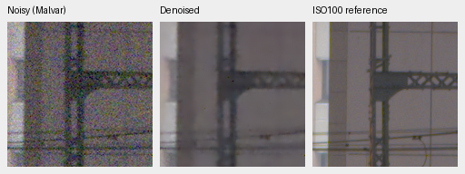
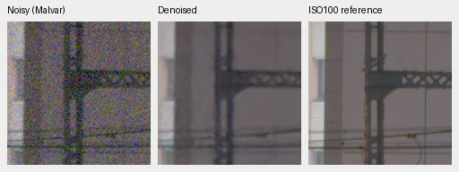

# GFX100S real-photo qualitative test

**DSCF3879 (ISO6400) and DSCF3880 (ISO100) are the standing pair from now on.**
They replace DSCF3842/DSCF3883. The December 31, 2023 train/platform scene and
its siblings remain evaluation-only and excluded from training.

Both RAFs are cached in `.cache/gfx-qualitative-20231231/` (230 MiB total).
[The cache receipt](results/gfx-3879-3880-cache.json) records original and cached
paths, byte counts, matching SHA-256 hashes and unchanged source metadata.
Subsequent tests read the local cache, leaving the source hard drives idle.
Private RAWs and full-resolution renders are not checked into Git.

Both captures are 11662×8746 Bayer images from the GFX100S and 55 mm lens:

| Capture | Time | ISO | Aperture | Shutter |
| --- | --- | ---: | ---: | ---: |
| DSCF3879 | 17:13:27 | 6400 | f/1.7 | 1/240 s |
| DSCF3880 | 17:17:05 | 100 | f/5.6 | 3 s |

The frames have nearly identical framing and are **3 minutes 38 seconds apart**.
Aperture, depth of field, moving subjects, lights and clouds still differ.
The low-ISO image is a qualitative reference, **not exact GT**; no PSNR/SSIM
is computed against it. Its higher sharpness is partly an aperture difference.

Four 160×160 regions were chosen from the input/reference images before viewing
model output. The reference receives only an integer crop-coordinate offset,
selected by normalized green correlation over a 512-pixel context (±12 pixels).
The featureless sky uses the same coordinates. No displayed pixels are warped,
resized, sharpened or adjusted independently.

| Region | DSCF3879 top-left (x,y) | DSCF3880 top-left (x,y) |
| --- | --- | --- |
| Overcast sky | (5800,1400) | (5800,1400) |
| Building detail | (5790,2690) | (5791,2690) |
| Foliage | (8890,5570) | (8890,5570) |
| Chain-link fence | (2240,6000) | (2241,6000) |

Each model restores the entire 101.996 MP frame before cropping. V16 step5000
uses FP16 neural inference with its default IEEE FP32 RGB refinement branch.
RawNIND uses publisher normalization, signed/unclipped input, observed-CFA
least-squares gain and IEEE FP32. Both use 512×512 tiles, overlap 64, batch 4,
and FP32 blending. All panels share the noisy capture's white balance, color
matrix and +2 EV display exposure. The input-only noise-fit result and actual
conditioning are recorded in the [full report receipt](results/gfx-3879-3880-v16-full.json).
The ISO100 reference is LibRaw AHD calibrated against its own CFA samples to
match normalized sensor units. PNGs are 8-bit sRGB previews; restoration and
full-frame TIFF outputs retain floating point/16-bit precision.

Foliage, V16 then RawNIND:


Chain-link fence, V16 then RawNIND:


Overcast sky, V16 then RawNIND:





Building detail, V16 then RawNIND:





Open each PNG at 100%. One sensor pixel occupies one PNG pixel. These are
qualitative diagnostics; the project's quality goal remains open.

The [stabilized Gaussian-prior review](stabilized-gaussian-review.md) adds matched
512px-context foliage/fence comparisons with independent-phase and eight-step
joint RGB priors. Joint RGB preserves more fence structure, but still softens
leaves and leaves isolated colored dots. Those context crops are separate from
the full-frame V16/RawNIND results on this page.

That review also includes [full-frame Joint8 comparisons](stabilized-gaussian-review.md#full-102-mp-gfx-output)
and verified RGB16 files. The fence advantage survives full-frame blending,
but restoration takes 967.31 seconds in a shared-machine run and foliage remains
soft. This is an expensive experimental reference; it is not the deployed model.

Full 11662×8746×3 unsigned16 linear-camera-RGB and ICC sRGB TIFFs are saved in
`/mnt/external/demosaic/evaluation/gfx-3879-3880-v16-5k-full/` as
`restored-{0,1}-{linear16,srgb16}.tiff` (0 = V16, 1 = RawNIND).
The receipt records output hashes, frozen model/source identities, display
settings, exact ROI coordinates and restoration timings. All four TIFFs were
verified as RGB uint16 with 16-bit sample tags; both sRGB files carry ICC profiles.
Restoration took 36.39 s for V16 and 19.88 s for RawNIND, excluding decoding,
model loading, rendering and TIFF encoding. This single shared-machine run is
not an idle benchmark; the 10-second target remains unmet.

Both methods lose some fine mesh and foliage detail. V16 also desaturates the
foliage and leaves more color variation in the sky; the sharper f/5.6 reference
should not be used to assign all capture differences to the restorers.

To reproduce or test another checkpoint using the cached files:

```bash
source scripts/env.sh
uv run --no-sync python scripts/report_raw_pair.py \
  configs/gfx-qualitative-20231231.json /path/to/checkpoint.pt \
  --rawnind /mnt/external/demosaic/references/rawnind \
  --full-frame \
  --output /mnt/external/demosaic/evaluation/gfx-next-review
```

The output contains `report.md`, eight native PNG triplets, complete 16-bit
TIFFs, source code, frozen weights and a JSON receipt. Coordinates are in the
unrotated visible sensor. Omit `--full-frame` for the faster 512-pixel-context
crop-only check. The config and `AGENTS.md` preserve this pair and all four
regions for future reports.

Historical DSCF3842/DSCF3883 results remain unchanged: [V16 receipt](results/gfx-refiner-wide-v16-5k-full.json),
[V15/RawNIND receipt](results/gfx-refiner-v15-5k-full.json) and
[earlier crop-only receipt](results/gfx-20231231-native.json).
The small GFX crops are from the user's own photographs, with permission
recorded in `PROMPT.md`.

The [V32/V33 review](low-lr-paired-v32-v33-review.md#standing-gfx-test-and-full-102-mp-files)
adds the same four native regions from complete blended102MP restorations.
All eight V30/V32/V33/RawNIND RGB16 files were verified. V32/V33 took35.42/35.77s
in that successive shared-machine run; foliage remains soft and mesh irregular.
The README now shows the V33 foliage/fence triplets. ISO100 remains a separate
qualitative reference, not GT.
