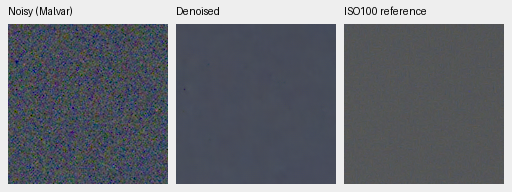
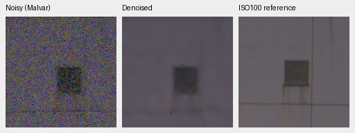
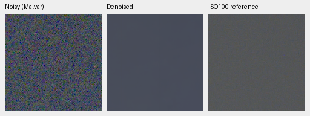
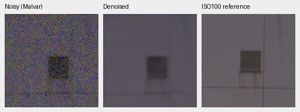

# GFX100S real-photo qualitative test

The December 31, 2023 train/platform scene is a standing evaluation case, kept
out of training along with its siblings. Both requested RAFs are cached in
`.cache/gfx-qualitative-20231231/` (about 230 MiB), with source paths, byte counts
and SHA-256 hashes in [the receipt](results/gfx-20231231-native.json). Subsequent
tests read the cache, leaving the source hard drives idle and originals unchanged.
Full private RAWs and full-resolution renders are not checked into Git.

Both captures are 11662×8746 Bayer images from the GFX100S and 55 mm lens:

| Capture | ISO | Aperture | Shutter |
| --- | ---: | ---: | ---: |
| DSCF3842, 17:07:56 | 6400 | f/1.7 | 1/300 s |
| DSCF3883, 17:17:29 | 100 | f/5.6 | 2.5 s |

The high-ISO frame was deliberately underexposed to protect illuminated platform
and train windows while freezing train motion. It includes foliage, buildings,
overcast sky, people and saturated lights. The low-ISO frame has different
framing, aperture, depth of field and moving subjects, ten minutes later. It is
a useful qualitative reference, **not exact GT**; no PSNR/SSIM is computed against
it. Crops retain native sensor pixels without warping or rescaling.

These 160×160 comparisons use V15 step5000, FP16 neural inference with an IEEE
FP32 refinement branch, after restoring the entire 101.996 MP frame. Tiles are
512×512, overlap 64, batch 4, blended in FP32. All panels use the high-ISO capture's WB and color matrix and the
same +2 EV display exposure. No panel receives automatic brightness, sharpening
or an independent gain adjustment. The ISO100 view is LibRaw AHD, calibrated
against its own CFA samples to match normalized sensor units. PNGs are 8-bit
sRGB previews; the restoration pipeline retains floating point/16-bit output.

Overcast sky:



Building detail (approximately corresponding regions; residual displacement and
aperture differences remain):



For the same regions, RawNIND (publisher normalization, signed/unclipped input,
observed-CFA least-squares gain, IEEE FP32), also restored as a complete frame:





Open each PNG at 100%. One sensor pixel occupies one PNG pixel. These crops show
remaining low-frequency color variation and lost structure; RawNIND's sky is
cleaner. They are a diagnostic,
not evidence that the project has reached its quality goal. The input-only noise
fit found too little intensity range to identify both physical coefficients, so
this run uses the disclosed nominal ISO6400 prior, not a measured camera profile.

Both methods produced full 11662×8746×3 unsigned16 TIFFs: linear camera RGB and
color-managed sRGB with +2 EV. All four files were checked for shape, 16-bit
sample tags and thousands of distinct sampled code values; both sRGB files have
ICC profiles. Files are under
`/mnt/external/demosaic/evaluation/gfx-refiner-v15-5k-full/` as
`restored-0-{linear16,srgb16}.tiff` (V15) and
`restored-1-{linear16,srgb16}.tiff` (RawNIND).
[The whole-frame receipt](results/gfx-refiner-v15-5k-full.json) records file
hashes, weight/source identities, display settings, crop coordinates and timing.
Restoration took 28.89 seconds for V15 and 16.35 for RawNIND while another
evaluation was running; these are not idle benchmark timings and exclude
decode/load/color rendering/TIFF encoding. The 10-second target remains unmet.

To reproduce or test another checkpoint, with the cached files present:

```bash
source scripts/env.sh
uv run --no-sync python scripts/report_raw_pair.py \
  configs/gfx-qualitative-20231231.json /path/to/checkpoint.pt \
  --rawnind /mnt/external/demosaic/references/rawnind \
  --full-frame \
  --output /mnt/external/demosaic/evaluation/gfx-next-review
```

The output contains `report.md`, native PNG triplets, complete 16-bit TIFFs, source code, frozen weights
and a JSON receipt with exact sensor/context coordinates, shared display
transforms, noise settings and source/model hashes. Selection coordinates are in
the unrotated visible sensor. Adding foliage and illuminated/moving regions is
straightforward; their low-ISO content must remain a qualitative reference.

Omit `--full-frame` for the original, faster 512-pixel-context crop-only check.
That mode was regression-checked against the original V11 report: both PNGs are
byte-identical. The earlier V11/V14/RawNIND comparison remains archived at
`/mnt/external/demosaic/evaluation/gfx-20231231-native-v2/report.md`, with
[its receipt](results/gfx-20231231-native.json). The small GFX crops are from the
user's own photographs, used with the permission recorded in `PROMPT.md`.
