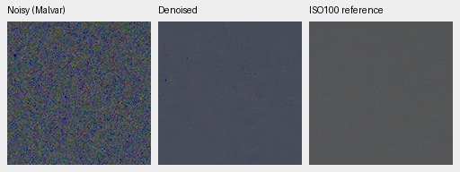

# GFX100S real-photo qualitative test

The December 31, 2023 train/platform scene is a standing evaluation case, kept
out of training along with its siblings. Both requested RAFs are cached in
`.cache/gfx-qualitative-20231231/` (about 230 MiB), with source paths, byte counts
and SHA-256 hashes in [the receipt](results/gfx-20231231-native.json). Subsequent
tests read the cache, leaving the source hard drives idle and originals unchanged.
Full private RAWs and full-resolution renders are not checked into Git.

Both captures are 11662×8746 Bayer images from the GFX100S and 55 mm lens:

| Capture | ISO | Aperture | Shutter |
| --- | ---: | ---: | ---: |
| DSCF3842, 17:07:56 | 6400 | f/1.7 | 1/300 s |
| DSCF3883, 17:17:29 | 100 | f/5.6 | 2.5 s |

The high-ISO frame was deliberately underexposed to protect illuminated platform
and train windows while freezing train motion. It includes foliage, buildings,
overcast sky, people and saturated lights. The low-ISO frame has different
framing, aperture, depth of field and moving subjects, ten minutes later. It is
a useful qualitative reference, **not exact GT**; no PSNR/SSIM is computed against
it. Crops retain native sensor pixels without warping or rescaling.

These two 160×160 comparisons use V11 step5000, FP16 inference on a surrounding
512×512 tile. All panels use the high-ISO capture's WB and color matrix and the
same +2 EV display exposure. No panel receives automatic brightness, sharpening
or an independent gain adjustment. The ISO100 view is LibRaw AHD, calibrated
against its own CFA samples to match normalized sensor units. PNGs are 8-bit
sRGB previews; the restoration pipeline retains floating point/16-bit output.

Overcast sky:



Building detail (approximately corresponding regions; residual displacement and
aperture differences remain):


Open each PNG at 100%. One sensor pixel occupies one PNG pixel. These crops show
substantial remaining color variation and lost structure; they are a diagnostic,
not evidence that the project has reached its quality goal. The input-only noise
fit found too little intensity range to identify both physical coefficients, so
this run uses the disclosed nominal ISO6400 prior, not a measured camera profile.

To reproduce or test another checkpoint, with the cached files present:

```bash
source scripts/env.sh
uv run --no-sync python scripts/report_raw_pair.py \
  configs/gfx-qualitative-20231231.json /path/to/checkpoint.pt \
  --rawnind /mnt/external/demosaic/references/rawnind \
  --output /mnt/external/demosaic/evaluation/gfx-next-review
```

The output contains `report.md`, native PNG triplets, source code, frozen weights
and a JSON receipt with exact sensor/context coordinates, shared display
transforms, noise settings and source/model hashes. Selection coordinates are in
the unrotated visible sensor. Adding foliage and illuminated/moving regions is
straightforward; their low-ISO content must remain a qualitative reference.

The local comparison also includes the rejected flat-only V14 trial and a
RawNIND baseline using publisher normalization, signed/unclipped input, observed
CFA least-squares gain and IEEE FP32. It lives at
`/mnt/external/demosaic/evaluation/gfx-20231231-native-v2/report.md`.
The tracked receipt identifies every method. The small GFX crops are from the
user's own photographs, used with the permission recorded in `PROMPT.md`.
