# GFX100S qualitative comparisons

**V120 Small is the current general recommendation.** The completed
[fixed-Haar full-frame comparison](v120-v121-primary.md#matched-profile-full-frame-gfx)
now matches older V115/V119 inputs exactly, including all130 variance/CFA/WB/
matrix batches. Rows below: noisy → V115 Small → V120 Small → separate ISO100
reference. Each cell is native160 pixels with shared +2EV and no resizing.
DSCF3879 ISO6400 and DSCF3880 ISO100 f/5.6 differ in aperture, time and moving
subjects; the independent ISO100 exposure is **not GT**.

The [V131/V132 spatial trial](raw-spatial-training.md) queues this six-region
scene and full-frame output, plus the additional DSCF3842/**DSCF3835** green
mesh. Both new full-frame methods use identical32px tile grids; older saved
pipelines retain their recorded grids/profiles with differences labeled.
The [V1311k context review](v131-progress1000-quality.md) is now complete,
with native comparisons below; its original20k training continues.

The [V137 conditioned-global review](v137-global-conditioned-quality.md) is
complete on the four established512px contexts and corrected extra mesh pair,
with saved V120/V129/V136 predictions reused. Native comparisons are below.

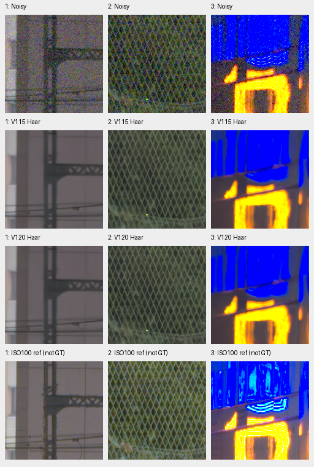

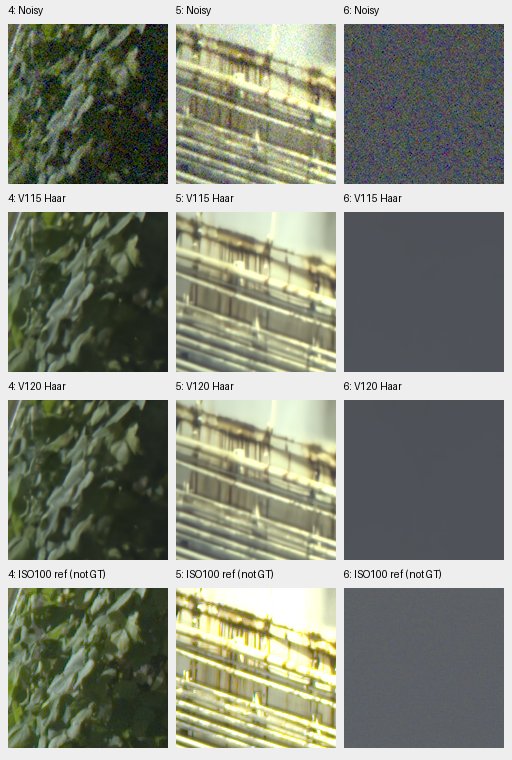

Actually viewed: changes are subtle. Larger fence/building geometry is coherent
and sky quiet; foliage remains painterly and neon markings smear. Matched
V119/V120 and V120/V121 comparisons show no clear large fine-detail recovery.
Same-weight nominal/Haar comparisons also leave these weaknesses unresolved.
Both complete101.996MP outputs and four RGB16 TIFFs verify, including921,600
exact native linear-quantization values. The historical profile is a fixed
comparison convention, not newly verified camera calibration; current automatic
estimation and original nominal outputs remain preserved.
[All comparisons and four triplets](results/v120-v121-fixed-Haar-GFX-v1.json) ·
[Source/ROI/checkpoint/profile/display and actual-viewing receipt](images/v120-v121-fixed-Haar-GFX-v1/manifest.json).

## V125 at2k

The [V125 progress review](v125-progress2000-quality.md) adds native comparisons
of all four established512px contexts. Columns: noisy → V120 → V1252k/20k EMA
→ independent DSCF3880 ISO100/AHD reference, **not GT**. Native160px cells share
+2EV, WB/matrix and nominal shot`.00128`/read`6.5536e−6`; this differs from the
fixed-Haar full-frame profile above.

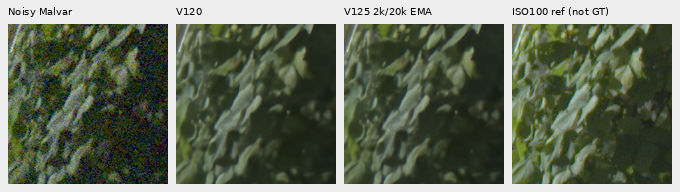

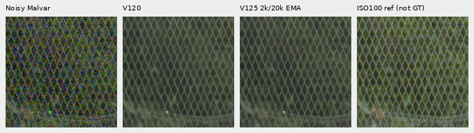

Actual viewing finds no clear new foliage/fence recovery: foliage stays
painterly, larger geometry coherent and sky smooth.
[Sky](images/v125-progress2000-quality-v1/main-overcast-sky-comparison.png) ·
[Building](images/v125-progress2000-quality-v1/main-building-detail-comparison.png) ·
[Corrected DSCF3842/DSCF3835 fine mesh and both camera JPEGs](gfx-green-mesh.md#v125-at2k) ·
[Source/ROI/checkpoint/noise/display metadata](images/v125-progress2000-quality-v1/manifest-v1.json).
The eight-photo training-monitor gain is mainly highlights; faint texture
regresses on separate retained contexts. V125's original20k run continues.

## V131 retained1k progress

The [completed progress review](v131-progress1000-quality.md) shows no clear
new foliage/fence recovery. Columns: noisy → V120 → V131 progress1k/20k →
independent DSCF3880 ISO100/AHD reference, **not GT**. Native160px cells share
512px contexts,+2EV, WB/matrix and nominal shot`.00128`/read`6.5536e−6`.
This profile differs from the fixed-Haar full-frame comparison above.

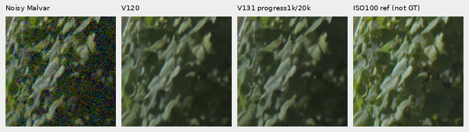

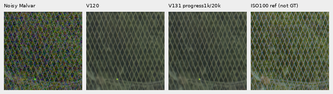

All four contexts were actually viewed, including
[sky](images/v131-progress1000-quality-v1/main-overcast-sky-comparison.png) and
[building](images/v131-progress1000-quality-v1/main-building-detail-comparison.png).
Foliage remains painterly, larger geometry coherent and sky quiet. The
[corrected DSCF3842/DSCF3835 mesh with both camera JPEGs](gfx-green-mesh.md#v131-retained1k-progress)
also shows no clear new lattice recovery. V131 retains V120's architecture;
V132's added branch and full-endpoint quality remain pending.
[Source/ROI/checkpoint/noise/display metadata](images/v131-progress1000-quality-v1/manifest-v2.json).

## V137 conditioned-global pilot

The [completed matched1k review](v137-global-conditioned-quality.md) shows no
clear large foliage/fence recovery. Columns: noisy → V120 → V1291k → V1361k →
V1371k → separate DSCF3880 ISO100/AHD reference, **not GT**. Native160px cells
share512px contexts,+2EV, WB/matrix and nominal shot`.00128`/read`6.5536e−6`.
This context profile differs from the fixed-Haar full-frame comparison above.

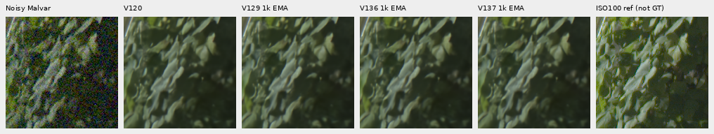

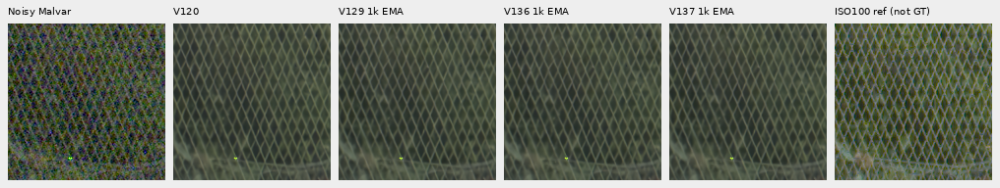

All four contexts were actually viewed, including
[sky](images/v137-global-conditioned-quality-v1/main-overcast-sky-comparison.png) and
[building](images/v137-global-conditioned-quality-v1/main-building-detail-comparison.png).
Foliage remains soft/painterly, larger geometry coherent and sky quiet.
Stronger query/key adaptation and a small faint-ADC gain coexist with tiny
ordinary/shadow regressions and no clear new real-detail recovery. The
[corrected extra mesh](gfx-green-mesh.md#v137-conditioned-global-pilot) remains
weak. V120 remains the general recommendation; no new full-frame result is
claimed. [Source/ROI/all four checkpoint hashes/noise/display metadata](images/v137-global-conditioned-quality-v1/manifest.json).

## V136 global-attention pilot

The [completed matched1k review](v136-global-attention-quality.md) shows no clear
large foliage/fence recovery. Columns: noisy → V120 → V1291k → V1361k → separate
DSCF3880 ISO100/AHD reference, **not GT**. Native160px cells share512px contexts,
+2EV, WB/matrix and nominal shot`.00128`/read`6.5536e−6`. This context review
uses a different profile from the fixed-Haar full-frame comparison above.

All four contexts were actually viewed, including
[sky](images/v136-global-attention-quality-v1/main-overcast-sky-comparison.png) and
[building](images/v136-global-attention-quality-v1/main-building-detail-comparison.png).
Foliage remains soft/painterly, larger geometry coherent and sky quiet.
The [corrected DSCF3842/DSCF3835 fine mesh](gfx-green-mesh.md#v136-global-attention-pilot)
also remains weak. The pilot has tiny mean gains over matched V129, with mixed
local detail; V120 remains the general recommendation. This is not a new
complete-frame result. [Source/ROI/checkpoint/noise/display metadata](images/v136-global-attention-quality-v1/manifest.json).

## V124 at 14,000 updates

The [actual14k progress checkpoint](v124-progress14000.md) gives no clear large
foliage/fence recovery over V120. Columns: noisy → V120 → V12414k EMA → separate
DSCF3880 ISO100/AHD reference, **not GT**. Native160px cells share512px contexts,
+2EV, WB/matrix and nominal shot`.00128`/read`6.5536e−6`. This context review
uses a different profile from the fixed-Haar full-frame comparison above.

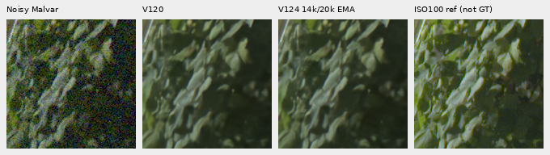

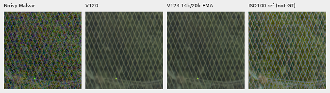

All four contexts were actually viewed, including
[sky](images/v124-progress14000-v1/main-overcast-sky-comparison.png) and
[building](images/v124-progress14000-v1/main-building-detail-comparison.png).
Foliage stays soft/painterly, sky quiet and larger geometry coherent. This is
partial training evidence, without a new full-frame result. The
[corrected extra mesh pair](gfx-green-mesh.md#v124-at-14000-updates) remains
weak under both fixed profiles. V120 remains the general recommendation.
[Checkpoint/source/ROI/noise/display metadata](images/v124-progress14000-v1/manifest.json).

## V122/V123 completed frequency trial

The [completed20k frequency trial](v122-v123-quality.md) shows no large new
foliage/fence recovery. Both complete101.996MP outputs and all six native
regions were reviewed. Rows: noisy → V122 adapter-only → V123 joint → separate
DSCF3880 ISO100 reference, **not GT**. Columns cover building/fence/neon and
foliage/platform/sky. Native160px cells share nominal conditioning,+2EV and
WB/matrix. V122 versus V123 is a matched model comparison.

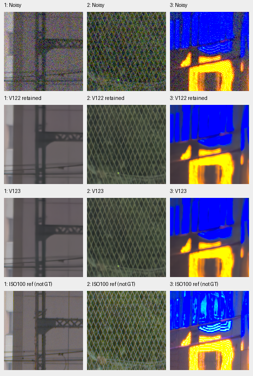

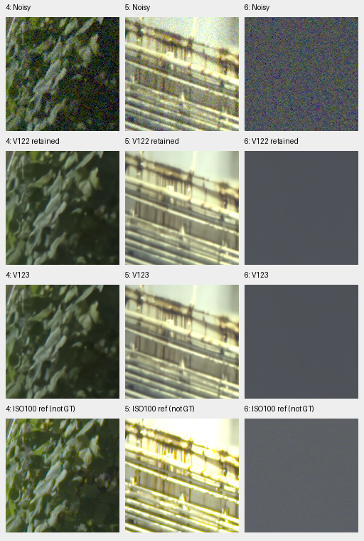

Foliage stays painterly and saturated sign details smear. The larger fence is
coherent; the [extra3842/3835 fine mesh](gfx-green-mesh.md#v122v123-completed-frequency-trial)
remains weak at both fixed profiles. Older V115/V117 GFX controls use a different
Haar profile and are explicitly labeled pipeline comparisons. V120 remains the
general recommendation. [Source/ROI/weights/noise/display metadata](images/v122-v123-quality-v1/manifest.json).

## V130 FP32 training pilot

The [completed matched1,000-update trial](training-precision-pilot.md) slightly
improves selected synthetic faint-ADC bands but shows no clear large real-photo
recovery. Columns: noisy → V120 → V129 BF16 → V130 FP32 → separate DSCF3880
ISO100 reference, **not GT**. Native160px cells share512px contexts,+2EV,
WB/matrix and nominal shot0.00128/read0.0000065536.

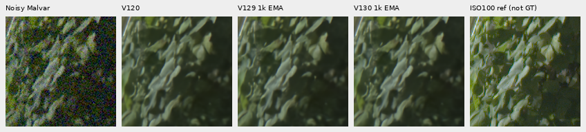

Foliage remains painterly and the larger fence coherent; candidate/control
differences are subtle. The [extra DSCF3842/DSCF3835 mesh](gfx-green-mesh.md#v130-fp32-training-pilot)
also remains weak under both profiles. All28 comparison boards were actually
viewed. [Source/ROI/checkpoint/conditioning/display metadata](images/v130-fp32-pilot-quality-v1/manifest.json).

## V129 curated-data pilot

The [completed1,000-update data pilot](reviewed-detail-training-pilot.md) shows
no useful visible recovery after adding the reviewed27-region data. Native160px
columns: noisy → V120 → V126 control → V129 → separate DSCF3880 ISO100 reference,
**not GT**. All methods share512px contexts, WB/matrix, noise profile and+2EV.

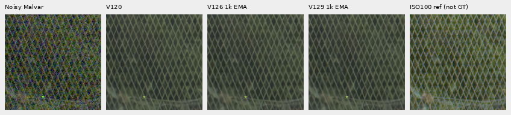

Foliage remains painterly; the larger fence is coherent without a clear new
detail gain. Both corrected3842/3835 fine-mesh regions were also inspected under
[both fixed profiles](gfx-green-mesh.md#v129-curated-data-pilot). Exact source,
ROI, checkpoint and display settings are in the [manifest](images/v129-data-pilot-quality-v1/manifest.json).

## V128 completed feature-loss pilot

The [completed1,000-update feature-loss trial](v128-feature-pilot-quality.md)
shows no useful new foliage/fence recovery. Columns: noisy → V120 → V126 control
→ V128 → separate DSCF3880 ISO100 reference, **not GT**. Native160 crops share
the fixed nominal-profile512px contexts, +2EV, WB/matrix and noise inputs.

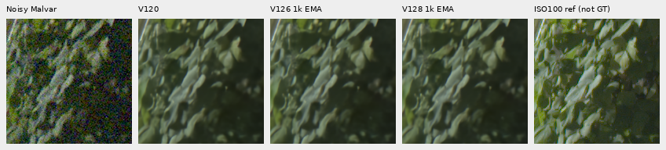

Fine foliage remains painterly; the larger fence pattern stays coherent. The
[corrected3842/3835 fine mesh](gfx-green-mesh.md#v128-feature-loss-pilot) also
remains weak under both fixed profiles. All28 comparison boards were actually
viewed, and every published native cell passes independent pixel checks.
[Checkpoint/source/ROI/conditioning/display metadata](images/v128-feature-pilot-quality-v1/manifest.json).

## V126/V127 completed shadow pilot

The [completed1,000-update matched pilot](reviewed-shadow-pilot-quality.md)
shows no clear useful foliage/fence improvement. Columns: noisy → V120 → V126
control → V127 shadow arm → independent DSCF3880 ISO100 reference, **not GT**.
These use the same nominal-profile512px contexts, native160 cells and +2EV
display. Shot/read are`.00128/6.5536e−6`; WB/matrix and pixels are shared.

Fine foliage stays painterly. The additional
[DSCF3842/DSCF3835 fine mesh](gfx-green-mesh.md#v126v127-shadow-data-pilot)
also remains weak under both fixed profiles. V120 remains the general recommendation.
[Checkpoint/source/ROI/profile/display metadata](images/reviewed-shadow-pilot-quality-v1/manifest.json).

## V123 midpoint: retained nominal-profile contexts

The [9,000-update V123 review](v123-midpoint-quality.md) adds four512px contexts
under the original nominal ISO6400 prior, reusing V120/V121 controls. Columns:
noisy → V120 → V121 → V1239k EMA → independent ISO100 reference, **not GT**.
Cells are native160px, shared +2EV/WB/matrix, without resizing. These use
shot`.00128`/read`6.5536e−6`, separate from the full-frame Haar comparison above.
Fine foliage remains soft, with no clear large recovery gain.

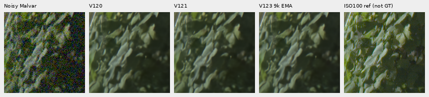

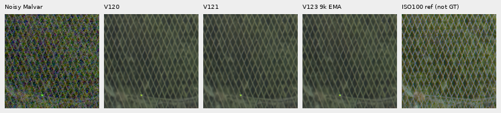

Both extra [DSCF3842/3835 mesh regions](gfx-green-mesh.md#v123-at-9000-updates)
also remain weak under both fixed profiles. V123's original20k run is complete;
full endpoint numerical and selected native review is now
[complete](v122-v123-quality.md). The current recommendation stays V120.

## Tiny/Small alternatives

The older matched Haar-profile V114 Tiny/V115 Small boards remain useful alternatives.
Both have complete101.996MP FP32 blended outputs and verified linear/sRGB RGB16
exports. These new boards compare all six fixed regions at native160 pixels,
with shared +2EV/WB/matrix and no resizing. Rows: noisy, Tiny, Small, separate
ISO100 reference. DSCF3879 ISO6400 and DSCF3880 ISO100 f/5.6 differ in aperture,
time and moving subjects; ISO100 is an approximate reference, **not GT**.

Both retain coherent mesh/building edges and suppress sky noise. Fine foliage
remains painterly, neon markings smear and small surface/lattice detail is weak.
Tiny/Small native differences are small; these are useful current examples,
not evidence of a large real-photo improvement. [Complete quality comparison](v114-v115-quality.md) ·
[Source/ROI/checkpoint/noise/display receipts](images/v114-v115-quality/manifest.json).

All four TIFF hashes/shapes/dtypes pass;921,600 channel values in the twelve
retained ROIs exactly match FP32-to-linear-RGB16 quantization. Ordered FP32
inference/blending observations are116.57s/101.66s; different warmup/workspace
states prevent a speed ranking. Quality remains the priority before speed work.

## Additional fine green mesh case

V120/V121 also retain their completed nominal-profile full-frame outputs, independently
audited primary panels and actually viewed saved comparisons. Their
[matched nominal-profile six-region boards](v120-v121-primary.md#completed-local-and-native-review)
show coherent larger fence/building edges but soft foliage/neon detail, with
no clear large V121 real-detail gain. Those original outputs fall back to the
nominal ISO prior, while older outputs use the input-Haar profile. The additional
fixed-profile operators above close the matched model comparison. The
[explicit original profile labels](endpoint-quality-review.md#material-selection-and-gfx-conditioning)
preserve the pipeline difference.

The [DSCF3842/DSCF3835 comparison](gfx-green-mesh.md) adds the fine green
chain-link fence beside the red train's cab, with both straight-out-of-camera
JPEGs. V112, V114, V115 Small and V117 largely lose its fine lattice under the
disclosed nominal ISO6400 prior; this exposes a weakness that the larger mesh
in the existing standing case does not resolve. RawNIND pre-upsampled retains
more directional texture, without clearly recovering the reference lattice.

Using one fixed input-only profile from nearby DSCF3879 makes more diagonal
texture visible in V114/V115 on the same saved context, with substantial fine
lattice loss remaining. This is a conditioning comparison with reused nominal
controls, not a newly trained model. The shared +4EV example below is native160px:
camera JPEG → noisy → V114 nominal → V114 nearby profile → independent ISO100
AHD → ISO100 camera JPEG, with both ISO100 references **not GT**.

[Both regions, V115, triplets and conditioning evidence](gfx-green-mesh.md#fixed-nearby-capture-profile).

The [completed V120 mesh comparison](gfx-green-mesh.md#v120-after-correcting-the-paired-data-mix)
adds the corrected-paired32 continuation after20k updates. At either fixed
profile it shows no clear fine-lattice recovery gain over V115 or V119; the blue
point and substantial mesh loss remain. Two native triplets and both matched
three-model boards are published. V120's broader numerical and complete-frame
comparisons are complete with their profile limits. The
[completed V121 mesh review](gfx-green-mesh.md#v121-after-adding-the-fourteen-region-bank)
also shows no clear gain at either matched profile. The [complete V119 quality review](v119-quality.md)
now documents its photo gains and camera/color regressions.

A [saved-array green-phase diagnostic](green-phase-spectrum.md) finds matching
diagonal frequency peaks in both measured RAW greens that V115/V119 strongly
attenuate. This supports the visible mesh loss; it is not a new restoration or
an exact-reference quality measurement.

The original five-method board above uses the nominal prior and +2EV display.
All its cells are native160 crops from one768px context,
input-only integer coordinate matching and no resizing or warp. The ISO100
f/5.6 frame was taken46s earlier; its AHD output and camera JPEG are independent
qualitative references, **not GT**. These context comparisons supplement the
existing six full-frame regions. [Sources, noise and checkpoint metadata](images/gfx-green-mesh-20231231-v1/manifest.json).

## Completed V119 cleaned-data comparison

Rows are noisy,V115 Small,V119 Small,and the independent ISO100 reference.
All cells are native160px sensor crops from complete blended102MP outputs,
with the same+2EV/WB/matrix and no resizing. The ISO100 exposure remains
**approximate, not GT**.

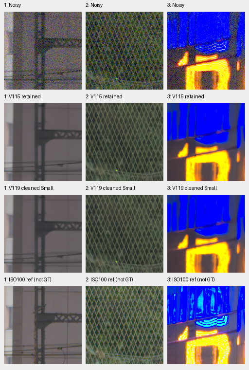

Native differences are small: fence/building geometry stays coherent, sky
smooth, foliage waxy and fine neon/platform detail soft. All three V119 parent
comparisons were viewed. Its photographic PSNR gain over V115 coexists with
known-camera and ADC-color regressions; these regions show no large real-photo
gain. [Complete metrics and native triplets](v119-quality.md) ·
[Source/ROI/checkpoint/noise/display metadata](images/v119-quality-v1/manifest.json) ·
[V117/V119 regions1–3](images/v119-quality-v1/V117-V119-matched-gfx-1.png) ·
[regions4–6](images/v119-quality-v1/V117-V119-matched-gfx-2.png).

Both V119 RGB16 outputs and460,800 retained-ROI channel values verify. Its
163.09s FP32 interval is an observation with separate warmup/workspace state,
not a speed ranking. Quality and100MP/10s remain open goals.

## Completed V117/V118 comparison

[V117](v117-v118-quality.md) is a useful single-view photo-score option at
37.04408dB, with slightly lower camera means and higher ADC bias than V114.
Rows below are noisy, V114, V117 and the separate ISO100 reference. Every cell
is an unchanged160px sensor crop from a complete blended102MP output, with the
same source/ROI/+2EV/WB/matrix. ISO100 remains **approximate, not GT**.

All three pairwise V114/V117/V118 comparisons were viewed. Geometry and sky
remain coherent; foliage stays waxy and saturated sign/platform detail soft.
No clear real-photo gain appears in these regions. The band term in V118 lowers
weak natural response against its control and worsens the ADC tail despite a
small analytic eight-pixel gain, so it stays off for further quality work.
[Matched V117/V118 regions1–3](images/v117-v118-quality/V117-V118-gfx-1.png) ·
[regions4–6](images/v117-v118-quality/V117-V118-gfx-2.png) ·
[Source/ROI/checkpoint/noise/display receipts](images/v117-v118-quality/manifest.json).
All four new TIFFs and921,600 retained-ROI RGB16 values verify. The112.94/95.39s
FP32 intervals are separate timing observations; warmup/workspace differences
prevent a speed ranking. Quality and100MP/10s remain open goals.

## Fixed Tiny/Small output mean

The [completed V115/V117 mean study](fixed-tiny-small-mean.md#standing-gfx-scene)
compares all six unchanged native regions against both components. Averaging
their retained FP32 full-frame crops leaves foliage painterly and blue neon
markings flat, with no clear qualitative gain. Its numerical scores are an
intermediate tradeoff; current useful single-model galleries remain above.

## Completed V116 data comparison

The [V116 full review](v116-quality.md) adds the fine-source/reviewed-mask
recipe with the same Tiny architecture and matched20k budget. Rows below are
noisy, V114, V116 and the separate ISO100 reference. All cells are native160px
crops from complete blended102MP frames, with common+2EV/WB/matrix.

Both preserve coherent fence/building structure and a smooth sky. Foliage stays
waxy and neon/platform detail soft; no clear visual improvement appears here.
V116's analytic eight-pixel carrier gain rises, but full-photo/unseen-CFA means
are slightly lower, broad weak natural-detail gain is unchanged and the ADC
color tail is worse. V114 has the better balance within that comparison; the
current general recommendation is the later V120 Small continuation.
ISO100 remains **approximate, not GT**. [Source/ROI/noise/weights/display receipts](images/v116-quality/manifest.json).
Both V116 TIFFs and all six retained native ROIs pass RGB16 checks. Its113.86s
FP32 interval is a separate timing observation, not a controlled speed gain.

## V114 eight-view context comparison

The [completed fixed24 V114 pilot](v114-eight-view.md) adds all six native GFX
regions. Rows are noisy, V104 eight views, V112 eight views, V114 single, V114
eight views, stronger RawNIND and the separate ISO100 reference. Columns: sky,
building, foliage, fence, neon, platform. All cells are unchanged160px crops
from512px contexts, with shared +2EV/WB/matrix; these are not full-frame
eight-view outputs. ISO100 remains approximate, **not GT**.

Sky and mesh/building geometry remain coherent. Foliage stays painterly and
neon markings smear; differences between V114 single/eight views and V112 eight
views are modest. The complete pilot improves material and selected camera
PSNR, with slightly higher selected color bias and lower spatial variation.
[Source/ROI/weights/noise/display receipts](images/v114-dihedral8-pilot/gfx.json).
Full V114 eight-view panels,102MP export and timing remain unmeasured.

## V112 and released RawNIND full-frame references

The following explicitly labeled comparison retains V104/V112 and both released
RawNIND variants at the same six regions. Learned methods retain more regular
mesh while foliage and saturated-sign structure remain soft.

All36 native 160 cells were viewed, with common+2EV and no resizing. All twelve
underlying noisy/reference float arrays match exactly; one common preview is
used across CPU/GPU runs. [Source/ROI/weights/noise/display and preview provenance](images/v112-fullframe/manifest.json).
The separate ISO100 f/5.6 exposure is a qualitative reference, **not GT**.
V112's linear/sRGB RGB16 TIFFs are rehashed/reopened; the original exporter
checked33 decoded full-width rows per file against floats. FP32 inference/
blending takes167.51s, tile512/overlap64/B4. [Completed full-frame receipt](results/v112-fullframe-review-v1.json).

The [earlier six-context V104/V111/V112 comparison](images/v112-quality/gfx/comparison.png)
remains separately labeled, with its [original metadata](images/v112-quality/gfx/manifest.json).

## V112 eight-view context comparison

The [eight-view V112 comparison](v112-eight-view.md) improves all twelve
fixed photographic cases and both selected adverse camera crops. On the standing
GFX scene, native changes remain small: foliage and saturated sign detail stay
soft; sky and building/fence geometry remain coherent.

All36 cells are native160 pixels from512px contexts, with common+2EV, WB and
matrix. Columns: sky, building, foliage, chain-link fence, neon, platform boundary.
DSCF3880 ISO100 f/5.6 remains an independently demosaiced qualitative reference,
**not GT**. These are context restorations; complete102MP eight-view V112 exports
and timing are unmeasured. [Source/ROI/checkpoint/noise/display receipts](images/v112-dihedral8-pilot/gfx.json).

## Eight-view full-frame reference

The optional [eight-view V104 full-frame review](dihedral-fullframe.md) now adds
all six fixed regions from its completed 102MP RGB16 export, alongside V104,
V112 and the stronger RawNIND reference. Single/eight-view changes look small;
fine foliage and saturated-sign detail remain soft. Its two TIFFs, sampled color
consistency and all 36 native cells are verified. The recorded FP32 inference/
blending interval is 885.93s; [full quality panels and independent audit](dihedral-quality.md)
are now complete. Fine-detail and ADC color weaknesses remain documented.

These restored cells all use camera-RGB16 exports, common +2EV and no resizing.
They are separate from the unquantized crop gallery above and earlier 512-pixel
[pilot context comparison](dihedral-quality.md#standing-gfx-scene).

## Other complete full-frame references

The [stronger released RawNIND reference now has a complete frame](rawnind-fullframe.md),
with the same CFA-channel calibration and all six native regions. Its blue-sign
grid is reduced relative to half; V104 retains more regular fence wires and
fine foliage remains soft across methods.

[All eighteen triplets, common previews and metadata](images/gfx-strong-fullframe/manifest.json).
The separate ISO100 capture remains a qualitative reference, not GT. The earlier
V102/V104 comparison and its complete exports remain below.

Rows: noisy Malvar, V102, V104, RawNIND half with input-only CFA-channel gain,
independent ISO100 f/5.6 reference. Each cell is **160×160 native sensor pixels**,
never resized. Crops come from complete 101.996MP IEEE FP32 blended outputs,
with tile512/overlap64/B4, before RGB16 encoding. All 30 native cells were
viewed at original resolution; shared noisy/reference pixels match exactly.
Open the original PNG at 100%; a browser may fit it to the window.

The final row is a separately captured and independently demosaiced qualitative
reference, **not GT**. Aperture, motion, LED scan and exposure differ; it has no
pixelwise quality score. Shared conditioning is shot .0014635775921166604,
read variance 1.0715704128646712e-6, display ×4 (+2EV), using the noisy capture's
WB/matrix. PNGs are RGB8 previews of float output.
[All 18 triplets and source/ROI/checkpoint/noise/display metadata](images/gfx-v102-v104-fullframe/manifest.json).

Foliage retains broad leaf shapes while losing fine surface detail. Fence
geometry is clearer than RawNIND; bright blue/neon and platform edges remain
rounded or filled. The separate f/5.6 capture has different optical detail.
Three resized full-frame overviews were also viewed: scene geometry is coherent,
while native detail must be assessed from the unchanged crops above.
[V102 overview](images/gfx-v102-v104-fullframe/V102-overview.png) ·
[V104 overview](images/gfx-v102-v104-fullframe/V104-overview.png) ·
[RawNIND overview](images/gfx-v102-v104-fullframe/RawNIND-overview.png).

All six linear/sRGB RGB16 TIFFs were completely rehashed and reopened as
8746×11662×3 uint16, 16 bits/channel. The original exporter also checked sampled
decoded rows against supplied floats; this is an export-path check rather than
a whole-image learned-precision bound.

| Method | Full-frame inference/blending, seconds | Peak CUDA allocation, GB |
| --- | ---: | ---: |
| V102 | 168.20 | 3.37 |
| V104 | 168.73 | 3.36 |
| RawNIND channel | 17.40 | 1.77 |

Settings: IEEE FP32, tile512/overlap64/B4, 520 tiles, channels-last. These
shared-machine observations exclude RAW decoding, model loading and writes.
They do not meet 100MP/10s; no speed optimization is claimed. Artifacts are in
`/mnt/external/demosaic/v102-reviewed-corpus-fullframe-20261023-v1/`.
The original controller and worker exited successfully.
[Full-frame audit, hashes and original export receipts](results/v104-reviewed-corpus-fullframe-v1.json).

## V111 final20k context comparison

The [current fusion-gate diagnostic](fusion-gate-quality.md#standing-gfx-scene-and-the-next-capacity-test)
also compares V104/V111 with their three fusion gates zeroed on all six contexts.
Native differences remain small and fine foliage/sign detail stays soft; the
selected photo/camera metrics favor retaining the learned fusion.

The [current Small feature-transfer boards](small-feature-transfer.md#color-and-standing-gfx-scene)
compare V112 Tiny and the Small initializer aligned to its learned lateral
outputs on all six contexts. Their appearance is close; foliage/sign detail
remains soft. These are 512-pixel context results with zero new joint updates,
separate from the complete-frame comparisons and pending trained Small results.

[V111's completed material and real-photo review](v111-early-quality.md) adds
the same six standing regions after its original20k endpoint. These are
**512-pixel context** restorations, native 160 cells and shared+2EV, with reused
V104 and stronger RawNIND-preup outputs. V111/V104 look close: coherent mesh and
building edges persist, while fine foliage and saturated-sign structure remain
soft. All30 cells were actually viewed. The independent ISO100 f/5.6 image is
qualitative, not GT; these are not new102MP exports.
[All18 triplets, checkpoint/source/ROI/noise/display metadata](images/v111-early-gfx/manifest.json).

## Stronger released RawNIND reference

The [pre-upsampled RawNIND comparison](rawnind-variants.md) adds a stronger
released reference, improving all 12 selected photographic cases and eight
of nine development scene means over the half-resolution model. The released
width48 model has also been checked and does not improve the matched panel means.

These are matched **512-pixel context** restorations with unchanged native 160
display cells and shared +2EV; the complete 102MP comparison above retains
its original half-resolution reference. V104's exact retained CPU predictions
are reused. The alternative improves some coarse sign/rail structure over
half, but foliage remains soft and mesh less regular than V104. Shared display
clipping limits saturated-light comparisons. Width48 retains coarse fence mesh
and a conspicuous periodic grid/grain in the blue sign. The separate ISO100 f/5.6 capture
remains a qualitative reference, not GT or a pixelwise scoring target.
[All 24 triplets, source/ROI/checkpoint and display metadata](images/rawnind-three-variants-current/gfx/manifest.json).
All 36 cells in this additional board were actually viewed at native resolution.

## Other useful comparisons

The [V101/V102/V103 complete-frame gallery](images/current-gfx-v102-v103-fullframe/gfx-comparison.png)
([metadata](images/current-gfx-v102-v103-fullframe/manifest.json)) preserves the
previous comparison and its separate timings.

The [V102 fixed5k/final20k CPU512-context comparison](images/current-gfx-v102-final/gfx-comparison.png)
([metadata](images/current-gfx-v102-final/manifest.json),
[exact parent replay and report corrections](results/V102-final20000-detail-GFX-CPU-v1.json))
is separate from full-frame blending. Its final20k material-panel gain remains
in the [natural-detail guide](heldout-detail.md).

The earlier [V84/V100/V101 complete-frame gallery](images/current-gfx-fullframe/gfx-comparison.png)
([original receipt](results/gfx-V84-V100-V101-fullframe-v1.json)) retains its
168.47/168.21/168.05s timings and original pixels; the new table measures a
separate run. [Older CPU contexts](images/current-gfx/gfx-comparison.png) and
[V43/V84/V95](images/current-quality/gfx-comparison.png) remain useful evidence.
The latter's single V95 noisy-sky channel differs by1RGB8 level, as recorded
in its receipt; current pixels are never adjusted for presentation.

The [current V104 conditioning study](noise-conditioning.md#real-gfx-contexts)
compares .50/.75/1.00/1.25× variance on the same six cached512 contexts. Lower
strengths retain more texture and grain; the nominal1× protocol is unchanged.
A local sky check finds normalized noise scale close to1, while the exact-target
contexts show lower high-noise PSNR under the alternative strengths. These
context results supplement the full-frame comparison above.
The [Q2,Sony a7RII and GFX50R comparison](cross-camera-qualitative.md) adds six
low-ISO regions for V102/V104 without a clean reference. The
[linear DNG/JPEG exporter](dng-export.md) and optional Bayer hot-pixel repair
are merged; repair is explicit and was off in these comparisons.

## Capture and crop protocol

DSCF3879 ISO 6400 and DSCF3880 ISO 100 are cached in
`.cache/gfx-qualitative-20231231/` (230MiB). The
[cache receipt](results/gfx-3879-3880-cache.json) records original/cache paths,
matching SHA256 hashes and source metadata. Subsequent testing reads the local
cache. Originals remain read-only; the scene and its siblings stay outside
training. Private RAWs and full-resolution renders stay outside Git.

Both captures are 11662×8746 Bayer images from the GFX100S and 55mm lens:

| Capture | Time | ISO | Aperture | Shutter |
| --- | --- | ---: | ---: | ---: |
| DSCF3879 | 17:13:27 | 6400 | f/1.7 | 1/240s |
| DSCF3880 | 17:17:05 | 100 | f/5.6 | 3s |

They are 3min38s apart. Aperture, depth of field, moving subjects, clouds and
LED scan differ. The sharper ISO 100 exposure is a qualitative reference,
**not exact GT**. No pixelwise PSNR/SSIM is computed against it.

The six regions were fixed from input/reference images before this comparison.
Only integer crop offsets are used: normalized-green correlation over a 512px
context, ±12px; featureless sky uses identical coordinates. Displayed pixels
are never warped, resized, sharpened or independently exposure-adjusted.

| Region | DSCF3879 top-left (x,y) | DSCF3880 top-left (x,y) |
| --- | --- | --- |
| Overcast sky | (5800,1400) | (5800,1400) |
| Building detail | (5790,2690) | (5791,2690) |
| Foliage | (8890,5570) | (8890,5570) |
| Chain-link fence | (2240,6000) | (2241,6000) |
| Colored neon sign | (9060,2050) | (9060,2050) |
| Illuminated platform boundary | (10320,4520) | (10321,4520) |

## Isolated blue features

Two blue features noticed in a V84 overview already occur in the noisy RAW.
The first also persists in the separate ISO 100 exposure; the second is absent
at those sensor coordinates in that later capture. Neither is created solely
by restoration. This pair does not distinguish scene lights, motion and sensor
causes, so the current processing retains them.

| Sensor (x,y) | ISO 6400 blue photosite | ISO 100 blue photosite |
| --- | ---: | ---: |
| (9065,5759) | .32675 | .32808 |
| (8991,5903) | .11302 | .00169 |

Values are black-subtracted/white-normalized sensor units. These posthoc input
diagnostics use two native 160×160 crops from each RAW, separately Malvar-demosaiced
with shared WB/matrix and +2 EV. The independent ISO 100 capture is not GT. They
are source observations, rather than independent model-selection cases.
[Source, ROI, pixels and display metadata](results/gfx-blue-feature-input-reference-v1.json).

## Reproduction

The source-frozen completed job is recorded under
`.cache/current-quality-20261023-v1/reviewed-corpus-fullframe-v1/`.
Its plan binds the fixed checkpoint hashes, source code, protected local RAW
cache and six ROIs. All seven preceding evaluation stages finished before
this GPU job began. Crops are extracted after complete-frame blending and
retain exact source/reference pixels. Preserve this evidence and use a fresh
output directory for any later model comparison.
