# GFX100S qualitative comparisons

**V114 Tiny is the current general baseline; V115 Small is a useful alternative.**
Both have complete101.996MP FP32 blended outputs and verified linear/sRGB RGB16
exports. These new boards compare all six fixed regions at native160 pixels,
with shared +2EV/WB/matrix and no resizing. Rows: noisy, Tiny, Small, separate
ISO100 reference. DSCF3879 ISO6400 and DSCF3880 ISO100 f/5.6 differ in aperture,
time and moving subjects; ISO100 is an approximate reference, **not GT**.

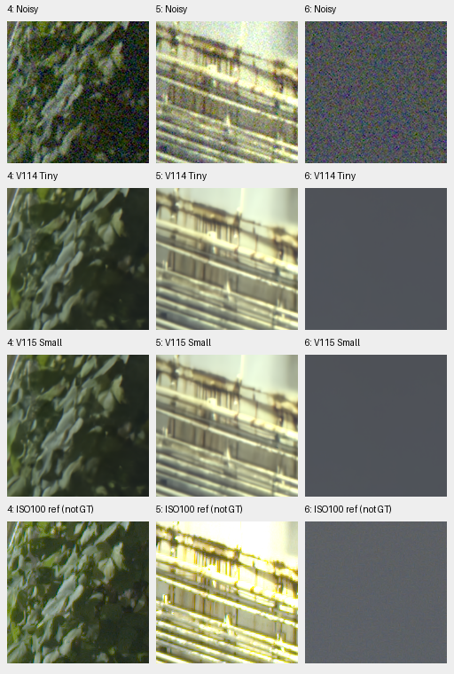

Both retain coherent mesh/building edges and suppress sky noise. Fine foliage
remains painterly, neon markings smear and small surface/lattice detail is weak.
Tiny/Small native differences are small; these are useful current examples,
not evidence of a large real-photo improvement. [Complete quality comparison](v114-v115-quality.md) ·
[Source/ROI/checkpoint/noise/display receipts](images/v114-v115-quality/manifest.json).

All four TIFF hashes/shapes/dtypes pass;921,600 channel values in the twelve
retained ROIs exactly match FP32-to-linear-RGB16 quantization. Ordered FP32
inference/blending observations are116.57s/101.66s; different warmup/workspace
states prevent a speed ranking. Quality remains the priority before speed work.

## Additional fine green mesh case

The [DSCF3842/DSCF3835 comparison](gfx-green-mesh.md) adds the fine green
chain-link fence beside the red train's cab, with both straight-out-of-camera
JPEGs. V112, V114, V115 Small and V117 largely lose its fine lattice under the
disclosed nominal ISO6400 prior; this exposes a weakness that the larger mesh
in the existing standing case does not resolve. RawNIND pre-upsampled retains
more directional texture, without clearly recovering the reference lattice.

Using one fixed input-only profile from nearby DSCF3879 makes more diagonal
texture visible in V114/V115 on the same saved context, with substantial fine
lattice loss remaining. This is a conditioning comparison with reused nominal
controls, not a newly trained model. The shared +4EV example below is native160px:
camera JPEG → noisy → V114 nominal → V114 nearby profile → independent ISO100
AHD → ISO100 camera JPEG, with both ISO100 references **not GT**.

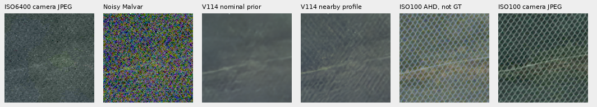

[Both regions, V115, triplets and conditioning evidence](gfx-green-mesh.md#fixed-nearby-capture-profile).

The [completed V119 endpoint comparison](gfx-green-mesh.md#v119-after-cleaned-data-training)
adds the same two fixed profiles after20k cleaned-data updates. At matched
conditioning it shows no clear fine-lattice recovery gain over V115; this
remains an adverse case. The complete main GFX/numerical evaluation is running.

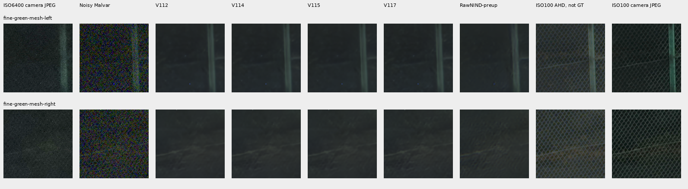

The original five-method board above uses the nominal prior and +2EV display.
All its cells are native160 crops from one768px context,
input-only integer coordinate matching and no resizing or warp. The ISO100
f/5.6 frame was taken46s earlier; its AHD output and camera JPEG are independent
qualitative references, **not GT**. These context comparisons supplement the
existing six full-frame regions. [Sources, noise and checkpoint metadata](images/gfx-green-mesh-20231231-v1/manifest.json).

## Completed V117/V118 comparison

[V117](v117-v118-quality.md) is a useful single-view photo-score option at
37.04408dB, with slightly lower camera means and higher ADC bias than V114.
Rows below are noisy, V114, V117 and the separate ISO100 reference. Every cell
is an unchanged160px sensor crop from a complete blended102MP output, with the
same source/ROI/+2EV/WB/matrix. ISO100 remains **approximate, not GT**.

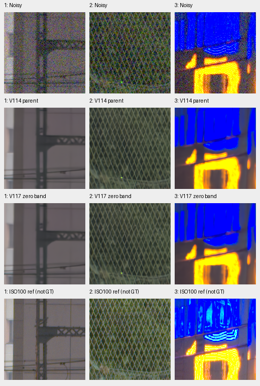

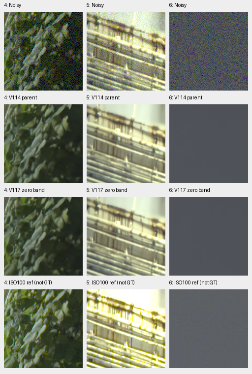

All three pairwise V114/V117/V118 comparisons were viewed. Geometry and sky
remain coherent; foliage stays waxy and saturated sign/platform detail soft.
No clear real-photo gain appears in these regions. The band term in V118 lowers
weak natural response against its control and worsens the ADC tail despite a
small analytic eight-pixel gain, so it stays off for further quality work.
[Matched V117/V118 regions1–3](images/v117-v118-quality/V117-V118-gfx-1.png) ·
[regions4–6](images/v117-v118-quality/V117-V118-gfx-2.png) ·
[Source/ROI/checkpoint/noise/display receipts](images/v117-v118-quality/manifest.json).
All four new TIFFs and921,600 retained-ROI RGB16 values verify. The112.94/95.39s
FP32 intervals are separate timing observations; warmup/workspace differences
prevent a speed ranking. Quality and100MP/10s remain open goals.

## Fixed Tiny/Small output mean

The [completed V115/V117 mean study](fixed-tiny-small-mean.md#standing-gfx-scene)
compares all six unchanged native regions against both components. Averaging
their retained FP32 full-frame crops leaves foliage painterly and blue neon
markings flat, with no clear qualitative gain. Its numerical scores are an
intermediate tradeoff; current useful single-model galleries remain above.

## Completed V116 data comparison

The [V116 full review](v116-quality.md) adds the fine-source/reviewed-mask
recipe with the same Tiny architecture and matched20k budget. Rows below are
noisy, V114, V116 and the separate ISO100 reference. All cells are native160px
crops from complete blended102MP frames, with common+2EV/WB/matrix.

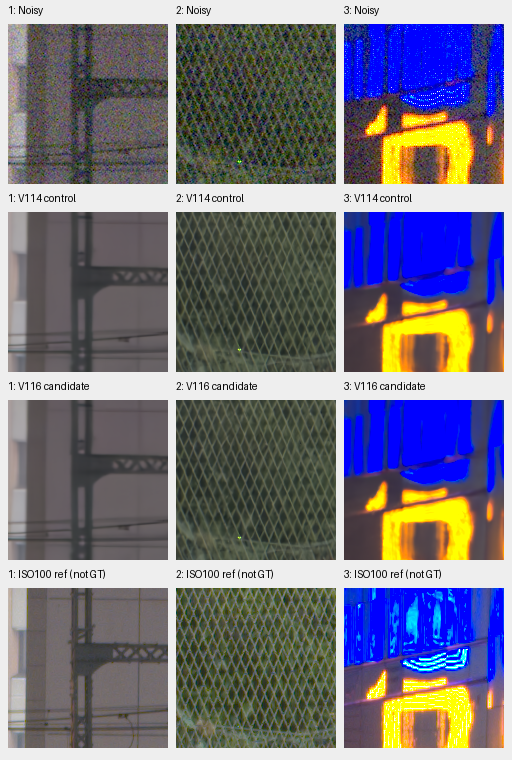

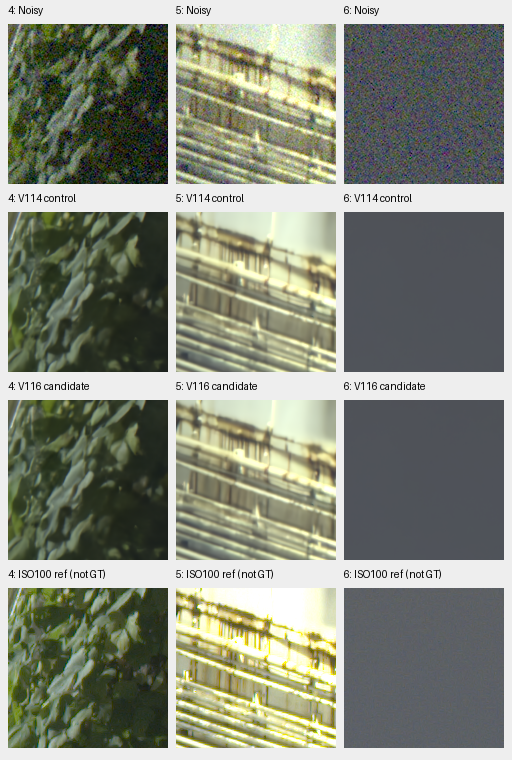

Both preserve coherent fence/building structure and a smooth sky. Foliage stays
waxy and neon/platform detail soft; no clear visual improvement appears here.
V116's analytic eight-pixel carrier gain rises, but full-photo/unseen-CFA means
are slightly lower, broad weak natural-detail gain is unchanged and the ADC
color tail is worse. V114 remains the general choice for that measured balance.
ISO100 remains **approximate, not GT**. [Source/ROI/noise/weights/display receipts](images/v116-quality/manifest.json).
Both V116 TIFFs and all six retained native ROIs pass RGB16 checks. Its113.86s
FP32 interval is a separate timing observation, not a controlled speed gain.

## V114 eight-view context comparison

The [completed fixed24 V114 pilot](v114-eight-view.md) adds all six native GFX
regions. Rows are noisy, V104 eight views, V112 eight views, V114 single, V114
eight views, stronger RawNIND and the separate ISO100 reference. Columns: sky,
building, foliage, fence, neon, platform. All cells are unchanged160px crops
from512px contexts, with shared +2EV/WB/matrix; these are not full-frame
eight-view outputs. ISO100 remains approximate, **not GT**.

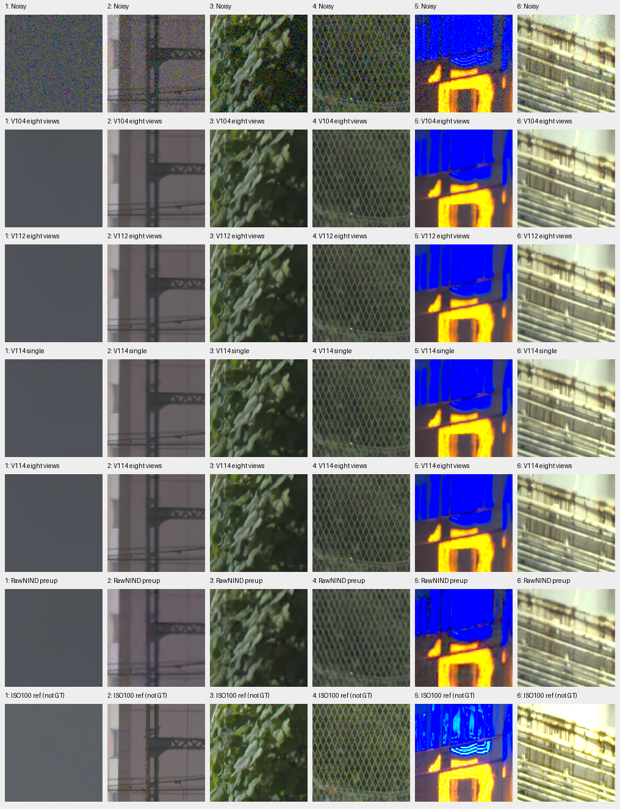

Sky and mesh/building geometry remain coherent. Foliage stays painterly and
neon markings smear; differences between V114 single/eight views and V112 eight
views are modest. The complete pilot improves material and selected camera
PSNR, with slightly higher selected color bias and lower spatial variation.
[Source/ROI/weights/noise/display receipts](images/v114-dihedral8-pilot/gfx.json).
Full V114 eight-view panels,102MP export and timing remain unmeasured.

## V112 and released RawNIND full-frame references

The following explicitly labeled comparison retains V104/V112 and both released
RawNIND variants at the same six regions. Learned methods retain more regular
mesh while foliage and saturated-sign structure remain soft.

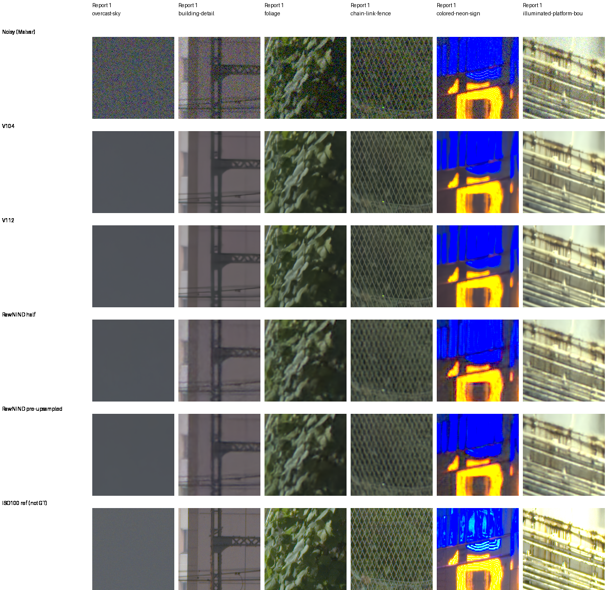

All36 native 160 cells were viewed, with common+2EV and no resizing. All twelve
underlying noisy/reference float arrays match exactly; one common preview is
used across CPU/GPU runs. [Source/ROI/weights/noise/display and preview provenance](images/v112-fullframe/manifest.json).
The separate ISO100 f/5.6 exposure is a qualitative reference, **not GT**.
V112's linear/sRGB RGB16 TIFFs are rehashed/reopened; the original exporter
checked33 decoded full-width rows per file against floats. FP32 inference/
blending takes167.51s, tile512/overlap64/B4. [Completed full-frame receipt](results/v112-fullframe-review-v1.json).

The [earlier six-context V104/V111/V112 comparison](images/v112-quality/gfx/comparison.png)
remains separately labeled, with its [original metadata](images/v112-quality/gfx/manifest.json).

## V112 eight-view context comparison

The [eight-view V112 comparison](v112-eight-view.md) improves all twelve
fixed photographic cases and both selected adverse camera crops. On the standing
GFX scene, native changes remain small: foliage and saturated sign detail stay
soft; sky and building/fence geometry remain coherent.

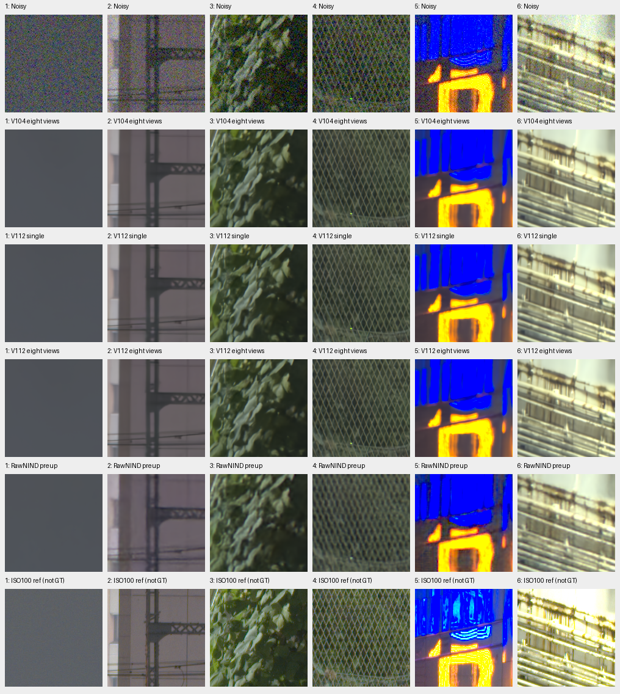

All36 cells are native160 pixels from512px contexts, with common+2EV, WB and
matrix. Columns: sky, building, foliage, chain-link fence, neon, platform boundary.
DSCF3880 ISO100 f/5.6 remains an independently demosaiced qualitative reference,
**not GT**. These are context restorations; complete102MP eight-view V112 exports
and timing are unmeasured. [Source/ROI/checkpoint/noise/display receipts](images/v112-dihedral8-pilot/gfx.json).

## Eight-view full-frame reference

The optional [eight-view V104 full-frame review](dihedral-fullframe.md) now adds
all six fixed regions from its completed 102MP RGB16 export, alongside V104,
V112 and the stronger RawNIND reference. Single/eight-view changes look small;
fine foliage and saturated-sign detail remain soft. Its two TIFFs, sampled color
consistency and all 36 native cells are verified. The recorded FP32 inference/
blending interval is 885.93s; [full quality panels and independent audit](dihedral-quality.md)
are now complete. Fine-detail and ADC color weaknesses remain documented.

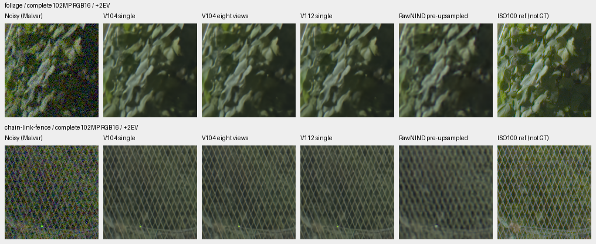

These restored cells all use camera-RGB16 exports, common +2EV and no resizing.
They are separate from the unquantized crop gallery above and earlier 512-pixel
[pilot context comparison](dihedral-quality.md#standing-gfx-scene).

## Other complete full-frame references

The [stronger released RawNIND reference now has a complete frame](rawnind-fullframe.md),
with the same CFA-channel calibration and all six native regions. Its blue-sign
grid is reduced relative to half; V104 retains more regular fence wires and
fine foliage remains soft across methods.

[All eighteen triplets, common previews and metadata](images/gfx-strong-fullframe/manifest.json).
The separate ISO100 capture remains a qualitative reference, not GT. The earlier
V102/V104 comparison and its complete exports remain below.

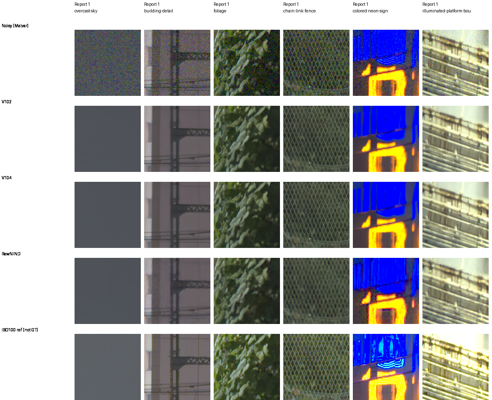

Rows: noisy Malvar, V102, V104, RawNIND half with input-only CFA-channel gain,
independent ISO100 f/5.6 reference. Each cell is **160×160 native sensor pixels**,
never resized. Crops come from complete 101.996MP IEEE FP32 blended outputs,
with tile512/overlap64/B4, before RGB16 encoding. All 30 native cells were
viewed at original resolution; shared noisy/reference pixels match exactly.
Open the original PNG at 100%; a browser may fit it to the window.

The final row is a separately captured and independently demosaiced qualitative
reference, **not GT**. Aperture, motion, LED scan and exposure differ; it has no
pixelwise quality score. Shared conditioning is shot .0014635775921166604,
read variance 1.0715704128646712e-6, display ×4 (+2EV), using the noisy capture's
WB/matrix. PNGs are RGB8 previews of float output.
[All 18 triplets and source/ROI/checkpoint/noise/display metadata](images/gfx-v102-v104-fullframe/manifest.json).

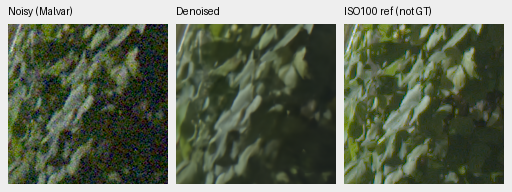

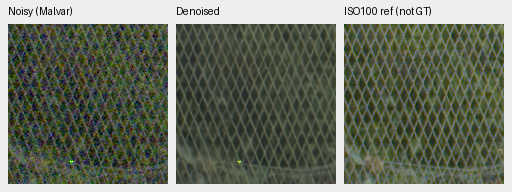

Foliage retains broad leaf shapes while losing fine surface detail. Fence
geometry is clearer than RawNIND; bright blue/neon and platform edges remain
rounded or filled. The separate f/5.6 capture has different optical detail.
Three resized full-frame overviews were also viewed: scene geometry is coherent,
while native detail must be assessed from the unchanged crops above.
[V102 overview](images/gfx-v102-v104-fullframe/V102-overview.png) ·
[V104 overview](images/gfx-v102-v104-fullframe/V104-overview.png) ·
[RawNIND overview](images/gfx-v102-v104-fullframe/RawNIND-overview.png).

All six linear/sRGB RGB16 TIFFs were completely rehashed and reopened as
8746×11662×3 uint16, 16 bits/channel. The original exporter also checked sampled
decoded rows against supplied floats; this is an export-path check rather than
a whole-image learned-precision bound.

| Method | Full-frame inference/blending, seconds | Peak CUDA allocation, GB |
| --- | ---: | ---: |
| V102 | 168.20 | 3.37 |
| V104 | 168.73 | 3.36 |
| RawNIND channel | 17.40 | 1.77 |

Settings: IEEE FP32, tile512/overlap64/B4, 520 tiles, channels-last. These
shared-machine observations exclude RAW decoding, model loading and writes.
They do not meet 100MP/10s; no speed optimization is claimed. Artifacts are in
`/mnt/external/demosaic/v102-reviewed-corpus-fullframe-20261023-v1/`.
The original controller and worker exited successfully.
[Full-frame audit, hashes and original export receipts](results/v104-reviewed-corpus-fullframe-v1.json).

## V111 final20k context comparison

The [current fusion-gate diagnostic](fusion-gate-quality.md#standing-gfx-scene-and-the-next-capacity-test)
also compares V104/V111 with their three fusion gates zeroed on all six contexts.
Native differences remain small and fine foliage/sign detail stays soft; the
selected photo/camera metrics favor retaining the learned fusion.

The [current Small feature-transfer boards](small-feature-transfer.md#color-and-standing-gfx-scene)
compare V112 Tiny and the Small initializer aligned to its learned lateral
outputs on all six contexts. Their appearance is close; foliage/sign detail
remains soft. These are 512-pixel context results with zero new joint updates,
separate from the complete-frame comparisons and pending trained Small results.

[V111's completed material and real-photo review](v111-early-quality.md) adds
the same six standing regions after its original20k endpoint. These are
**512-pixel context** restorations, native 160 cells and shared+2EV, with reused
V104 and stronger RawNIND-preup outputs. V111/V104 look close: coherent mesh and
building edges persist, while fine foliage and saturated-sign structure remain
soft. All30 cells were actually viewed. The independent ISO100 f/5.6 image is
qualitative, not GT; these are not new102MP exports.
[All18 triplets, checkpoint/source/ROI/noise/display metadata](images/v111-early-gfx/manifest.json).

## Stronger released RawNIND reference

The [pre-upsampled RawNIND comparison](rawnind-variants.md) adds a stronger
released reference, improving all 12 selected photographic cases and eight
of nine development scene means over the half-resolution model. The released
width48 model has also been checked and does not improve the matched panel means.

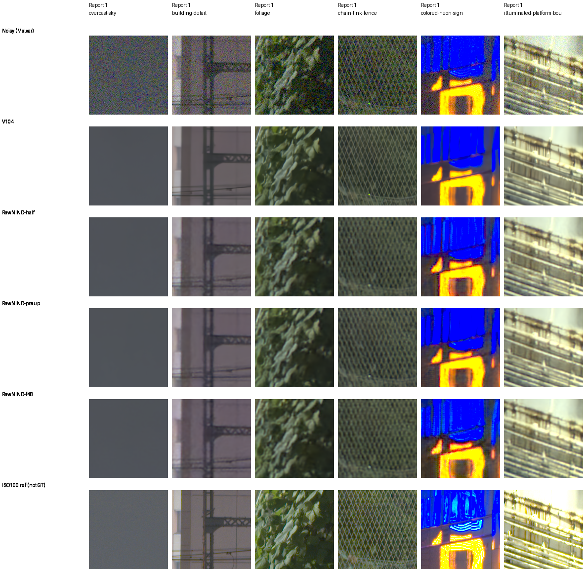

These are matched **512-pixel context** restorations with unchanged native 160
display cells and shared +2EV; the complete 102MP comparison above retains
its original half-resolution reference. V104's exact retained CPU predictions
are reused. The alternative improves some coarse sign/rail structure over
half, but foliage remains soft and mesh less regular than V104. Shared display
clipping limits saturated-light comparisons. Width48 retains coarse fence mesh
and a conspicuous periodic grid/grain in the blue sign. The separate ISO100 f/5.6 capture
remains a qualitative reference, not GT or a pixelwise scoring target.
[All 24 triplets, source/ROI/checkpoint and display metadata](images/rawnind-three-variants-current/gfx/manifest.json).
All 36 cells in this additional board were actually viewed at native resolution.

## Other useful comparisons

The [V101/V102/V103 complete-frame gallery](images/current-gfx-v102-v103-fullframe/gfx-comparison.png)
([metadata](images/current-gfx-v102-v103-fullframe/manifest.json)) preserves the
previous comparison and its separate timings.

The [V102 fixed5k/final20k CPU512-context comparison](images/current-gfx-v102-final/gfx-comparison.png)
([metadata](images/current-gfx-v102-final/manifest.json),
[exact parent replay and report corrections](results/V102-final20000-detail-GFX-CPU-v1.json))
is separate from full-frame blending. Its final20k material-panel gain remains
in the [natural-detail guide](heldout-detail.md).

The earlier [V84/V100/V101 complete-frame gallery](images/current-gfx-fullframe/gfx-comparison.png)
([original receipt](results/gfx-V84-V100-V101-fullframe-v1.json)) retains its
168.47/168.21/168.05s timings and original pixels; the new table measures a
separate run. [Older CPU contexts](images/current-gfx/gfx-comparison.png) and
[V43/V84/V95](images/current-quality/gfx-comparison.png) remain useful evidence.
The latter's single V95 noisy-sky channel differs by1RGB8 level, as recorded
in its receipt; current pixels are never adjusted for presentation.

The [current V104 conditioning study](noise-conditioning.md#real-gfx-contexts)
compares .50/.75/1.00/1.25× variance on the same six cached512 contexts. Lower
strengths retain more texture and grain; the nominal1× protocol is unchanged.
A local sky check finds normalized noise scale close to1, while the exact-target
contexts show lower high-noise PSNR under the alternative strengths. These
context results supplement the full-frame comparison above.
The [Q2,Sony a7RII and GFX50R comparison](cross-camera-qualitative.md) adds six
low-ISO regions for V102/V104 without a clean reference. The
[linear DNG/JPEG exporter](dng-export.md) and optional Bayer hot-pixel repair
are merged; repair is explicit and was off in these comparisons.

## Capture and crop protocol

DSCF3879 ISO 6400 and DSCF3880 ISO 100 are cached in
`.cache/gfx-qualitative-20231231/` (230MiB). The
[cache receipt](results/gfx-3879-3880-cache.json) records original/cache paths,
matching SHA256 hashes and source metadata. Subsequent testing reads the local
cache. Originals remain read-only; the scene and its siblings stay outside
training. Private RAWs and full-resolution renders stay outside Git.

Both captures are 11662×8746 Bayer images from the GFX100S and 55mm lens:

| Capture | Time | ISO | Aperture | Shutter |
| --- | --- | ---: | ---: | ---: |
| DSCF3879 | 17:13:27 | 6400 | f/1.7 | 1/240s |
| DSCF3880 | 17:17:05 | 100 | f/5.6 | 3s |

They are 3min38s apart. Aperture, depth of field, moving subjects, clouds and
LED scan differ. The sharper ISO 100 exposure is a qualitative reference,
**not exact GT**. No pixelwise PSNR/SSIM is computed against it.

The six regions were fixed from input/reference images before this comparison.
Only integer crop offsets are used: normalized-green correlation over a 512px
context, ±12px; featureless sky uses identical coordinates. Displayed pixels
are never warped, resized, sharpened or independently exposure-adjusted.

| Region | DSCF3879 top-left (x,y) | DSCF3880 top-left (x,y) |
| --- | --- | --- |
| Overcast sky | (5800,1400) | (5800,1400) |
| Building detail | (5790,2690) | (5791,2690) |
| Foliage | (8890,5570) | (8890,5570) |
| Chain-link fence | (2240,6000) | (2241,6000) |
| Colored neon sign | (9060,2050) | (9060,2050) |
| Illuminated platform boundary | (10320,4520) | (10321,4520) |

## Isolated blue features

Two blue features noticed in a V84 overview already occur in the noisy RAW.
The first also persists in the separate ISO 100 exposure; the second is absent
at those sensor coordinates in that later capture. Neither is created solely
by restoration. This pair does not distinguish scene lights, motion and sensor
causes, so the current processing retains them.

| Sensor (x,y) | ISO 6400 blue photosite | ISO 100 blue photosite |
| --- | ---: | ---: |
| (9065,5759) | .32675 | .32808 |
| (8991,5903) | .11302 | .00169 |

Values are black-subtracted/white-normalized sensor units. These posthoc input
diagnostics use two native 160×160 crops from each RAW, separately Malvar-demosaiced
with shared WB/matrix and +2 EV. The independent ISO 100 capture is not GT. They
are source observations, rather than independent model-selection cases.
[Source, ROI, pixels and display metadata](results/gfx-blue-feature-input-reference-v1.json).

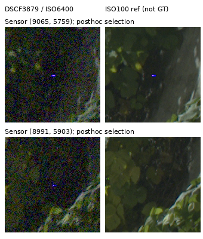

## Reproduction

The source-frozen completed job is recorded under
`.cache/current-quality-20261023-v1/reviewed-corpus-fullframe-v1/`.
Its plan binds the fixed checkpoint hashes, source code, protected local RAW
cache and six ROIs. All seven preceding evaluation stages finished before
this GPU job began. Crops are extracted after complete-frame blending and
retain exact source/reference pixels. Preserve this evidence and use a fresh
output directory for any later model comparison.
