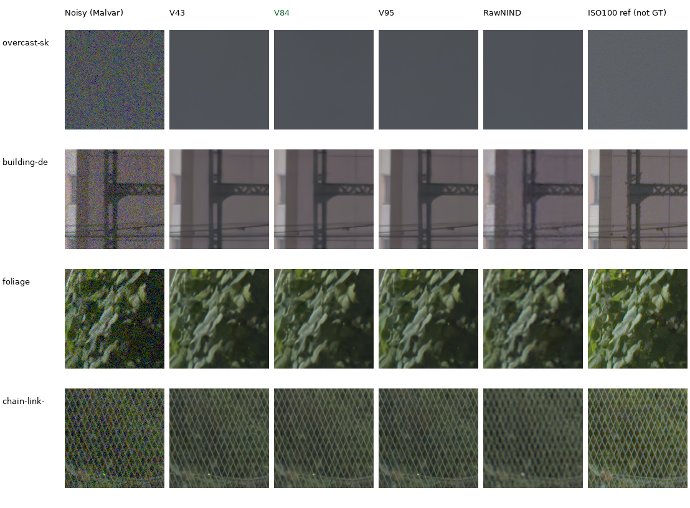

# GFX100S qualitative comparisons

**V84 is the current development baseline.** Compare it below with V43, V95
and RawNIND on the standing train/platform scene. V84/V95 produce more coherent
fence strands and cleaner building rails than RawNIND in these crops. V84 keeps
smooth sky and useful leaf shapes; fine foliage texture and saturated-light
boundaries remain areas to improve. The models are close in some regions, so
use this scene alongside the photographic/camera results in the
[current model guide](current-model.md).



Columns: noisy Malvar, V43, **V84**, V95, RawNIND with input-only per-CFA-channel
gain, separate ISO 100 reference. Each cell is 160×160 sensor pixels, never resized.
The learned-model crops use IEEE FP32 with 512px contexts. Shared conditioning:
shot `.0014635775921166604`, read variance `1.0715704128646712e-6`; display ×4
(+2 EV), with the noisy capture's WB and camera matrix shared across methods.
PNG previews are 8-bit sRGB; this does not change restoration/output precision.

[V84 foliage triplet and metadata](images/current-quality/gfx-V84-foliage.json) ·
[V84 fence triplet and metadata](images/current-quality/gfx-V84-chain-link-f.json) ·
[all crop/checkpoint/source metadata](images/current-quality/manifest.json).
Each method retains its own restored pixels. Shared source coordinates, display
settings and reference pixels are checked by the gallery renderer. Its JSON
also records the single V95 sky noisy-preview channel that differs by 1 RGB8
level; no prediction or reference pixels are adjusted for presentation.

## Capture and crop protocol

DSCF3879 ISO 6400 and DSCF3880 ISO 100 are cached in
`.cache/gfx-qualitative-20231231/` (230MiB). The
[cache receipt](results/gfx-3879-3880-cache.json) records original/cache paths,
matching SHA256 hashes and source metadata. Subsequent testing reads the local
cache. Originals remain read-only; the scene and its siblings stay outside
training. Private RAWs and full-resolution renders stay outside Git.

Both captures are 11662×8746 Bayer images from the GFX100S and 55mm lens:

| Capture | Time | ISO | Aperture | Shutter |
| --- | --- | ---: | ---: | ---: |
| DSCF3879 | 17:13:27 | 6400 | f/1.7 | 1/240s |
| DSCF3880 | 17:17:05 | 100 | f/5.6 | 3s |

They are 3min38s apart. Aperture, depth of field, moving subjects, clouds and
LED scan differ. The sharper ISO 100 exposure is a qualitative reference,
**not exact GT**. No pixelwise PSNR/SSIM is computed against it.

Regions were chosen from input/reference images before viewing model outputs.
Only integer crop offsets are used: normalized-green correlation over a 512px
context, ±12px; featureless sky uses identical coordinates. Displayed pixels
are never warped, resized, sharpened or independently exposure-adjusted.

| Region | DSCF3879 top-left (x,y) | DSCF3880 top-left (x,y) |
| --- | --- | --- |
| Overcast sky | (5800,1400) | (5800,1400) |
| Building detail | (5790,2690) | (5791,2690) |
| Foliage | (8890,5570) | (8890,5570) |
| Chain-link fence | (2240,6000) | (2241,6000) |

## Reproduce and extend the comparisons

Rebuild the shipped gallery without inference or access to private RAWs:

```bash
source scripts/env.sh
PYTHONPATH=src:scripts uv run --no-sync python scripts/render_quality_comparisons.py \
  docs/images/current-quality/manifest.json --noisy-preview-tolerance-dn 1
```

For another checkpoint, restore the same cached contexts and preserve the
sidecar metadata:

```bash
source scripts/env.sh
uv run --no-sync python scripts/report_raw_pair.py \
  configs/gfx-qualitative-20231231.json \
  /mnt/external/demosaic/models/v84-original20000.pt \
  --rawnind /mnt/external/demosaic/references/rawnind \
  --rawnind-gain-modes cfa-ls cfa-channel \
  --output /mnt/external/demosaic/evaluation/gfx-next-review
```

Use a fresh output directory. `--full-frame` additionally restores the full
image and writes linear/sRGB16 TIFFs before cropping. Distinguish full-frame
blended results from context-only comparisons. See
[usage](usage.md) and the [16-bit/full-frame measurement record](mature-cudnn-fullframe.md).
Current image comparisons should include useful new versions as they appear;
a diagnostic tradeoff does not require keeping an older gallery indefinitely.

[Colored-light cases](gfx-highlight-qualitative.md) ·
[V84/V85 quality results](native-data-original20k-review.md) ·
[recent ADC/ISO 100 and GFX comparisons](v95-adc-training-quality-review.md).
Older [V16 full-frame evidence](results/gfx-3879-3880-v16-full.json),
[stabilized Gaussian-prior results](stabilized-gaussian-review.md) and
[V32/V33 full-frame results](low-lr-paired-v32-v33-review.md) retain their original
measurements. The timestamped [diary](../diary/index.md) records their history;
this page presents the current useful comparisons. The crops use the user's
own photographs with permission recorded in `PROMPT.md`.
