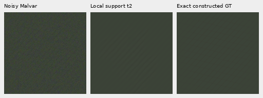
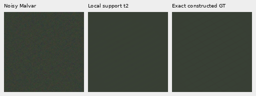
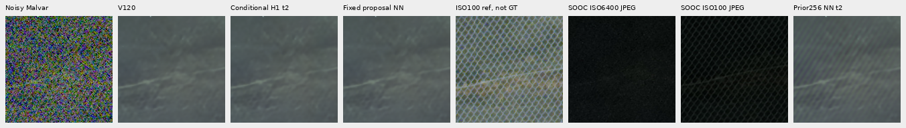

# Full source/CFA/noise test of global background and local amplitudes

**The full1164-case review is complete: compared with256 neural,400/far weak
response rises2.299%→2.778% and strong response37.032%→48.055%, with higher
mean quiet/increment errors.** All eight sources improve strong response and
full RGB error; seven improve weak response. Real cab ripples are substantially
smaller, but fine crossings remain missing. This is a useful stronger-detail/
lower-real-ripple alternative with explicit error costs. V120 remains the
general recommendation.

All68 native figures were actually inspected, including the predeclared64
saved-baseline comparisons and two noisy/restored/exact-GT triplets.
[Native viewer](images/neural-nuisance-fixed-bg129-full-v1/native-viewer.html) ·
[68 exact archives,2328 case receipts and332 executed source files](results/neural-nuisance-fixed-bg129-full-v1/publication.json).
The [two-source pilot](global-background-local-carriers.md) remains separately
documented; the following numbers use all eight sources, CFAs and repeats.

|400 / far,64 views /8 sources|Weak response|Strong response|Quiet RMS DN16|Weak-increment RMS DN16|Full RGB RMS DN16|
|---|---:|---:|---:|---:|---:|
|V143 parent|1.826%|30.902%|4.05895|10.06832|19.30746|
|Prior256 neural|2.299%|37.032%|4.06128|10.07382|19.25076|
|Global background/local129 neural|2.778%|48.055%|4.06405|10.08538|19.18777|
|Global background/local129 analytic|3.425%|49.090%|4.06446|10.08068|19.18105|

Versus256 neural, the current neural arm raises weak response on7/8 source
means and strong response on8/8, with full RGB error lower on8/8. Quiet error
increases on7/8, weak-increment error on5/8. Only22/64 views improve increment
error; only5/64 jointly increase weak response while lowering quiet and
increment errors. Source1 supplies about61% of the mean weak-response gain;
source2 loses0.243 percentage points. Response is broader than one source,
without uniformly better weak reconstruction.
All four CFA-level means and both repeat means raise weak response, quiet
error and increment error versus256 neural. Current CFA weak means span
2.546–3.092%; repeat0/1 are2.444%/3.112% versus prior2.216%/2.383%.
These strata reuse the same eight sources rather than supplying extra
independent scene observations.

|Paired current−256 neural,400/far|Mean change|Exact8-source bootstrap2.5–97.5%|
|---|---:|---:|
|Weak response, percentage points|+0.479|[+0.077,+1.066]|
|Strong response, percentage points|+11.022|[+6.213,+16.138]|
|Quiet RMS DN16|+0.00277|[+0.00055,+0.00505]|
|Weak-increment RMS DN16|+0.01155|[−0.00504,+0.02994]|
|Full RGB RMS DN16|−0.06299|[−0.09681,−0.03423]|

These enumerate6435 count vectors representing`8^8` ordered paired resamples,
conditional on eight reused development geometries. They are **not calibrated
camera-population confidence**. The increment-error interval spans zero; its
mean and5/8 adverse source count remain visible rather than being called a gain.

Versus parent, weak response rises1.826%→2.778%, with quiet/increment
+0.126%/+0.169%. Only source1 improves increment error versus parent; seven
other source means worsen it. Source7 illustrates the limitation: weak response
1.591%→2.712%, increment error10.25540→10.32495 DN16.

|Prior / placement|Current neural weak response|Quiet vs parent|Increment vs parent|Quiet vs256 NN|Increment vs256 NN|
|---|---:|---:|---:|---:|---:|
|400 / near|3.418%|+0.0274%|+0.1197%|−0.0255%|+0.0303%|
|400 / far|2.778%|+0.1258%|+0.1694%|+0.0682%|+0.1147%|
|1600 / near|2.203%|+0.0127%|+0.1010%|−0.0024%|+0.0542%|
|1600 / far|1.465%|+0.0400%|+0.3114%|+0.0275%|+0.2229%|
|6400 / near|1.039%|+0.0116%|+0.0582%|+0.0105%|+0.0482%|
|6400 / far|1.033%|+0.0003%|+0.0903%|+0.0017%|+0.0735%|

Mean increment error is higher than256 neural in all six cells. High-noise
weak response remains near parent. All raw-H1/analytic/neural global/local
controls, absolute roles, source/CFA/repeat cells and adverse tails remain in
the exact numerical archives. This compares complete operating points:
Hann512 discovery/local129 amplitudes/global background versus the prior256
method; it does not isolate the background coefficient scope alone.

The fixed cohort is unchanged:1152 procedural roles, eight sources × two
placements × four CFA patterns × two independent-noise repeats × three roles
× three priors, plus12 original materials/protected contexts. These are reused
development geometries, not an untouched camera test set. No new sensor noise,
RAW decode, training admission or learned-weight update is involved.

The intervention retains Hann512/full-frame edge discovery, native129/stride32
carrier amplitudes and the fixed global nuisance operator. Full and each null
share that background; the same global residualization applies to parent
projection only after validation. All six global/local raw-wave/conditional/
neural controls run at the single predeclared threshold2. The pilot retains
the0/2/4 curves; no new threshold sweep is selected from full outcomes.

All2320 existing masked neural fields were adopted after physical input, mask,
argument and checkpoint configuration checks: **zero fresh neural/DINO forwards
occurred**. The completed pilot contributed48 cases/288 exact threshold2
outputs, guarded by complete package source, canonical geometry and actual
RAW/CFA/parent fingerprints. Remaining1116 corrections used the frozen package.
Every field and correction closed before new full target/reference scoring.
Four ADC cases bypass the neural stage unchanged.

The separate reviewer audited2688 method/group rows,8064 absolute-role rows,
all eight source clusters and exact paired bootstrap summaries. It checked252
overlapping role rows against this completed pilot. It then joined the
[completed256 neural baseline](neural-nuisance-full-panel.md) by actual1164
input/parent archive hashes, noise, sample, group/source/CFA/repeat metadata,
with identical parent metrics. Primary external contrast is old256 neural
versus current fixed-global-background neural; the analytic contrast is also
retained. Old predictions are never replayed.

The cross-study comparator's rehearsal matches the closed baseline to itself:
all six neural contrasts/all13 fields are exactly zero, including paired
percentiles.1950 independently enumerated summary fields agree within
`2.85e-14`, using all6435 count vectors/`8^8` ordered source resamples. The
statistics remain conditional on eight development geometries, not calibrated
camera-population confidence.

Native selection retained all48 RGGB/repeat0 two-direction source/prior/placement
views at ROI`[176,176,160,160]`, exposure2/contrast1, plus every material and
protected context. Saved prior256 neural panels use identical ROIs and
display transforms, with no neural replay. Noisy/restored/exact constructed-GT
triplets and maximum-correction stress views followed numerical closure;
actual viewing and publication are complete.
The [saved-baseline panel helper](../scripts/add_neural_nuisance_baseline_panels.py)
now has a completed [self-join rehearsal](results/fixed-bg129-full-setup-v1/baseline-panels-rehearsal-v1.json):
all64 existing audited256 neural cells reproduce exactly, with every original
board pixel preserved. It requires closed collections and the audited paired
input match before rendering actual current-versus-prior boards. This separate
postprocessing helper does not change either running snapshot.
Its [publication queue](results/fixed-bg129-full-setup-v1/publication-queue-v1.json)
waited for both exact original owners to finish, then prepared all64 saved-
baseline boards, two additional building stress views and two exact-GT
triplets. All68 figures were inspected before final publication.

Noisy Malvar → current neural localt2 → exact constructed GT:

These native160 crops use512-native400/far RGGB/repeat0, ROI above,
shot/read`8e-5/2.56e-8`, exposure2/contrast1, saved per-source WB/matrix and
recipe seed202611160500. Pixels are never resized. Full configuration/source
SHA256:`ef54fe005d5cc1db41e61388b6d2777ea62142263aa98f0d626992db9213b4a7`.
The inherited labels “Fixed proposal NN” and “Conditional H1 t2” name current
global-background/local129 arms; the appended “Prior256 NN t2” is the saved
baseline, not a replay.

DSCF3879/3880 sky, building, foliage and coarse fence and DSCF3842/3835 cab
mesh remain included, both profiles/left-right ROIs/JPEGs. Independent ISO100/AHD
references differ in aperture, exposure time and moving subjects; they are
qualitative, **not exact GT**, and never receive pixelwise scores. Local caches
only; protected media/JPEGs/siblings stay outside training and originals remain
read-only.

Actual viewing finds stronger first-direction modulation, incomplete weak
crossings and mostly parent-like high-noise output. Sky stays quiet; bark,
fur and foliage remain soft. The real cab has substantially fewer added
periodic waves than256 NN, without convincing fine crossing recovery on
either profile/ROI. Maximum scene changes from V120 fall12.42→3.51 DN16
nominal and9.11→4.51 under profile3879. Coarse-fence maximum falls40.99→22.00,
building17.49→15.55. These are correction magnitudes, **not reference errors**.
The analytic arm retains severe building bands around302.55 DN16.

The full independent audit verifies34,944 scalar fields and8064 absolute
roles, maximum scalar discrepancy`6.06e-11`;252 overlapping pilot roles agree
within`2.56e-11`. The independently enumerated paired statistics check1950
fields within`2.85e-14`, with all1164 actual input/parent bindings matched.
All68 published figures were inspected in17 exact native sheets.68 compressed
receipts,2328 bundled case receipts and332 source files remain preserved.
The correction stage took75.27 minutes with48 cases adopted/1116 computed on
two CPU threads; background adoption71.96s and scoring88.39s. These are
development timings, not100MP performance results.

The [full guided-phase follow-up](neural-guided-phase-full-panel.md) is separate
and still running. Its pilot's useful analytic-nuisance option and adverse
neural-nuisance result do not replace this completed broader comparison.

Procedural parent V143 SHA256:
`96d146d017c54196288c585f8b7eddcf030e8a235061049c31e985b9380b7ce4`.
Photographic parent/frozen teacher V120:
`a9d9b6b4f974e24a6b11e5e740aab32314233a7f53c056cf37c7d2aac1c589fb`.
Official DINO backbone:
`691963f0f796aac860d818d59d9d14287a4675612829fbe9467c7f5df8ce5b14`.
Producer plan:
`8fa1fcd6791a95316f478604b413bf28089d461788f5f6254dd7c40dbfa3ff83`.
Reviewer plan:
`b98b7ca23c538fba039853414613e01d1a048a1f1e27ddcead8693cc7429fc5d`.

Roots are `.cache/experiments/neural-nuisance-fixed-bg129-full-v1/` and
`.cache/experiments/neural-nuisance-fixed-bg129-full-review-v1/`. The exact
producer PID/creation-time pair gates the reviewer; no automatic restart.
RAM admission/runtime reserves48/32GiB, disk96GiB, six-hour stage deadlines,
two threads/low priority and isolated CPU pairs are retained. An initial review
preparation preceded the required launch receipt and stopped before any review
worker. Its partial source/logs remain preserved; corrected preparation checks
prerequisites before creating directories. The actual producer is launched once.

[Launch protocol and frozen sources](results/fixed-bg129-full-setup-v1/publication.json) ·
[Cross-study comparator](../scripts/compare_neural_nuisance_panels.py).
