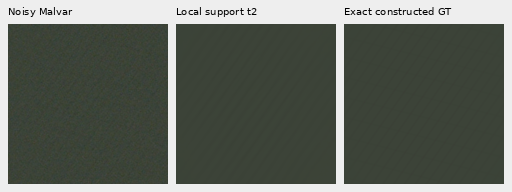
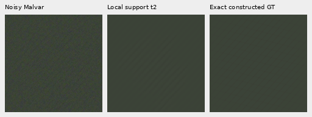
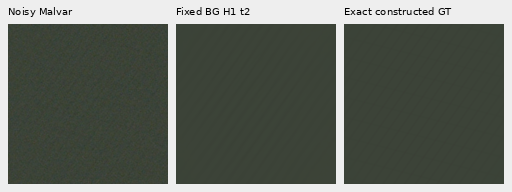
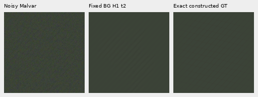
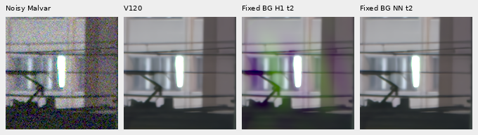
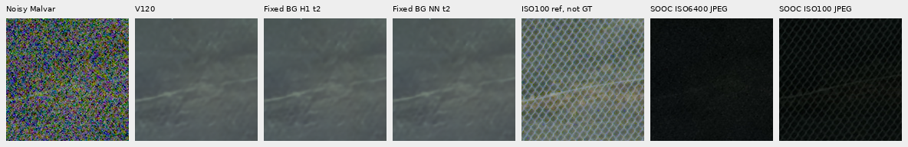

# A global neural background reduces local-fit bands, with a response cost

**Keeping the background coefficients global reduces the neural local-fit
building correction41.87→15.55 DN16 and largely removes its severe colored
bands.** At400/far, weak response falls6.043%→4.695%, while strong response
rises46.992%→51.780%. Weak-increment error increases slightly versus the prior
local fit and remains just below parent. This is a useful stronger-detail
experimental option with explicit noise/error costs; fine real cab crossings
remain missing. V120 remains the general recommendation.

All48 inputs, independent audits and actual inspection of36 figures are
complete. [Native viewer](images/neural-nuisance-fixed-bg129-v1/native-viewer.html) ·
[Exact receipts, executed source and viewing records](results/neural-nuisance-fixed-bg129-v1/publication.json).
This is the same two adaptively reused development sources/RGGB/repeat0,
three priors and near/far placements, not camera-generalization evidence.

|400 / far, local threshold2|Weak response|Strong response|Quiet RMS DN16|Weak-increment RMS DN16|Full RGB RMS DN16|
|---|---:|---:|---:|---:|---:|
|V143 parent|0.958%|33.783%|4.00857|11.78863|21.77841|
|256 fixed-proposal neural|2.690%|41.168%|4.00751|11.82767|21.70476|
|Global-amplitude Hann neural|2.304%|37.565%|4.01108|11.78409|21.73904|
|Local129 nuisance+amplitudes, neural|6.043%|46.992%|4.02525|11.76328|21.67411|
|Global background/local129 amplitudes, neural|4.695%|51.780%|4.02489|11.78246|21.66418|
|Global background/local129 amplitudes, analytic|6.095%|52.052%|4.01513|11.76180|21.66073|

Versus parent, the new neural arm has quiet+0.407% and weak-increment−0.052%.
Source0 weak response rises1.014%→1.440% but increment error worsens
8.82672→8.86744 DN16; source1 rises0.902%→7.949%, with error14.75054→14.69748.
The favorable mean still depends on source1. Relative to256 neural, stronger
responses and lower increment/full errors come with higher quiet error.
Relative to global-amplitude Hann, the building correction and quiet error
increase. None of these operating points dominates every quality measure.

|Prior / placement|New neural weak response|Quiet error vs parent|Weak-increment error vs parent|
|---|---:|---:|---:|
|400 / near|3.563%|+0.0097%|+0.0568%|
|400 / far|4.695%|+0.4070%|−0.0523%|
|1600 / near|4.283%|+0.0005%|+0.1003%|
|1600 / far|0.930%|+0.0595%|+0.2887%|
|6400 / near|0.407%|0|0|
|6400 / far|0.260%|+0.0019%|+0.0157%|

The higher-noise weak component remains largely absent. All six global/local
raw-wave/conditional/neural controls and fixed0/2/4 thresholds remain in the
[quiet](images/neural-nuisance-fixed-bg129-v1/plots/quiet-tradeoff.png) and
[increment](images/neural-nuisance-fixed-bg129-v1/plots/increment-tradeoff.png)
curves. Threshold2 remains the declared comparison; no post-hoc threshold or
window tuning is used.

This changes one coefficient-scope decision from the
[local129 prototype](spatial-carrier-amplitudes.md). The original broad-context
A-only joint WLS operator estimates one affine/step/neural background per color.
Subtract that fixed background on discovery sites, fit only the four carrier
residual coefficients over native129 boxes/stride32, and interpolate them.
Full and direction-null validation predictions share exactly the same global
background. After validation, parent projection uses the identical global
residualization and local operator on the raw-minus-parent RHS. No parent,
withheld values, template or GT enters geometry, nuisance or amplitude fitting.
The neural background field itself remains the original masked A-only field.

Set `LocalWaveConfig(window=512, stride=256, edge_search="full-frame",
frequency_weighting="hann-inverse-variance", amplitude_window=129,
amplitude_nuisance="global")`. `restore_neural_nuisance` uses this with
`reselect_frequencies=False` and two genuine A-only `WithheldBackground` fields.
`restore_conditional_waves` exposes the matched analytic arm without neural
fields; that arm still has severe building artifacts. `amplitude_window=0`
keeps global amplitudes. The producer adds `--amplitude-nuisance global` to the
existing local129 recipe. Source is in the
[operator](../src/demosaic/spatial_carrier_amplitudes.py).

Noisy Malvar → fixed-global-background neural localt2 → exact constructed GT:

Matched analytic arm:

All four native160 crops use512-native400/far two-direction sources0/1,
RGGB/repeat0, ROI`[176,176,160,160]`, exposure2/contrast1, shot/read`8e-5/2.56e-8`,
recipe seed202611160500 and saved per-source WB/matrix. Pixels are never resized.
Configuration/source SHA256:
`7487fb3a27ea73d447a00e63f03e1630bbbe1ba836bd3f965b05a5583d89a737`.
Procedural parent V143:
`96d146d017c54196288c585f8b7eddcf030e8a235061049c31e985b9380b7ce4`.
Photographic parent/frozen background teacher V120:
`a9d9b6b4f974e24a6b11e5e740aab32314233a7f53c056cf37c7d2aac1c589fb`.
Official DINO backbone:
`691963f0f796aac860d818d59d9d14287a4675612829fbe9467c7f5df8ce5b14`.

The analytic arm still produces302.55 DN16 maximum building correction at
`[81,262,160,160]`, with302.49 at the retained prior-failure ROI`[76,260,160,160]`.
Its large green/magenta bands remain clearly visible. This rejects the simple
explanation that local nuisance-coefficient changes alone caused those bands.
The neural maximum is15.55 at`[252,352,160,160]`: much smaller, without proving
real-photo fidelity. Global-amplitude Hann neural remains quieter at1.95 DN16.
These are changes from V120, never real-reference error scores.

Both standing GFX families remain fully represented: DSCF3879/3880 sky,
building, foliage and chain-link fence; DSCF3842/3835 cab mesh, both noise
profiles/left-right ROIs/JPEGs. Sky is quiet, foliage soft and fine crossings
still absent. Cab maximum corrections rise to3.51/4.51 DN16 versus the prior
local-nuisance arm's0.11/0.06, without clear new crossing recovery. ISO100/AHD
references differ in aperture, exposure time and moving subjects; they are
qualitative, **not exact GT**, and receive no pixelwise score. Local caches
only; protected captures/JPEGs/siblings remain outside training, originals
read-only.

All88 closed nuisance fields are adopted exactly: **zero new neural/DINO
forwards**, noise draws, RAW decodes or learned-weight updates. All48 corrections
close before new quality analysis. The independent input audit checks88 fields/
70,778,880 finite FP32 values and exact withholding/imputation fingerprints.
The independent output audit checks3819 fields/228 finite/114 material rows/
14,131,200 encoded channels, maximum discrepancy`3.17e-15`. All36 figures were
actually inspected in eleven unresized contact sheets.167 numerical tests pass,
including independent local SVDs, all four CFA withholding checks, global
nuisance-span invariance and identical parent projection. The standalone
analytic API matches36 saved outputs exactly. CPU correction takes200.64s;
this is a development timing, not a100MP benchmark.

Broader source/CFA/repeat validation is needed to assess whether the stronger
detail tradeoff survives beyond these two sources. Real weak-detail recovery
and reliable nuisance discrimination remain open.
The [full1164-case comparison](global-background-full-panel.md) is complete,
reusing all2320 masked fields and48 exact pilot cases. Versus256 neural,
400/far weak2.299%→2.778% and strong37.032%→48.055% accompany higher mean
quiet/increment errors. All8 sources improve strong response/full RGB error;
added real cab ripples are smaller while fine crossings remain missing.
All68 native figures and paired saved-baseline panels are actually reviewed.
