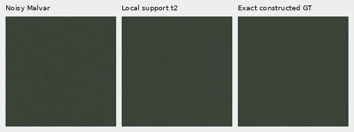
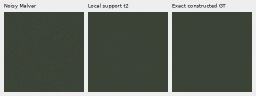
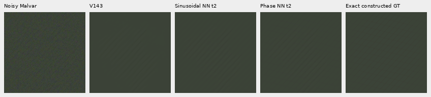
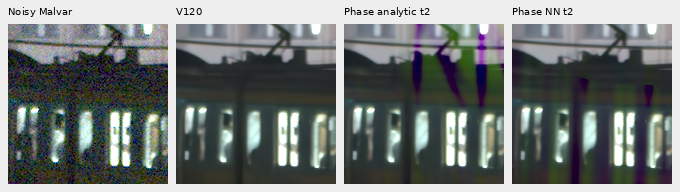
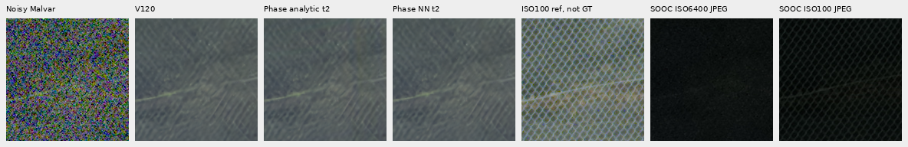

# Phase-aligned measurements above a fixed global background

**Phase reconstruction raises400/far neural weak response4.695%→27.390%, with
gains on both constructed sources, but increases noise/error and real building
artifacts.** Mean quiet error is+2.352% and weak-increment error+0.434% versus
parent. The matched analytic phase arm has28.558% response and−0.539%
increment error, with much worse real bands. Both remain experimental
reconstruction choices; V120 remains the general recommendation.

All48 cases, independent audits and actual inspection of38 figures are
complete. [Native viewer](images/neural-nuisance-phase129-v1/native-viewer.html) ·
[Exact receipts, source and viewing records](results/neural-nuisance-phase129-v1/publication.json).
These are the same two adaptively reused RGGB/repeat0 development sources,
not camera-generalization evidence. This follows the
[fixed-background sinusoidal trial](global-background-local-carriers.md) and
the earlier [phase aggregation trial](phase-measurement-aggregation.md).

|400 / far, local threshold2|Weak response|Strong response|Quiet RMS DN16|Weak-increment RMS DN16|Full RGB RMS DN16|
|---|---:|---:|---:|---:|---:|
|V143 parent|0.958%|33.783%|4.00857|11.78863|21.77841|
|256 fixed-proposal neural|2.690%|41.168%|4.00751|11.82767|21.70476|
|Global-background sinusoidal129 neural|4.695%|51.780%|4.02489|11.78246|21.66418|
|Global-background phase129 neural|27.390%|75.116%|4.10286|11.83984|21.41285|
|Global-background phase129 analytic|28.558%|75.337%|4.04743|11.72513|21.39060|

More response and lower total RGB error do not establish weak-detail fidelity.
Neural weak-orthogonal RMS rises11.38408→11.62419 DN16 versus parent. Source0
response1.014%→22.678% accompanies worse increment error8.82672→9.00268;
source1 response0.902%→32.101% accompanies lower error14.75054→14.67700.
The response gain now spans both sources, while only source1 improves that
error. The analytic arm also worsens source0 increment error8.82672→8.88603,
with a larger source1 improvement14.75054→14.56424. These remain mixed error
tradeoffs rather than broad weak reconstruction gains.

|Prior / placement|Neural phase weak response|Quiet error vs parent|Weak-increment error vs parent|
|---|---:|---:|---:|
|400 / near|3.599%|+0.0304%|+0.2854%|
|400 / far|27.390%|+2.3522%|+0.4344%|
|1600 / near|4.252%|≈0|+0.2026%|
|1600 / far|0.988%|+0.0406%|+0.6403%|
|6400 / near|0.407%|0|0|
|6400 / far|0.269%|0|+0.1623%|

High-noise weak detail remains almost absent. All six modes and fixed0/2/4
thresholds remain in the [quiet](images/neural-nuisance-phase129-v1/plots/quiet-tradeoff.png)
and [increment](images/neural-nuisance-phase129-v1/plots/increment-tradeoff.png)
curves; no post-hoc threshold is selected. Reported cell errors average the
source-level RMS values; full RGB error includes all three roles.

The discovery geometry is unchanged: native512/stride256, full-frame edge
search, Hann/inverse-variance frequency discovery, fixed analytic H1 proposals,
shared whole-context A/B CFA partition and physical shot/read variance proxy.
For each fold/color, the global joint H1 fit supplies background coefficients.
Subtract that background on discovery sites, fit the other direction's two H1
coefficients globally, then reconstruct the residual with local129/stride32
same-color, same-edge-side phase averages. The phase kernel uses32 bins,
linear bin assignments and fixed circular `[1,2,3,2,1]/9` smoothing. Subtracting
the normalized local mean gives a signed detail operator.

Each direction's held-out null is the fixed background plus competing H1 fit;
its full prediction adds only the phase increment. Both folds must support a
matched direction under the existing local/global empirical scores. After
scoring, the identical composite linear map projects the RAW-minus-parent RHS.
No parent, withheld value, template, reference, GT profile or target envelope
enters discovery or fitting. These empirical scores are not calibrated
confidence, and final RGB retains the full-input parent.

The six modes retain raw H1 controls with their own original H1 scores;
`conditional-*` denotes analytic-background phase reconstruction and the
unprefixed modes use the neural nuisance. Fixed thresholds0/2/4 remain visible,
with local threshold2 declared primary. The old sinusoidal129 option fits its
competing direction locally, whereas this phase operator uses a global
competitor. Comparing them changes the complete reconstruction; it cannot
isolate waveform capacity alone.

Use `restore_neural_nuisance(..., reselect_frequencies=False,
aggregation_config=PhaseAggregateConfig(bins=32, window=129, query_stride=32))`
with the geometry above, `amplitude_window=0` and two genuine A-only
`WithheldBackground` fields. The phase option replaces the amplitude model;
it rejects simultaneous local WLS. Omitting it retains existing behavior.
The [operator](../src/demosaic/background_phase_aggregation.py) reads A values
only. Its independent tests check both analytic/neural nuisance spans, all four
CFAs, direct two-stage weighted least squares, actual NaN withholding, linearity,
identical parent projection and nonzero H1 control parity. A noiseless known-
geometry narrow-profile test checks representational capacity, without making
an image-quality claim.

This is the same adaptive two-source RGGB/repeat0 cohort:36 finite roles over
three original priors and near/far placements, plus12 material/protected
contexts. All88 existing nuisance fields are adopted: zero new neural/DINO
forwards, sensor-noise draws, RAW decodes or learned-weight updates. All48
corrections closed before target/reference analysis. Four ADC cases bypass
the correction unchanged. The input audit verifies88 fields/70,778,880 finite
FP32 values, actual withholding and exact imputation/argument fingerprints.

Both standing GFX families remain included: DSCF3879/3880 sky, building,
foliage and coarse fence; DSCF3842/3835 fine cab mesh with both noise profiles,
left/right ROIs and both JPEGs. ISO100/AHD references differ in aperture,
exposure time and moving subjects; they are qualitative, **not exact GT**,
and receive no pixelwise score. Local caches only; captures/JPEGs/siblings stay
outside training and originals remain read-only.

Noisy Malvar → neural phase localt2 → exact constructed GT:

Matched analytic [source0](images/neural-nuisance-phase129-v1/triplets/iso400-index0008-role2-analytic-triplet.png)
and [source1](images/neural-nuisance-phase129-v1/triplets/iso400-index0024-role2-analytic-triplet.png)
triplets are also retained. Direct prior-sinusoidal/current-phase comparisons
use identical pixels and transforms:

All native160 crops use512-native400/far two-direction sources0/1,
ROI`[176,176,160,160]`, RGGB/repeat0, exposure2/contrast1, saved per-source
WB/matrix, shot/read`8e-5/2.56e-8`, recipe seed202611160500. No resizing.
Configuration/source SHA256:
`d0dff7793c6b81034eecf6702e9889c9955824e87765aaf1f05408ebfbcde818`.
Procedural V143 parent:
`96d146d017c54196288c585f8b7eddcf030e8a235061049c31e985b9380b7ce4`.
Photographic V120 parent/frozen background teacher:
`a9d9b6b4f974e24a6b11e5e740aab32314233a7f53c056cf37c7d2aac1c589fb`.
Official DINO backbone:
`691963f0f796aac860d818d59d9d14287a4675612829fbe9467c7f5df8ce5b14`.

The neural building maximum correction rises15.55→75.18 DN16 versus the
previous sinusoidal129 option; current maximum ROI`[21,352,160,160]` shows
clear purple/green bands. Analytic bands grow302.55→531.58 at
`[69,263,160,160]`, with531.38 at the retained historical failure ROI.
These are changes from V120, never reference-error scores. Global nuisance
coefficients alone do not constrain phase reconstruction enough to prevent
the artifact.

Cab maximum corrections are5.32/6.98 DN16 under nominal/profile3879, versus
prior3.51/4.51, without convincing new fine crossings in either left/right
view or profile. Sky stays unchanged; foliage, bark and fur remain soft.
Coarse fence modulation changes, without establishing finer real fidelity.

The independent output audit checks3819 fields/228 finite/114 material rows
and14,131,200 encoded channels, maximum discrepancy`2.95e-15`. All38 published
figures were actually inspected in11 exact, unresized contact sheets.174 exact
receipt/source archives and165 executed source files retain all methods,
thresholds, source errors and viewing notes.95 numerical tests pass, including
the existing local-WLS regressions; strengthened nonzero H1 parity tests also
pass. Two actual whole-context standalone H1 checks match all six controls
exactly. CPU correction takes629.08s with two threads versus200.64s for
sinusoidal129; this is a development timing, not a100MP benchmark. The
higher-capacity operator remains available for further discrimination work,
without replacing the quieter alternatives or claiming resolved fine mesh.

Root: `.cache/experiments/neural-nuisance-phase129-pilot-v1/`.
Frozen plan SHA256:
`fbcee97a2c509d9512dd063c1416e0b83ed4cf4ac9c16852538e017a7d16b31b`.
The [separate full sinusoidal comparison](global-background-full-panel.md)
continues from its original frozen source and owners; this pilot does not
change that run.
