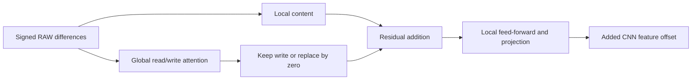

# What V137's trained global memory contributes

**Removing the trained memory write changes only 0.83–1.39% of V137's added
branch-feature offset RMS on six retained training contexts.** The normalized
attention is spatially varying, but the branch's local path dominates this
particular feature output at 1,000 updates. This does not measure the effect
on final RGB, PSNR or the real fence. V120 remains the general recommendation.

[Execution, weights, source and queued comparison](results/v137-memory-contribution-v1.json) ·
[Six-context table](results/v137-memory-contribution-v1.csv) ·
[All 216 probe-gradient rows](results/v137-memory-probe-gradients-v1.csv) ·
[Publication verification](results/v137-memory-contribution-publication-v1.json) ·
[Actual V137 image-quality results and native crops](v137-global-conditioned-quality.md).

## A fixed intervention inside the trained branch

The earlier [conditioning diagnostic](raw-global-conditioning.md) applied the
normalized operator to V136's weights. It showed more varied attention and
stronger query/key gradients, but was an untrained operator counterfactual.
This check instead loads **V137's actual completed 1,000-update EMA**, SHA256
`5f7473dbd040326cdfb1a9cd326571388863024d789651cdc5194cb9d33229dd`.
All four required source modules match the actual trained source byte-for-byte.
The branch has 18 tensors / 18,272 parameters.

Six inputs are reused from that earlier diagnostic: the first two retained
Commons, native and paired batch members at steps 1, 2 and 5. They were selected
without quality outputs or targets. Their stabilized RAW/span arrays were
reconstructed by the earlier CPU diagnostic; they are not asserted bitwise
equal to the original GPU training activations. Six contexts are not six
independent photographs or a representative corpus sample.

For each input, execute the full trained branch once and a second forward that
replaces only `write_out`'s returned context by zeros. The attention arguments,
weights and attention outputs must remain exactly identical. The intervention
occurs after they are computed, before the residual addition and local
feed-forward path. It removes the memory write and its subsequent nonlinear
influence, while keeping the weights and local content path fixed.

Both forwards receive the same already saved Rademacher linear-output probe
backward. It is not a reconstruction-loss gradient. Exactly **12 branch
forwards, 12 backwards and 24 attention softmaxes** execute in CPU IEEE FP32.
There are no full-model/CNN/DINO/VST calls, target reads, new sensor observations,
RAW decodes or optimizer updates. Model weights and Python/NumPy/Torch RNG stay
unchanged; CUDA remains uninitialized. Collection took 9.26 seconds, which is
not a full-image inference benchmark.

## Measured feature effect

`effect = full branch offset − memory-ablated branch offset`.
The percentage is `RMS(effect) / RMS(full offset)`. These are CNN-feature units,
not camera-RGB values. The ratio is **not an additive energy fraction**: the
paths interact and their outputs can correlate or cancel.

| Retained context | Full offset RMS | Removed-write effect RMS | Ratio | Read / write entropy divided by logN |
| --- | ---: | ---: | ---: | --- |
| Commons, step1 member0 |1.32682e−5 |1.10153e−7 |0.830% |0.96562 / 0.90350 |
| Commons, step1 member1 |1.91131e−5 |2.21560e−7 |1.159% |0.96578 / 0.90459 |
| Native, step2 member0 |5.49423e−6 |7.63963e−8 |1.390% |0.97570 / 0.89268 |
| Native, step2 member1 |4.63919e−6 |5.00148e−8 |1.078% |0.98052 / 0.91470 |
| Paired, step5 member0 |7.19027e−6 |9.00816e−8 |1.253% |0.96620 / 0.90630 |
| Paired, step5 member1 |9.88707e−6 |1.37473e−7 |1.390% |0.96536 / 0.91101 |

Entropy/logN equal to one means uniform attention. The trained memory write
is spatially varying: centered-spatial RMS / RMS of its returned context ranges
0.58–0.84 before the later feature projection. Yet its final branch-offset
effect remains small relative to the local bypass on these inputs. Attention
diversity alone therefore does not establish a substantial contribution to
the added feature output.

All 12 memory-path parameter gradients become exactly zero under the ablation;
the six local-path tensors retain a gradient path. Full-branch write-query probe
gradients are around 2.10e−11–1.21e−10, versus local down-projection maxima
5.64e−10–1.86e−9. Different tensors have different coordinates and scales; those
maxima do not by themselves measure useful learning or prescribe an optimizer.
No RGB trunk is executed, so a small feature difference could still be
amplified downstream. The already completed quality review remains the evidence
for the model's small gains, regressions and unresolved real mesh.

## Independent arithmetic and preserved failure

A separate NumPy FP64 implementation checks all **50,331,648 attention weights**
and **3,158,016 weighted output values**, using retained queries, keys and values.
Maximum weight difference is 9.19e−8. Maximum weighted-output difference is
3.16e−6. It also verifies all 18,272 branch-state values against the checkpoint,
reduces 50,331,648 retained offset values and 219,264 gradient values, and checks
354 saved-array scalar reductions within 2.94e−15. Attention statistics from the
independent cosine formula differ by at most 7.02e−7. Complete backward derivatives are not
independently rederived; retained gradient arrays are independently reduced.

The first audit's fixed near-zero absolute output tolerance rejected three of
the first 2,048 weighted sums, with maximum offending difference 8.08e−8.
The original audit source, policy and failure log remain preserved. The corrected
audit separates the independently checked softmax difference from a standard
FP32 weighted-dot accumulation bound based on key count and absolute products,
plus FP64 arithmetic allowance. This handles cancellation without fitting a
wider absolute threshold. The largest observed error is 6.46% of that bound.
The original numerical criterion is not claimed passed, and no measured branch
forward, backward or old control was replayed.

## Prospective V138 comparison

[V138](raw-global-only-training.md) already queues the same normalized branch
with the parent frozen and LR1e−3. Its 1,000-update training and image-quality
review remain pending after V125. The new bounded mechanism companion will
check whether that intervention increases the actual memory-write effect,
using the **same six input/probe hashes** and all saved V137 controls.

The live companion waits for V138's original primary and faint reviews to
complete and their exact owners to exit. It reuses the verified endpoint,
requires the four trained branch source modules to match, and then permits
12 new branch forwards/backwards and 24 softmaxes. It adds no full-model/DINO
calls or training. CPU admission is 40 GiB with a 32 GiB runtime floor; its
absolute deadline remains the original V138 faint-review deadline. There is
no automatic retry or schedule reset. No existing training or 102-input image
review budget changes. Between-model differences also combine freezing and LR,
so neither intervention is isolated by this comparison.

The mechanism result will be read alongside V138's actual native/GFX quality.
An increased memory effect alone will not establish improved images.

As a separate source check on 2026-10-27, the recent
[structural-guided JDD paper](https://arxiv.org/html/2608.09995v1) describes an
online DINOv3 branch with a conditioned SwinIR restoration stream. Its linked
[repository](https://github.com/Calista-pedi/SG-for-JDD) returned 404 through both
web and connected GitHub metadata access. No code or checkpoint was acquired;
this dated observation does not establish permanent unavailability.
[Saved metadata response](results/sg-jdd-availability-20261027-v1.json).
