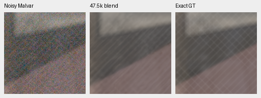
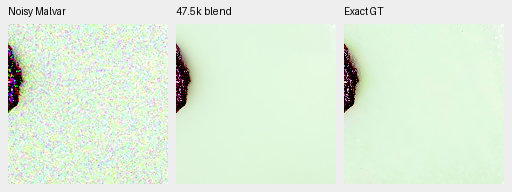
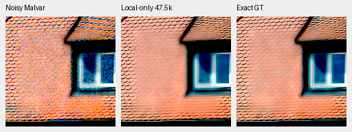

# Phase-aligned green recovery and the matched 47.5k checkpoints

On 24 new ISO6400 photos, the **local-only 47.5k EMA lowers
fine-increment error by 1.73 DN16 and fine-flat error by 1.24 DN16**
versus Corpus 100k. It also lowers absolute error inside exact gaps
on a separate wire panel. Intact-wire error rises slightly and weak
response is uncertain. The matched spatial checkpoint has lower
natural fine response. Neither tested Bayer recovery fitted a
positive coefficient under the development error budgets. The real
fine cab crossings remain incomplete.

[Machine results](results/green-covariance-refit-v1/publication.json) ·
[Frozen drivers and receipts](results/green-covariance-refit-v1/evidence.tar.xz) ·
[Native crop provenance](images/green-covariance-refit-v1/manifest.json).

## Frozen inputs and models

The confirmation uses 24 planted-wire backgrounds and 24 separate
unplanted photos from the cached bin4 validation pool. Source IDs and
decoded pixel hashes are outside the fixed 427-photo panel, prior
wire fit, scene training manifest and 559,808 recorded Corpus 100k
photographic visits. The four Bayer layouts occur six times each per
panel. Each wire geometry uses all layouts across its six cases.
Twelve wire cases have exact gaps. All roles use separate simulated
noise draws at ISO6400, with shot/read `0.00128/6.5536e-6`, capture
×0.33, 16-bit ADC and black level 0.03. The 256-pixel query shares
the same measured exterior across its roles. For the scene intervention
each packed phase grid is reversed and the exact query is reinserted.

| Frozen weights | SHA256 |
| --- | --- |
| V120 EMA | `a9d9b6b4f974e24a6b11e5e740aab32314233a7f53c056cf37c7d2aac1c589fb` |
| Corpus 100k EMA | `87b96f3c487b9edaf1c477742b6c38f2a82cc6b20a94716d51cc8cf46a17a760` |
| Spatial 40k EMA | `d8ba41fa48bab80d515d8248ce6bd787b5347bcd00bcc1816ebbe39ddf52b8ef` |
| Local-only 47.5k EMA | `98b0c71988ff0c9540c9dd310b60cc324ef9642fc9d4c14c35d85b57522dba19` |
| Spatial 47.5k EMA | `11c5940f9ae82d1af07c5d51c4c938dc44182e2aea80a3ea2a6b3710cfc71804` |

The paired training through 47,500 contains 95,000 observations
and 380,000 native queries per arm, including 4,308 distinct
second-pass draws. Both inherit Corpus 100k, use the frozen 50,000-step
schedule and keep DINO unchanged. The original program continues.
The query evaluations run in CUDA IEEE FP32. Forward collection for
the earlier checkpoints takes 94.90 s. The 47.5k query replay including
aligned and reversed contexts takes 68.05 s of wall time, separate from
training and the standing real comparisons.
[Matched training audit](results/scene-full-epoch-v1/paired-prefix-047500.json).

## Directional recovery under error limits

The two green grids are phase-aligned at the actual CFA offsets in
Fourier space. A radial passband rises at 0.055–0.082 and rolls off
at 0.195–0.239 cycles per native pixel. Four overlapping axial
directions separate the response. In each direction the local cross
product measures shared signal, relative to a shot/read noise scale.
Fixed linear alignment keeps the two grids' noise inputs disjoint in
this calculation. The estimator uses reflection padding, local smoothing
and a bounded weight. The inference path also uses full-input neural
predictions, so the gate supplies empirical evidence about the delivered
correction. The four-layout algebra checks reject an opposed green phase
and a constant input, and select the planted direction over its
perpendicular control.

The first recovery shape is the frozen endpoint difference split into
the same four directions. The second is actual measured-minus-restored
green, using the previous damped blend at the measured sites. It aligns the
two residual spectra, interpolates in the observable native band and
suppresses bright clipped neighborhoods. Both deliver neutral luminance
through the same edge taper. Controls use debiased within-grid power, a
90-degree rotation of the registered gate, and uniform weights.

The fit jointly changes the existing damping and the added recovery
gain, using the same 24 development wires and 16 natural triplets at
ISO6400 as the previous study. Eight calibration ceilings cover photo
and wire flat error, both increment errors, and total, strong-band,
weak-band and exterior-only weak-band gap error. The objective maximizes
the smaller normalized recovery across natural and wire response. At
the original damping budget every proposed method selects the old
weights. Giving the endpoint-difference path half of the earlier saved
flat and increment budget also selects zero recovery. Removing any one
gap constraint still gives zero recovery. Removing all four lets the
fit reduce damping and recover about half of its lost response on
development. The new recovery terms still receive zero weight.

The direct measured-green fit has one secondary budget. It may spend
half of any error reduction that damping achieved versus Corpus 100k.
It selects a damping coefficient of `−0.376410` in place of `−0.5`,
with zero added recovery within solver tolerance. A diagnostic applies
a positive green correction at the same 0.0284 DN16 added fine-flat
change on development as easing damping, then evaluates both choices
on the new sources. The tests use frozen weights and a fixed coefficient
for each policy. [Prior damping and true-gap study](scene-mixture-wire-gaps.md).

## Fresh exact-target results

| ISO6400, wire panel | Weak response | Intact error, DN16 | Exact-flat RMS, DN16 | Absolute gap RMS, DN16 | Weak-band gap RMS, DN16 |
| --- | ---: | ---: | ---: | ---: | ---: |
| V120 | 30.679% | 183.603 | 20.755 | 146.212 | 8.478 |
| Corpus 100k | 31.804% | 183.117 | 20.245 | 145.612 | 8.539 |
| Bayer-damped 40k blend | 31.773% | 183.015 | 19.550 | 145.241 | 8.567 |
| Less damping, 40k blend | 31.785% | 183.074 | 19.551 | 145.241 | 8.568 |
| Local-only 47.5k | 31.917% | 183.614 | 19.012 | 144.113 | 8.542 |
| Spatial 47.5k | 31.851% | 183.716 | 19.610 | 144.357 | 8.542 |
| Band-limited 47.5k blend | 31.825% | 183.285 | 19.600 | 145.231 | 8.574 |

The wire increment subtracts the strong-only role and removes the
known tone, edge and strong directional terms. True gaps use exact
zero weak support. On continuous dips the 128-pixel center remains
in the response score because contrast can stay below the intact
shoulder threshold throughout while still containing the weak wire.
Intervals resample individual source photographs.

Relative to Corpus 100k, the local arm lowers true-gap error
1.499 DN16 [0.861, 2.092] and error in the strong wire that continues
through the gap by 2.565 DN16 [0.786, 4.453]. Weak-band gap error
moves +0.003 DN16 with an interval spanning zero. Intact error rises
0.497 DN16 [−0.634, +1.643] and weak response moves +0.113 points
[−0.733, +0.895]. The local gain is clearest in flat regions and where
the continuing strong direction can be judged against an exact target.

The aligned spatial context lowers wire response 0.262 points
[0.098, 0.427] and adds 0.175 DN16 exact-flat variation
[0.025, 0.331] versus its reversed-exterior control. On the natural
photos, the same intervention lowers mean fine-flat error by 0.109 DN16
[−0.035, +0.311] with nearly the same natural fine response. Changing the
blend expert from spatial 40k to spatial 47.5k moves wire weak response
only +0.004 points and adds 0.010 DN16 fine-flat error on the natural
photos. The previous fit coefficients are identical.

| Independent ISO6400, 24 natural photos | Fine-flat RMS, DN16 | Fine-increment RMS, DN16 | Mean per-photo fine response |
| --- | ---: | ---: | ---: |
| V120 | 6.318 | 161.723 | 51.907% |
| Corpus 100k | 5.832 | 160.956 | 52.067% |
| Bayer-damped 40k blend | 5.279 | 160.718 | 51.902% |
| Less damping, 40k blend | 5.332 | 160.757 | 51.934% |
| Local-only 47.5k | 4.589 | 159.222 | 51.926% |
| Spatial 47.5k | 4.654 | 159.270 | 51.701% |
| Band-limited 47.5k blend | 5.515 | 160.887 | 52.031% |

Luma RMS uses the 1/8–1/3 band normalized over the native score
region. Local-only fine error falls 1.734 DN16 [1.088, 2.439]
versus Corpus 100k, with a −0.142-point response change
[−0.640, +0.346]. Easing the earlier damping adds 0.012 wire and
0.032 natural response points. It costs 0.059 DN16 of intact-wire
error and 0.039 DN16 of fine-increment error on natural photos.
The forced green correction at the matched development dose adds
0.007 wire and 0.003 natural response points, with 0.009 DN16 of
wire-increment error. Its rotated and uniform controls are close.

This is a scoped intermediate checkpoint and component review. The
fixed 427 photos and both measured-camera panels are queued for 50k.
[Comparable model history](performance-history.md).

## Native exact-target triplets

Each cell shows 160 × 160 unchanged native pixels at
`[48,48,160,160]` within the supplied query. The noise profile and
capture exposure match the panel above. Every comparison uses the
same display transform.

**Röbersdorf church**, Ermell, CC BY-SA 4.0. BGGR, source box
`[112,378,512,512]`, query `[128,128,256,256]`, display ×2.
The later blend cuts gap error 0.071 DN16 on this witness. The stronger
diagonal remains visible and the weaker family stays soft.
[Source](https://commons.wikimedia.org/wiki/File:R%C3%B6bersdorf_Kirche_2180336.jpg) ·
[Comparison](images/green-covariance-refit-v1/exact/01-wire-iso6400-comparison.png).

**GTE Sylvania SDL145**, Mister rf, CC BY-SA 4.0. BGGR, query
`[586,544,256,256]`, display ×3.0303 and contrast ×2. This is the
largest natural increment regression for the later blend. The nearly
uniform surface looks smooth and the dark edge remains soft.
[Source](https://commons.wikimedia.org/wiki/File:GTE_Sylvania_SDL145.jpg) ·
[Comparison](images/green-covariance-refit-v1/exact/36-natural-iso6400-comparison.png).

**Former rectory**, Stephan van Helden, CC BY-SA 4.0. GRBG, query
`[102,94,256,256]`, display ×3.0303 and contrast ×2. This case has
the largest local-only fine-increment improvement. The roof rows and
window edge hold, with finer tiles still softer than the exact target.
[Source](https://commons.wikimedia.org/wiki/File:D-6-74-163-119_Ehemaliges_Pfarrhaus.jpg) ·
[Comparison](images/green-covariance-refit-v1/exact/47-local-iso6400-comparison.png).

## Standing GFX100S comparisons

All eight boards were viewed at native scale with the same cached
observations, coordinates and transforms. The overcast sky stays
smooth and coarse fence crossings remain coherent. Fine branches
and building wires stay soft. The 47.5k blend changes the four main
crops by 0.310–1.103 DN16 camera-RGB RMS versus the 40k blend.
In the fine cab crops the difference is 0.243–0.991 DN16. The
transferred right diagonals remain the clearest with incomplete
crossings. The ISO100 AHD and camera JPEGs are qualitative references
with aperture, exposure and motion differences.

DSCF3879 uses shot/read `0.00128/6.5536e-6` and display ×4.
DSCF3842 uses display ×16 and either that nominal prior or
`0.0014635775921166604/1.0715704128646712e-6` transferred from
the main capture.

[Sky](images/green-covariance-refit-v1/standing/main-overcast-sky-main-overcast-sky.png) ·
[Building](images/green-covariance-refit-v1/standing/main-building-detail-main-building-detail.png) ·
[Foliage](images/green-covariance-refit-v1/standing/main-foliage-main-foliage.png) ·
[Coarse fence](images/green-covariance-refit-v1/standing/main-chain-link-fence-main-chain-link-fence.png).

| Cab conditioning | Left ROI | Right ROI |
| --- | --- | --- |
| Nominal | [Native board](images/green-covariance-refit-v1/standing/mesh-nominal-fine-green-mesh-left.png) | [Native board](images/green-covariance-refit-v1/standing/mesh-nominal-fine-green-mesh-right.png) |
| Transferred | [Native board](images/green-covariance-refit-v1/standing/mesh-profile3879-fine-green-mesh-left.png) | [Native board](images/green-covariance-refit-v1/standing/mesh-profile3879-fine-green-mesh-right.png) |
