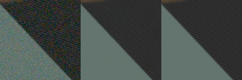
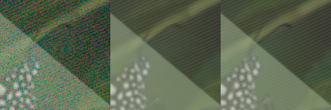

# Local RAW support and exterior phase across gaps

On held-out photographs with a planted weak Bayer alias, fitting phase in
surrounding RAW and checking amplitude locally recovers **43.95%** of the
intact signal, versus **41.32%** from a local free-phase fit and **26.00%**
from a wide fit at strengths calibrated on separate gap scenes. The exterior
fit also adds less flat-core variation than the local fit. It leaves more of
the missing carrier in the exact gap. On the standing GFX100S captures, the
automatic exterior search misses the fine cab frequencies. A second replay
using the existing input-selected cab frequencies brings out both directions,
most clearly on the right, with incomplete and sometimes overly regular
intersections.

[Publication receipt and intervals](results/green-gap-validation-v1/publication.json) ·
[Frozen sources, exact inputs and scoring records](results/green-gap-validation-v1/evidence.tar.xz) ·
[Native crops and camera provenance](images/green-gap-validation-v1/manifest.json).

## Fit and held-out comparison

The experiment uses 32 bin4 validation photographs. All 32 are outside the
90,692-image full-epoch training manifest. Twelve set the output strengths
and 20 measure the result. A low-pass photographic field carries a strong
sinusoid and a weaker sinusoid displaced by half a cycle per native pixel on
one axis. The two share a packed green-plane frequency. Half of the fields
also contain a shared high-contrast step. Separate sensor redraws observe
the weak carrier with a stripe or elliptical gap, the entire weak carrier,
the strong carrier alone, and an exact flat center. Each role has two
independent physical redraws at the ISO6400 recipe.

The regression receives the exact two frequencies for this diagnostic.
Phase, amplitude and gap placement are estimated or withheld from the fit.
The regression uses the measured green sites at their Bayer coordinates and
fits both frequencies with an affine background per Bayer-green phase and
affine modulation of the strong carrier. A four-CFA preflight recovers the
weak component with the competing alias in both orientations and rejects
the same component when the supplied exterior phase is rotated by 90°.
Three fits change the weak proposal only.

- **Wide RAW fit** estimates both phase and amplitude with a 24-native-pixel
  Gaussian standard deviation.
- **Local RAW fit** estimates both with a 9-pixel deviation and a hard
  30-pixel radius.
- **Exterior phase** fits the phase in an annulus outside that radius, with
  a 42-pixel deviation, and estimates the nonnegative amplitude inside the
  30-pixel radius. A rotated phase is a control with the same exterior
  strength. The near and far measurements occupy disjoint pixel sets.

At each fit center, two disjoint checkerboard folds of whole Bayer cells
must agree for delivery. The noise-weighted shrink uses a local average
variance approximation. Real shared readout or errors in the background
fit can affect both folds. The fitted amplitude already present in the
parent is deducted before delivering an achromatic linear correction to
Corpus 100k EMA
`87b96f3c487b9edaf1c477742b6c38f2a82cc6b20a94716d51cc8cf46a17a760`.
The exact targets set the scoring regions and calibrate strength on the
12 calibration photos. The three delivered scales are 0.333872, 1.000000
and 0.786855, respectively, at 7.993 DN16 mean added gap RMS on those photos.
The rotated control uses 0.786855.

| ISO6400 held-out method | Intact response | Unbroken response | Intact increment RMS, DN16 | Added gap RMS, DN16 | Spurious gap response | Added flat RMS, DN16 |
| --- | ---: | ---: | ---: | ---: | ---: | ---: |
| Corpus 100k | 5.64% | 6.18% | 201.459 | 0.000 | 1.63% | 0.000 |
| Wide RAW fit | 26.00% | 31.74% | 195.768 | 8.507 | 8.95% | 0.521 |
| Local RAW fit | 41.32% | 44.43% | 194.008 | 7.113 | 3.96% | 4.696 |
| Exterior phase | 43.95% | 48.29% | 192.855 | 8.000 | 5.41% | 1.667 |
| Rotated exterior phase | 5.87% | 6.31% | 201.503 | 2.254 | 1.98% | 1.415 |

Response is the projection of the restored present-minus-absent pair onto
the exact full weak carrier. The intact and spurious gap columns use fully
present and exactly absent pixels, respectively. Added RMS measures the
correction relative to the same parent. Total gap error is 204.232 DN16
with exterior phase and 203.907 DN16 in the parent. Total exact-flat
error is 25.724 and 25.567 DN16, respectively.

Against the local fit, exterior phase adds **2.62 percentage points**
of intact recovery (paired 95% bootstrap interval **+0.08 to +5.06**)
and reduces intact increment RMS by **1.153 DN16** (**−1.503 to −0.822**).
It adds **0.887 DN16** more gap correction (**−0.080 to +1.907**)
and raises the spurious gap projection by **1.45 points** (**+0.53 to
+2.46**). Added flat RMS falls **3.029 DN16** (**−4.356 to −1.741**).
The extra response comes mostly from elliptical gaps, where the
test-set gap-RMS mismatch is larger. At original strength, the exterior
fit recovers 54.32% against 41.32% locally and adds 10.168 against
7.113 DN16 in gaps. The budget is matched on calibration photos and
the test rows expose the realized tradeoff. A separate reduction
reproduces 384 source-level values from the saved arrays.

### Native exact-target crops

Each row is noisy Malvar, exterior-phase output, then exact constructed
target. Each cell is 160×160 native pixels at `[48,48,160,160]` in its
256-pixel query. Both use repeat 0, shot/read `.00128/6.5536e-6`,
simulated exposure 0.33, and shared WB/matrix, display exposure ×2 and
clipped sRGB. Original image attribution, source box, CFA, sensor seed
and checkpoint are bound in the image manifest.

[Full stripe comparison](images/green-gap-validation-v1/exact/012-gap-comparison.png) ·
[Exact-flat counterpart](images/green-gap-validation-v1/exact/012-flat-comparison.png).

[Full ellipse comparison](images/green-gap-validation-v1/exact/014-gap-comparison.png) ·
[Unbroken counterpart](images/green-gap-validation-v1/exact/014-full-comparison.png).

## Standing GFX100S comparisons

The automatic replay takes two nonparallel principal-band frequencies from
four 128-native-pixel Bayer tiles outside each 256-pixel fit. A proposed
frequency must clear the measured cross-power and signed coherence heuristic
in at least two tiles. These tiles select frequency only. The fit uses the
same 30-pixel local support and exterior phase shape as the planted
diagnostic, with the original calibration scales.

No pair qualifies in the sky. The displayed output is pixel-identical to
Corpus 100k. The coarse fence retains both directions with little visible
change. Foliage stays soft, and changed building tones do not bring back
the finest cables. The automatically selected cab frequencies are dominated
by lower-frequency content. They change the four crops by 0–1.27 camera-linear
RGB DN16 and leave the fine crossings incomplete.

[Overcast sky](images/green-gap-validation-v1/standing-exterior/main-overcast-sky-main-overcast-sky.png) ·
[Building](images/green-gap-validation-v1/standing-exterior/main-building-detail-main-building-detail.png) ·
[Foliage](images/green-gap-validation-v1/standing-exterior/main-foliage-main-foliage.png) ·
[Coarse chain-link fence](images/green-gap-validation-v1/standing-exterior/main-chain-link-fence-main-chain-link-fence.png).

The second replay uses the two pre-existing strong signed peaks from the
same cab's noisy RAW window. The two frequencies were selected within the
fit window in the earlier diagnostic, so this replay shares samples between
frequency selection and estimation. Both directions become visible in more
of the right cab under nominal conditioning. The left gains an uneven
lattice around the post. Some spacing is overly regular, crossings still
break or fade, and the local-only fit gives a similarly visible pattern.
Rotating the exterior phase largely removes the added lattice. This
supports testing frequency search and local support together. The
qualitative reference cannot establish the recovered phase or intersection
positions at individual pixels.
[Earlier input-selected frequency evidence](green-phase-spectrum.md).
The [exterior peak follow-up](donor-peak-prominence.md) finds eligible
nearby donor frequencies on the left cab and insufficient two-tile
evidence on the right.

| GFX cab conditioning | Exterior frequency search | Earlier noisy-RAW frequencies |
| --- | --- | --- |
| Nominal `.00128/6.5536e-6` | [Left](images/green-gap-validation-v1/standing-exterior/mesh-nominal-fine-green-mesh-left.png) · [Right](images/green-gap-validation-v1/standing-exterior/mesh-nominal-fine-green-mesh-right.png) | [Left](images/green-gap-validation-v1/standing-known-cab/mesh-nominal-fine-green-mesh-left.png) · [Right](images/green-gap-validation-v1/standing-known-cab/mesh-nominal-fine-green-mesh-right.png) |
| Transferred `.0014635775921166604/1.0715704128646712e-6` | [Left](images/green-gap-validation-v1/standing-exterior/mesh-profile3879-fine-green-mesh-left.png) · [Right](images/green-gap-validation-v1/standing-exterior/mesh-profile3879-fine-green-mesh-right.png) | [Left](images/green-gap-validation-v1/standing-known-cab/mesh-profile3879-fine-green-mesh-left.png) · [Right](images/green-gap-validation-v1/standing-known-cab/mesh-profile3879-fine-green-mesh-right.png) |

All 12 native boards were viewed. The main DSCF3879 scene uses the
existing exposure ×4 and independent DSCF3880 ISO100 AHD reference. The
DSCF3842 cab uses exposure ×16, DSCF3835 ISO100 AHD and both unchanged
camera JPEGs. References differ in capture settings and are qualitative.
These are scoped inference comparisons above a frozen parent. The
fixed 427-photo and known/unseen camera panels were outside this experiment.
