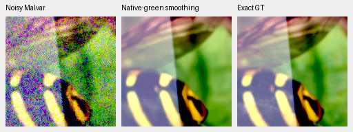
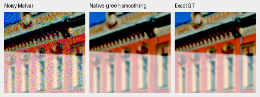

# Mixing the native Bayer green phases in the fine-detail input

Smoothing with closer physical green neighbors retains more of a
planted 0.2-cycle/pixel horizontal-frequency signal than the current
same-phase smoothing. In the full correction, it lowers ISO6400
near-step error by 0.041 DN16 at similar held-out response and raises
whole-core increment error by 0.022 DN16. Fine real cab crossings
remain incomplete.
[Scores, physical checks and native boards](results/green-phase-innovation-v1/publication.json).

## Fixed-checkpoint comparison

The [whole-image gain test](context-strength.md) found little headroom
from scaling the existing fine proposal. This test changes the
proposed signal. It smooths the normalized green Bayer innovation
with one native diagonal step and two-pixel axial steps. The
same-phase control uses the eight neighbors on each packed Bayer
plane, with the same center and neighbor weights. At interior
pixels the two filters have equal squared weight sum, one third.
The red and blue inputs stay identical. Clipped-site protection,
quiet smoothing, the paired network and the parent stay fixed.

On all four CFA layouts, observed white-noise green variance is
0.3325 native and 0.3323 same-phase for a unit-variance input.
The horizontal-frequency test retains 64.54% amplitude versus
39.70% before the head. This measures one direction and frequency.
It does not establish the same transfer for diagonal signals or
reconstructed outputs. The same-phase implementation replay
matches the original head input path exactly.
[Frozen input geometry and checks](results/green-phase-innovation-v1/evidence.tar.xz).

The [48-photo weak-edge panel](weak-edge-distill.md#weak-texture-beside-a-common-edge)
uses both natural and common-step conditions and two independent
physical redraws. The first 24 sources fit one scalar per prior
on common-step crops. The other 24 score both types with the same
scalars. ISO6400 uses 0.879 for the native-green lift and 1 for
the same-phase control. The paired EMA is
`02f8d5e6664bd580bafe2abeb3b8584b070b60bfadfefaff587cadd8bd643d7f`
over Corpus 100k
`87b96f3c487b9edaf1c477742b6c38f2a82cc6b20a94716d51cc8cf46a17a760`.
Scoring all 192 groups took about 50 seconds with saved parents.

## Held-out tradeoff

| Prior and condition | Whole-core increment RMS, DN16 | Near-step increment RMS, DN16 | Near-step absent-detail RMS, DN16 | Aligned response, percentage points |
| --- | ---: | ---: | ---: | ---: |
| ISO1600, common step | +0.052 | −0.039 | −0.056 | +0.029 |
| ISO6400, common step | +0.022 | −0.041 | −0.031 | +0.005 |
| ISO6400, natural | +0.025 | −0.028 | −0.026 | +0.009 |

Rows subtract the same-phase control. On ISO6400 common-step
crops, 95% paired intervals are [+0.013, +0.033] whole-core
and [−0.071, −0.016] near the step. The response interval
is [−0.008, +0.015] percentage points. Exact-flat RMS changes
by less than 0.001 DN16, and repeated-noise variance rises
6.90 DN16². At original strength, near-step increment RMS
rises 0.070 DN16 versus the same-phase lift. Against the
Corpus 100k parent, the matched native-green policy adds
0.200 percentage points of response and reduces exact-flat
RMS by 0.160 DN16, with 0.303 DN16 higher whole-core error.
The change reduces error near the step at this operating point
and remains a mixed reconstruction tradeoff.

### Transfer by frequency and direction

An analytic split of the fine band separates 63 DCT bins where
the native-green input filter passes at least 0.02 more amplitude
from 16 bins where it passes at least 0.02 less. Six bins fall
between them. The input filter predicts different transfer across
the band. On held-out ISO6400 common-step crops, the higher-transfer
bins add 0.027 DN16 increment RMS and 8.24 DN16² of repeat variance.
In those bins, the aligned response difference has a confidence
interval spanning zero. The lower-transfer bins reduce increment
RMS by 0.022 DN16 and lose 0.040 percentage points of aligned
response. Preserving more input amplitude in some orientations
still leaves the frozen head's signal and noise entangled.
[Orientation-stratified measurements](results/green-phase-innovation-v1/orientation-evidence.json).

## Native comparison

The triplets show noisy Malvar, native-green smoothing, and exact GT.
The ISO6400 inputs use shot/read `0.00128/6.5536e-6`, ADC16 black
0.03, capture exposure 0.33, display exposure ×3.0303 and contrast ×2.
Each native 160×160 crop starts at `[48,48]` inside its 256-pixel query.

At the largest near-step improvement, the added edge is
continuous, while fine insect and leaf markings stay soft.
Query origin `[344,114]`, GRBG. Alvesgaspar, CC BY-SA 3.0.
[Source photo](https://commons.wikimedia.org/wiki/File:Hoverfly_December_2007-5.jpg) ·
[All methods](images/green-phase-innovation-v1/026-same-edge-iso6400-r0-role0-comparison.png).

At the largest near-step regression, the overall trim remains
coherent and the finest ornaments and frames are soft.
Query origin `[106,150]`, GRBG. A.Savin, CC BY-SA 3.0.
[Source photo](https://commons.wikimedia.org/wiki/File:Moscow_05-2012_Prechistenka_05.jpg) ·
[All methods](images/green-phase-innovation-v1/046-same-edge-iso6400-r0-role0-comparison.png) ·
[Absent-detail control](images/green-phase-innovation-v1/028-same-edge-iso6400-r0-role1-comparison.png).

### Standing GFX100S comparisons

The sky stays smooth and both coarse-fence directions remain
visible. The thin building wires and fine foliage stay soft.
The cab retains faint diagonals and background mottle in both
profiles. Fine crossings remain incomplete. All eight boards
were viewed at native size against V120, Corpus 100k, same-phase
smoothing and the independently captured references.

The main ROI is `[176,176,160,160]` in each 512-pixel query,
at display exposure ×4 and nominal shot/read `0.00128/6.5536e-6`.
Cab ROIs are `[206,229,160,160]` and `[426,189,160,160]`
in the 768-pixel context, at display exposure ×16. The transferred
profile uses `0.0014635775921166604/1.0715704128646712e-6`.
ISO100 AHD and the camera JPEGs are qualitative references.
[Sky](images/green-phase-innovation-v1/main-overcast-sky-main-overcast-sky.png) ·
[Building](images/green-phase-innovation-v1/main-building-detail-main-building-detail.png) ·
[Foliage](images/green-phase-innovation-v1/main-foliage-main-foliage.png) ·
[Coarse fence](images/green-phase-innovation-v1/main-chain-link-fence-main-chain-link-fence.png) ·
[Nominal left](images/green-phase-innovation-v1/mesh-nominal-fine-green-mesh-left.png) ·
[Nominal right](images/green-phase-innovation-v1/mesh-nominal-fine-green-mesh-right.png) ·
[Transferred left](images/green-phase-innovation-v1/mesh-profile3879-fine-green-mesh-left.png) ·
[Transferred right](images/green-phase-innovation-v1/mesh-profile3879-fine-green-mesh-right.png).

## Restricting the change to quieter bands on separate photos

A follow-up keeps the same-phase lift and adds part of the difference
from native-green smoothing. A reflect-padded Fourier taper keeps either
the bands where the native filter has lower input transfer or the bands
where it has higher transfer. The [separate 64-photo panel](context-strength.md)
uses 32 photos to match response on coupled inputs and the other 32 to
score both draw laws. The parent, paired EMA and quiet path above
remain fixed. All 256 groups were scored with cached parent RGB.

At ISO6400 with independent draws, the lower-transfer route reduces
absent-detail RMS by 0.0023 DN16 [−0.0035, −0.0013]. Its true
increment RMS difference is +0.0015 DN16 [−0.0007, +0.0040],
versus +0.0179 DN16 with the full native-green change. The coupled
increment difference is +0.0020 DN16. At ISO400, the lower-transfer
route improves coupled increment RMS by 0.0027 DN16, with an
interval spanning zero under independent noise. Restricting the
change removes most of the all-band penalty, with little effect
on delivered weak detail.
[Numbers, source and viewing record](results/green-transfer-band-v1/publication.json).

The two native triplets reuse `[48,48,160,160]` within the 256-pixel
query, ISO6400 shot/read `0.00128/6.5536e-6`, ADC16 black 0.03,
display exposure ×3.0303 and contrast ×2. The Bush Hopper crop is
`[34,346]`, BGGR, Sandipoutsider, CC BY-SA 4.0. The Calocochlia
crop is `[756,396]`, GRBG, H. Zell, CC BY-SA 3.0. Wing, leaf and
shell detail remain soft. Both standing GFX families and all eight
boards were inspected at the same coordinates and exposure as above.
Fine cab crossings remain incomplete.
[Bush Hopper triplet](images/green-transfer-band-v1/045-iso6400-independent-role0-triplet.png) ·
[Calocochlia triplet](images/green-transfer-band-v1/042-iso6400-independent-role0-triplet.png) ·
[Standing sky](images/green-transfer-band-v1/main-overcast-sky-main-overcast-sky.png) ·
[Transferred right cab](images/green-transfer-band-v1/mesh-profile3879-fine-green-mesh-right.png).
