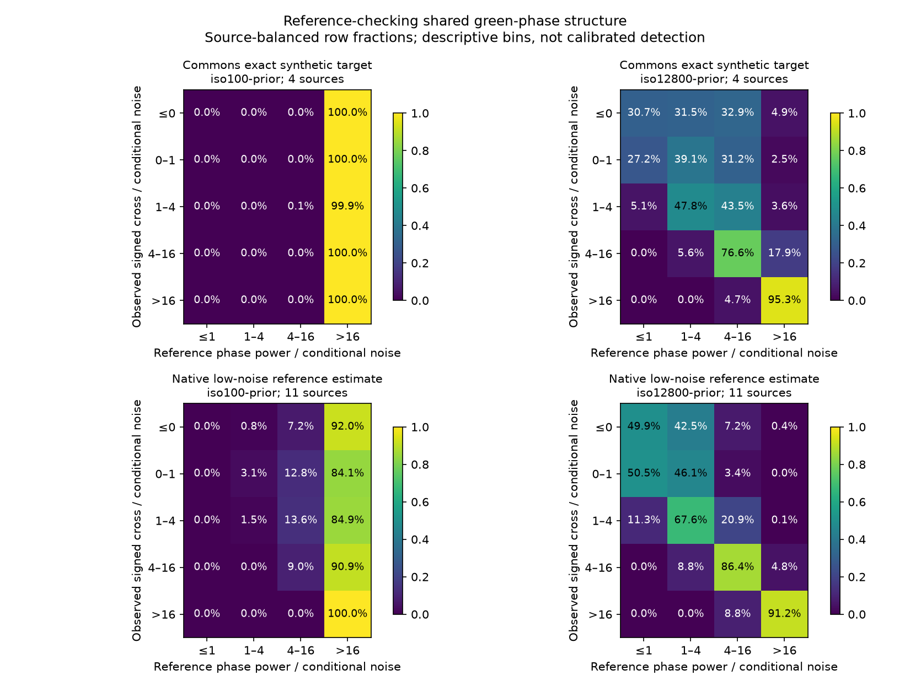
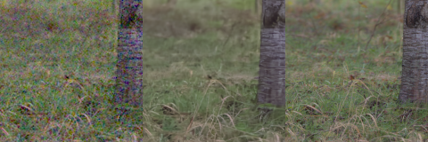
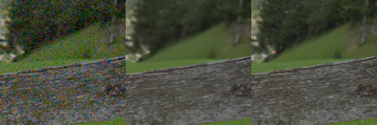

# Checking green-phase evidence against photographic references

**Strong positive green-phase peaks track reference structure in these retained
photos, but negative cross-power also occurs at many reference-supported
frequencies.** Positive agreement can describe a coherent pattern such as the
[train fence](green-phase-spectrum.md); it cannot safely define a universal
detail-preservation mask. This is an input/reference diagnostic, with no new
model result or inference correction.

The check uses168 existing positive-noise observations: four Commons material
photos at two conditions, plus20 native-camera regions from11 captures at two
conditions/four CFAs. There are15 source captures and24 contexts, not168
independent photographs. Commons targets are exact for the synthetic task.
Native references are binned low-noise camera-RGB estimates, **not exact
noiseless GT** or real high-ISO observations.

[Protocol, results, independent arithmetic and actual viewing](results/green-phase-reference-v1.json) ·
[Commons material support](heldout-detail.md) ·
[Native-camera sources and limitations](native-camera-development.md).

## What the statistic captures and misses

The figure groups frequencies by observed signed cross-power and reference
phase power, normalized by the saved conditional variance proxy. Each row
first pools repeated CFAs/regions inside a capture, then weights contributing
captures equally. All sources contribute to every displayed row. Bins are
descriptive ranges, **not calibrated confidence or detection thresholds**.

[Standalone PDF](images/green-phase-reference-v1/reference-check.pdf).
At the high-noise prior, most strong positive values correspond to appreciable
reference power. Across704 input-selected positive peaks with cross/noise>4,
none has reference phase-power/noise≤1. That finite selected result does not
establish a false-discovery rate or correctness for other inputs. Small positive
cross values mix weak reference structure and residual/interference effects.

An exploratory follow-up asks, among bins with reference phase-power/noise≥4,
how often cross-power is nonpositive:

| Support | Noise prior | Nonpositive observed cross | Nonpositive reference-only cross |
| --- | --- | ---: | ---: |
| Four Commons sources | ISO100 |22.08% |22.01% |
| Four Commons sources | ISO12800 |11.12% |10.36% |
| Eleven native captures | ISO100 |22.33% |22.24% |
| Eleven native captures | ISO12800 |9.05% |8.42% |

These are source-balanced fractions of supported **spectral bins**, not fractions
of image pixels, signal energy or recoverable detail. The reference column is
computed without the added noisy residual. Negative cross-power cannot simply
be interpreted as absent structure or attributed to added noise. Aliasing, real
differences between sampled green phases and finite-window phase compensation
can contribute; this check does not isolate their causes. The deterministic
alias/phase-null tests provide explicit counterexamples separately.

This supports retaining signed sampling-phase information when investigating
learned frequency features. It argues against forcing a positive-only mask or
increasing the earlier fixed MHC correction. It establishes no particular new
architecture, quality gain or replacement for the ongoing V120/V121 data trials.

## Fixed math and reference split

The unchanged256px contexts provide128×128 packed green planes. Weighted affine
removal, Hann taper, orthonormal FFT, displacement compensation,3×3 frequency
averaging and native radial1/16–1/3 band match the fence diagnostic. Conditional
independent-noise propagation includes the fitted plane. The saved variance is
an observed-signal proxy, not known camera noise truth. No profile, window,
reference or output is fitted.

For observed spectra `O=S+E`, with sampled reference `S` and residual `E`,
cross-power splits exactly into:

`O0*conj(O1) = S0*conj(S1) + E0*conj(E1) + S0*conj(E1) + E0*conj(S1)`.

The same alignment, averaging and normalization apply to every term. Mixed
terms can reinforce or cancel reference structure. The identity needs no
independence assumption; it does **not** prove unbiasedness. Here `E` may include
ADC quantization/clipping or reference mismatch as well as added noise. Every
case retains reference/residual/mixed maps and input-selected peaks. Selections
are saved before reference arrays are accessed.

The existing priors are shot/read2e−5/1.6e−9 and.00256/.0000262144. ADC-only
normalization is omitted because its supplied variance is zero. Hann bins and
neighboring frequencies are correlated; there is one retained realization per
context/condition/CFA and no new random draw.

## Native context and verification

These existing native160px strips show noisy Malvar → V119 → low-noise estimate
at the ISO12800 prior, with unchanged pixels and shared exposure×1/WB/matrix.
They illustrate grass/root and weathered-rail structure; they do not isolate
individual frequency bins or show a new method.

[Source/ROI/checkpoint/noise/display/license metadata](images/native-camera-development-comparison-v1/manifest.json).
Both strips and the diagnostic plot were actually viewed. Fine grass/wood grain
remains softer than the reference. No model checkpoint is reopened or executed.

The [NumPy split](../scripts/green_phase_spectrum.py) and
[saved-input runner](../scripts/report_green_phase_reference.py) pass24 focused
tests, including five new decomposition fixtures and two sampling/source-weighting
checks. Independent explicit Fourier rows, without FFT or diagnostic imports,
compute6,048 complex coefficients and3,024 conditional variance rows at the
first input-selected frequency of all168 cases, checking840 scalar values.
Maximum discrepancy divided by `max(1,abs(recorded value))` is below5e−12.
Boolean interval counts reproduce3,360 histogram cells exactly; all80 balanced
fraction cells agree. The full-map decomposition's maximum error relative to
component scale is6.52e−16. Neural/camera libraries are absent from both numerical
processes. Previous predictions, captures, source memberships and active frozen
training/evaluation workers remain unchanged.
