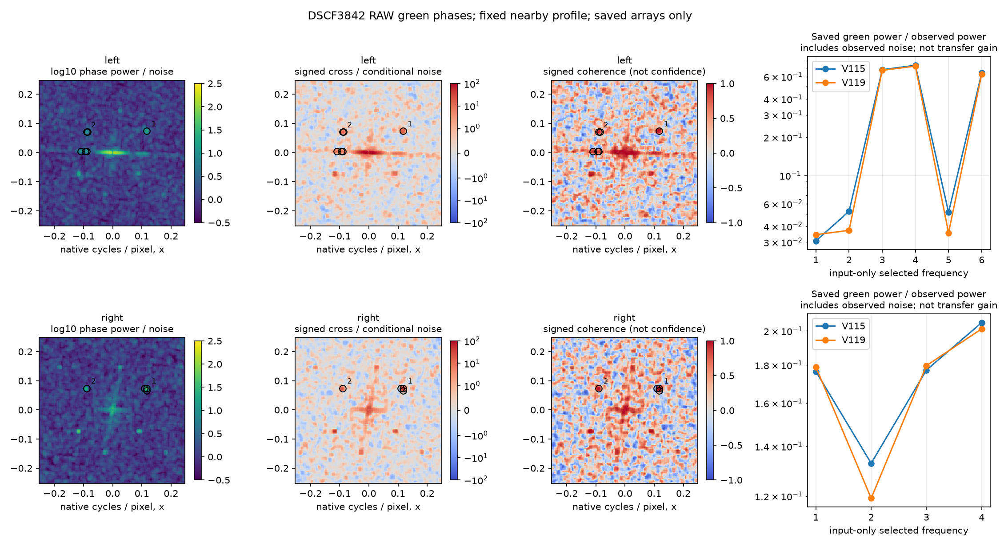

# What remains in the measured green phases

**The extra DSCF3842 fence has matching diagonal frequency peaks in both measured
green Bayer planes, while saved V115/V119 outputs contain much less power there.**
This supports the visible loss of weak mesh structure. It does not supply a
safe reconstruction rule or establish exact mesh recovery. No new model,
restoration, noise realization, RAW decode or training is used in this diagnostic.
The corrected reference is **DSCF3835 ISO100**, an independent exposure, not GT.

[Sources, native comparisons and conditioning](gfx-green-mesh.md) ·
[Frozen plan, numerical results, independent check and publication bindings](results/green-phase-cross-spectrum-v1.json).

## Measured result

Two fixed256px windows surround the existing160px mesh regions. Frequencies are
selected from the noisy RAW alone, before accessing predictions or reference
arrays. The table shows the first two cross-power selections per window; the
receipt retains all ten selections, including less diagonal structure on the left.

| Window / selection | Native frequency `(fx,fy)` | Cross/noise | Signed coherence | V115 power / noisy power | V119 power / noisy power |
| --- | --- | ---: | ---: | ---: | ---: |
| Left1 |(.1171875,.07421875) |20.123 |.9642 |3.06% |3.43% |
| Left2 |(−.08984375,.0703125) |10.479 |.9333 |5.24% |3.71% |
| Right1 |(.1171875,.07421875) |49.980 |.9884 |17.65% |17.89% |
| Right2 |(−.08984375,.07421875) |24.567 |.9782 |13.28% |11.92% |

Cross/noise uses the unchanged nearby3879 variance proxy, propagated through
the plane fit and taper. It is **not a calibrated significance statistic**.
Output ratios compare green-channel Fourier power at the same sampled physical
sites, window and frequencies. Their denominator includes observed noise; these
are descriptive power ratios, **not signal-transfer gains or quality scores**.
V119 is slightly higher on one frequency family and lower on the other; this
does not demonstrate a lattice-recovery improvement over V115.

[Standalone PDF](images/green-phase-cross-spectrum-v1/phase-diagnostic.pdf).
Plot pixels show frequency bins, not photograph crops. Both rows use the same
color limits. Circles mark all selected bins; labels1/2 identify the table's
first two selections. Nearby bins are correlated, not independent detections.

The retained native160px V119 triplets below share +4EV display. They show noisy
Malvar, V119 with the fixed nearby profile, and independent DSCF3835 ISO100 AHD.
The reference's aperture, exposure time and capture time differ; it is **not GT**.

[Native ROI/checkpoint/conditioning/display metadata](images/v119-green-mesh-v1/manifest.json) ·
[Matched V114/V115/V119 board](images/v119-green-mesh-v1/profile3879-comparison-2EV.png).
The plot, both triplets and matched board were actually viewed. The faint soft
diagonals, lost lattice and small blue point remain visible in the saved outputs.

## Method and limitations

The two green samples in each2×2 RGGB cell lie at different physical coordinates.
For each128×128 packed plane, subtract a weighted affine fit with
`Q=[1,x,y]`, weights `Hann²`, then apply the separable Hann taper and orthonormal
FFT. Multiply `F0*conj(F1)` by
`exp(2πi * f_native · (offset1-offset0))` to compensate their displacement in the
principal packed-grid band. Average cross/power over3×3 frequency bins. Propagate
the supplied independent variances through the **entire fitted-plane operator**;
using only mean input variance would omit the fit's effect at low frequencies.

Uncorrelated-noise cross spectra are an established measurement principle;
[Fleming, Ninness and Wills (2013)](https://pubmed.ncbi.nlm.nih.gov/24007112/)
describe recovery from two noisy sensor measurements. Our Bayer phases are
separated samples rather than identical colocated measurements. Applying phase
compensation here is a diagnostic approximation with additional sampling limits:

- Above a green plane's Nyquist frequency, genuine signal can produce negative
  aligned cross-power. A native four-pixel carrier at a particular phase can
  vanish in one green plane altogether. Deterministic checks demonstrate both
  effects for all four Bayer layouts.
- Correlated electronics noise, unequal green responses, window leakage and
  data-dependent variance proxies can bias the interpretation. The fixed nearby
  profile is not dedicated camera flat/dark calibration.
- A Hann window and3×3 average do not yield nine independent observations.
  Signed coherence is bounded, but is neither a confidence probability nor an
  all-frequency signal detector. No threshold, parameter sweep or fitted
  reference-dependent selection is introduced.
- The independent ISO100 AHD array provides only spectral context, normalized by
  its own local mean. Its power ratio is retained in the receipt, without a GT,
  SNR, correct-detail or pixelwise-score interpretation.

The earlier [shared-power spectral head](spectral-photo-components.md) and
[its window dependence](spectral-operator-context.md) already show that a strong
fixed MHC correction can introduce grids and color errors. This result does not
justify increasing that gate. It identifies shared RAW structure worth checking
in future phase-aware reconstruction work after the current data trials.

## Reproduction and checks

Inputs are the retained768px DSCF3842 context `[600,6260,768,768]`, with the
unchanged nearby3879 profile: shot `.0014635775921166604`, read variance
`1.0715704128646712e-6`. Global diagnostic windows are
`[758,6440,256,256]` and `[978,6400,256,256]`. Their centers follow the existing
ROIs, rounded down to even Bayer origins. No window/profile sweep is performed.

The fixed input-only rule takes the union of four largest absolute signed
cross/noise bins and four largest phase-power/noise bins, within native radial
frequencies1/16–1/3 cycles/pixel and one conjugate half-plane. Each ranking uses
3×3 nonmaximum suppression, also suppressing the conjugate neighborhood.

V115 checkpoint SHA256:
`fee5d05c599cb32f5a1e587c31979f040a06152c8e14676481eee83a4ce04d84`.
V119 checkpoint SHA256:
`b3c0d43264c6ad8446dd930aafa337298e4690d0d08f2967824f03ecd844f427`.
Both predictions are previously completed CPU FP32 nearby-profile outputs.
Neither checkpoint is reopened. Captures and siblings remain held out.

The NumPy implementation is in
[`green_phase_spectrum.py`](../scripts/green_phase_spectrum.py); the saved-array
runner is [`report_green_phase_spectrum.py`](../scripts/report_green_phase_spectrum.py).
Seventeen mathematical tests cover independent dense-DFT/noise propagation,
affine removal, phase alignment, aliases and phase-null counterexamples.
With the existing camera-coordinate checks, **19 tests pass**.

A separate implementation uses explicit complex Fourier rows, rather than FFTs
or the diagnostic module, to compute720 neighboring complex coefficients
across four fields. It checks40 averaged complex cross values,180 conditional
noise-variance values and60 reported scalar metrics. Maximum metric difference
is below `5.87e-14`. No neural or camera library is
imported in either numerical execution. The initial launcher failed at import
before reading arrays; that failure is preserved. The publication figure is
rendered from the saved spectra, correcting half-bin plot edges and sharing
color limits without recomputing the diagnostic or any restoration.
