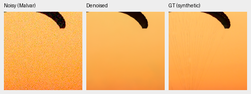
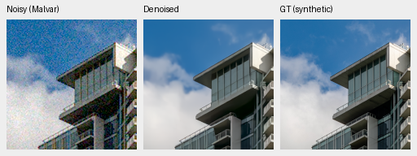
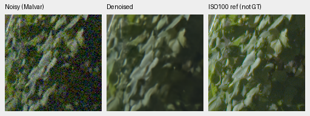
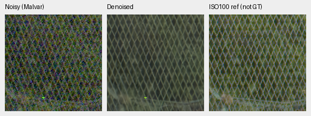

# Guarded input-CFA gain: rejected CPU pilot

The new guarded policy fails its fixed high-saturation screen. Do not extend it
to the full photographic benchmark, tune it against these results, or use it in
inference. This is a separate method from the already
[rejected unmasked gain](mature-input-cfa-gain.md); that rejection is unchanged.
No model was trained or forwarded for this pilot. All calculations use verified
saved genuine V63 original20k predictions and their original observations.

The [complete registry](results/guarded-CFA-gain-pilot-v1.json) records the frozen
plan, executed sources, pixel/fit audits, native PNG metadata, and actual view
receipt. Plan SHA256:
`72049d1e30d1f5ac05bd5ba5cdb6209f992d7fddda2819053fc20c39b3f6cf7f`.
Parent checkpoint SHA256:
`ed70952dd33c5d7da39199bf1306b58b579862920fb0cccd6b222f19871bc9b5`.

## Fixed policy and screen

Fit one multiplicative gain per camera channel using only prediction, input CFA,
and camera/noise conditioning. Require positive predicted linear-sRGB channels
with maximum below .90; predicted CFA must lie above
`4 * input_sigma + 1/65535` and below `1 -` that margin. Observed CFA must be
below `1 - 1/65535`; negative signed samples remain eligible. Require 256 samples
per channel, positive numerator and denominator at least `1e-12`, otherwise use
identity. Cap gains to [.95, 1.05]. A common continuous application weight is one
below linear-sRGB maximum .90 and falls to zero at .98. Fit/multiply in FP64,
then return FP32. Neither GT nor display exposure enters the fit.

Before outputs, the plan required at least 25% lower mean maximum-channel bias
for **both** high-noise, peak .90 saturation groups, no increase in their worst
case, and no other group mean increase above .001. It also required unchanged
perfect-target oracles, independent arithmetic and native photo/GFX review.

| High-noise saturation | Mean bias, parent → guarded | Worst bias, parent → guarded | Screen |
| --- | --- | --- | --- |
| .50 | .01435008 → .00719477 | .05754835 → .03136327 | Pass |
| .98 | .00573934 → .00677505 | .03997871 → .04301730 | **Fail** |

The latter mean grows 18.05%. These are the fixed 147-color × two-noise ×
four-CFA cases, with unchanged native256 predictions. All 14 selected color
triplets/28 unique native cells were actually viewed on the
[color board](images/guarded-gain-v1-grid-native.png).

An analytical noiseless oracle deliberately supplies a perfect canonical
reference-white prediction. The unmasked policy then introduces .04249619 MSE,
while this guarded policy preserves it exactly for all four CFAs. This explains
a target-compatibility problem in that fixture; it does not make the guarded
policy photographically successful or quantify causes of learned-model errors.

## Native photographic examples

Each panel below contains the same native160×160 pixels: noisy Malvar,
guarded V63, exact synthetic GT. No crop pixels are resized. Open the original
PNG at 100%; previews use 8-bit sRGB, while scores use unquantized camera RGB.
The [complete photo board](images/guarded-gain-v1-photos-native.png) includes
the matched parent rows. All four triplets/eight unique cells were viewed.

[Swiss Riviera](https://commons.wikimedia.org/wiki/File:CH.VD.Villeneuve_2007-08-25_Vertigo-Swiss-Riviera_2392_3x2-R_4K.jpg),
Roy Egloff, CC BY-SA 4.0; source ID `0014aa4e075b1827f91ef8a02069e1e318f040ba`.
In the 8× cache, context `[189,3,256,256]`, displayed ROI `[237,51,160,160]`.
Selected canopy sRGB PSNR changes 33.09372 → 36.41374 dB. Broad color improves;
fine cords/detail remain missing. This selected example is not a population gain.

[Vancouver](https://commons.wikimedia.org/wiki/File:Vancouver_(BC,_Canada),_Coal_Harbour_Seaside_Park,_Blick_in_den_Himmel_--_2022_--_2158.jpg),
Dietmar Rabich, CC BY-SA 4.0; source ID `002fc6eeadf637e81d5a327f117b79abb86becd9`.
Context `[195,89,256,256]`, ROI `[243,137,160,160]`.
Building sRGB PSNR changes 35.38537 → 35.38358 dB; appearance remains close.

Both use RGGB, shot .00256, read variance .0000262144, WB [2,1,1.5], display
exposure 1. Camera matrices and all hashes are in the registry. These are fixed
**CPU-generated** noisy observations with saved genuine GPU FP32 predictions;
they differ from the full427 CUDA noise realization. They cannot be substituted
for full427 results. Derived crops are provided under the sources'
[CC BY-SA 4.0](https://creativecommons.org/licenses/by-sa/4.0/) license.

## Standing GFX scene

Fit globally on the saved full101.996MP V63 FP32 output; gains are
[.9977769251, .9999137952, .9928953414]. All 305,987,556 corrected RGB values
are finite and independently replayed, maximum absolute difference 7.45e-9.
This produces no new full-frame export or timing measurement.

The cached DSCF3879 ISO6400/f1.7/1/240 exposure and DSCF3880
ISO100/f5.6/3s exposure differ in aperture and moving subjects. The latter is
an independently demosaiced qualitative reference, **not exact GT**. No source
RAFs were read from the original drives or modified. Neither capture nor its
siblings enters training.

Native160px noisy/reference ROI origins are foliage [8890,5570]/[8890,5570],
fence [2240,6000]/[2241,6000]. Common display is +2EV; shot
.0014635775921166604, read variance 1.0715704128646712e-6,
WB [1.5132450331,1,2.2152317881]. The registry contains RAW/output hashes,
matrix, alignment and original512/64 restore provenance. The
[GFX board](images/guarded-gain-v1-gfx-native.png) also includes sky, building,
sign and platform: all 12 triplets/24 unique cells were actually viewed.
The prior purple cast is avoided, but soft foliage/fence and clipped lights
remain. No broad detail repair or real-photo superiority is established.

Thirty triplets/60 unique native cells were reviewed across the three boards.
The failed color screen closes this policy. The separate
[camera-target convention audit](camera-supervision-v76-v77.md) motivates a
training experiment; it does not reopen either gain policy.
