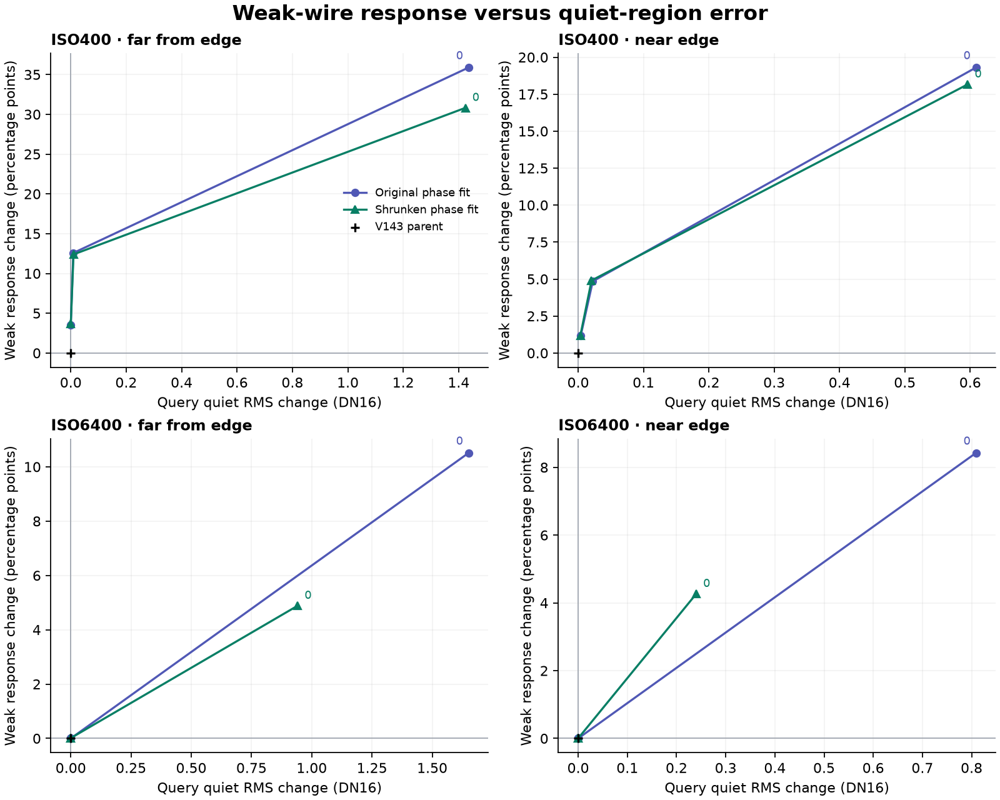
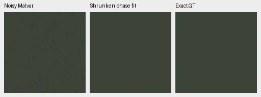
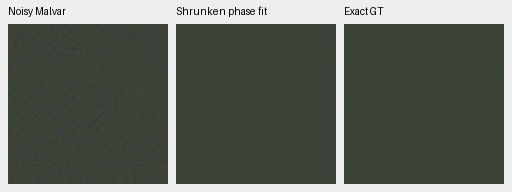

# Discovery-only shrinkage for guided RAW phase fits

At ISO6400, shrinking the highest-response phase fit makes flat areas quieter
and lowers weak-increment error in all eight synthetic geometries. It also
attenuates real wire signal. At the conservative thresholds, the weak
direction stays close to the parent. The standing sky and building receive
zero correction, while fine cab crossings remain unresolved.
[Results and exact receipts](results/phase-fit-shrinkage-probe-v1/publication.json).

## What the test measures

The [phase-profile study](guided-phase-profiles.md) found that a guide can
identify where to search for a wire, while the query can still be too noisy
to recover its waveform. Eight circular phase knots give each direction
seven free coefficients per color. Under high sensor noise, the fitted shape
can have enough excess energy to predict the held-out samples poorly even
if a smaller version would improve the prediction.

For each color and direction, the test computes the variance-weighted
energy `E` of the difference between the full fit and its conditional null
on the discovery fold. It applies `max(0, 1 − 7/E)` to the difference before
scoring it on the opposite fold. The zero-energy case returns zero.
Both folds still need local predictive support. The delivered correction
from each fold is also multiplied by its own factor. Seven is the nominal
number of fit coefficients. The fitted variance and the searched nuisance
edge make this an approximate estimate of the amount of supported signal.
[Operator](../src/demosaic/local_validated_waves.py).

The new arm reuses the 384 query views from 128 procedural cases. Those
cases cover eight geometries, four Bayer layouts, two noise profiles and
two distances from the nuisance edge. Phase fits run on the same 256×256
query windows, with the same guides and fixed thresholds of 0, 2 and 4.
The V143, sine and original phase outputs are reused byte for byte.
The quiet error is measured in the existing quiet mask within the query.
The increment error compares the two-direction result minus its weak-absent
counterpart against the exact RGB difference across the 512×512 field.
The weak-absent projection tests whether the error follows the missing
wire's template.

## Fixed threshold results

The table averages four Bayer layouts per geometry and then eight geometries.
DN16 is 65,535 times the error in camera-linear RGB. Weak response is the
projection of the restored difference onto the exact weak-wire difference.

| Noise and position | Method | Weak response | Weak-increment RMS DN16 | Quiet RMS DN16 |
| --- | --- | ---: | ---: | ---: |
| ISO6400 far | V143 | 1.073% | 22.408 | 6.698 |
| ISO6400 far | Phase bins, t0 | 11.582% | 22.761 | 8.349 |
| ISO6400 far | Shrunken fit, t0 | 5.958% | 22.570 | 7.640 |
| ISO6400 far | Phase bins, t2 | 1.073% | 22.429 | 6.698 |
| ISO6400 far | Shrunken fit, t2 | 1.086% | 22.426 | 6.698 |
| ISO6400 near | V143 | 2.761% | 30.786 | 22.819 |
| ISO6400 near | Phase bins, t0 | 11.185% | 31.102 | 23.628 |
| ISO6400 near | Shrunken fit, t0 | 7.027% | 30.905 | 23.059 |
| ISO400 far | V143 | 1.755% | 10.09691 | 2.49165 |
| ISO400 far | Phase bins, t2 | 14.330% | 10.03998 | 2.50075 |
| ISO400 far | Shrunken fit, t2 | 14.149% | 10.03973 | 2.50143 |

At ISO6400 and threshold 0, mean absolute projection onto the absent wire
falls from 1.72% to 1.02% far from the edge and from 5.21% to 3.84% near it.
The parent measures 0.58% and 4.52% respectively. The mean full query RMS
also falls slightly with shrinkage. Quiet and increment RMS remain above the
parent. At threshold 2, the far strong-direction response is 8.30% versus
8.10% for the original fit, with little weak-direction change. Roughly
43% of the per-fold, per-color direction weights are zero at ISO6400,
compared with 19% at ISO400. The shrinkage helps limit the effect of noisy
fits. Recovering crossings at the same quiet error remains the open test.
[Paired geometry deltas](results/phase-fit-shrinkage-probe-v1/paired-summary.json).

Each panel shows the three tested thresholds. The point marked 0 uses the
least restrictive held-out gate. Axis scales vary between panels.

## ISO6400 at equal measured quiet error

For each geometry at threshold 0, a single scalar attenuates the unshrunk
correction equally across every pixel, color, and role. The scalar makes
its quiet RMS equal to the shrunken fit's across all four Bayer layouts.
All 16 geometry and edge-distance pairs admit a match. The calculation
uses the exact targets to choose the scalar, so it measures the tradeoff
possible with uniform attenuation on this panel. The table averages the
eight geometry values. Here each geometry's RMS comes from pooled CFA
MSE, so the means can differ slightly from the fixed-threshold table.

| Edge distance | Treatment | Weak response | Strong response | Weak-increment RMS DN16 | Mean absolute absent projection |
| --- | --- | ---: | ---: | ---: | ---: |
| Far, quiet RMS 7.680 | Uniform attenuation | 8.424% | 27.560% | 22.621 | 1.278% |
| Far, quiet RMS 7.680 | Discovery-only shrinkage | 5.958% | 29.798% | 22.596 | 1.024% |
| Near, quiet RMS 23.136 | Uniform attenuation | 7.729% | 15.591% | 30.916 | 4.129% |
| Near, quiet RMS 23.136 | Discovery-only shrinkage | 7.027% | 19.804% | 30.932 | 3.842% |

At the same quiet error, shrinkage improves query RGB RMS in seven of eight
geometries at each distance. It also has higher mean strong response and
lower mean absolute absent projection. Weak response falls on average, and
near-edge weak-increment RMS increases in seven of eight geometries. Both
arms leave the weak-increment RMS above V143. This comparison gives a
specific way to test the next gate's claim of weak recovery at equal quiet
error. [Matched geometry scores and audit](results/matched-quiet-phase-shrinkage-v1/publication.json) ·
[Pooled RAW support experiment](fold-support-pooling.md).

## Native comparisons

Both triplets show noisy Malvar, the shrunken phase fit at threshold 2 and
exact simulated GT. They use ISO400 far queries from procedural sources 0 and
1, RGGB draw 1, two-direction role, native ROI `[176,176,160,160]`, exposure 2,
and shared WB and display transform. ADC16 uses black fraction 0.03.
The ISO400 shot/read coefficients are `8e-5/2.56e-8` and the ISO6400 coefficients
are `0.00128/6.5536e-6`. The synthetic parent is V143 EMA
`96d146d017c54196288c585f8b7eddcf030e8a235061049c31e985b9380b7ce4`.

At ISO6400 and threshold 0, the source 0 restorations still look nearly flat
at the same exposure and native ROI. The exact target has clearer diagonals.
[Near-edge comparison](images/phase-fit-shrinkage-probe-v1/iso6400-index0001-comparison.png) ·
[Far comparison](images/phase-fit-shrinkage-probe-v1/iso6400-index0009-comparison.png).

The standing DSCF3879/3880 scene uses exposure 4. The DSCF3842/3835 cab
uses exposure 16 with the nominal and transferred noise profiles. The real
parent is V120 EMA `a9d9b6b4f974e24a6b11e5e740aab32314233a7f53c056cf37c7d2aac1c589fb`.
At threshold 2, sky and building pixels match V120 exactly. Foliage remains
soft and the coarse fence keeps its existing crossings. Shrinkage slightly
reduces the cab correction in both ROIs and profiles. Faint diagonals remain
on the left, and the right remains much subtler than the query-only fit.
The separate ISO100 AHD and camera JPEG views differ in exposure, aperture
and motion. They are qualitative references.
[Sky](images/phase-fit-shrinkage-probe-v1/main-overcast-sky.png) ·
[Building](images/phase-fit-shrinkage-probe-v1/main-building-detail.png) ·
[Foliage](images/phase-fit-shrinkage-probe-v1/main-foliage.png) ·
[Coarse fence](images/phase-fit-shrinkage-probe-v1/main-chain-link-fence.png) ·
[Cab left](images/phase-fit-shrinkage-probe-v1/mesh-nominal-left.png) ·
[Cab right](images/phase-fit-shrinkage-probe-v1/mesh-nominal-right.png) ·
[Transferred profile left](images/phase-fit-shrinkage-probe-v1/mesh-profile3879-left.png) ·
[Transferred profile right](images/phase-fit-shrinkage-probe-v1/mesh-profile3879-right.png).

The two-thread CPU collector took 226.86 seconds using retained RAW and
parent arrays. All 14 native comparison boards were opened. The independent
audit reproduced 6,528 reductions for the new arm, matched the 896 reused
score rows exactly, and verified 56 reused native camera cells and four
synthetic triplet subsets. Both supplemental high-noise triplets were
also checked against their boards. V120 remains the general inference choice.
[Native provenance and viewing](images/phase-fit-shrinkage-probe-v1/manifest.json) ·
[Independent audit](results/phase-fit-shrinkage-probe-v1/independent-audit.json).
