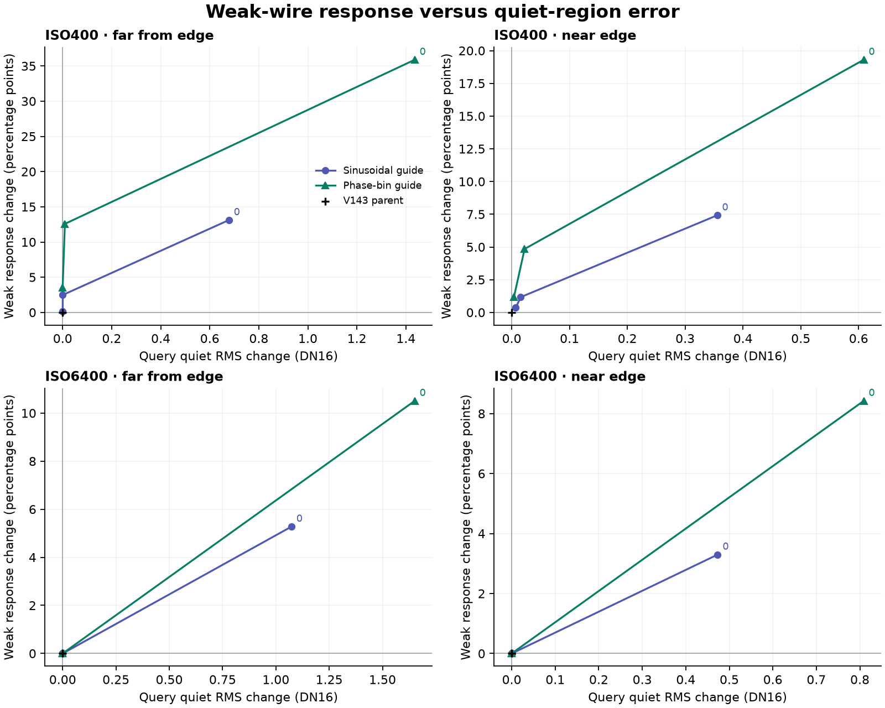
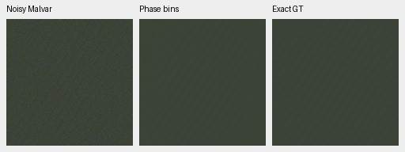
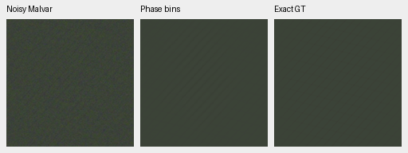

# RAW phase profiles for guided wire reconstruction

On the ISO400 far-wire test, fitting a periodic profile from the query RAW
raises weak response from **4.23% to 14.33%** versus a sinusoidal guide at
the same threshold. Weak-increment RMS drops from 10.089 to 10.040 DN16
and query quiet RMS rises from 2.492 to 2.501 DN16. A stricter phase-bin
threshold also gives a smaller gain at nearly the same quiet error as the
sinusoidal control. At ISO6400, the weak wire remains largely absent at both
conservative thresholds. Both real cab regions still lack convincing new
crossings. [Paired scores and receipts](results/phase-profile-probe-v1/publication.json).

## Measurement and validation

The donor contributes only two frequencies. For each direction, each query
pixel interpolates between adjacent knots on a circle with eight equally
spaced phase bins. A weighted least-squares fit estimates a different
zero-mean profile for each CFA color. It fits both directions and the nuisance
edge jointly from one query fold, so the profiles have independent signs and
shapes across colors. This accommodates narrow wires whose profiles need
more than one harmonic. The opposite fold compares the full estimate with
a fit that omits one direction. Both folds must show local support before
the existing parent-projection step replaces any of that direction in RGB.

Both representations use the same independently estimated donor guides,
nuisance fit, thresholds, validation windows and parent. The only change is
the shape basis. The phase-bin basis has more degrees of freedom, which can
admit more residual noise or an incorrect waveform. The local held-out score
is a test of predictive support on these data. Its scale can change with
noise correlation, edge mismatch and uncertainty in the donor.
[Operator](../src/demosaic/local_validated_waves.py).

The test covers all four Bayer layouts, eight reused wire geometries, near and
far placements, two noise profiles and three independently noised roles per
case. This gives 128 groups and 384 image roles. The query uses retained draw 1
throughout, distinct from draw 0 in the preceding guide report. The two
synthetic priors are ISO400 with shot/read `8e-5/2.56e-8` and ISO6400 with
`0.00128/6.5536e-6`. All profile fits use the center 256×256 of the native512
field. Pixels outside that window retain the common V143 output. Full-region
increment RMS uses the paired role difference. Quiet-region RMS below uses
only the fixed quiet mask inside the query window.
[Prior guide experiment](scene-wave-guides.md).

## Fixed threshold results

Each cell averages four CFAs per geometry and then eight geometries. DN16 here
is 65,535 times camera-RGB error. The error measures use the exact simulated
target. The thresholds are the same fixed values of 0, 2 and 4 in each arm.

| Prior and position | Method | Weak response | Strong response | Weak-increment RMS DN16 | Query quiet RMS DN16 |
| --- | --- | ---: | ---: | ---: | ---: |
| ISO400 far | V143 | 1.755% | 31.087% | 10.09691 | 2.49165 |
| ISO400 far | Sinusoid, t2 | 4.235% | 44.261% | 10.08948 | 2.49215 |
| ISO400 far | Phase bins, t2 | 14.330% | 59.152% | 10.03998 | 2.50075 |
| ISO400 far | Phase bins, t4 | 5.307% | 50.205% | 10.08100 | 2.49167 |
| ISO400 near | V143 | 3.861% | 15.487% | 13.04448 | 6.08136 |
| ISO400 near | Sinusoid, t2 | 5.030% | 25.912% | 13.04840 | 6.09702 |
| ISO400 near | Phase bins, t2 | 8.710% | 34.862% | 13.03891 | 6.10371 |
| ISO6400 far | V143 | 1.073% | 0.392% | 22.40787 | 6.69818 |
| ISO6400 far | Sinusoid, t2 | 1.071% | 3.547% | 22.41981 | 6.69824 |
| ISO6400 far | Phase bins, t2 | 1.073% | 8.095% | 22.42908 | 6.69818 |
| ISO6400 near | V143 | 2.761% | 0.171% | 30.78605 | 22.81872 |
| ISO6400 near | Sinusoid, t2 | 2.765% | 1.682% | 30.79385 | 22.81941 |
| ISO6400 near | Phase bins, t2 | 2.764% | 2.768% | 30.79861 | 22.81888 |

At ISO400 far and threshold 2, the phase profile improves weak response in 30
of 32 geometry/CFA cells. It lowers mean increment error in five of eight
geometries, with three small increases. Quiet RMS rises by as much as 0.0778
DN16 in one cell. The weak-absent query error drops on average from 9.745 to
7.908 DN16 as the strong wire and its surroundings improve. The change in
mean absolute projection onto the absent weak template is −0.0022 percentage
points. Near the edge that projection rises by 0.0219 percentage points.

At ISO6400 far and threshold 0, phase bins reach 11.58% weak response, with
8.349 DN16 quiet RMS and 22.761 DN16 increment RMS, both above the parent.
Thresholds 2 and 4 reduce those costs and lose almost all of the extra weak
response. The remaining high-noise benefit is mainly in the stronger
direction. [All paired source deltas and descriptive bootstrap intervals](results/phase-profile-probe-v1/paired-summary.json).

Points are shown relative to V143. Each curve includes the fixed thresholds
0, 2 and 4, with the threshold-0 point labeled. Axes differ by panel.

## Native comparisons

Noisy Malvar, V143 with phase-bin guide at threshold 2, and exact simulated
GT. Both triplets use the ISO400 far query, source 0 or 1, RGGB draw 1,
two-direction role, native ROI `[176,176,160,160]`, exposure 2 and the same WB
and rendering transform. ADC16 uses black fraction 0.03. The procedural parent
is V143 EMA `96d146d017c54196288c585f8b7eddcf030e8a235061049c31e985b9380b7ce4`.

The real parent is V120 EMA
`a9d9b6b4f974e24a6b11e5e740aab32314233a7f53c056cf37c7d2aac1c589fb`.
Both guided methods deliver exactly zero correction in the standing sky crop.
The phase profile also delivers zero in the building ROI. Foliage stays soft,
and the coarse fence keeps its existing crossings with slightly stronger
modulation. Both cab noise profiles show faint stripes on the left, and much
less striping than query-only fitting on the right. Phase bins slightly
increase the correction on both cab sides. The independent ISO100 AHD/JPEG
views differ in exposure, aperture and motion and are used qualitatively.
[Sky](images/phase-profile-probe-v1/main-overcast-sky.png) ·
[Coarse fence](images/phase-profile-probe-v1/main-chain-link-fence.png) ·
[Cab left](images/phase-profile-probe-v1/mesh-nominal-left.png) ·
[Cab right](images/phase-profile-probe-v1/mesh-nominal-right.png).

The operator ran from cached restorations and RAW arrays in 408.58 seconds
using the two-thread CPU policy. The audit covers 896 metric rows, 15,232
numeric reductions, 48 unchanged camera display cells and four exact triplet
subsets. All twelve comparison boards were opened and reviewed. V120 remains
the general restoration recommendation. [Native provenance and viewing record](images/phase-profile-probe-v1/manifest.json) ·
[Independent audit](results/phase-profile-probe-v1/independent-audit.json).
