# Distant frequency context: V161 final quality

V161 adds distant frequency context and produces stronger learned mesh response, with a further quiet-field cost. Response rises **20.56% raw / 21.57% EMA over matched V160 paired response**, reaching **4.825% / 5.240% of exact constructed GT amplitude**. That is 119.12% / 137.95% above V143. Present-image RMS falls about 1% versus the paired control. This is a useful gain in the learned architecture; additional capacity and compute are part of the comparison.

The false-detail problem remains. Actual blank RMS rises **0.18% / 0.59% versus the paired control**, or **3.44% / 5.31% versus V143**. Quiet RMS rises another **4.99–7.37% versus matched V160**, ending **14.14–18.38% above V143**. At both endpoints, 28/32 quiet inputs worsen versus matched control and all 32 worsen versus V143. The maximum quiet increase is 1.016 DN16 raw / 0.873 EMA versus control, and 2.138 / 1.990 versus V143. Both quiet spatial error and mean RGB bias increase; the independent pixel decomposition below records these separately. Native boosted crops show extra colored, sometimes gridded grain and casts on exact-flat targets.

Coarse correction also improves: native512 block32 RMS falls **0.20–0.30% versus matched V160** and **0.48–0.58% versus V143**. All 48 inputs improve in coarse error at both endpoints against both baselines. Total flat RMS instead rises **1.51–3.30% versus V143**, with 46/48 raw and 48/48 EMA inputs worse. Broad mottle remains visible. V157 retains a larger coarse gain; V160 ordinary retains stronger total-flat accuracy, and V158 EMA remains the quieter neighbor control. These strengths remain useful alongside V161's stronger learned response.

Actual native viewing covers all 72 figures in 18 original-detail sheets. Both protected cab priors/windows show modestly stronger existing lattice/diagonal contrast, most apparent in the right window. Crossings remain soft and incomplete; the ISO100 exposures still show much more structure. The procedural seed2309 crop retains the dominant orientation without recovering the complete crossing grid, while seed2302 remains nearly flat at ordinary display contrast. Main-scene sky looks smooth at the fixed +2EV view, without an obvious new coherent pattern; that observation does not establish flat-field safety. Building edges and foliage remain soft. Both ISO100 captures and camera JPEGs are qualitative references, not exact GT.

Natural microtexture remains weak: bird feather, butterfly, grass and wood crops do not show convincing broad recovery. Seven of eight natural-photo full-RMS cohort means worsen versus the paired control; the remaining change is a tiny −0.00026%. Six of eight band-response means decrease. These mixed, small changes do not transfer the procedural mesh response into a broad organic-detail improvement. ADC-photo RMS improves only about 0.01–0.02% versus V143, far below V150's retained 3.06% improvement. All 192 tested constant ADC outputs equal the parent exactly; sloped ADC coarse errors remain slightly worse than V143.

The prospectively fixed context-removal diagnostic confirms an active learned path: output RMS displacement ranges from 2.16 to 5.52 DN16 across the 24 raw/EMA cases, including backgrounds, flats and sky. Main-sky displacement is 3.04 / 3.39 DN16. These are changes in output, not accuracy improvements. Only the added adapter is zeroed; common weights have co-adapted during training, so this does not isolate the complete effect of context on training. Direct spatial corrections stay byte-exact, and all active outputs replay the main archive exactly.

Retain V161 as the stronger learned-detail capacity prototype while addressing its measured quiet/flat costs. V160 paired response, V160 ordinary, V158 quiet accuracy, V159's coarse/quiet compromise and V157's stronger spatial/coarse correction remain documented comparators. V120 Small remains the broad general recommendation. This completed, related and adaptively reused cohort does not establish blind generalization, and the combined goal of recovering dark fine detail without false structure remains open.

[Final evidence and immutable sources](results/v161-harmonic-context-final-v1.json) · [Native pixels, source ROIs, conditioning, exposure and checkpoint hashes](images/v161-harmonic-context-v1/manifest-v1.json).

## Response and actual blank error

RMS values are camera-RGB DN16. Response1 means the exact constructed mesh amplitude. Blank error measures actual target error; added blank RMS measures displacement from V143.

| Method | Present full RMS | Response | Actual blank RMS | Blank spatial RMS | Added blank RMS |
| --- | ---: | ---: | ---: | ---: | ---: |
|V143|9.111243|0.02202090|5.523323|5.343113|0.00000000|
|Pair ctrl raw|9.032421|0.04002247|5.702844|5.532452|1.45472504|
|Pair ctrl EMA|9.061365|0.04310254|5.782327|5.611326|1.69262495|
|Harmonic raw|8.942284|0.04825149|5.713081|5.545150|1.55501600|
|Harmonic EMA|8.979201|0.05239854|5.816396|5.645413|1.83264649|
|Existing periodic detail|8.586126|0.07089755|5.523328|5.343118|0.00063557|

## Quiet neighbors and coarse fields

| Prior | Method | Whole RMS | Quiet RMS | Quiet spatial RMS |
| --- | --- | ---: | ---: | ---: |
|ISO6400|V143|27.105631|3.898845|3.268502|
|ISO6400|Pair ctrl raw|27.073388|4.278818|3.567739|
|ISO6400|Pair ctrl EMA|27.055578|4.341703|3.658529|
|ISO6400|Harmonic raw|27.015906|4.594075|3.658947|
|ISO6400|Harmonic EMA|26.972453|4.615625|3.772120|
|ISO12800|V143|36.747466|6.152652|5.341833|
|ISO12800|Pair ctrl raw|36.174651|6.673191|5.652459|
|ISO12800|Pair ctrl EMA|36.065053|6.725417|5.758698|
|ISO12800|Harmonic raw|35.543905|7.022340|5.811414|
|ISO12800|Harmonic EMA|35.371842|7.060811|5.949189|

Quiet bias is averaged per RGB channel before its Euclidean RMS. The independent pixel audit verifies total squared = spatial squared + DC squared per case; means of RMS values do not share that identity.

| Prior | Method | Quiet DC RMS DN16 |
| --- | --- | ---: |
| iso6400-prior | parent | 2.016074 |
| iso6400-prior | paired-control-raw-step1000 | 2.221410 |
| iso6400-prior | paired-control-EMA-step1000 | 2.201768 |
| iso6400-prior | harmonic-context-raw-step1000 | 2.591170 |
| iso6400-prior | harmonic-context-EMA-step1000 | 2.478187 |
| iso12800-prior | parent | 2.849060 |
| iso12800-prior | paired-control-raw-step1000 | 3.318674 |
| iso12800-prior | paired-control-EMA-step1000 | 3.248981 |
| iso12800-prior | harmonic-context-raw-step1000 | 3.735989 |
| iso12800-prior | harmonic-context-EMA-step1000 | 3.597003 |

|Flat test|V143|Pair ctrl raw|Pair ctrl EMA|Harmonic raw|Harmonic EMA|
| --- | ---: | ---: | ---: | ---: | ---: |
|Native512 ISO6400 full RMS|18.546808|18.820493|18.968767|18.826539|19.024279|
|Native512 ISO6400 spatial RMS|18.235130|18.530542|18.677087|18.527491|18.723699|
|Native512 ISO6400 block32 RMS|13.440561|13.403898|13.408983|13.363268|13.375119|
|Native512 ISO12800 full RMS|24.071890|24.530907|24.753278|24.578261|24.866512|
|Native512 ISO12800 spatial RMS|23.596861|24.099408|24.333860|24.129865|24.441501|
|Native512 ISO12800 block32 RMS|17.932544|17.878447|17.883072|17.832772|17.847243|
|Older native256 ISO12800 full RMS|27.233548|27.742641|27.983204|27.736351|28.043239|
|Older native256 ISO12800 spatial RMS|26.017191|26.564107|26.815484|26.549347|26.872305|
|Older native256 ISO12800 block32 RMS|19.539875|19.490785|19.495782|19.442077|19.456009|

## Natural detail and ADC controls

|Photo test|V143|Pair ctrl raw|Pair ctrl EMA|Harmonic raw|Harmonic EMA|
| --- | ---: | ---: | ---: | ---: | ---: |
|Retained512 faint full RMS|33.963754|33.977642|33.985622|33.977553|33.989892|
|Retained512 faint band error|0.824639|0.824407|0.824298|0.824651|0.824519|
|Retained512 faint band response|0.298560|0.299729|0.300718|0.299368|0.300629|
|Retained512 dark full RMS|29.097715|29.099629|29.103808|29.102824|29.108120|
|Retained512 dark band error|0.661447|0.661256|0.661227|0.661248|0.661212|
|Retained512 dark band response|0.531446|0.531047|0.531647|0.531132|0.531944|
|Organic384 faint full RMS|37.469061|37.458327|37.456232|37.470642|37.468656|
|Organic384 faint band error|0.924117|0.924291|0.924106|0.925087|0.924824|
|Organic384 faint band response|0.150701|0.151586|0.152628|0.150442|0.151718|
|Organic384 dark full RMS|33.685796|33.679874|33.679938|33.689916|33.688406|
|Organic384 dark band error|0.781612|0.781639|0.781641|0.781780|0.781774|
|Organic384 dark band response|0.398945|0.398554|0.399256|0.397925|0.398821|

|ADC test|V143|Pair ctrl raw|Pair ctrl EMA|Harmonic raw|Harmonic EMA|
| --- | ---: | ---: | ---: | ---: | ---: |
|Photo full RMS|18.149871|18.155182|18.155606|18.147494|18.146394|
|Photo band error|0.101855|0.101918|0.101921|0.101827|0.101811|
|Photo band response|0.968329|0.968174|0.968174|0.968346|0.968357|
|Sloped512 full RMS|3.771369|3.770121|3.768219|3.770226|3.769995|
|Sloped512 spatial RMS|3.397249|3.395495|3.393466|3.395901|3.395581|
|Sloped512 block32 RMS|0.574652|0.575040|0.575652|0.575722|0.575804|
|Sloped512 crop block32 RMS|0.088145|0.088129|0.088126|0.088150|0.088146|
|Sloped512 worst absolute DC|11.176981|11.173857|11.171162|11.173789|11.173521|

## Fixed native comparisons

Every cell is native 160×160; crop pixels are never resized. All RAW methods within each board share source coordinates, camera display transform, exposure and contrast. JPEG cells retain native sRGB8 without exposure/contrast changes. Both final raw/EMA endpoints of both heads are shown, with five retained V156/V157/V158/V159/V160 ordinary columns.

The main scene is DSCF3879 ISO6400 versus DSCF3880 ISO100 f/5.6. The fine cab mesh uses DSCF3842 versus DSCF3835 and both camera JPEGs. Aperture, shutter, moving subjects and processing differ: ISO100 views are qualitative references, not exact GT. All30 real score rows stay unscored.

### Mesh and exact absence

mesh-seed2026112302-present-iso6400-prior-RGGB; ROI `[176, 176, 160, 160]`, RAW exposure 8, contrast 1.

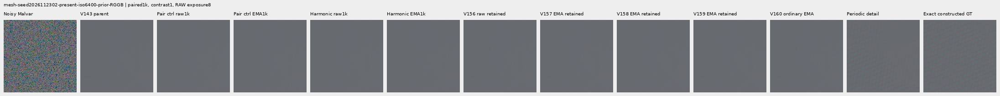

mesh-seed2026112302-present-iso6400-prior-RGGB; ROI `[176, 176, 160, 160]`, RAW exposure 8, contrast 40.

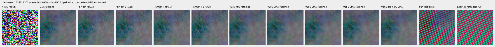

mesh-seed2026112309-present-iso6400-prior-RGGB; ROI `[176, 176, 160, 160]`, RAW exposure 8, contrast 1.

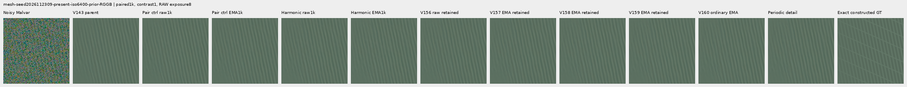

mesh-seed2026112309-present-iso6400-prior-RGGB; ROI `[176, 176, 160, 160]`, RAW exposure 8, contrast 40.

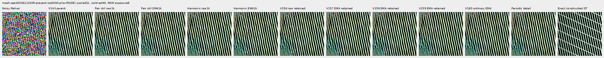

mesh-seed2026112304-absent-iso6400-prior-RGGB; ROI `[165, 0, 160, 160]`, RAW exposure 8, contrast 40.

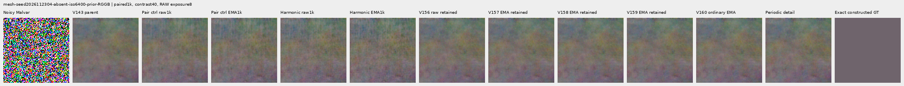

### Quiet neighbors beside edges

mixed-vertical-step-iso6400-prior-RGGB; ROI `[80, 176, 160, 160]`, RAW exposure 8, contrast 40.

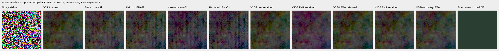

mixed-vertical-step-iso6400-prior-RGGB; ROI `[240, 176, 160, 160]`, RAW exposure 8, contrast 1.

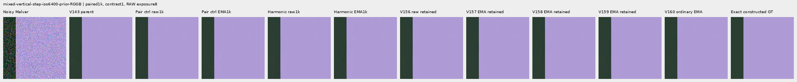

mixed-vertical-step-iso12800-prior-RGGB; ROI `[80, 176, 160, 160]`, RAW exposure 8, contrast 40.

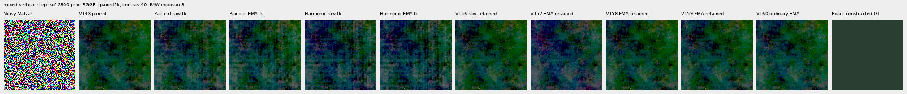

mixed-vertical-step-iso12800-prior-RGGB; ROI `[240, 176, 160, 160]`, RAW exposure 8, contrast 1.

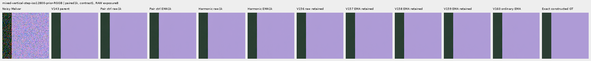

mixed-narrow-bar-iso6400-prior-RGGB; ROI `[80, 176, 160, 160]`, RAW exposure 8, contrast 40.

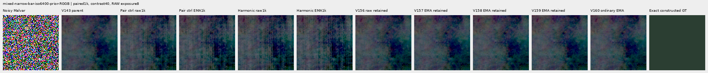

mixed-narrow-bar-iso6400-prior-RGGB; ROI `[240, 176, 160, 160]`, RAW exposure 8, contrast 1.

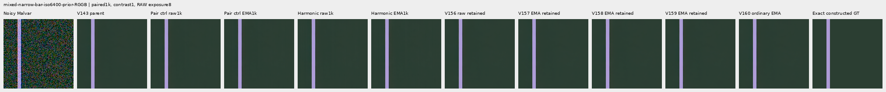

mixed-narrow-bar-iso12800-prior-RGGB; ROI `[80, 176, 160, 160]`, RAW exposure 8, contrast 40.

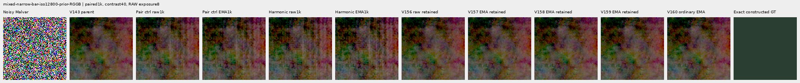

mixed-narrow-bar-iso12800-prior-RGGB; ROI `[240, 176, 160, 160]`, RAW exposure 8, contrast 1.

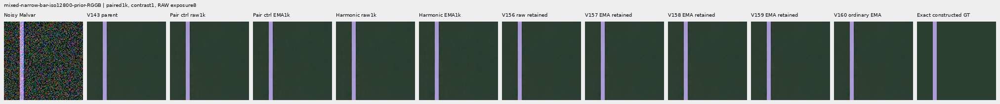

mixed-slanted-step-iso6400-prior-RGGB; ROI `[80, 176, 160, 160]`, RAW exposure 8, contrast 40.

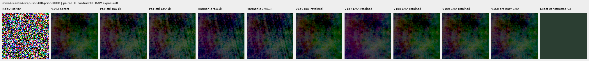

mixed-slanted-step-iso6400-prior-RGGB; ROI `[240, 176, 160, 160]`, RAW exposure 8, contrast 1.

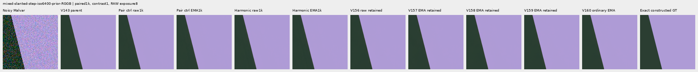

mixed-slanted-step-iso12800-prior-RGGB; ROI `[80, 176, 160, 160]`, RAW exposure 8, contrast 40.

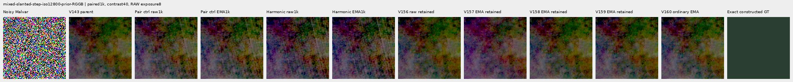

mixed-slanted-step-iso12800-prior-RGGB; ROI `[240, 176, 160, 160]`, RAW exposure 8, contrast 1.

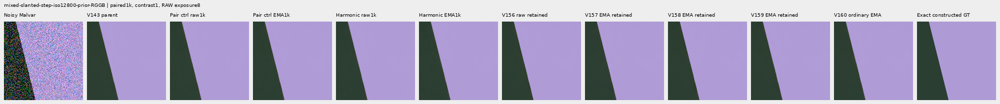

mixed-striped-patch-iso6400-prior-RGGB; ROI `[80, 176, 160, 160]`, RAW exposure 8, contrast 40.

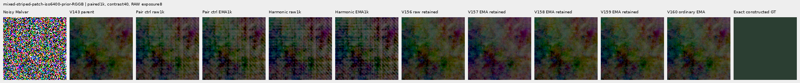

mixed-striped-patch-iso6400-prior-RGGB; ROI `[240, 176, 160, 160]`, RAW exposure 8, contrast 1.

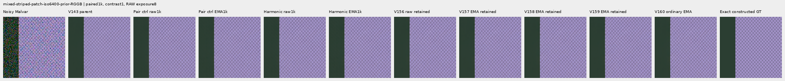

mixed-striped-patch-iso12800-prior-RGGB; ROI `[80, 176, 160, 160]`, RAW exposure 8, contrast 40.

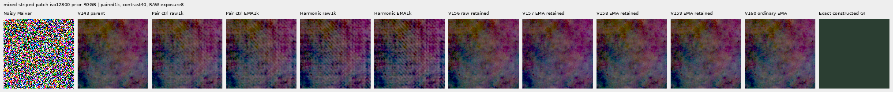

mixed-striped-patch-iso12800-prior-RGGB; ROI `[240, 176, 160, 160]`, RAW exposure 8, contrast 1.

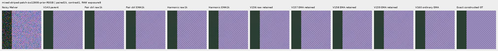

### Standalone flats and slopes

gray-l0.02-adc-only-RGGB; ROI `[48, 48, 160, 160]`, RAW exposure 4, contrast 40.

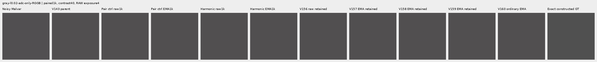

gray-l0.02-iso12800-prior-RGGB; ROI `[48, 48, 160, 160]`, RAW exposure 4, contrast 40.

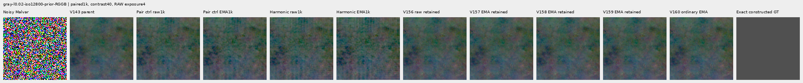

flat512-gray-l0.02-adc-only-RGGB; ROI `[176, 176, 160, 160]`, RAW exposure 4, contrast 40.

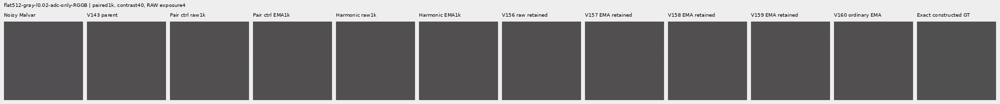

flat512-gray-l0.02-iso6400-prior-RGGB; ROI `[176, 176, 160, 160]`, RAW exposure 4, contrast 40.

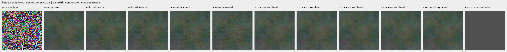

flat512-gray-l0.02-iso12800-prior-RGGB; ROI `[176, 176, 160, 160]`, RAW exposure 4, contrast 40.

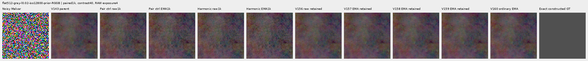

flat512-h210-s0.50-l0.02-iso6400-prior-RGGB; ROI `[176, 176, 160, 160]`, RAW exposure 4, contrast 40.

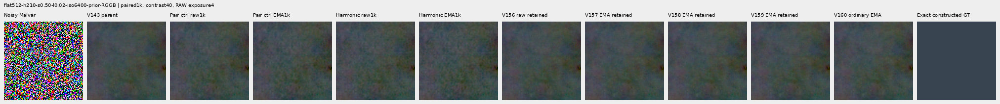

flat512-gray-l0.18-iso12800-prior-RGGB; ROI `[176, 176, 160, 160]`, RAW exposure 1, contrast 8.

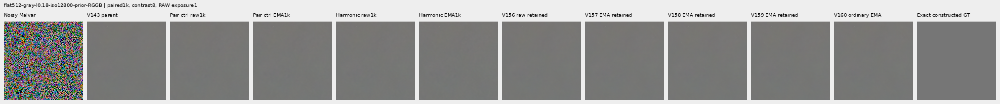

flat512-gray-l0.90-iso12800-prior-RGGB; ROI `[176, 176, 160, 160]`, RAW exposure 1, contrast 4.

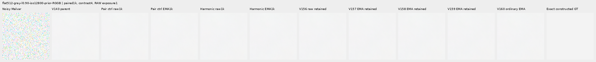

V150-control-ADC-plane0-RGGB; ROI `[176, 176, 160, 160]`, RAW exposure 45, contrast 8.

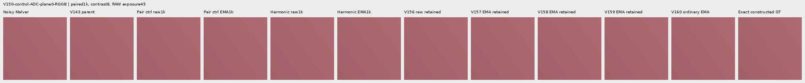

V150-control-ADC-plane1-RGGB; ROI `[176, 176, 160, 160]`, RAW exposure 9, contrast 8.

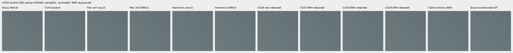

V150-control-ADC-plane2-RGGB; ROI `[176, 176, 160, 160]`, RAW exposure 1, contrast 8.

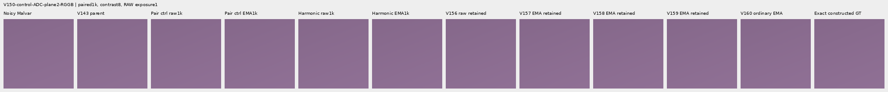

V150-control-ADC-plane3-RGGB; ROI `[176, 176, 160, 160]`, RAW exposure 0.24, contrast 8.

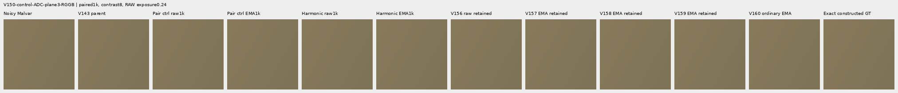

### Natural photographic detail

organic-02a76fd33b5e1414a0504f0b3f0aeb03a569b6f4-photo-faint-RGGB; ROI `[112, 112, 160, 160]`, RAW exposure 14.3883, contrast 8.

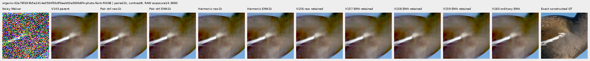

organic-dabacecd4780a1c230f8e9fce6ca1a604bdeab4c-photo-dark-RGGB; ROI `[112, 112, 160, 160]`, RAW exposure 102.758, contrast 1.

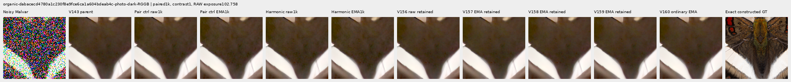

organic-6b3920bceba82d95ecf9351d47f6f94267694bd0-photo-dark-RGGB; ROI `[112, 112, 160, 160]`, RAW exposure 64.0491, contrast 1.

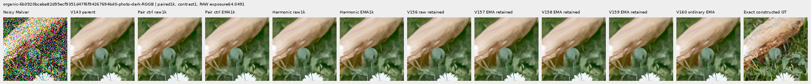

photo-3e638bbb56ed80abc88939468783e3bf9b92ee77-photo-faint-RGGB; ROI `[176, 176, 160, 160]`, RAW exposure 12.1494, contrast 8.

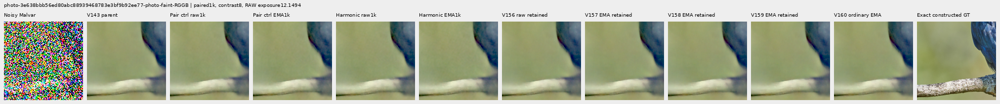

photo-3e638bbb56ed80abc88939468783e3bf9b92ee77-photo-dark-RGGB; ROI `[176, 176, 160, 160]`, RAW exposure 80.9959, contrast 1.

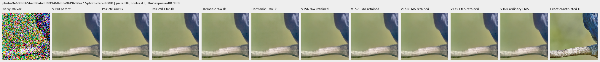

V150-control-bark-contrast0p025-adc-RGGB; ROI `[48, 48, 160, 160]`, RAW exposure 1, contrast 40.

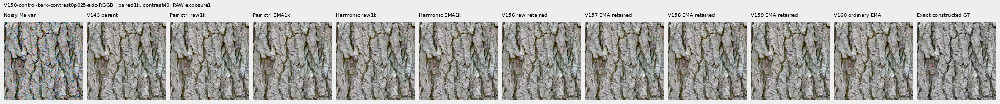

V150-control-raccoon-fur-contrast0p025-adc-RGGB; ROI `[48, 48, 160, 160]`, RAW exposure 1, contrast 40.

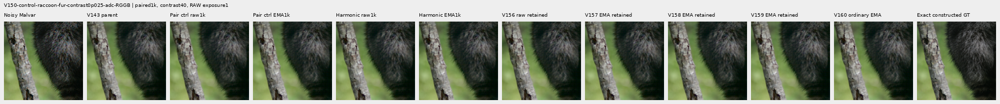

### Protected real GFX scenes

main-overcast-sky; ROI `[176, 176, 160, 160]`, RAW exposure 4, contrast 1.

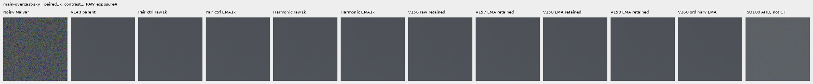

main-building-detail; ROI `[176, 176, 160, 160]`, RAW exposure 4, contrast 1.

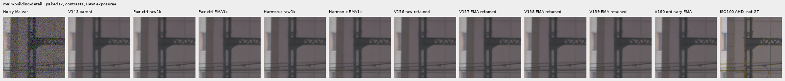

main-foliage; ROI `[176, 176, 160, 160]`, RAW exposure 4, contrast 1.

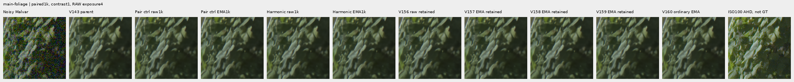

main-chain-link-fence; ROI `[176, 176, 160, 160]`, RAW exposure 4, contrast 1.

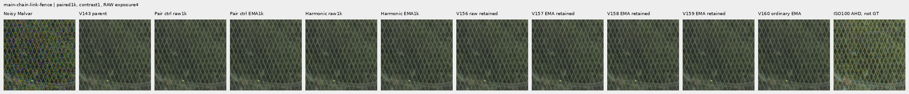

mesh-nominal; ROI `[206, 229, 160, 160]`, RAW exposure 16, contrast 1.

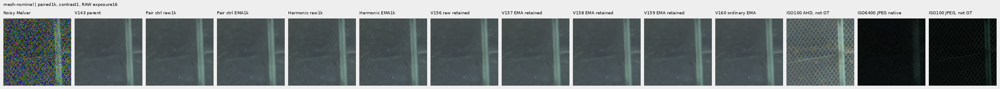

mesh-nominal; ROI `[426, 189, 160, 160]`, RAW exposure 16, contrast 1.

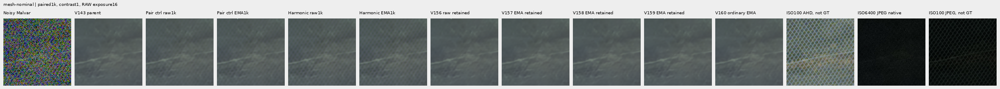

mesh-profile3879; ROI `[206, 229, 160, 160]`, RAW exposure 16, contrast 1.

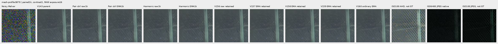

mesh-profile3879; ROI `[426, 189, 160, 160]`, RAW exposure 16, contrast 1.

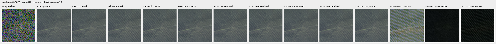

### Noisy, restored, exact constructed GT triplets

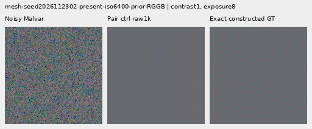

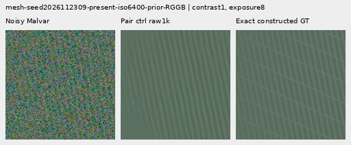

## Training, architecture and validation

The candidate has 124,397 parameters/46 tensors versus 117,677/45 in the control. It adds a zero-initialized bias-free210→32 projection of five transported 42-channel frequency descriptors: twice frequency and four half-frequency alias branches. Half-bin interpolation wraps on the full descriptor map, including alias-branch boundaries. Common initialization, cached 1,000 B4 batches, pair-response weight 1, all RGB/gradient/local/DC/delivered spectral losses, AdamW/clipping and EMA clocks are fixed. The comparison includes 6,720 extra parameters and compute. Targets/pair fields never enter inference.

The control exactly reproduces every V160 paired-response trace row and final raw/EMA/Adam state; all 1,644 actual control predictions replay byte-exact before archive storage is reused. The candidate retains 1,644 new arrays externally. All 87 prior neural source files remain unchanged; one new module adds the adapter. Older comparator columns mix architecture/loss/data changes.

The reused V160 cache contains 4,000 frames: 1,382 present/background pairs and 1,236 ordinary frames, based on 2,618 scene/patch instances. Its 486 photo pairs visit 268 free-photo IDs; 234 reduce contrast and 245 use reviewed ROIs. Geometry precedes area 2 after bin 4;zero optical blur. All 18 held-out source IDs and protected captures/JPEGs/siblings remain excluded. Pair units use pre-ADC shot-increment RMS floored at 16 DN16;shared read draws cancel before ADC, and RGB losses remain necessary. No new source construction, parent/DINO calls or sensor draws occur in V161. [V160 construction evidence](paired-response.md) retains its original accounting failure and explicit 23-batch adoption.

139 CPU checks pass, including 16 new independent coordinate/input-adjoint, half-branch boundary, nonzero old-head embedding, per-image independence, all 46 tensor-gradient and constant-control checks. Genuine 8+2 model/EMA/Adam/RNG restoration passes;the first 10 complete smoke/train rows match exactly. CUDA zero-adapter parity covers 28 contexts / 56 calls and all CFAs/native 256/384/512/768. Four strict final CPU loads and 91 finite Adam states at 1,000 pass. All 1,000 control trace rows match V160.

`paired-control`: 142/900 supervised batches clip; pre-clip norm median 0.279755, maximum 73.602211.

`harmonic-context`: 134/900 supervised batches clip; pre-clip norm median 0.269817, maximum 73.602211.

The 100 zero-gradient ADC batches advance Adam/EMA clocks. Gradient norms describe optimization pressure; they do not isolate the cause of a quality change.

The independent audit checks 40,210 scalars across 4,686 rows and 476 Decimal reductions; maximum scalar difference is5.12e-13. All 72 native images / 24 triplets were actually viewed in 18 original-detail sheets;50,764,800 RGB channels were independently checked.

Actual scientific work is 5,412 head calls: 56 parity, 20 discarded smoke, 2,000 training, 3,288 main review and 48 context-removal calls. These evaluate 11,472 head images. There are 1,668 new external arrays: 1,644 main candidate outputs plus 24 context-off outputs. The main control and 24 diagnostic on outputs are actual exact replays. All 11 original owners are terminal;zero scientific stage failures/full-training restarts. All new work preserves 60/156 GiB local/external reserves plus 0.5 GiB projected margin. Originals and `/mnt/dataz` are unused.

## Trained context contribution

The fixed 12-case/raw-EMA diagnostic makes 48 actual calls. Zeroing only the new adapter and restoring it leaves direct RGB corrections exact;active outputs replay the main archive byte-exact. Values below measure output displacement. They do not measure improved accuracy, isolate changed training dynamics or prove false-detail suppression. Independent ISO100 references remain qualitative.

| Endpoint | Fixed case | On/off RMS DN16 | Maximum absolute DN16 |
| --- | --- | ---: | ---: |
| harmonic-context-raw-step1000 | mesh-seed2026112302-present-iso6400-prior-RGGB | 3.00062890 | 30.18191250 |
| harmonic-context-raw-step1000 | mesh-seed2026112302-absent-iso6400-prior-RGGB | 3.19231462 | 33.10520774 |
| harmonic-context-raw-step1000 | mesh-seed2026112309-present-iso6400-prior-RGGB | 3.16977499 | 29.55179516 |
| harmonic-context-raw-step1000 | mesh-seed2026112309-absent-iso6400-prior-RGGB | 2.93412180 | 27.75592413 |
| harmonic-context-raw-step1000 | organic-02a76fd33b5e1414a0504f0b3f0aeb03a569b6f4-photo-faint-RGGB | 2.87116705 | 27.08674489 |
| harmonic-context-raw-step1000 | main-overcast-sky | 3.04223916 | 29.05253520 |
| harmonic-context-raw-step1000 | mesh-nominal | 2.15979487 | 23.52692372 |
| harmonic-context-raw-step1000 | mesh-profile3879 | 2.38501006 | 22.86464134 |
| harmonic-context-raw-step1000 | flat512-gray-l0.02-iso6400-prior-RGGB | 2.78783591 | 20.98320032 |
| harmonic-context-raw-step1000 | flat512-gray-l0.02-iso12800-prior-RGGB | 4.49094125 | 38.27578314 |
| harmonic-context-raw-step1000 | mixed-vertical-step-iso6400-prior-RGGB | 3.53085080 | 42.65901703 |
| harmonic-context-raw-step1000 | mixed-vertical-step-iso12800-prior-RGGB | 4.98687348 | 49.79050001 |
| harmonic-context-EMA-step1000 | mesh-seed2026112302-present-iso6400-prior-RGGB | 3.30721110 | 31.32886766 |
| harmonic-context-EMA-step1000 | mesh-seed2026112302-absent-iso6400-prior-RGGB | 3.52181925 | 35.25788485 |
| harmonic-context-EMA-step1000 | mesh-seed2026112309-present-iso6400-prior-RGGB | 3.48468484 | 32.12731739 |
| harmonic-context-EMA-step1000 | mesh-seed2026112309-absent-iso6400-prior-RGGB | 3.26431450 | 31.03871095 |
| harmonic-context-EMA-step1000 | organic-02a76fd33b5e1414a0504f0b3f0aeb03a569b6f4-photo-faint-RGGB | 3.16979938 | 29.33243816 |
| harmonic-context-EMA-step1000 | main-overcast-sky | 3.39135729 | 32.43395333 |
| harmonic-context-EMA-step1000 | mesh-nominal | 2.29849724 | 27.04878160 |
| harmonic-context-EMA-step1000 | mesh-profile3879 | 2.57251982 | 26.45021895 |
| harmonic-context-EMA-step1000 | flat512-gray-l0.02-iso6400-prior-RGGB | 3.09932585 | 23.24671559 |
| harmonic-context-EMA-step1000 | flat512-gray-l0.02-iso12800-prior-RGGB | 5.00762260 | 42.17428322 |
| harmonic-context-EMA-step1000 | mixed-vertical-step-iso6400-prior-RGGB | 3.91200051 | 46.81642430 |
| harmonic-context-EMA-step1000 | mixed-vertical-step-iso12800-prior-RGGB | 5.51828899 | 56.50939163 |

[Original protocol](results/v161-harmonic-context-v1/original-protocol.md) · [Immutable preparation](results/v161-harmonic-context-preparation-v1.json) · [Independent publication verification](results/v161-harmonic-context-publication-verification-v1.json).

## Photographic credits

Derived native targets/crops retain the respective source licenses; transformations include linearization, area binning and exposure/contrast changes. Source IDs and ROIs are in the manifest.

| Source | Author | License |
| --- | --- | --- |
| [File:Emamzadeh Esmaeil roof.jpg](https://commons.wikimedia.org/wiki/File:Emamzadeh_Esmaeil_roof.jpg) | مانفی | [CC BY-SA 4.0](https://creativecommons.org/licenses/by-sa/4.0) |
| [File:HP-85-IMG 0439.jpg](https://commons.wikimedia.org/wiki/File:HP-85-IMG_0439.jpg) | Rama & Musée Bolo | [CC BY-SA 2.0 fr](https://creativecommons.org/licenses/by-sa/2.0/fr/deed.en) |
| [File:Spangled Drongo - AndrewMercer - DSC00966.jpg](https://commons.wikimedia.org/wiki/File:Spangled_Drongo_-_AndrewMercer_-_DSC00966.jpg) | Andrew Mercer (www.baldwhiteguy.co.nz) | [CC BY-SA 4.0](https://creativecommons.org/licenses/by-sa/4.0) |
| [File:Naxos Chora 2025-06-14 0505.jpg](https://commons.wikimedia.org/wiki/File:Naxos_Chora_2025-06-14_0505.jpg) | Tsui | [CC BY-SA 4.0](https://creativecommons.org/licenses/by-sa/4.0) |
| [File:Castelo Novo April 2015-2a.jpg](https://commons.wikimedia.org/wiki/File:Castelo_Novo_April_2015-2a.jpg) | Alvesgaspar | [CC BY-SA 4.0](https://creativecommons.org/licenses/by-sa/4.0) |
| [File:RX50 -5 ¼” dual floppy disk drive 02.jpg](https://commons.wikimedia.org/wiki/File:RX50_-5_%C2%BC%E2%80%9D_dual_floppy_disk_drive_02.jpg) | Mister rf | [CC BY-SA 4.0](https://creativecommons.org/licenses/by-sa/4.0) |
| [File:DSC00752 San Salvator Laur.jpg](https://commons.wikimedia.org/wiki/File:DSC00752_San_Salvator_Laur.jpg) | Rione Colonna | [CC BY 4.0](https://creativecommons.org/licenses/by/4.0) |
| [File:Regierungsgebäude, Vaduz.jpg](https://commons.wikimedia.org/wiki/File:Regierungsgeb%C3%A4ude,_Vaduz.jpg) | AuHaidhausen | [CC BY 4.0](https://creativecommons.org/licenses/by/4.0) |
| [File:Common moorhen (Gallinula chloropus) France.jpg](https://commons.wikimedia.org/wiki/File:Common_moorhen_(Gallinula_chloropus)_France.jpg) | Alexis Lours | [CC BY 4.0](https://creativecommons.org/licenses/by/4.0) |
| [File:Dried platanus leaves on rain puddle, Quinta das Conchas e dos Lilases, Lisbon, Portugal julesvernex2.jpg](https://commons.wikimedia.org/wiki/File:Dried_platanus_leaves_on_rain_puddle,_Quinta_das_Conchas_e_dos_Lilases,_Lisbon,_Portugal_julesvernex2.jpg) | Jules Verne Times Two | [CC BY-SA 4.0](https://creativecommons.org/licenses/by-sa/4.0) |
| [File:Close wing pudding position of Lethe visrava (Moore, 1866) - White-edged Woodbrown WLB IMG 0997.jpg](https://commons.wikimedia.org/wiki/File:Close_wing_pudding_position_of_Lethe_visrava_(Moore,_1866)_-_White-edged_Woodbrown_WLB_IMG_0997.jpg) | Thamblyok | [CC BY-SA 4.0](https://creativecommons.org/licenses/by-sa/4.0) |
| [File:Daisies near Cockspur coral tree (Erythrina crista-galli) roots, Jardim da Praça de Londres, Lisbon, Portugal julesvernex2.jpg](https://commons.wikimedia.org/wiki/File:Daisies_near_Cockspur_coral_tree_(Erythrina_crista-galli)_roots,_Jardim_da_Pra%C3%A7a_de_Londres,_Lisbon,_Portugal_julesvernex2.jpg) | Jules Verne Times Two | [CC BY-SA 4.0](https://creativecommons.org/licenses/by-sa/4.0) |
| [File:Apples on tree 2021 G1.jpg](https://commons.wikimedia.org/wiki/File:Apples_on_tree_2021_G1.jpg) | George Chernilevsky | [CC BY-SA 4.0](https://creativecommons.org/licenses/by-sa/4.0) |
| [File:Close wing Nectering of Pseudozizeeria maha (Kollar, 1844) - Pale Grass Blue WLB.jpg](https://commons.wikimedia.org/wiki/File:Close_wing_Nectering_of_Pseudozizeeria_maha_(Kollar,_1844)_-_Pale_Grass_Blue_WLB.jpg) | Anitava Roy | [CC BY-SA 4.0](https://creativecommons.org/licenses/by-sa/4.0) |
| [File:Grey heron (Ardea cinerea) head.jpg](https://commons.wikimedia.org/wiki/File:Grey_heron_(Ardea_cinerea)_head.jpg) | Alexis Lours | [CC BY 4.0](https://creativecommons.org/licenses/by/4.0) |
| [File:Openwing position of Parasarpa dudu (Westwood, -1850-) - White Commodore.jpg](https://commons.wikimedia.org/wiki/File:Openwing_position_of_Parasarpa_dudu_(Westwood,_-1850-)_-_White_Commodore.jpg) | MaheshBaruahwildlife | [CC BY-SA 4.0](https://creativecommons.org/licenses/by-sa/4.0) |
| [File:Kentucky Coffee-tree Gymnocladus dioicus 3264px.jpg](https://commons.wikimedia.org/wiki/File:Kentucky_Coffee-tree_Gymnocladus_dioicus_3264px.jpg) | Photo (c)2007 Derek Ramsey (Ram-Man) | [CC BY-SA 2.5](https://creativecommons.org/licenses/by-sa/2.5) |
| [File:Racoon clinging to a tree.JPG](https://commons.wikimedia.org/wiki/File:Racoon_clinging_to_a_tree.JPG) | Korall | [CC BY 3.0](https://creativecommons.org/licenses/by/3.0) |

## Fixed component checkpoints

- `paired-control-raw-step1000`: `fa18728ffe1dbdc75533abedcbb6e107f5bfb79b5575404ff9cd66737fd8c06b`.
- `paired-control-EMA-step1000`: `362e3e7b35848135c78e953410ffc1347c2c58ea4748b27d5ae7a58ac62fc882`.
- `harmonic-context-raw-step1000`: `0f41c572d605ed3a07491d3f682b985ce197b3c0a9f5fe7cc99d44a91d69ed49`.
- `harmonic-context-EMA-step1000`: `f4816a46f059b00bff90ce675e078ca91d7c77d8e4740016d86a1a67abc1c7c7`.
