# Cross-frequency phase inputs: V163 final quality

V163's phase-input/capacity change produces a small quiet-color-bias gain at fixed V162 data and losses. **Mean quiet RMS falls 0.62–1.19% versus V162**, improving 23/32 raw inputs and 20/32 EMA inputs. Nine raw and twelve EMA inputs worsen; maximum increases are 0.289 / 0.0904 DN16. This gain belongs beside V162's grain reduction, while V161 retains stronger learned mesh response.

The independent original-pixel decomposition identifies lower bias rather than lower spatial error. Mean quiet DC RMS falls **2.60–3.96%**: ISO6400 raw/EMA 2.535833→2.469855 / 2.487000→2.395376 DN16; ISO12800 3.915659→3.773396 / 3.772640→3.623360. Quiet spatial means increase 0.025–0.185%, worsening 24/32 raw and 17/32 EMA inputs. Total quiet RMS remains **10.23–11.06% above V143**, with 30/32 inputs worse at both endpoints; all 32 spatial errors are worse than V143. Lower mean error therefore does not establish flat-field safety.

Mesh response falls another **0.516% raw / 0.594% EMA versus V162**, reaching **3.827% / 4.088% of exact constructed GT amplitude**. This remains 73.77% / 85.62% above V143 but below V161's 4.83–5.24%. Present full RMS rises 0.081–0.082% versus V162, actual blank RMS rises about 0.10%, and exact-absence RMS rises 0.098–0.117%. The additional phase information does not recover the missing weak lattice in this run.

Native512 full-flat means rise **0.030–0.183% versus V162**; only 17/48 raw and 15/48 EMA inputs improve. Worst increases are 0.224 / 0.138 DN16. Coarse block32 means worsen 0.119–0.194%, with **all 48 inputs worse at both endpoints**. Against V143, coarse RMS is still 0.41–0.48% lower on all 48 inputs, while total-flat RMS is 0.24–0.70% higher. V162 retains stronger grain/coarse performance, V160 ordinary stronger total-flat accuracy and V157 stronger coarse capacity.

Natural-photo differences are tiny and mixed. All four raw cohort full-RMS means improve 0.004–0.018% versus V162; all four EMA means worsen 0.0015–0.0029%. Six of eight band-response means increase, two decrease; every change is below 0.019%. These are measured changes on the retained adaptive cohort, not a visible recovery or broad generalization claim. ADC-photo RMS is 0.087–0.099% below V143 but 0.060–0.065% worse than V162, far from V150's retained 3.06% gain. ADC sloped-plane coarse means improve about 0.051–0.056% versus V162, while full error worsens slightly. All 192 tested ADC constant outputs remain exact parent values.

All 72 native figures were actually inspected in 18 original-detail sheets. Phase and anchor controls look very close. Both cab priors/windows show no convincing new complete fine crossings; V161 retains stronger strand contrast. The main coarse fence is recovered but building edges, leaves, bird feathers, butterfly scales and grass/wood microtexture remain softened. The fixed +2EV sky view stays smooth without an obvious new coherent pattern; this single view does not establish flat-field safety. Boosted quiet crops show only subtle cast differences amid persistent broad mottle and fine gridded/colored texture. Flat fields show no convincing cleanup. ISO100 captures and native JPEGs differ in aperture, shutter and moving subjects: qualitative references, not exact GT.

The trained phase adapter is active but its fixed-input output displacement is small: 0.0303–0.0635 DN16 RMS raw and 0.0336–0.0699 EMA over twelve inputs. All 24 on outputs replay the main archive exactly, direct RGB corrections stay bit-exact, weights are restored and RNG is unchanged. Removing the adapter measures its trained output contribution, not accuracy or an isolated explanation of training dynamics. Shared weights also change during training; extra 512-parameter capacity/compute is part of the matched intervention.

Retain the small measured quiet-bias gain as an implementation option, together with V161's stronger response, V162's grain reduction and the quieter V158 / stronger-coarse V157 / stronger-total-flat V160 ordinary comparisons. The requested combination of recovered fine dark fence detail and reliable flat regions remains unresolved. [Audited reductions and actual viewing evidence](results/v163-quality-claims-v1.json) preserve both strengths and remaining costs.

[Final evidence and immutable sources](results/v163-harmonic-phase-final-v2.json) · [Native pixels, source ROIs, conditioning, exposure and checkpoint hashes](images/v163-harmonic-phase-v1/manifest-v1.json).

## Response and actual blank error

RMS values are camera-RGB DN16. Response1 means the exact constructed mesh amplitude. Blank error measures actual target error; added blank RMS measures displacement from V143.

| Method | Present full RMS | Response | Actual blank RMS | Blank spatial RMS | Added blank RMS |
| --- | ---: | ---: | ---: | ---: | ---: |
|V143|9.111243|0.02202090|5.523323|5.343113|0.00000000|
|Anchor ctrl raw|8.949879|0.03846471|5.583074|5.403889|1.09371049|
|Anchor ctrl EMA|8.954442|0.04111957|5.624725|5.445889|1.21505232|
|Phase raw|8.957231|0.03826631|5.588622|5.411993|1.08082965|
|Phase EMA|8.961685|0.04087513|5.630462|5.451010|1.21218164|
|Existing periodic detail|8.586126|0.07089755|5.523328|5.343118|0.00063557|

## Quiet neighbors and coarse fields

| Prior | Method | Whole RMS | Quiet RMS | Quiet spatial RMS |
| --- | --- | ---: | ---: | ---: |
|ISO6400|V143|27.105631|3.898845|3.268502|
|ISO6400|Anchor ctrl raw|27.007081|4.357444|3.429304|
|ISO6400|Anchor ctrl EMA|26.991217|4.371246|3.480570|
|ISO6400|Phase raw|26.986131|4.330212|3.435640|
|ISO6400|Phase EMA|26.979330|4.319271|3.482048|
|ISO12800|V143|36.747466|6.152652|5.341833|
|ISO12800|Anchor ctrl raw|35.875252|6.904136|5.536684|
|ISO12800|Anchor ctrl EMA|35.774065|6.862538|5.586692|
|ISO12800|Phase raw|35.866912|6.832716|5.545841|
|ISO12800|Phase EMA|35.771495|6.782337|5.588088|

Quiet bias is averaged per RGB channel before its Euclidean RMS. The independent pixel audit verifies total squared = spatial squared + DC squared per case; means of RMS values do not share that identity.

| Prior | Method | Quiet DC RMS DN16 |
| --- | --- | ---: |
| iso6400-prior | parent | 2.016074 |
| iso6400-prior | anchor-control-raw-step1000 | 2.535833 |
| iso6400-prior | anchor-control-EMA-step1000 | 2.487000 |
| iso6400-prior | harmonic-phase-raw-step1000 | 2.469855 |
| iso6400-prior | harmonic-phase-EMA-step1000 | 2.395376 |
| iso12800-prior | parent | 2.849060 |
| iso12800-prior | anchor-control-raw-step1000 | 3.915659 |
| iso12800-prior | anchor-control-EMA-step1000 | 3.772640 |
| iso12800-prior | harmonic-phase-raw-step1000 | 3.773396 |
| iso12800-prior | harmonic-phase-EMA-step1000 | 3.623360 |

|Flat test|V143|Anchor ctrl raw|Anchor ctrl EMA|Phase raw|Phase EMA|
| --- | ---: | ---: | ---: | ---: | ---: |
|Native512 ISO6400 full RMS|18.546808|18.585475|18.629697|18.591729|18.643330|
|Native512 ISO6400 spatial RMS|18.235130|18.240981|18.329562|18.270816|18.348602|
|Native512 ISO6400 block32 RMS|13.440561|13.353534|13.369736|13.378119|13.385712|
|Native512 ISO12800 full RMS|24.071890|24.122393|24.232774|24.166555|24.239957|
|Native512 ISO12800 spatial RMS|23.596861|23.661838|23.794943|23.700166|23.818940|
|Native512 ISO12800 block32 RMS|17.932544|17.812308|17.832816|17.846781|17.855207|
|Older native256 ISO12800 full RMS|27.233548|27.279997|27.400426|27.312940|27.421470|
|Older native256 ISO12800 spatial RMS|26.017191|26.061415|26.210132|26.106662|26.237532|
|Older native256 ISO12800 block32 RMS|19.539875|19.411683|19.435240|19.449790|19.458808|

## Natural detail and ADC controls

|Photo test|V143|Anchor ctrl raw|Anchor ctrl EMA|Phase raw|Phase EMA|
| --- | ---: | ---: | ---: | ---: | ---: |
|Retained512 faint full RMS|33.963754|33.967916|33.967087|33.966439|33.967994|
|Retained512 faint band error|0.824639|0.824655|0.824456|0.824647|0.824462|
|Retained512 faint band response|0.298560|0.297322|0.298299|0.297329|0.298279|
|Retained512 dark full RMS|29.097715|29.099585|29.095951|29.095662|29.096800|
|Retained512 dark band error|0.661447|0.661306|0.661247|0.661305|0.661250|
|Retained512 dark band response|0.531446|0.529251|0.529948|0.529323|0.530009|
|Organic384 faint full RMS|37.469061|37.478905|37.469023|37.474622|37.470047|
|Organic384 faint band error|0.924117|0.924858|0.924545|0.924864|0.924570|
|Organic384 faint band response|0.150701|0.149180|0.150133|0.149207|0.150121|
|Organic384 dark full RMS|33.685796|33.693059|33.686492|33.687156|33.687013|
|Organic384 dark band error|0.781612|0.781647|0.781619|0.781630|0.781604|
|Organic384 dark band response|0.398945|0.396776|0.397497|0.396837|0.397541|

|ADC test|V143|Anchor ctrl raw|Anchor ctrl EMA|Phase raw|Phase EMA|
| --- | ---: | ---: | ---: | ---: | ---: |
|Photo full RMS|18.149871|18.120138|18.123230|18.131938|18.134059|
|Photo band error|0.101855|0.101620|0.101654|0.101739|0.101761|
|Photo band response|0.968329|0.968423|0.968416|0.968380|0.968370|
|Sloped512 full RMS|3.771369|3.774910|3.774662|3.774965|3.774793|
|Sloped512 spatial RMS|3.397249|3.400832|3.400446|3.400843|3.400540|
|Sloped512 block32 RMS|0.574652|0.573505|0.573225|0.573213|0.572903|
|Sloped512 crop block32 RMS|0.088145|0.088148|0.088148|0.088148|0.088147|
|Sloped512 worst absolute DC|11.176981|11.176790|11.176686|11.179721|11.179511|

## Fixed native comparisons

Every cell is native 160×160; crop pixels are never resized. All RAW methods within each board share source coordinates, camera display transform, exposure and contrast. JPEG cells retain native sRGB8 without exposure/contrast changes. Both final raw/EMA endpoints of both heads are shown, with seven retained V156/V157/V158/V159/V160 ordinary/V160 paired/V161 columns.

The main scene is DSCF3879 ISO6400 versus DSCF3880 ISO100 f/5.6. The fine cab mesh uses DSCF3842 versus DSCF3835 and both camera JPEGs. Aperture, shutter, moving subjects and processing differ: ISO100 views are qualitative references, not exact GT. All30 real score rows stay unscored.

### Mesh and exact absence

mesh-seed2026112302-present-iso6400-prior-RGGB; ROI `[176, 176, 160, 160]`, RAW exposure 8, contrast 1.

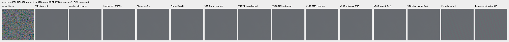

mesh-seed2026112302-present-iso6400-prior-RGGB; ROI `[176, 176, 160, 160]`, RAW exposure 8, contrast 40.

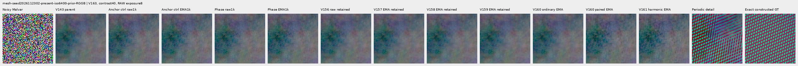

mesh-seed2026112309-present-iso6400-prior-RGGB; ROI `[176, 176, 160, 160]`, RAW exposure 8, contrast 1.

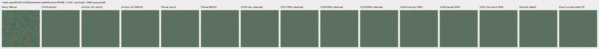

mesh-seed2026112309-present-iso6400-prior-RGGB; ROI `[176, 176, 160, 160]`, RAW exposure 8, contrast 40.

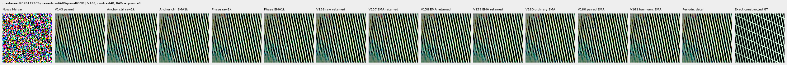

mesh-seed2026112304-absent-iso6400-prior-RGGB; ROI `[165, 0, 160, 160]`, RAW exposure 8, contrast 40.

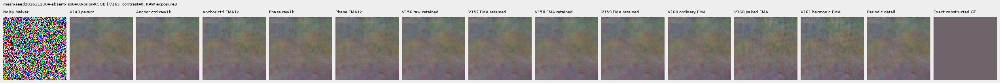

### Quiet neighbors beside edges

mixed-vertical-step-iso6400-prior-RGGB; ROI `[80, 176, 160, 160]`, RAW exposure 8, contrast 40.

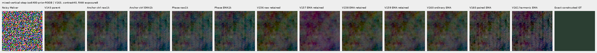

mixed-vertical-step-iso6400-prior-RGGB; ROI `[240, 176, 160, 160]`, RAW exposure 8, contrast 1.

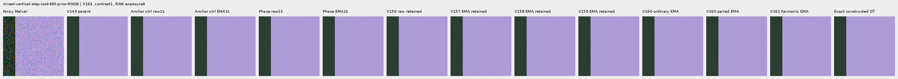

mixed-vertical-step-iso12800-prior-RGGB; ROI `[80, 176, 160, 160]`, RAW exposure 8, contrast 40.

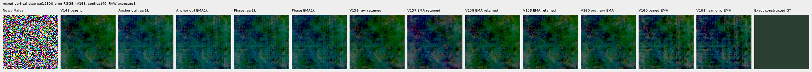

mixed-vertical-step-iso12800-prior-RGGB; ROI `[240, 176, 160, 160]`, RAW exposure 8, contrast 1.

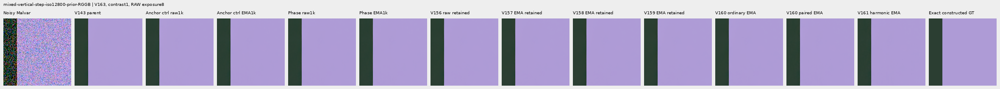

mixed-narrow-bar-iso6400-prior-RGGB; ROI `[80, 176, 160, 160]`, RAW exposure 8, contrast 40.

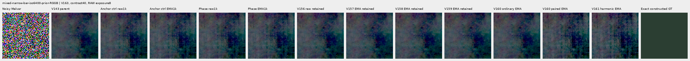

mixed-narrow-bar-iso6400-prior-RGGB; ROI `[240, 176, 160, 160]`, RAW exposure 8, contrast 1.

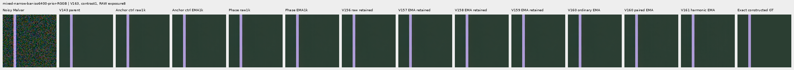

mixed-narrow-bar-iso12800-prior-RGGB; ROI `[80, 176, 160, 160]`, RAW exposure 8, contrast 40.

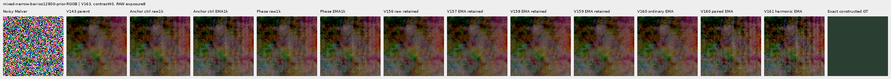

mixed-narrow-bar-iso12800-prior-RGGB; ROI `[240, 176, 160, 160]`, RAW exposure 8, contrast 1.

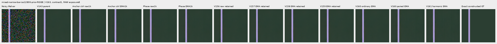

mixed-slanted-step-iso6400-prior-RGGB; ROI `[80, 176, 160, 160]`, RAW exposure 8, contrast 40.

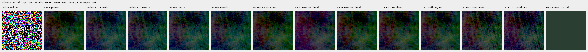

mixed-slanted-step-iso6400-prior-RGGB; ROI `[240, 176, 160, 160]`, RAW exposure 8, contrast 1.

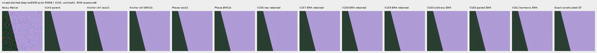

mixed-slanted-step-iso12800-prior-RGGB; ROI `[80, 176, 160, 160]`, RAW exposure 8, contrast 40.

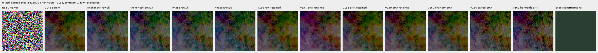

mixed-slanted-step-iso12800-prior-RGGB; ROI `[240, 176, 160, 160]`, RAW exposure 8, contrast 1.

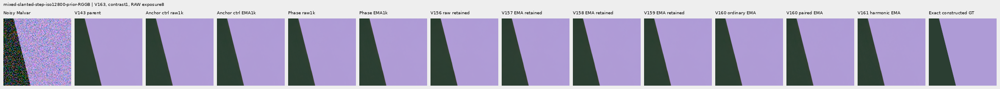

mixed-striped-patch-iso6400-prior-RGGB; ROI `[80, 176, 160, 160]`, RAW exposure 8, contrast 40.

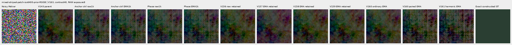

mixed-striped-patch-iso6400-prior-RGGB; ROI `[240, 176, 160, 160]`, RAW exposure 8, contrast 1.

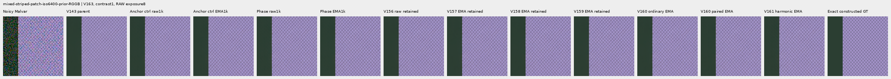

mixed-striped-patch-iso12800-prior-RGGB; ROI `[80, 176, 160, 160]`, RAW exposure 8, contrast 40.

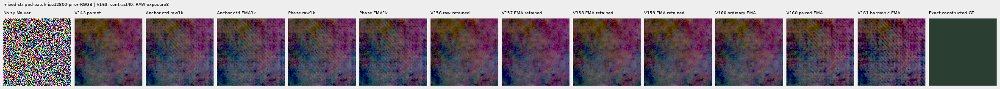

mixed-striped-patch-iso12800-prior-RGGB; ROI `[240, 176, 160, 160]`, RAW exposure 8, contrast 1.

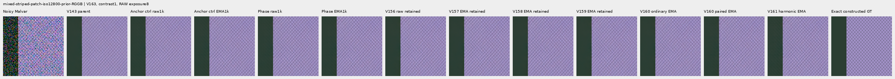

### Standalone flats and slopes

gray-l0.02-adc-only-RGGB; ROI `[48, 48, 160, 160]`, RAW exposure 4, contrast 40.

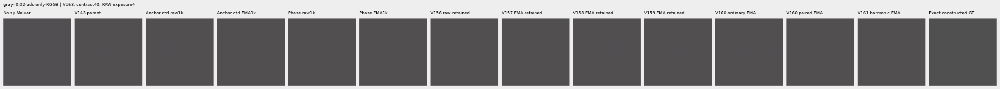

gray-l0.02-iso12800-prior-RGGB; ROI `[48, 48, 160, 160]`, RAW exposure 4, contrast 40.

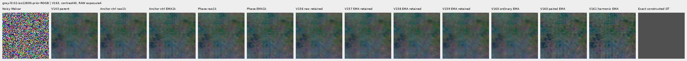

flat512-gray-l0.02-adc-only-RGGB; ROI `[176, 176, 160, 160]`, RAW exposure 4, contrast 40.

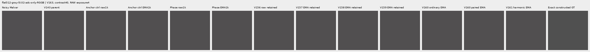

flat512-gray-l0.02-iso6400-prior-RGGB; ROI `[176, 176, 160, 160]`, RAW exposure 4, contrast 40.

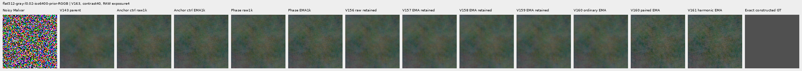

flat512-gray-l0.02-iso12800-prior-RGGB; ROI `[176, 176, 160, 160]`, RAW exposure 4, contrast 40.

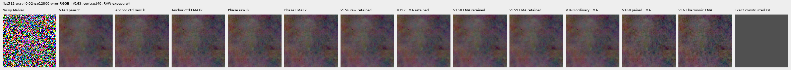

flat512-h210-s0.50-l0.02-iso6400-prior-RGGB; ROI `[176, 176, 160, 160]`, RAW exposure 4, contrast 40.

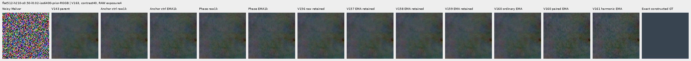

flat512-gray-l0.18-iso12800-prior-RGGB; ROI `[176, 176, 160, 160]`, RAW exposure 1, contrast 8.

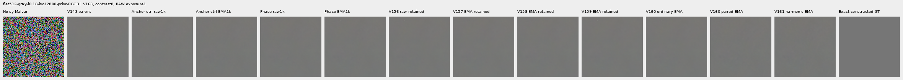

flat512-gray-l0.90-iso12800-prior-RGGB; ROI `[176, 176, 160, 160]`, RAW exposure 1, contrast 4.

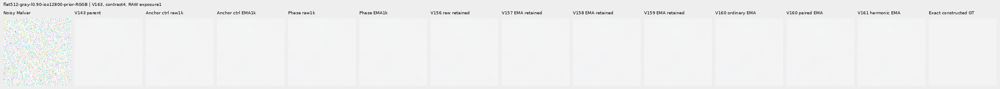

V150-control-ADC-plane0-RGGB; ROI `[176, 176, 160, 160]`, RAW exposure 45, contrast 8.

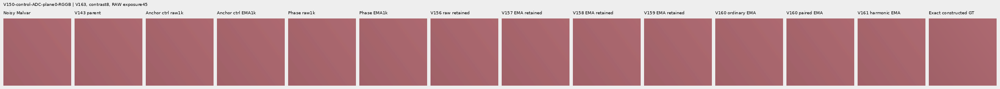

V150-control-ADC-plane1-RGGB; ROI `[176, 176, 160, 160]`, RAW exposure 9, contrast 8.

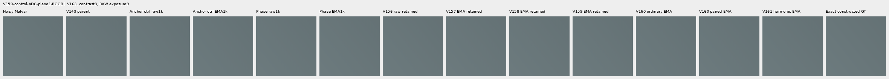

V150-control-ADC-plane2-RGGB; ROI `[176, 176, 160, 160]`, RAW exposure 1, contrast 8.

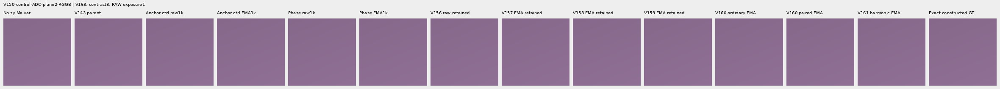

V150-control-ADC-plane3-RGGB; ROI `[176, 176, 160, 160]`, RAW exposure 0.24, contrast 8.

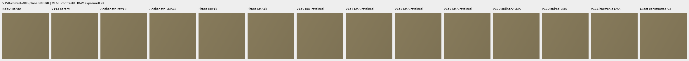

### Natural photographic detail

organic-02a76fd33b5e1414a0504f0b3f0aeb03a569b6f4-photo-faint-RGGB; ROI `[112, 112, 160, 160]`, RAW exposure 14.3883, contrast 8.

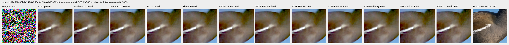

organic-dabacecd4780a1c230f8e9fce6ca1a604bdeab4c-photo-dark-RGGB; ROI `[112, 112, 160, 160]`, RAW exposure 102.758, contrast 1.

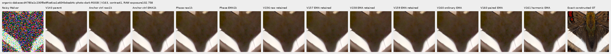

organic-6b3920bceba82d95ecf9351d47f6f94267694bd0-photo-dark-RGGB; ROI `[112, 112, 160, 160]`, RAW exposure 64.0491, contrast 1.

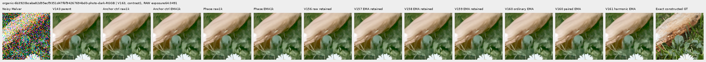

photo-3e638bbb56ed80abc88939468783e3bf9b92ee77-photo-faint-RGGB; ROI `[176, 176, 160, 160]`, RAW exposure 12.1494, contrast 8.

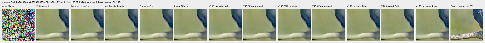

photo-3e638bbb56ed80abc88939468783e3bf9b92ee77-photo-dark-RGGB; ROI `[176, 176, 160, 160]`, RAW exposure 80.9959, contrast 1.

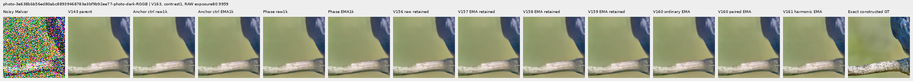

V150-control-bark-contrast0p025-adc-RGGB; ROI `[48, 48, 160, 160]`, RAW exposure 1, contrast 40.

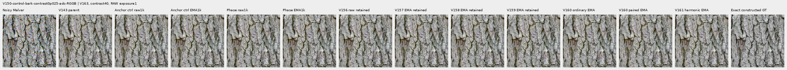

V150-control-raccoon-fur-contrast0p025-adc-RGGB; ROI `[48, 48, 160, 160]`, RAW exposure 1, contrast 40.

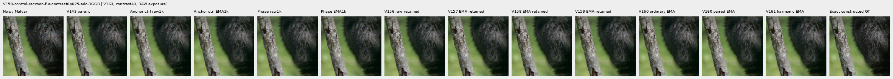

### Protected real GFX scenes

main-overcast-sky; ROI `[176, 176, 160, 160]`, RAW exposure 4, contrast 1.

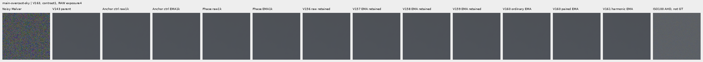

main-building-detail; ROI `[176, 176, 160, 160]`, RAW exposure 4, contrast 1.

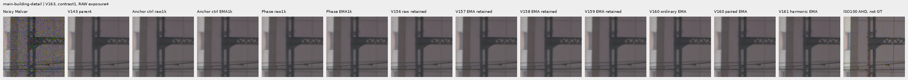

main-foliage; ROI `[176, 176, 160, 160]`, RAW exposure 4, contrast 1.

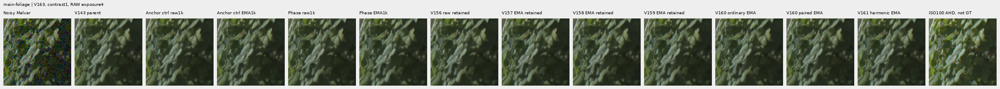

main-chain-link-fence; ROI `[176, 176, 160, 160]`, RAW exposure 4, contrast 1.

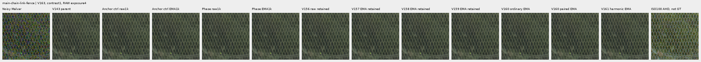

mesh-nominal; ROI `[206, 229, 160, 160]`, RAW exposure 16, contrast 1.

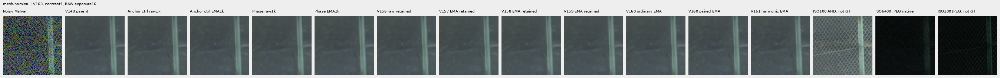

mesh-nominal; ROI `[426, 189, 160, 160]`, RAW exposure 16, contrast 1.

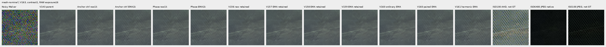

mesh-profile3879; ROI `[206, 229, 160, 160]`, RAW exposure 16, contrast 1.

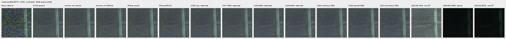

mesh-profile3879; ROI `[426, 189, 160, 160]`, RAW exposure 16, contrast 1.

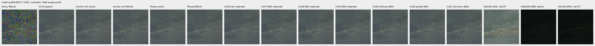

### Noisy, restored, exact constructed GT triplets

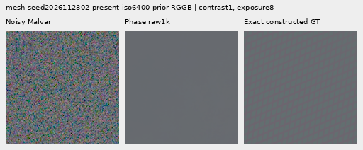

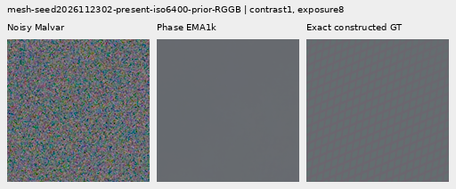

## Training, architecture and validation

V163 exposes phase coupling to frequency conditioning while keeping V162 flat-target anchor weight 0.25 and all base/paired objectives fixed. Control has 124,397 parameters / 46 tensors; candidate has 124,909 / 47. A zero bias-free 16→32 projection adds 512 parameters before the inherited frequency SiLU. For observed RAW and innovation separately, u(w)=F(w)/sqrt(sum_phase|F(w)|²+sum_phase noise), with the existing 1e-12 floor. Real/imaginary coordinates of four same-phase u(w)² conj(u(2w mod S)) products supply sixteen inputs. Doubling indexes the periodic frequency grid exactly; no interpolation is needed. Extra capacity and compute are part of this intervention, not an equal-capacity causal contrast.

The inherited power/Gram/relative frequency conditioning loses common per-frequency phase rotations; its spatial/support paths can already see spatial phase. Each new complex product has magnitude at most one in exact arithmetic. Integer packed-grid circular-shift phase ramps cancel, but windowing/detrending prevent interpreting this as full-network translation invariance. A noisy third-order statistic is not calibrated confidence or an unbiased signal estimate. [Primary-source reading and limitations](results/harmonic-phase-research-20261107-v1.json) informed the hypothesis; no paper code, weights or pseudo-infrared prior is adopted. Gaussian repeated-signal theory and RGB enhancement results do not establish RAW fidelity.

The control exactly reproduces every V162 flat-anchor trace row and final raw/EMA/Adam state; 1,644 actual control predictions replay byte-exact before archive storage is reused. All 88 prior neural modules stay unchanged, with one new module. Initial shared tensors are equal and the phase adapter starts at zero. Historical comparator columns mix architecture/loss/data changes. Only the current comparison holds V162 data and losses fixed for the phase-input/capacity intervention.

The retained V160 cache contains 4,000 frames: 1,382 present/background pairs and 1,236 ordinary frames from 2,618 scene/patch instances. Its 486 photo pairs visit 268 free-photo IDs; 234 reduce contrast and 245 use reviewed ROIs. Geometry precedes area 2 after bin 4; optical blur is zero. All 18 held-out IDs and protected captures/JPEGs/siblings remain excluded. V163 creates no new sources/noise or parent/DINO predictions. [V160 construction evidence](paired-response.md) preserves its original accounting failure and explicit 23-batch adoption.

All 180 CPU checks pass, including 24 new tests with independent NumPy values and complete complex input/shared-noise adjoints, alias accumulation, descriptor collisions, integer shifts, conjugacy, nonzero-head embedding/common gradients, batch isolation, active-path constants and all 47 candidate parameter tensors receiving gradients. Genuine 8+2 model/EMA/Adam/RNG restoration passes; the first ten complete smoke/train rows match exactly. CUDA parity covers 28 archived contexts / 56 calls and all CFAs/native 256/384/512/768. Ten additional leaf-output backwards independently check masks/losses/gradients; these are not neural forwards. Four strict CPU endpoint loads and 93 finite final Adam states pass.

An [artificial-spectrum witness on the trained V162 EMA head](results/v163-phase-information-witness-v2.json) preserves inherited conditioning and actual frequency gain exactly under a conjugate-bin sign flip while new phase inputs differ. It proves a representation distinction, not image quality. Its first serializer failure and the initial overstrict FP64 conjugacy-test assertion are preserved in [preparation evidence](results/v163-harmonic-phase-preparation-v1.json); model arithmetic was unchanged by those corrections.

`anchor-control`: 197/900 supervised batches clip; pre-clip norm median 0.422909, maximum 113.627274.

`harmonic-phase`: 198/900 supervised batches clip; pre-clip norm median 0.428669, maximum 113.627281.

The 100 zero-gradient ADC batches advance Adam/EMA clocks. Gradient norms describe optimization pressure; they do not isolate the cause of a quality change.

The independent audit checks 40,210 scalars across 4,686 rows and 476 Decimal reductions; maximum scalar difference is 1.59e-12. All 72 native images / 24 triplets were actually viewed in 18 original-detail sheets; 58,137,600 RGB channels were independently checked.

Actual scientific work is 5,412 root head calls: 56 parity, 20 discarded smoke, 2,000 training, 3,288 main review and 48 phase-removal calls. These evaluate 11,472 head images. Ten CUDA leaf-output backwards, four separate CPU frequency-gain witness calls including the failed serializer, and CPU tests are outside root-forward counts. All 1,644 new main candidate arrays / 4.421 GiB plus 24 off arrays / 0.0824 GiB remain external. Control outputs replay exactly before storage adoption. All thirteen original and continuation scientific owners are terminal. The original review stopped at a combined disk guard after 268 completed control calls; its log does not identify which disk crossed its floor. All original source/log/journal/export bytes are retained. Full input/parent/output/export checks adopted those 268 calls, then an explicit continuation evaluated only the missing 3,020 main calls. No completed call or training run was repeated; one scientific review-stage failure is recorded. Initial local/external reserves were 60/148 GiB; continuation uses 58/148 GiB with a 0.25 GiB remaining local artifact bound and a 0.5 GiB projected margin; older evidence is retained. Original RAW files and `/mnt/dataz` are unused.

## Trained phase-adapter removal

Twelve prospectively fixed inputs at both candidate endpoints produce 24 on/off pairs / 48 actual calls. Only phase_in.weight is zeroed for off; harmonic context and direct RGB paths remain active. On outputs replay the main collection exactly; the direct spatial correction stays bit-exact, weights are restored and RNG stays unchanged. These are output displacements, not accuracy gains or an isolated account of training dynamics. The real scenes have qualitative ISO100 references, not GT.

| Endpoint | Fixed case | On-off RMS DN16 | Maximum absolute DN16 |
| --- | --- | ---: | ---: |
| harmonic-phase-raw-step1000 | mesh-seed2026112302-present-iso6400-prior-RGGB | 0.03452255 | 0.22887834 |
| harmonic-phase-raw-step1000 | mesh-seed2026112302-absent-iso6400-prior-RGGB | 0.03947868 | 0.40538932 |
| harmonic-phase-raw-step1000 | mesh-seed2026112309-present-iso6400-prior-RGGB | 0.06350796 | 0.44530571 |
| harmonic-phase-raw-step1000 | mesh-seed2026112309-absent-iso6400-prior-RGGB | 0.03553798 | 0.31261730 |
| harmonic-phase-raw-step1000 | organic-02a76fd33b5e1414a0504f0b3f0aeb03a569b6f4-photo-faint-RGGB | 0.03025756 | 0.26244717 |
| harmonic-phase-raw-step1000 | main-overcast-sky | 0.03712059 | 0.30590354 |
| harmonic-phase-raw-step1000 | mesh-nominal | 0.04168315 | 0.31573005 |
| harmonic-phase-raw-step1000 | mesh-profile3879 | 0.03564337 | 0.25359720 |
| harmonic-phase-raw-step1000 | flat512-gray-l0.02-iso6400-prior-RGGB | 0.03175096 | 0.19201367 |
| harmonic-phase-raw-step1000 | flat512-gray-l0.02-iso12800-prior-RGGB | 0.05315396 | 0.36010193 |
| harmonic-phase-raw-step1000 | mixed-vertical-step-iso6400-prior-RGGB | 0.05124971 | 0.38085356 |
| harmonic-phase-raw-step1000 | mixed-vertical-step-iso12800-prior-RGGB | 0.06308019 | 0.48314692 |
| harmonic-phase-EMA-step1000 | mesh-seed2026112302-present-iso6400-prior-RGGB | 0.03829800 | 0.28295467 |
| harmonic-phase-EMA-step1000 | mesh-seed2026112302-absent-iso6400-prior-RGGB | 0.04386165 | 0.43761539 |
| harmonic-phase-EMA-step1000 | mesh-seed2026112309-present-iso6400-prior-RGGB | 0.06818562 | 0.48937242 |
| harmonic-phase-EMA-step1000 | mesh-seed2026112309-absent-iso6400-prior-RGGB | 0.03965441 | 0.35143507 |
| harmonic-phase-EMA-step1000 | organic-02a76fd33b5e1414a0504f0b3f0aeb03a569b6f4-photo-faint-RGGB | 0.03358217 | 0.28808154 |
| harmonic-phase-EMA-step1000 | main-overcast-sky | 0.04112315 | 0.34203580 |
| harmonic-phase-EMA-step1000 | mesh-nominal | 0.04386045 | 0.32415277 |
| harmonic-phase-EMA-step1000 | mesh-profile3879 | 0.03794667 | 0.26391199 |
| harmonic-phase-EMA-step1000 | flat512-gray-l0.02-iso6400-prior-RGGB | 0.03481017 | 0.21374186 |
| harmonic-phase-EMA-step1000 | flat512-gray-l0.02-iso12800-prior-RGGB | 0.05848718 | 0.37902254 |
| harmonic-phase-EMA-step1000 | mixed-vertical-step-iso6400-prior-RGGB | 0.05705254 | 0.45531532 |
| harmonic-phase-EMA-step1000 | mixed-vertical-step-iso12800-prior-RGGB | 0.06990589 | 0.51024612 |

## Inherited audited training-mask coverage

All 1,000 actual V163 mask records match V162 on identical target batches and unchanged mask code. V162 independently recomputed these masks from original clean RGB with streaming NumPy; V163 replays that oracle and performs no new independent mask computation. Eligibility uses detached per-channel 17×17 clean-target range at most 1 DN16 with truncated borders. Stable pseudo-Huber absolute target error uses 16 DN16 units and a whole-image denominator; eligible weak gradients keep actual targets. Mean batch fraction reflects that denominator, while pixel-weighted fraction accounts for mixed context sizes. ADC masks are recorded but supervised loss remains zero. Targets/masks never enter inference; coverage is not a flat-safety result.

| Domain | ADC only | Batches | Mean batch eligible fraction | Pixel-weighted eligible fraction |
| --- | --- | ---: | ---: | ---: |
| mesh | False | 307 | 0.699702 | 0.699702 |
| mesh | True | 34 | 0.667894 | 0.667894 |
| weak | False | 99 | 0.502555 | 0.502555 |
| weak | True | 8 | 0.500000 | 0.500000 |
| photo | False | 214 | 0.522321 | 0.522321 |
| photo | True | 29 | 0.507665 | 0.507665 |
| flat | False | 141 | 0.688589 | 0.688589 |
| flat | True | 12 | 0.646564 | 0.646564 |
| mixed | False | 139 | 0.907641 | 0.907641 |
| mixed | True | 17 | 0.907094 | 0.907094 |

[Original protocol](results/v163-harmonic-phase-v1/original-protocol.md) · [Immutable preparation](results/v163-harmonic-phase-preparation-v1.json) · [Independent publication verification](results/v163-harmonic-phase-publication-verification-v2.json).

## Photographic credits

Derived native targets/crops retain the respective source licenses; transformations include linearization, area binning and exposure/contrast changes. Source IDs and ROIs are in the manifest.

| Source | Author | License |
| --- | --- | --- |
| [File:Emamzadeh Esmaeil roof.jpg](https://commons.wikimedia.org/wiki/File:Emamzadeh_Esmaeil_roof.jpg) | مانفی | [CC BY-SA 4.0](https://creativecommons.org/licenses/by-sa/4.0) |
| [File:HP-85-IMG 0439.jpg](https://commons.wikimedia.org/wiki/File:HP-85-IMG_0439.jpg) | Rama & Musée Bolo | [CC BY-SA 2.0 fr](https://creativecommons.org/licenses/by-sa/2.0/fr/deed.en) |
| [File:Spangled Drongo - AndrewMercer - DSC00966.jpg](https://commons.wikimedia.org/wiki/File:Spangled_Drongo_-_AndrewMercer_-_DSC00966.jpg) | Andrew Mercer (www.baldwhiteguy.co.nz) | [CC BY-SA 4.0](https://creativecommons.org/licenses/by-sa/4.0) |
| [File:Naxos Chora 2025-06-14 0505.jpg](https://commons.wikimedia.org/wiki/File:Naxos_Chora_2025-06-14_0505.jpg) | Tsui | [CC BY-SA 4.0](https://creativecommons.org/licenses/by-sa/4.0) |
| [File:Castelo Novo April 2015-2a.jpg](https://commons.wikimedia.org/wiki/File:Castelo_Novo_April_2015-2a.jpg) | Alvesgaspar | [CC BY-SA 4.0](https://creativecommons.org/licenses/by-sa/4.0) |
| [File:RX50 -5 ¼” dual floppy disk drive 02.jpg](https://commons.wikimedia.org/wiki/File:RX50_-5_%C2%BC%E2%80%9D_dual_floppy_disk_drive_02.jpg) | Mister rf | [CC BY-SA 4.0](https://creativecommons.org/licenses/by-sa/4.0) |
| [File:DSC00752 San Salvator Laur.jpg](https://commons.wikimedia.org/wiki/File:DSC00752_San_Salvator_Laur.jpg) | Rione Colonna | [CC BY 4.0](https://creativecommons.org/licenses/by/4.0) |
| [File:Regierungsgebäude, Vaduz.jpg](https://commons.wikimedia.org/wiki/File:Regierungsgeb%C3%A4ude,_Vaduz.jpg) | AuHaidhausen | [CC BY 4.0](https://creativecommons.org/licenses/by/4.0) |
| [File:Common moorhen (Gallinula chloropus) France.jpg](https://commons.wikimedia.org/wiki/File:Common_moorhen_(Gallinula_chloropus)_France.jpg) | Alexis Lours | [CC BY 4.0](https://creativecommons.org/licenses/by/4.0) |
| [File:Dried platanus leaves on rain puddle, Quinta das Conchas e dos Lilases, Lisbon, Portugal julesvernex2.jpg](https://commons.wikimedia.org/wiki/File:Dried_platanus_leaves_on_rain_puddle,_Quinta_das_Conchas_e_dos_Lilases,_Lisbon,_Portugal_julesvernex2.jpg) | Jules Verne Times Two | [CC BY-SA 4.0](https://creativecommons.org/licenses/by-sa/4.0) |
| [File:Close wing pudding position of Lethe visrava (Moore, 1866) - White-edged Woodbrown WLB IMG 0997.jpg](https://commons.wikimedia.org/wiki/File:Close_wing_pudding_position_of_Lethe_visrava_(Moore,_1866)_-_White-edged_Woodbrown_WLB_IMG_0997.jpg) | Thamblyok | [CC BY-SA 4.0](https://creativecommons.org/licenses/by-sa/4.0) |
| [File:Daisies near Cockspur coral tree (Erythrina crista-galli) roots, Jardim da Praça de Londres, Lisbon, Portugal julesvernex2.jpg](https://commons.wikimedia.org/wiki/File:Daisies_near_Cockspur_coral_tree_(Erythrina_crista-galli)_roots,_Jardim_da_Pra%C3%A7a_de_Londres,_Lisbon,_Portugal_julesvernex2.jpg) | Jules Verne Times Two | [CC BY-SA 4.0](https://creativecommons.org/licenses/by-sa/4.0) |
| [File:Apples on tree 2021 G1.jpg](https://commons.wikimedia.org/wiki/File:Apples_on_tree_2021_G1.jpg) | George Chernilevsky | [CC BY-SA 4.0](https://creativecommons.org/licenses/by-sa/4.0) |
| [File:Close wing Nectering of Pseudozizeeria maha (Kollar, 1844) - Pale Grass Blue WLB.jpg](https://commons.wikimedia.org/wiki/File:Close_wing_Nectering_of_Pseudozizeeria_maha_(Kollar,_1844)_-_Pale_Grass_Blue_WLB.jpg) | Anitava Roy | [CC BY-SA 4.0](https://creativecommons.org/licenses/by-sa/4.0) |
| [File:Grey heron (Ardea cinerea) head.jpg](https://commons.wikimedia.org/wiki/File:Grey_heron_(Ardea_cinerea)_head.jpg) | Alexis Lours | [CC BY 4.0](https://creativecommons.org/licenses/by/4.0) |
| [File:Openwing position of Parasarpa dudu (Westwood, -1850-) - White Commodore.jpg](https://commons.wikimedia.org/wiki/File:Openwing_position_of_Parasarpa_dudu_(Westwood,_-1850-)_-_White_Commodore.jpg) | MaheshBaruahwildlife | [CC BY-SA 4.0](https://creativecommons.org/licenses/by-sa/4.0) |
| [File:Kentucky Coffee-tree Gymnocladus dioicus 3264px.jpg](https://commons.wikimedia.org/wiki/File:Kentucky_Coffee-tree_Gymnocladus_dioicus_3264px.jpg) | Photo (c)2007 Derek Ramsey (Ram-Man) | [CC BY-SA 2.5](https://creativecommons.org/licenses/by-sa/2.5) |
| [File:Racoon clinging to a tree.JPG](https://commons.wikimedia.org/wiki/File:Racoon_clinging_to_a_tree.JPG) | Korall | [CC BY 3.0](https://creativecommons.org/licenses/by/3.0) |

## Fixed component checkpoints

- `anchor-control-raw-step1000`: `b0d07ac3f9a7138867fbd19b59e1419e48b41a8cbd01ccc9797d8c8e92b7b6b8`.
- `anchor-control-EMA-step1000`: `e972f9a65dc4292b4df1a91ece4f79dbdea85a27918a36b75d30001e49c85dc8`.
- `harmonic-phase-raw-step1000`: `d098ffeb5bc866234c9d193eedb6c8c4b1cdfc55c1d67ee4e2f949668cfbf51f`.
- `harmonic-phase-EMA-step1000`: `e7164725cb42e0aedf11a56af8f3e96458406fcd0ddba7b624475e2b944033c2`.
