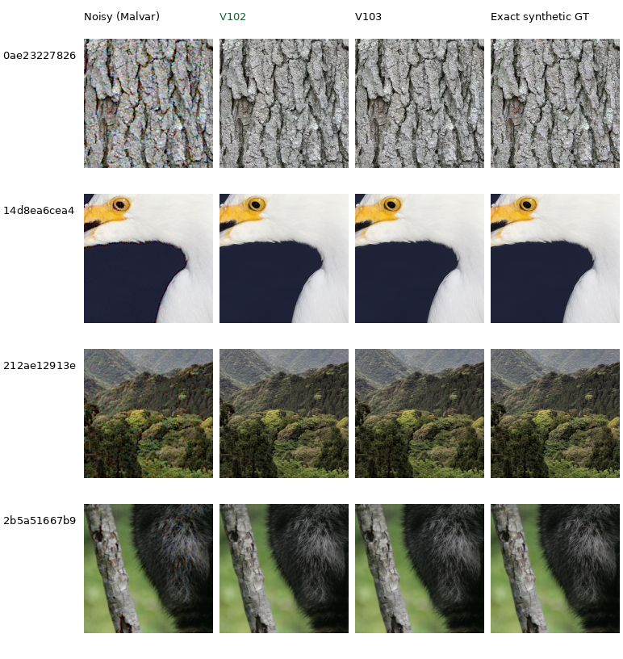
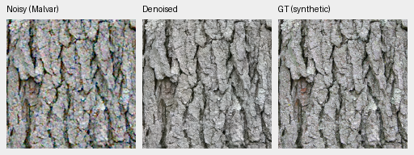
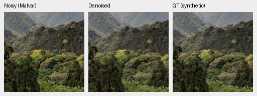

# Natural fine-detail comparisons

**V102 final20k improves PSNR, SSIM, chroma and gradient error on all12 selected
cases over V101 and fixed V102@5000**, adding +.36dB ADC-only, +.29dB ISO100
and +.043dB ISO12800 over V101.
Visible changes are small. V84/V100/V101/V102 all preserve substantially more bark grain,
feather texture, canopy structure and fur than RawNIND here. At high noise,
white plumage, distant trees and individual hairs remain smoothed.

The four contexts were selected by viewing clean inputs before inspecting
these model outputs. They cover mixed contrast, including weak fine structures;
they are not a set of globally low-contrast images. Their exact source IDs are
absent from the training cohort. This small diagnostic complements the
[full photographic and camera results](current-model.md). The [V102/V103 full matched primary panels](v102-v103-quality-review.md) and
complete GFX exports are finished; V102 is the current quality baseline.
The completed V103 follow-up below is also available; it remains close to V102.

Each cell is an unchanged **160×160 native-pixel crop** at the8×-binned evaluation
resolution. Open the original PNG at100%; a browser may fit the board to its
window. Columns share the same noisy observation, coordinates, display and exact
synthetic target. RawNIND uses input-only CFA-channel gain. V102@20000 is highlighted
among the matched checkpoints in this gallery.

The [fixed-weight noise-conditioning probe](noise-conditioning.md) separates a
related detail/grain tradeoff: lower priors preserve more high-noise structure
and residual error. It keeps the true noisy observations fixed; the current
calibrated default remains unchanged.

## V102 versus V103 on the fixed material panel

The original final 20k EMAs are now compared on the same 12 cached observations.
All 12 V102 scores and triplet PNGs reproduce the earlier report exactly.
V103 improves all 12 PSNR, SSIM, chroma and gradient cases over V101,but is slightly
lower than V102 on these four-source condition means:

| Condition | V102 PSNR | V103 PSNR | V103−V102, dB |
| --- | ---: | ---: | ---: |
| ADC-only | 39.24687 | 39.24499 | −.00187 |
| ISO100 prior | 40.63881 | 40.62445 | −.01436 |
| ISO12800 prior | 33.46901 | 33.46767 | −.00134 |

V103 improves 4/12 PSNR cases over V102 and regresses 8; SSIM splits 6/6.
Chroma/gradient error improve in 4/3 cases and worsen in 8/9 respectively.
These small differences from one seed and four selected sources support retaining V102;
they do not override V103's nearly identical full 427-photo result.
[Exact scores, identities, input replay and 48 actually viewed native cells](results/V103-final20000-heldout-detail-CPU-v1.json).

Columns: noisy Malvar, V102, V103, exact synthetic GT. Each cell is 160×160 native
pixels at the 8×-binned evaluation resolution. No resizing, sharpening or
method-specific display changes are applied. Low-noise bark and canopy remain
close; high-noise pale feathers, distant canopy and individual hairs stay soft.

[ISO100 source, ROI, checkpoint, noise and display records](images/detail-v102-v103/iso100-prior/manifest.json) ·
[ADC-only native comparison](images/detail-v102-v103/adc-only/photo-comparison.png)
([metadata](images/detail-v102-v103/adc-only/manifest.json)) ·
[High-noise native comparison](images/detail-v102-v103/iso12800-prior/photo-comparison.png)
([metadata](images/detail-v102-v103/iso12800-prior/manifest.json)).

Two V103 noisy/restored/exact-GT triplets at the ISO100 prior:

Sources: [Derek Ramsey, bark](https://commons.wikimedia.org/wiki/File:Kentucky_Coffee-tree_Gymnocladus_dioicus_3264px.jpg),
[CC BY-SA 2.5](https://creativecommons.org/licenses/by-sa/2.5/), and
[Grendelkhan, forest canopy](https://commons.wikimedia.org/wiki/File:Forest_covered_hills_on_Yakushima.jpg),
[CC BY-SA 4.0](https://creativecommons.org/licenses/by-sa/4.0/). Modifications:
binning, cropping, synthetic noise, restoration and shared display conversion.
Remaining source credits accompany each gallery manifest and the earlier panel below.

V104's original final 20k endpoint is queued for this same CPU panel after its
exact trainer/controller exits. Freshly prepared inputs reproduce all 12
original observation tensor hashes and all four source IDs are absent from the
90,872-source training cohort. The queue uses the current frozen loader source;
it accepts no intermediate checkpoint and performs no automatic promotion.
[Active training and evidence](quality-first-training.md#active-v104-cleaned-corpus-continuation).

## Current continuations

V102 continues the final V101 EMA with fresh AdamW/EMA on the separately frozen
88,477-source cohort, retaining its six reviewed ROIs and zero-PSF/detail
recipe. Its **original20,000-update endpoint** has finished; the earlier fixed
quarter-budget5k snapshot remains alongside it. Neither was selected through
a best-checkpoint search. V103 completed its32-ROI arm at the same final budget; its full427 results
are in the [completed comparison](v102-v103-quality-review.md).

| Condition, four-source mean | V101 PSNR | V102@5000 | V102 final20k | Final−V101, dB |
| --- | ---: | ---: | ---: | ---: |
| ADC-only | 38.885 | 39.043 | **39.247** | +.362 |
| ISO100 prior | 40.354 | 40.503 | **40.639** | +.285 |
| ISO12800 prior | 33.426 | 33.447 | **33.469** | +.043 |

All four main case metrics improve in12/12 versus both V101 and fixed5000.
Shadow PSNR improves12/12 versus V101; the three available highlight-boundary
chroma/RGB cases also improve. Low-noise bark and canopy retain slightly more
structure, while high-noise
feathers, canopy and fur remain smoothed. These are four selected sources,
three conditions and RGGB, rather than full427 or measured-camera results.
Continuation budget, LR, seed and cohort differ from V101, so this comparison
does not isolate a dataset effect. The [final20k receipt](results/V102-final20000-detail-GFX-CPU-v1.json)
records all12 scores and actual viewing of96 native gallery cells plus30 GFX
cells. [Six-region real-capture comparison](gfx-qualitative.md#v102-at-5000-and-20000-updates).
The [fixed5k receipt](results/V102-progress5000-detail-GFX-CPU-v1.json) preserves
its earlier gains and small individual SSIM/chroma regressions.

V100/V101 each continue the exact V84 final20k EMA for10,000 updates on the
curated88,484-source cohort, with fresh AdamW/EMA. V100 retains the control
recipe; V101 removes optical PSFs and adds weak textures, photographic contrast
attenuation and reviewed fine-detail ROI sampling. Their comparison tests that
combined package, not a single isolated component.

| Condition, four-source mean | V84 PSNR | V100 PSNR | V101 PSNR | V101−V84, dB | V101−V100, dB |
| --- | ---: | ---: | ---: | ---: | ---: |
| ADC-only | 38.730 | 38.806 | **38.885** | +.155 | +.079 |
| ISO100 prior | 40.244 | 40.305 | **40.354** | +.110 | +.048 |
| ISO12800 prior | 33.409 | 33.416 | **33.426** | +.017 | +.010 |

V101's PSNR/SSIM improve in all12 cases against both checkpoints. Gradient error
improves in12/12 versus V84 and11/12 versus V100; chroma improves in10/12 and9/12
respectively. The native images remain close. Slightly stronger low-noise bark
grain and canopy contrast are useful progress; high-noise detail remains a
quality target. These means describe four selected240-pixel interiors, not the
full427 benchmark or real-camera quality.
[Complete V101 per-case scores and viewed-image receipt](results/heldout-detail-V101-final-v1.json).
The planned final endpoints were used without searching intermediate checkpoints.
The [completed full photographic/camera comparison](v84-curated-quality-review.md)
confirms a smaller widespread photographic gain, with camera means close to V84.

All learned checkpoints here retain their original output policy. The
[optional ADC-only site correction](adc-consistency.md) is evaluated separately;
it is not applied to any column in these training comparisons.

## Low noise

At the ISO 100 prior, V84 retains the fine pale bark texture, feather strands
and canopy detail that RawNIND softens:

[ISO100 source triplets and metadata](images/current-detail/iso100-prior/manifest.json)
include source attribution, checkpoint hashes, source/context coordinates,
noise parameters and display exposure.

With no simulated shot/read noise, demosaicing and ADC quantization still
leave some fine-texture errors:

[ADC-only source triplets and metadata](images/current-detail/adc-only/manifest.json).
The [optional ADC site correction](adc-consistency.md) gains .400dB across the
complete427-photo/four-CFA ADC-only panel with unchanged V84 weights. Its native
examples include these four contexts, preselected fabric/building views and
posthoc weakest-gain/chroma-increase cases. Color/uniformity tradeoffs remain
documented; positive-noise inputs bypass it.

## High noise

At the ISO 12800 prior, V84 restores the broad structures much better than
RawNIND, but the feather/canopy/fur examples show why detail retention remains
an active quality target:

[ISO12800 source triplets and metadata](images/current-detail/iso12800-prior/manifest.json).
The standing [GFX comparisons](gfx-qualitative.md) provide a separate check on
real ISO 6400 RAW data, including foliage and chain-link fencing.

## Inputs and reproduction

These are the original seed42 native256 contexts at indices124,200,320,392 of
the fixed full427 photographic validation panel. Sources use the existing
8× binned linear-sRGB caches. Display ROI is **[48,48,160,160]** within each
context; optional numerical scores use the **[8,8,240,240]** interior.
The [selection file](../configs/heldout-fine-detail-v1.json) records context
coordinates and hashes. Filtering and reindexing the dataset before extracting
these contexts would change the crops.

The three conditions use RGGB and the existing physical-noise protocol:

| Condition | Shot coefficient | Read variance | Display exposure |
| --- | ---: | ---: | ---: |
| ADC-only | 0 | 0 | ×1 |
| ISO100 prior | .00002 | .0000000016 | ×1 |
| ISO12800 prior | .00256 | .0000262144 | ×1 |

These are declared priors, not measured ISO calibrations. WB=[2,1,1.5] and the
shared camera-to-sRGB matrix come from [evaluation.yaml](../configs/evaluation.yaml).
Noisy previews use Malvar demosaicing. All methods use FP32 CPU inference on
the same 12 cached observations; the CPU noise draws are newly generated and
do not replace the original full-panel CUDA scores. Display uses the same
linear-to-sRGB transform and exposure across columns.

V84 selects the final20k EMA from checkpoint SHA256
`134887e12357aabf420cceee3ee53fc8832cf02a8f81ff883b829a9e51e16f10`.
RawNIND weights have SHA256
`c1f7de3de24cb12f4803ee65e11cfb467e9a5b80c3cb7126746ef026106c15e0`.
The [reference receipt](results/heldout-detail-V84-reference-v1.json) binds the
input plan, complete numerical report, immutable reference boards and 24
source triplets. All 48 displayed cells were inspected at native resolution;
model and input hashes remained unchanged.
V100 uses its final10000 EMA, checkpoint SHA256
`4b689fb187b13df72fbf79ebd46f98cf7361c3ca8a97fb1f7afee940b249ad3e`.
Its receipt preserves the earlier three boards/60 native160 cells.
V101 uses the final10000 EMA, checkpoint SHA256
`6f691c653a618bdde0d7db501f3efc557a9699e2dbba73cf94c7440b364ef3e3`.
Its receipt adds12 triplets and records actual inspection of its three
boards/72 native160 cells, with self-contained immutable gallery copies.
V102's fixed5000 EMA has checkpoint SHA256
`64f3540fa6415a179d061efc226330fc59e21c3306048dcb6854d18528e6505b`.
Its receipt preserves12 triplets and self-contained copies of its three boards/
84 native160 cells. The original final20000 EMA has checkpoint SHA256
`55936a11ca5be7c1ae941953e14c8afe1186123f366e54f1947104a894e64c7a`.
Its receipt preserves the enlarged current three boards/96 native160 cells.
All shared noisy/GT pixels remain exact;
earlier receipts and individual source crops are unchanged. The read-only
local checkpoints are `/mnt/external/demosaic/models/v101-final10000.pt` and
`/mnt/external/demosaic/models/v102-final20000.pt`; the earlier
`/mnt/external/demosaic/models/v102-progress5000.pt` remains available.

[report_heldout_detail.py](../scripts/report_heldout_detail.py) prepares shared
observations and evaluates additional checkpoints. The frozen local input plan
is `.cache/current-quality-20261022-v1/heldout-detail-inputs-v2/plan.json`.
Use its copied worker for comparisons so the numerical implementation stays
identical. This current gallery can grow when useful models appear; the
reference receipt preserves the original V84 evidence.

## Image credits

All panels are modified through binning, cropping, simulated observation and
restoration. Rows are ordered as follows:

| Detail | Original image and author | License |
| --- | --- | --- |
| Bark | [Kentucky Coffee-tree](https://commons.wikimedia.org/wiki/File:Kentucky_Coffee-tree_Gymnocladus_dioicus_3264px.jpg), Photo (c)2007 Derek Ramsey (Ram-Man) | [CC BY-SA 2.5](https://creativecommons.org/licenses/by-sa/2.5) |
| White feathers | [Snowy egret in profile](https://commons.wikimedia.org/wiki/File:Snowy_egret_in_profile.jpg), Serebit | [CC BY-SA 4.0](https://creativecommons.org/licenses/by-sa/4.0) |
| Forest canopy | [Forest covered hills on Yakushima](https://commons.wikimedia.org/wiki/File:Forest_covered_hills_on_Yakushima.jpg), Grendelkhan | [CC BY-SA 4.0](https://creativecommons.org/licenses/by-sa/4.0) |
| Gray fur | [Racoon clinging to a tree](https://commons.wikimedia.org/wiki/File:Racoon_clinging_to_a_tree.JPG), Korall | [CC BY 3.0](https://creativecommons.org/licenses/by/3.0) |
