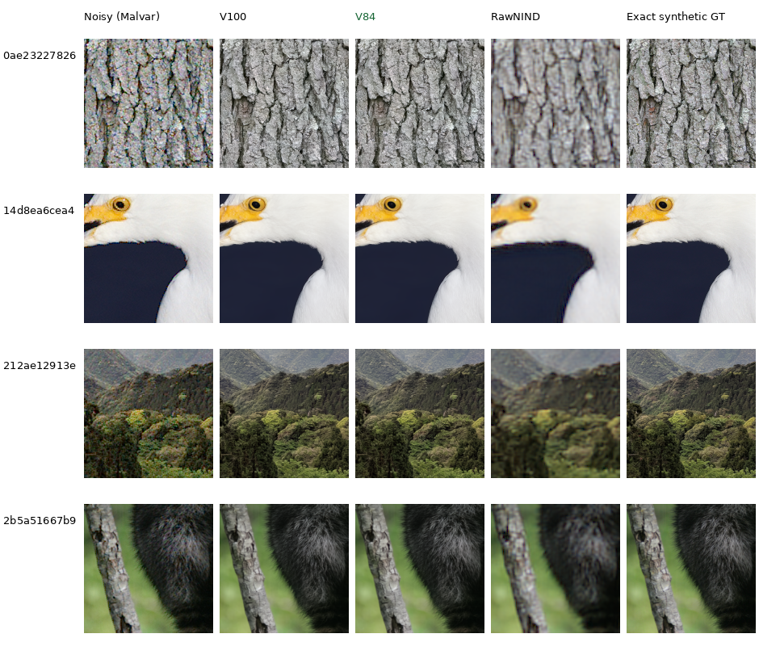
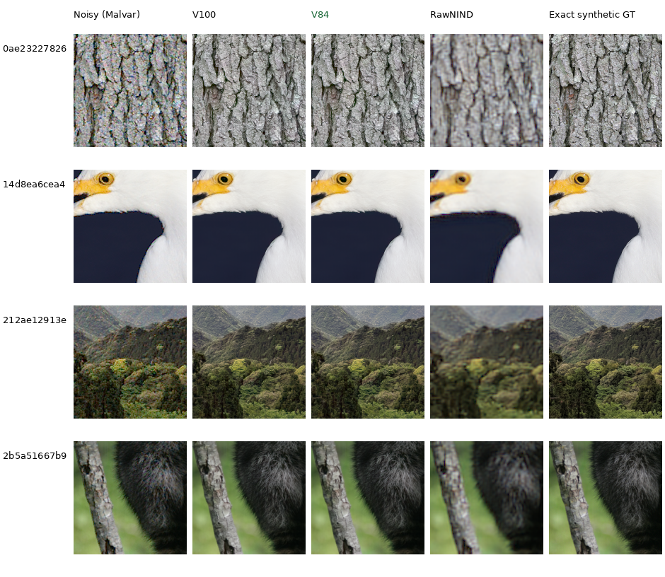
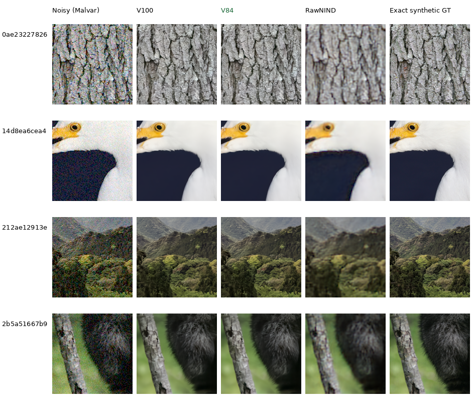

# Natural fine-detail comparisons

V84 preserves substantially more bark grain, feather texture, canopy structure
and fur than RawNIND in these examples. At high noise, it still smooths the
egret's white plumage, distant trees and individual hairs. These are useful
targets for the current reduced-blur and fine-detail training recipes.

The four contexts were selected by viewing clean inputs before inspecting
these model outputs. They cover mixed contrast, including weak fine structures;
they are not a set of globally low-contrast images. Their exact source IDs are
absent from the active training cohort. This small diagnostic complements the
[full photographic and camera results](current-model.md), which determine the
broader comparison. V100's final continuation is included; V101's reduced-blur
and fine-detail continuation is still training.

Each cell is an unchanged **160×160 native-pixel crop**. Open the original PNG
at 100% for inspection; a browser may fit the whole board to its window.
Columns share the same noisy observation, coordinates, display and exact
synthetic target. RawNIND uses input-only CFA-channel gain.

## Current continuation

V100 final10000 continues V84 on the curated 88,484-source cohort with the
control recipe. It gains a little PSNR on all 12 selected cases:

| Condition, four-source mean | V84 sRGB PSNR | V100 sRGB PSNR | Change, dB |
| --- | ---: | ---: | ---: |
| ADC-only | 38.730 | 38.806 | +.076 |
| ISO100 prior | 40.244 | 40.305 | +.062 |
| ISO12800 prior | 33.409 | 33.416 | +.007 |

The native images look close, and the high-noise feather/canopy/fur smoothing
remains. SSIM and gradient error improve in 11/12 cases, chroma error in 8/12;
the remaining cases show small tradeoffs. These means describe only the four
selected 240-pixel interiors, not the full427 benchmark or real-camera quality.
[Per-case results and viewed-image receipt](results/heldout-detail-V100-final-v1.json).
The final endpoint was selected by the planned update count, with no search
over intermediate checkpoints. The [full evaluation remains queued](quality-first-training.md).

## Low noise

At the ISO 100 prior, V84 retains the fine pale bark texture, feather strands
and canopy detail that RawNIND softens:

[ISO100 source triplets and metadata](images/current-detail/iso100-prior/manifest.json)
include source attribution, checkpoint hashes, source/context coordinates,
noise parameters and display exposure.

With no simulated shot/read noise, demosaicing and ADC quantization still
leave some fine-texture errors:

[ADC-only source triplets and metadata](images/current-detail/adc-only/manifest.json).

## High noise

At the ISO 12800 prior, V84 restores the broad structures much better than
RawNIND, but the feather/canopy/fur examples show why detail retention remains
an active quality target:

[ISO12800 source triplets and metadata](images/current-detail/iso12800-prior/manifest.json).
The standing [GFX comparisons](gfx-qualitative.md) provide a separate check on
real ISO 6400 RAW data, including foliage and chain-link fencing.

## Inputs and reproduction

These are the original seed42 native256 contexts at indices124,200,320,392 of
the fixed full427 photographic validation panel. Sources use the existing
8× binned linear-sRGB caches. Display ROI is **[48,48,160,160]** within each
context; optional numerical scores use the **[8,8,240,240]** interior.
The [selection file](../configs/heldout-fine-detail-v1.json) records context
coordinates and hashes. Filtering and reindexing the dataset before extracting
these contexts would change the crops.

The three conditions use RGGB and the existing physical-noise protocol:

| Condition | Shot coefficient | Read variance | Display exposure |
| --- | ---: | ---: | ---: |
| ADC-only | 0 | 0 | ×1 |
| ISO100 prior | .00002 | .0000000016 | ×1 |
| ISO12800 prior | .00256 | .0000262144 | ×1 |

These are declared priors, not measured ISO calibrations. WB=[2,1,1.5] and the
shared camera-to-sRGB matrix come from [evaluation.yaml](../configs/evaluation.yaml).
Noisy previews use Malvar demosaicing. All methods use FP32 CPU inference on
the same 12 cached observations; the CPU noise draws are newly generated and
do not replace the original full-panel CUDA scores. Display uses the same
linear-to-sRGB transform and exposure across columns.

V84 selects the final20k EMA from checkpoint SHA256
`134887e12357aabf420cceee3ee53fc8832cf02a8f81ff883b829a9e51e16f10`.
RawNIND weights have SHA256
`c1f7de3de24cb12f4803ee65e11cfb467e9a5b80c3cb7126746ef026106c15e0`.
The [reference receipt](results/heldout-detail-V84-reference-v1.json) binds the
input plan, complete numerical report, immutable reference boards and 24
source triplets. All 48 displayed cells were inspected at native resolution;
model and input hashes remained unchanged.
V100 uses its final10000 EMA, checkpoint SHA256
`4b689fb187b13df72fbf79ebd46f98cf7361c3ca8a97fb1f7afee940b249ad3e`.
Its receipt adds 12 triplets and records actual inspection of the three updated
boards, totaling 60 native160 cells. All shared noisy/GT pixels remain exact.

[report_heldout_detail.py](../scripts/report_heldout_detail.py) prepares shared
observations and evaluates additional checkpoints. The frozen local input plan
is `.cache/current-quality-20261022-v1/heldout-detail-inputs-v2/plan.json`.
Use its copied worker for comparisons so the numerical implementation stays
identical. This current gallery can grow when useful models appear; the
reference receipt preserves the original V84 evidence.

## Image credits

All panels are modified through binning, cropping, simulated observation and
restoration. Rows are ordered as follows:

| Detail | Original image and author | License |
| --- | --- | --- |
| Bark | [Kentucky Coffee-tree](https://commons.wikimedia.org/wiki/File:Kentucky_Coffee-tree_Gymnocladus_dioicus_3264px.jpg), Photo (c)2007 Derek Ramsey (Ram-Man) | [CC BY-SA 2.5](https://creativecommons.org/licenses/by-sa/2.5) |
| White feathers | [Snowy egret in profile](https://commons.wikimedia.org/wiki/File:Snowy_egret_in_profile.jpg), Serebit | [CC BY-SA 4.0](https://creativecommons.org/licenses/by-sa/4.0) |
| Forest canopy | [Forest covered hills on Yakushima](https://commons.wikimedia.org/wiki/File:Forest_covered_hills_on_Yakushima.jpg), Grendelkhan | [CC BY-SA 4.0](https://creativecommons.org/licenses/by-sa/4.0) |
| Gray fur | [Racoon clinging to a tree](https://commons.wikimedia.org/wiki/File:Racoon_clinging_to_a_tree.JPG), Korall | [CC BY 3.0](https://creativecommons.org/licenses/by/3.0) |
