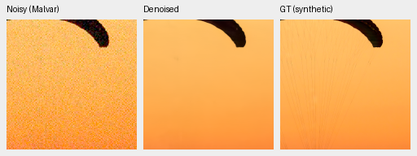
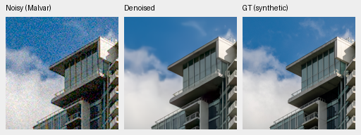
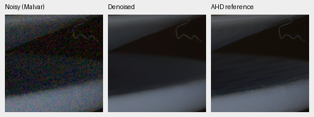
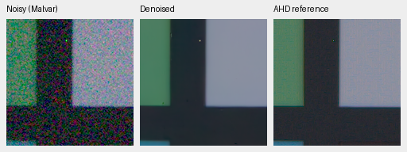
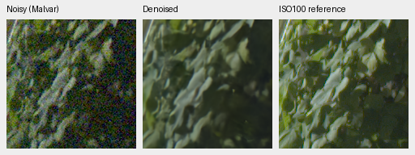
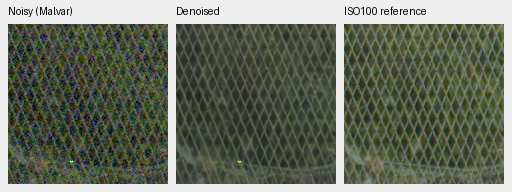

# Hidden RGB autocast: quality and full-frame timing

The opt-in precision policy has tiny measured quality changes with unchanged
learned tensors. After full-frame warmup, mean 102 MP restoration time is
**30.31 → 24.60 s** (18.8% less time) in four alternating
measurements per policy on this shared machine. The 10-second target and broad
qualitative superiority over RawNIND remain unproven.
[Complete metrics, identities, native crops and timing receipt](results/hidden-autocast-v42-review.json).

V42 is an **inference-only export of V37 EMA**, with zero training updates. Only
the first hidden encoder stage follows CNN FP16 autocast. The original FP32
physical head/final native skip, output projection, normalization and expectation
inverse remain intact. Explicit FP32 behavior and old defaults are unchanged.
The [policy/export instructions](rgb-hidden-autocast.md) describe the exact
change. This does not establish faster training or a new quality improvement.

| Panel | Policy | Measured-CFA PSNR | AHD RGB PSNR | AHD SSIM |
| --- | --- | ---: | ---: | ---: |
| Known4 | V37 original | 54.279434 | 40.015312 | 0.930414901 |
| Known4 | V42 hidden autocast | 54.279319 | 40.015283 | 0.930414616 |
| Unseen5 | V37 original | 53.679898 | 38.435895 | 0.920981250 |
| Unseen5 | V42 hidden autocast | 53.679887 | 38.435891 | 0.920980601 |

Known: four scenes/eight pairs/72 crops. Unseen: five scenes/ten pairs/90 crops.
Means balance captures within scenes and then scenes. Registered low-noise CFA
measurements are the primary reference. Independently demosaiced AHD RGB is an
auxiliary reference, **not exact RGB GT**. Protected-final performance is unscored.
Primary mean changes are −0.000115 dB known and −0.000010 dB unseen; they are
small numerical changes, not bitwise equality.

| Policy | 427-photo PSNR | SSIM | 16-procedural PSNR | SSIM |
| --- | ---: | ---: | ---: | ---: |
| V37 original | 34.654970 | 0.955272595 | 33.808093 | 0.967787247 |
| V42 hidden autocast | 34.654992 | 0.955272507 | 33.808143 | 0.967787419 |

Photo PSNR changes by +0.000021 dB, 95% source-bootstrap interval
[−0.000002,+0.000046]; procedural changes by +0.000051 dB. All 443 sources share
seven conditions and four CFAs. Among 11,956 individual photo cases, the worst
sRGB PSNR change is −0.02547 dB and the best +0.03616 dB; the 1st/99th percentiles
are −0.00236/+0.00252 dB. The receipt also records ADC-only, linear and SSIM
distributions and worst source/condition/CFA identities. Similar means alone do
not imply identical outputs or prove perceptual equivalence.

The new-only suite has 49,616 records. Combining explicit frozen V34/V37/V38/
RawNIND comparators yields 111,636. Reuse requires identical data/render/metric/
evaluator bytes and protocol, exact 24 known/30 unseen classical pair summaries
and **37,212** individual synthetic classical records. Old/new report hashes,
method source and original RawNIND calibrations remain in the receipt.

Checkpoint SHA256:

- V37 parent: `2e79285ba72003417eb681cae2bc304106548c8a8d3235dd20a4ea7218ec332a`
- V42 export: `efb90a929cab017d57398016139013a21cd5470f08736a340448ebb9dd494d55`

Every learned tensor is identical after serialization, canonical SHA256
`6502923340722cba257dec52aa55d20bbd0cd91e6a5185dd41fc89e4b3795e14`.
Code is frozen at `a50ea37`. All 329 tests pass, including all-CFA native ADC
ramps under BF16 with odd dimensions, FP32 identity and policy roundtrip.
An additional actual-trained-model CUDA probe covers five analytic patches at
all four CFAs. Both policies retain more than 256 codes on its native ramp
(806 each), respond to a one-code input offset, and keep FP32 outputs. Their
one-code-wave prediction RMS difference is 5.34e-9. This is a precision probe,
not a claim of lossless reconstruction by the learned model.

## Native synthetic and real images

Noisy Malvar → restored → **exact synthetic GT**; each panel native 160×160,
never resized. Same first two prescribed sources, RGGB/ISO12800 prior
`shot=.00256`, `read=.0000262144`, ROI[48,48,160,160] in the validation tile,
display×1, WB[2,1,1.5] and fixed protocol matrix. Per-crop source/cache, checkpoint,
conditioning and display records remain in the receipt. PNGs are 8-bit sRGB
previews; scoring and physical outputs retain FP32.

Original V37:

V42:

Sources: [Roy Egloff](https://commons.wikimedia.org/wiki/File:CH.VD.Villeneuve_2007-08-25_Vertigo-Swiss-Riviera_2392_3x2-R_4K.jpg)
and [Dietmar Rabich](https://commons.wikimedia.org/wiki/File:Vancouver_(BC,_Canada),_Coal_Harbour_Seaside_Park,_Blick_in_den_Himmel_--_2022_--_2158.jpg),
[CC BY-SA 4.0](https://creativecommons.org/licenses/by-sa/4.0/). Modified by linear
binning, crop, noise simulation, restoration and rendering; derivative previews
retain that license. Noisy/GT panel bytes match the original exactly.

Known real examples, noisy → V42 → independent AHD reference:

Real sources: Benoit Brummer and Christophe De Vleeschouwer,
[Raw Natural Image Noise Dataset](https://doi.org/10.14428/DVN/DEQCIM),
[CC BY-SA 4.0](https://creativecommons.org/licenses/by-sa/4.0/), with individual
scene credits/CC0 grants in publisher `permissions.txt`. Modified by crop,
restoration and rendering; derivative previews retain the applicable license.

Full 102 MP GFX DSCF3879 ISO6400 → restored → separate DSCF3880 ISO100 f/5.6.
Native 160px foliage[8890,5570] and fence[2240,6000], reference fence x2241.
Shared +2EV/WB/matrix; input-only `shot=.001463577592`, `read=.000001071570413`.
Time, aperture and motion differ: the final panel is a qualitative reference,
**not GT**. No pixelwise GFX reference scores are computed.

Original V37:

V42:

The native comparisons look consistent with the original; this precision policy
does not repair its remaining fine-detail softness. All ten new triplets pass
PNG SHA, panel dimensions, metadata and exact noisy/reference panel checks.
All four GFX regions remain in the receipt. Both new 8746×11662×3 uint16 TIFFs
pass full SHA/size, actual dtype/shape/16-bit tags, >256 sampled-code and sRGB ICC
checks. They reside in
`/mnt/external/demosaic/evaluation/gfx-3879-3880-hidden-autocast-v42-full-newonly/`.

## Full-frame timing

| Policy | Mean seconds | Four-run range |
| --- | ---: | ---: |
| V37 original | 30.31 | 25.25–32.42 |
| V42 hidden autocast | 24.60 | 23.46–27.49 |

The repeated benchmark uses the same cached 101.995852 MP RAW, input-only prior,
tile512/overlap64/batch4, FP16 CNN/DINO and FP32 physical/head/native skip. Each
policy receives three resident warmups and one excluded full-frame warmup.
Timed order is ABBA/BAAB. Timing includes tiling, packing, transfer and blending;
it excludes RAW decode, model load, render and encoding. These are shared-machine
ranges, not confidence intervals or an idle-machine optimum. The earlier
resident-only-warmup ABBA run varied substantially and is retained separately;
the table above uses the subsequent full-frame-warmed run.

The policy remains explicit and opt-in. README keeps its representative V34
images; the tested export uses V37 weights. No stronger RawNIND/SOTA claim,
10-second result or trained DINO ablation follows from this numerical change.
