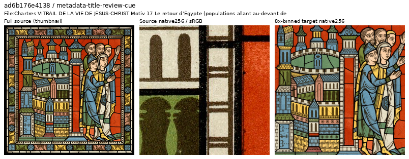
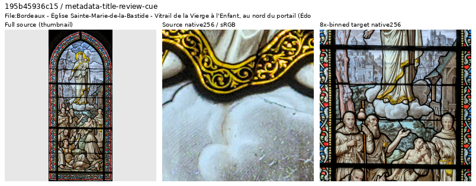
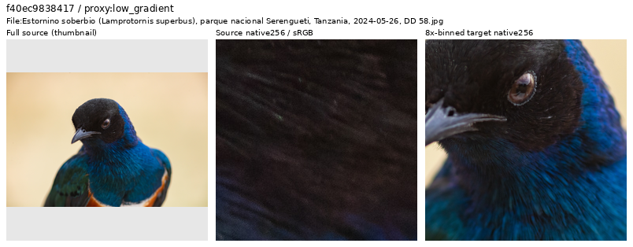

# Incoming Commons source quality

The **2,395-source V102 difficulty screen is complete**, with 4,790 cases
covering ADC-only and ISO12800-prior observations. Independent reconstruction
checks every source, condition, crop binding and saved rank. The final top 32
loss cases per condition and top 12 per proxy contain **74 unique sources**;
all have actually inspected native views at their scored coordinates.
[Completed scan, native decisions and provenance](results/incoming-source-loss-complete-v1.json).

All **3,807 valid arrivals** also had full-source thumbnails inspected across
39 sheets. Targeted native review now covers **153 unique arrival identities**.
This is a complete neural screen of the eligible additions and targeted visual
inspection, rather than native inspection of every image.

## Current data and training

| Cohort | Training sources | Status |
| --- | ---: | --- |
| V102/V103 | 88,477 | Completed model comparison |
| V104 | 90,872 | Original 20k training, all panels and full-frame exports complete |
| Current reviewed cohort | **90,864** | V114 is the working baseline; V114/V115 quality review complete; V116 uses this corpus |

The current cohort applies **eight additional training-source withholds relative
to V104**: the three previously inspected photo-quality cases and five printed
atlas images. Four atlas targets were in the older V102 corpus; one was an
arrival. Relative to V102, the next corpus adds **2,391 eligible arrivals** and
removes those four older sources. Validation/test remain **2,303/2,255** with
identical records and order. Other excluded/reserved rows, protected scenes and
source/cache metadata retain their bytes. Originals and cache pixels are unchanged.
[Coupled 4×/8× manifests and literal-row audit](results/commons-source-tail-reviewed90864-v1.json).

The original six training ROI objects are preserved with a new manifest binding.
Twelve actual clean-reader checks repeat exactly: six new-source draws and all
six ROIs, with finite native256 targets, unchanged Torch RNG and no CUDA.
[V111/V112](loss-scale-training.md) completed their original 20,000 updates each
on this cohort, preserving the V104 EMA and learned gates while comparing
reconstruction epsilon. V112 supplied the parent after
[complete photo/camera/color/material/GFX evaluation](v112-quality.md).
The [V114 Tiny / V115 fitted Small continuations](small-aligned-training.md)
use seed63 and this same corpus, six ROIs, zero optical blur and existing
contrast/detail recipe. Their actual CPU/CUDA checks and both original
20,000-update runs and [complete quality review](v114-v115-quality.md) finished;
V114 is now the general baseline. No new frequency-profile option changes these
frozen recipes.

A separate [paired-reference review](paired-reference-quality.md) inspects all
576 cached training crops. It preserves useful fine-detail examples and prepares
a narrow mask revision for two low-ISO references with a recurring red speck.
That revision is used by the [completed V116 trial](v116-quality.md), whose
combined data change improves an analytic carrier but not broad weak-material
quality. Original Tiny/Small bindings stay exact; the mask correction's isolated
effect is not established.

### Preserved, unlaunched V109/V110 preparation

The earlier capacity preparation used seed62, 20,000 planned updates per arm,
zero optical blur and the same contrast/detail recipe. Its prospective photo schedule has
111,559 examples from 62,367 unique sources, including 2,707 draws from 1,634
newly eligible sources and 5,657 ROI examples. These are scheduled counts, not
completed training. [Prepared recipes and actual reader evidence](results/backbone-capacity-training-prepared-v2.json).

Both recipes also pass separate discarded eight-update CPU checks at native64,
batch1/FP32. Initialization and frozen encoders match exactly; model/EMA/Adam
remain finite, and all eight actual observation fingerprints match across arms
through Commons/synthetic, native-RAW and paired-RAW domains.
[Actual CPU checks](results/backbone-cleaned-recipes-CPU-v1.json).
Eight-update CUDA checks also pass at native256/B16/BF16, with exact initial
EMA/encoder identities, finite model/EMA/Adam, matching actual observations and
matching first losses. [Actual CUDA checks](results/backbone-cleaned-recipes-CUDA-v1.json).
Production training did not launch for V109/V110. The active V114/V115
comparison above instead retains V112's learned function and fits the Small
laterals to its features. These older prospective counts are not receipts of
exposure in the current production run.

These inputs supersede the unlaunched 90,869-source preparation. Earlier
manifests, recipes and receipts remain preserved. V104 completed its original
90,872-source run. Its [selected material gains](heldout-detail.md) are published
alongside its [completed full comparison](v104-reviewed-corpus-quality.md). Its
exact EMA initialized the completed loss-scale test, while V102 remains a
separate reference. [Current quality training](quality-first-training.md).

## Printed atlas targets and photographed windows

A final loss-tail candidate resembled stained glass, but its
[Commons description](https://commons.wikimedia.org/wiki/File%3AChartres_VITRAIL_DE_LA_VIE_DE_J%C3%89SUS-CHRIST_Motiv_17_Le_retour_d%E2%80%99%C3%89gypte_%28populations_allant_au-devant_de_la_Sainte_Famille%29_.jpg)
identifies an atlas chromolithograph. A metadata follow-up inspected seven
training sources: five atlas reproductions and two photographed-window controls.
The five reproductions are withheld; both controls remain eligible. The same
atlas credit also identifies two already excluded sources and one reserved
source, whose memberships remain unchanged.

[Source/ROI/decision metadata](images/incoming-source-loss-complete/atlas-reproduction-withhold.json).
Source: Lassus and collaborators, *Monographie de la Cathédrale de Chartres – Atlas*;
listed as public domain in the source catalogue.

[Source/ROI/decision metadata](images/incoming-source-loss-complete/retained-photographed-window.json).
Photo: [Romainbehar, Bordeaux window](https://commons.wikimedia.org/wiki/File:Bordeaux_-_%C3%89glise_Sainte-Marie-de-la-Bastide_-_Vitrail_de_la_Vierge_%C3%A0_l'Enfant,_au_nord_du_portail_(%C3%89douard_Didron)_01.jpg),
[CC0](https://creativecommons.org/publicdomain/zero/1.0/).

Native views and source credit distinguish the printed targets from the
photographed glass, reflections and physical framing. A shared artist name or
window subject does not decide exclusion. The two controls retain useful
photographic texture and geometry.

## Retained weak and difficult detail

The final ranking added 27 new native arrival reviews and four scored-ROI
revisits, with 62 native source/target panels. Five larger native 1024 source
views resolved uncertain appearances. These support retaining fine feathers,
moss, natural flower structures, reflective metal and granular stone. Other
retained examples include weak clouds, skin, underwater texture, thin branches,
night lights, PCB traces, etched lettering, wrapped glass and physical specimens.
Grain, high loss, clipping, monochrome or a white background alone do not
identify a bad target.

[Native 1024 source view](images/incoming-source-loss-complete/retained-weak-feathers-native1024.png) ·
[Source/ROI/decision metadata](images/incoming-source-loss-complete/retained-weak-feathers.json).
Photo: [Diego Delso, starling](https://commons.wikimedia.org/wiki/File:Estornino_soberbio_(Lamprotornis_superbus),_parque_nacional_Serengueti,_Tanzania,_2024-05-26,_DD_58.jpg),
[CC BY-SA 4.0](https://creativecommons.org/licenses/by-sa/4.0/).

The earlier flower, tulip and ornament decisions remain applied. Larger source
views showed flattened/smeared surfaces or conspicuous outlines retained in the
binned targets. These are source-specific visible-quality judgments, without
identifying a processing algorithm or imposing camera/author-wide exclusions.
[Flower](images/incoming-source-loss-first64/flower-future-withhold.png) ·
[Tulips](images/incoming-source-loss-prefix576/tulips-future-withhold.png) ·
[Ornament](images/incoming-source-loss-prefix1280/ornament-withhold.png).

## Reading the source views and scores

Each figure shows a resized full-source context, an unchanged native256 source
crop and an unchanged native256 binned target. Their physical field of view
differs because the target is binned. Originals are ICC-managed to sRGB; targets
use linear area2-from4× followed by sRGB display, at exposure ×1. Modifications
are cropping, binning, context-thumbnail creation and display conversion.
These inspect clean training sources, with no denoiser output or clean-RAW GT.

The screen uses a fixed center512 bin4 crop followed by area2 to native256,
RGGB, fixed WB/matrix and two noise conditions, with CPU FP32 V102 final20k.
It measures the reference-white reconstruction objective; it is **not the
stochastic sensor-valid V104 training loss**. Loss and image-quality proxies
select review candidates. Decisions use native target appearance and source
provenance. Whole-cache and original hashes were rechecked for all 74 final
candidate sources; 43 exact scored ROIs reuse prior actual views and 31 were
viewed in the final follow-up. The atlas follow-up adds seven source views,
including one repeated incoming candidate. No automatic quality exclusions or
model promotions occur.

[Initial thumbnail/native review](results/commons-post4000-source-quality-v1.json) ·
[Original 90,872-source admission](results/commons-post4000-reviewed-v1.json) ·
[Earlier partial reviews: 64](results/incoming-source-loss-first64-native-review-v1.json),
[192](results/incoming-source-loss-prefix192-native-review-v1.json),
[576](results/incoming-source-loss-prefix576-native-review-v1.json),
[1,280](results/incoming-source-loss-prefix1280-native-review-v1.json).
The [timestamped diary](../diary/index.md) records historical decisions;
current recommendations use the completed evidence above.
