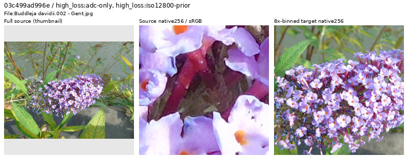
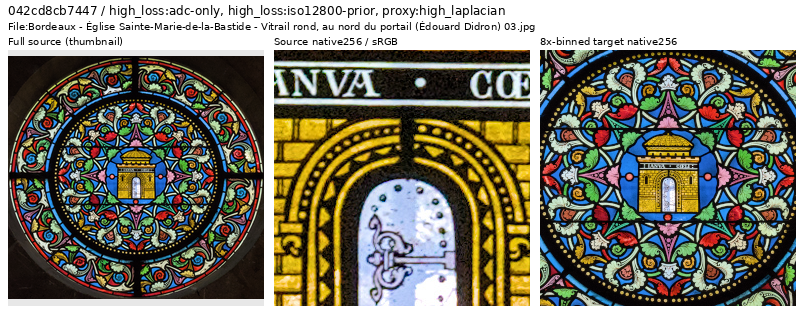
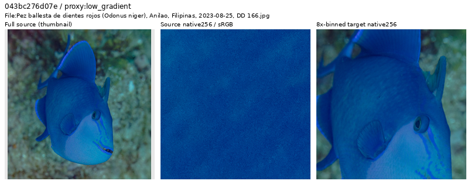
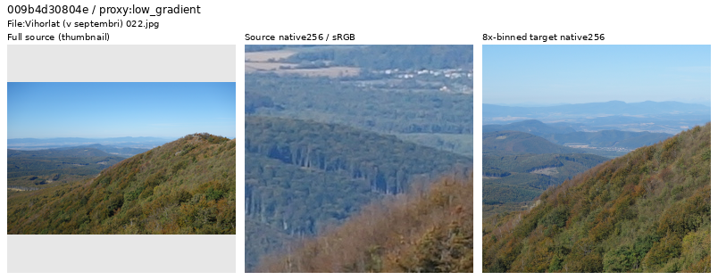
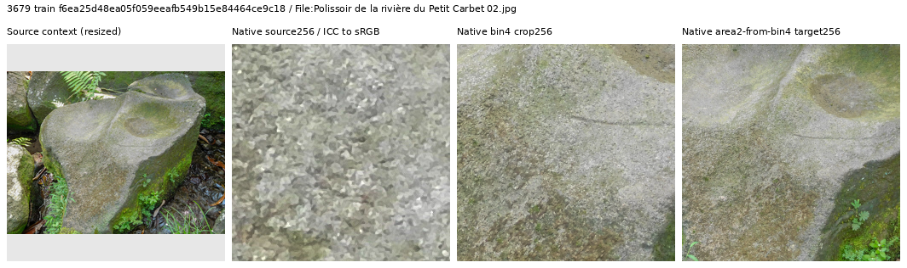
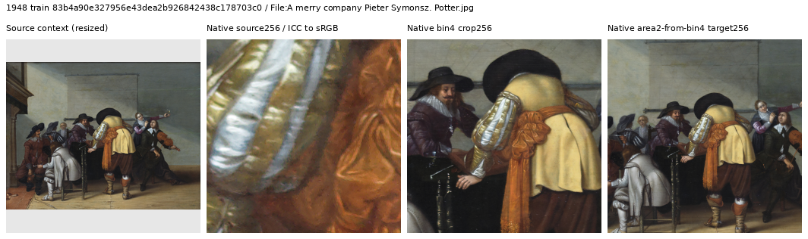
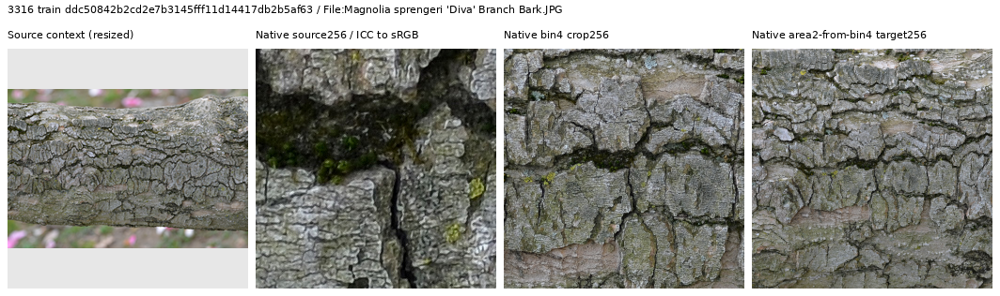
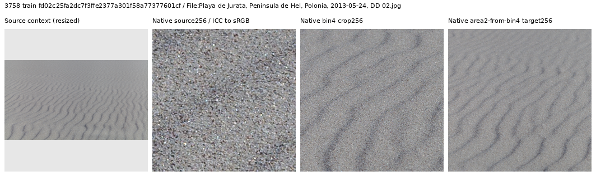
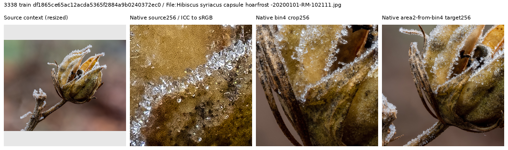

# Incoming Commons source quality

All **3,807 valid arrivals** have now had their full-image thumbnail contexts
inspected across 39 sheets. Initial follow-up covered **61 source identities**:
69 four-panel native views and one additional native 1024 crop. The loss-tail
follow-up below adds **11 identities**, bringing targeted native review to
**72 unique sources**. This is not a native-quality audit of every image in the batch.
[Sources, decisions, exact views and hashes](results/commons-post4000-source-quality-v1.json).

Four train-bucket sources are withheld: three artwork-only reproductions and
one stone photograph with flattened, patchy texture. Two more artwork-only
sources have validation hash buckets; they receive quality flags and remain
reserved. The two earlier malformed-ICC failures remain separately withheld.
Originals and prepared caches are unchanged. The completed protected, duplicate,
title and content/series review now admits **2,395 additions** to a separately
frozen **90,872-source training cohort**,now used by the
[V104 continuation from V102](quality-first-training.md#active-v104-cleaned-corpus-continuation).
Completed V102/V103 inputs remain fixed. Validation/test remain 2,303/2,255 with their original records and order.
[Completed freeze, independent audit and actual CPU reader](results/commons-post4000-reviewed-v1.json).

A subsequent [V102 CPU loss-tail scan](corpus-source-review.md#incoming-loss-tail-follow-up)
is running on the 2,395 eligible additions, after a four-source/eight-case
implementation check. Full ranking and native tail review remain pending;
this adds no current exclusions or claim of complete neural source coverage.

## First loss-tail follow-up: 64 of 2,395 sources scored

The first ranking snapshot covers 64 sources, not the complete incoming set.
Eleven selected sources were actually inspected through 22 unchanged native 256
source/target panels and 11 context thumbnails. A further native 1024 view
confirmed the flower decision below. All 11 are additional to the earlier 61
native identities. [Views, hashes, partial-ranking scope and decisions](results/incoming-source-loss-first64-native-review-v1.json).

One additional flower photograph is recorded for **withholding from the next
corpus**. Its native source has strongly flattened/smeared petal surfaces and
conspicuous edge contours; the binned target retains a flat patchwork appearance.
This records visible source quality rather than a known processing algorithm.
The current V104 90,872-source cohort remains unchanged; the full scan and remaining
tail review will inform a later frozen cohort.

[Unchanged 1024×1024 source crop](images/incoming-source-loss-first64/flower-native1024.png) ·
[source,ROI,display and decision metadata](images/incoming-source-loss-first64/flower-future-withhold.json).
Source: [Fernando Losada Rodríguez, Buddleja davidii](https://commons.wikimedia.org/wiki/File:Buddleja_davidii.002_-_Gent.jpg),
[CC BY-SA 4.0](https://creativecommons.org/licenses/by-sa/4.0/).

Ten sources remain eligible. Photographed stained glass supplies difficult
lead/glass boundaries and illumination; it is not treated as a flat digital
artwork reproduction. Underwater fish retains useful skin detail despite source
grain. The hazy forest retains weak distant structures rather than requiring
rejection for low contrast. A physical sculpture, clipped sunset, rock slopes,
street wires and aerial architecture also remain useful targets.

Source: [Romainbehar, Bordeaux stained glass](https://commons.wikimedia.org/wiki/File:Bordeaux_-_%C3%89glise_Sainte-Marie-de-la-Bastide_-_Vitrail_rond,_au_nord_du_portail_(%C3%89douard_Didron)_03.jpg),
[CC0](https://creativecommons.org/publicdomain/zero/1.0/).
[Source/ROI metadata](images/incoming-source-loss-first64/retained-stained-glass.json).

Source: [Diego Delso, red-toothed triggerfish](https://commons.wikimedia.org/wiki/File:Pez_ballesta_de_dientes_rojos_(Odonus_niger),_Anilao,_Filipinas,_2023-08-25,_DD_166.jpg),
[CC BY-SA 4.0](https://creativecommons.org/licenses/by-sa/4.0/).
[Source/ROI metadata](images/incoming-source-loss-first64/retained-underwater-grain.json).

Source: [Milan Bališin, Vihorlat](https://commons.wikimedia.org/wiki/File:Vihorlat_(v_septembri)_022.jpg),
[CC BY-SA 4.0](https://creativecommons.org/licenses/by-sa/4.0/).
[Source/ROI metadata](images/incoming-source-loss-first64/retained-hazy-forest.json).

Only the left full-source contexts are resized. Middle source and right target
panels retain 256×256 native pixels, exposure ×1. Originals are ICC-managed to
sRGB; targets use exact area2-from4× binning followed by sRGB display. These are
training-source views, not denoised model outputs or independent clean references.
Modifications: cropping, binning, context-thumbnail creation and display conversion.

Most thumbnail flags cleared under native inspection. The opposing door
handles belong to one scene; the repeated window pattern is real glass and
wrapping; shell, bone and figurine photographs retain physical material detail.
Mounted signs, framed objects, murals and genuine fine textures remain useful.
White/black backgrounds, multi-view specimen presentation, monochrome rendering
and clipping alone do not decide exclusion. Artwork-only reproductions are
distinguished from photographs showing physical frames, walls or objects.

Each figure contains a resized source thumbnail followed by three unchanged
native 256 views: ICC-managed original pixels, the 4× cache, and the float32
area2-from4× target used before synthetic noise. Only the thumbnail is resized;
display exposure is ×1. The original native crop has a smaller physical field
of view than the binned crops. These are clean-source inspections, with no
restoration prediction or model-quality gain.

## Withheld clean targets

The stone's larger native 1024 follow-up confirms angular, flattened patches
and lost fine surface texture. Patchiness remains after binning, so it is
withheld as a conservative clean-target judgment. No particular processing
software or cause is inferred.

Source: [Filo gèn', Polissoir du Petit Carbet](https://commons.wikimedia.org/wiki/File:Polissoir_de_la_rivi%C3%A8re_du_Petit_Carbet_02.jpg),
[CC BY-SA 4.0](https://creativecommons.org/licenses/by-sa/4.0).
Modified by color conversion, binning, cropping and thumbnail creation.
[Source/ROI/display metadata](images/incoming-commons-source-quality/withheld-stone.json).

This painted group scene is an artwork-only reproduction. Its apparent people,
fabric and room are painted rather than a photographed scene. It stays outside
photographic clean-target training.

Source: [Pieter Symonsz Potter, A merry company](https://commons.wikimedia.org/wiki/File:A_merry_company_Pieter_Symonsz._Potter.jpg),
[CC BY-SA 3.0](https://creativecommons.org/licenses/by-sa/3.0).
Modified by color conversion, binning, cropping and thumbnail creation.
[Source/ROI/display metadata](images/incoming-commons-source-quality/withheld-artwork.json).

## Useful fine-detail candidates

Seven train-bucket sources were proposed for later fine-detail sampling:
bark, cocoon fibers, weathered window bars, frost, sand ripples and flower
filaments. **Five pass the final admission review**; the sand and flower-filament
proposals remain title-withheld. Two other tempting thumbnail candidates were
actually reserved validation/test sources and cannot become training ROIs.
No new ROI catalogue or active recipe is changed by these proposals.

Source: [Derek Ramsey (Ram-Man), Magnolia sprengeri bark](https://commons.wikimedia.org/wiki/File:Magnolia_sprengeri_'Diva'_Branch_Bark.JPG),
[CC BY-SA 4.0](https://creativecommons.org/licenses/by-sa/4.0).
[Source/ROI/display metadata](images/incoming-commons-source-quality/retained-bark.json).

Source: [Diego Delso, Playa de Jurata](https://commons.wikimedia.org/wiki/File:Playa_de_Jurata,_Pen%C3%ADnsula_de_Hel,_Polonia,_2013-05-24,_DD_02.jpg),
[CC BY-SA 3.0](https://creativecommons.org/licenses/by-sa/3.0).
This source passes visual quality review but remains outside training because
of its title-risk flag.
[Source/ROI/display metadata](images/incoming-commons-source-quality/retained-sand.json).

Source: [Ermell, Hibiscus capsule hoarfrost](https://commons.wikimedia.org/wiki/File:Hibiscus_syriacus_capsule_hoarfrost_-20200101-RM-102111.jpg),
[CC BY-SA 4.0](https://creativecommons.org/licenses/by-sa/4.0).
These three views are modified by color conversion, binning, cropping and
thumbnail creation. [Frost source/ROI/display metadata](images/incoming-commons-source-quality/retained-frost.json).

## Completed admission review

The unchanged duplicate operator excludes three new near-duplicates, reusing
all 99,913 old fingerprints. Final titles withhold 960 risks and nine uninformative
titles. Two preliminary flags are also preserved: a Marienberg fortress sibling
and a Frankfurt riverside image. They do not become eligible solely because the
final title population differs from the earlier conservative anchor superset.
All ten previously reviewed title-prefix rules have zero matches in this batch.

All 120 selected DINO source-neighbor pairs were actually viewed. Most show
different subjects or scenes; metadata clarifies similar camera models,
different tree species and distinct cycling events. One additional no-title
query is withheld as a studio capture-session risk: original EXIF places the
two dice images 8m13s apart with the same camera/photographer and backdrop.
This is a specific session judgment, not a blanket rule against studio photos.

| Disposition among 3,809 selected arrivals | Sources |
| --- | ---: |
| Reviewed ICC failures | 2 |
| Protected-source flags, outside the candidate | 43 |
| Pixel-duplicate exclusions | 3 |
| Final title flags | 969 |
| Preserved preliminary title flags | 2 |
| Additional capture-session risk | 1 |
| Additional native-quality withholds | 4 |
| New reserved sources | 390 |
| New eligible training sources | 2,395 |

The independent content audit checks all 40,992 saved scalar cosine values,
170 full-database selected/prefix rank groups and all 240 contact-image cells.
This does not re-encode every image or replay every query's full ranking.
The coupled freezer checks all 4,790 newly eligible cache hashes/headers.
Independent membership checks preserve all old literal rows across both scales;
eight sources also run the actual CPU clean reader at native 256, geometry
before final area2, zero optical blur and photographic contrast attenuation.
This prepares data; it does not measure a trained quality benefit.

Frozen files: `/mnt/external/demosaic/commons-post4000-reviewed-20261022-v1/`.

- `manifest4.jsonl`: 90,872 train / 2,303 val / 2,255 test,
  SHA256 `a68450954e5ed7a1c45da3349c7007faf3a608c9b8a4dd3fb1c16f3882ce277b`.
- `manifest8.jsonl`: same active memberships plus 5,919 reserved / 2,328 excluded,
  SHA256 `c18600fb3a72603d7ed7f61d2b8cd3512d4b84d3148a799ef1765f2765952c75`.

The current 88,477-source training cohort also has a separately prepared 8×
companion for the next extension. Its 31 train-to-excluded changes exactly match
the existing 4× visual decisions; all 99,882 other literal records, including
all 10,087 old holdout records, are preserved. It reuses existing caches and does
not change V102/V103 inputs. The completed duplicate audit compared all incoming
protected-cleared sources against this complete prior population, including old exclusions.
