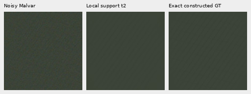
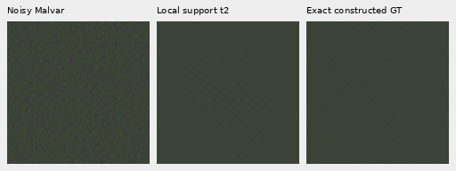
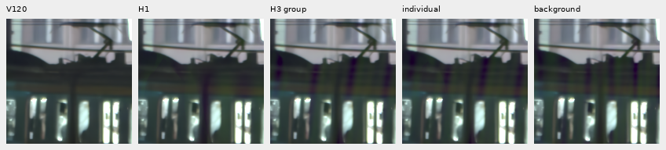

# Individual harmonic evidence reduces one cost, but leaves building bands

**Per-harmonic support lowers far-edge quiet and increment error relative to
H3 group support, with less weak response. Neither it nor a piecewise-affine
background removes the building bands.** H1 remains the default analytic
configuration; V120 remains the general full-model recommendation.
[Publication and executed sources](results/individual-wave-pilot-v1/publication.json).

This follows the [harmonic waveform trial](local-wave-shapes.md) on identical
development inputs. Both new 24-image arms close before new target/reference
analysis. The separate [full three-prior H1 evaluation](local-wave-full-panel.md)
and [V13220k review](v132-endpoint-quality.md) are now complete with their
original frozen sources preserved.

## What changes

`support_unit="harmonic"` gives every cosine/sine pair its own A-only
conditional null, retaining the fundamental and every other harmonic/direction
as competitors. A strong fundamental cannot supply an added harmonic's score.
Each color still needs its own complementary-fold evidence. Fold matching
also uses **the actual harmonic frequency**: a third-harmonic pair must be
within 1.5 native bins itself, rather than allowing 4.5 bins because its
fundamentals match. The score and matching changes are evaluated together;
their separate causal effects are not isolated.

The first arm otherwise keeps the original H3 step-background discovery and
joint coefficients. The second adds `background="piecewise_affine"`: two
extra slope columns, step×x and step×y, permit different affine gradients on
each side of the A-only discovered edge. Frequencies are selected/refined
after that richer nuisance fit. Variance proxies and parent projection use
the same expanded basis. Edge geometry still comes from A-only step discovery;
this is not an arbitrary piecewise-smooth scene model.

Both use up to three harmonics, native 256 discovery/128 stride, native 129
validation/32 stride, the original splits, thresholds 0/2/4 and primary 2.
GT, references and the full-input parent do not enter discovery/validation.
The parent is projected only afterward. These are empirical plug-in scores,
not calibrated probabilities or final-output error guarantees.

## Restricted numerical tradeoff

Means below cover two finite-wire geometries, RGGB/repeat 0, far placement and
the 400 prior. Responses are projected amplitudes, not accuracy. All methods
use the same V143 parent and sensor observations.

| Local support, t2 | Strong % | Weak % | Quiet RMS DN16 | Weak-increment RMS DN16 | Full RMS DN16 |
| --- | ---: | ---: | ---: | ---: | ---: |
| H1 | 43.332 | 2.801 | 4.02596 | 11.80386 | 21.72125 |
| H3 group | 46.884 | 5.460 | 4.06592 | 11.89181 | 21.70823 |
| H3 individual | 46.487 | 4.070 | 4.05049 | 11.85942 | 21.70360 |
| H3 individual + piecewise affine | 41.130 | 3.756 | 4.09276 | 11.86712 | 21.73984 |

Individual support improves these far errors over the group rule, but it is
not uniformly conservative: near-edge quiet RMS **increases** from 7.06775 to
7.09053 DN16; the expanded background raises it further to 7.15258. Near weak
responses remain 3.8138/3.7933/3.8084% for group/individual/expanded background.

Source dependence remains substantial. Source 1/far weak response changes
9.822%→7.232% under individual support, while source 0 changes 1.097%→0.907%.
The expanded background retains 7.231% on source 1 but falls to 0.280% on source 0.
H1/t0 from the preserved fixed sweep already reaches 5.368% mean far weak
response with quiet RMS 4.03922 and increment RMS 11.80625, lower than either
new t2 arm's errors; strong responses differ. Full-image error alone would
hide these distinctions. [All thresholds and source metrics](results/individual-wave-pilot-v1/comparison-summary.json.gz).

Ordinary bark/fur sRGB PSNR changes versus V120 are +0.000589/+0.002298dB for
individual support and +0.000522/−0.006374dB with the expanded background.
All four ADC-only controls remain bit-identical for all six outputs in both
arms. Ordinary crops remain visually close to the parent.

## Native GT triplets and the persistent real failure

The two triplets below are noisy Malvar → **H3 individual local t2** → exact
constructed GT. Each cell is native 160, unchanged from native 512, ROI
`[176,176,160,160]`, two-direction far image, RGGB/repeat 0, shot/read
`0.00008/2.56e−8`, ADC16/black 0.03, exposure 2/contrast 1 and identical
WB/matrix/clipped-sRGB display. Source 0 is the weak-response counterexample.





The expanded-background arm retains its own
[source 0 triplet](images/individual-wave-pilot-v1/background/source0-far-role2-triplet.png)
and [source 1 triplet](images/individual-wave-pilot-v1/background/source1-far-role2-triplet.png)
at exactly those conditions. Direct four-variant comparisons include both
local and global support:
[source 0/far](images/individual-wave-pilot-v1/comparison/source0-far-role2-comparison.png),
[source 1/far](images/individual-wave-pilot-v1/comparison/source1-far-role2-comparison.png),
[bark](images/individual-wave-pilot-v1/comparison/bark-RGGB-draw0-comparison.png)
and [fur](images/individual-wave-pilot-v1/comparison/raccoon-fur-RGGB-draw0-comparison.png).

The fixed previous building-failure ROI `[0,334,160,160]`, exposure 4/contrast 1,
shows that **both new arms retain conspicuous green/magenta bands**. Cells
below are V120, H1, H3 group, individual and expanded-background local t2.
No GT/reference is claimed at these extra coordinates.



Post-inference maximal-change ROIs also remain archived, using no GT to select
coordinates. Largest camera-RGB differences from H1 are 260.22 DN16 for
individual and 370.67 for expanded background, at different building pixels.
These maxima are correction magnitudes, not GT errors. The
[two selected building ROIs](images/individual-wave-pilot-v1/stress/main-building-detail-max-changes.png)
show the same problem beyond the fixed crop.

All four protected DSCF3879/3880 contexts retain native 512/native 160 pixels,
exposure 4 and nominal `.00128/6.5536e−6` shot/read:
[sky](images/individual-wave-pilot-v1/comparison/main-overcast-sky-comparison.png),
[building](images/individual-wave-pilot-v1/comparison/main-building-detail-comparison.png),
[foliage](images/individual-wave-pilot-v1/comparison/main-foliage-comparison.png)
and [coarse fence](images/individual-wave-pilot-v1/comparison/main-chain-link-fence-comparison.png).
Sky remains identical, foliage soft and coarse wire geometry already present.
Both native 768 cab profiles retain exposure 16, both ROIs and both SOOC JPEGs:

| Noise profile | Left | Right |
| --- | --- | --- |
| Nominal `.00128/6.5536e−6` | [Left](images/individual-wave-pilot-v1/comparison/mesh-nominal-fine-green-mesh-left-comparison.png) | [Right](images/individual-wave-pilot-v1/comparison/mesh-nominal-fine-green-mesh-right-comparison.png) |
| Nearby DSCF3879 `.0014635775921166604/1.0715704128646712e−6` | [Left](images/individual-wave-pilot-v1/comparison/mesh-profile3879-fine-green-mesh-left-comparison.png) | [Right](images/individual-wave-pilot-v1/comparison/mesh-profile3879-fine-green-mesh-right-comparison.png) |

Periodic modulation changes without convincing complete fine-crossing recovery.
ISO100/AHD references differ in aperture/exposure/motion and are **not exact
GT**; real references receive no pixelwise scores. Originals remain read-only;
protected captures, JPEGs and siblings remain outside training.

## Identities and verification

Procedural V143 checkpoint:
`96d146d017c54196288c585f8b7eddcf030e8a235061049c31e985b9380b7ce4`.
Photographic/GFX V120 checkpoint:
`a9d9b6b4f974e24a6b11e5e740aab32314233a7f53c056cf37c7d2aac1c589fb`.
No new trained weights. Analytic configuration/model SHA256:
individual `3104fb2a3e1bc6d4bd1b157fea5778d705ed774e8775651f2a8cabb5606b5e65`;
background `aa3b413ca6d96adc26d05ac7678e040b43138cc43a8d231bb71e07d919164b1f`.
[Complete source/ROI/noise/display/identity manifests](images/individual-wave-pilot-v1/manifest.json).

Each arm completes 24 images/196 discovery tiles, taking 266.93/277.01 seconds
on CPU during other work. These are not full-frame timings. Each independent
audit reproduces 679 scalar fields and 9,216,000 exact native RGB channels
across 28 boards; maximum scalar discrepancy 2.56e−15, zero PSNR/finite-metric
discrepancy. The combined boards recheck 16,281,600 channels exactly.
All 14 combined boards, four triplets and seven stress boards were actually
viewed. Standalone arm boards are covered by matching-cell audits rather than
a separate viewing claim. The publication preserves 36 archives and 77 native
boards. The combined 48-case closure and exact legacy regression are preserved.

Sixty-eight tests cover all-CFA withheld-NaN invariance for both new arms,
fundamental-versus-harmonic conditional evidence, physical frequency matching,
piecewise-affine recovery, exact-parent replacement and even boundary axes.
Before new predictions, the old H3 group path reproduces 18 saved arrays
byte-for-byte across 43 tiles. No neural/DINO forward, fresh source/noise draw,
RAW decode or optimizer update occurs in this analytic trial. Full 102MP
integration and speed remain unverified.

```python
LocalWaveConfig(harmonics=3, support_unit="harmonic")
LocalWaveConfig(harmonics=3, support_unit="harmonic", background="piecewise_affine")
```

These remain explicit ablations. Neither control resolves the bands. This
does not identify their complete cause or prove that accepted harmonics are
true detail; their support scores can still accept scene-model errors.
