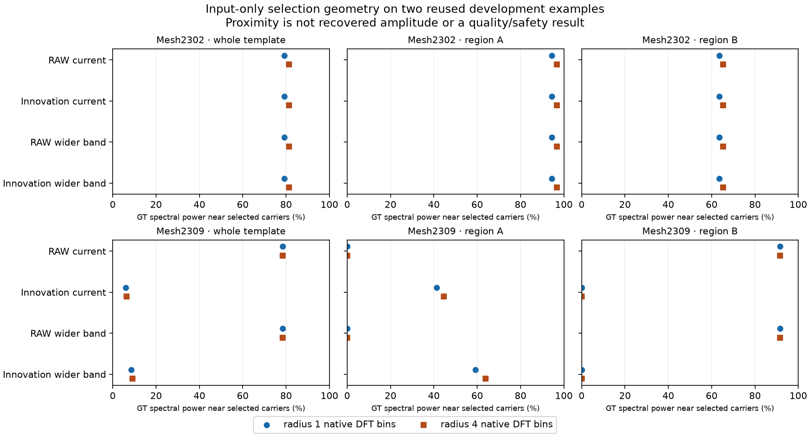

# Selecting what the current model misses (V196)

On the fixed weak-crossing mesh example 2309, **subtracting the current restoration and widening the selection band finds the missing coarse fundamental**. Its nearest selected carrier is **0.391 native DFT bins** away, versus **55.489** for RAW selection. At radius one native bin, selected carriers lie near **59.13% of region A's exact GT spectral power**, versus **0%** for RAW. Widening RAW alone does not change that result. All four views make identical selections on example 2302.

This is an input-measurement diagnostic, **not a restored-image improvement or flat-safety result**. Current useful options include [V198 for stronger periodic response](cfa-innovation-wave-comparison.md), [V200 for its small quiet/response tradeoff](scale-supported-cfa-wave-comparison.md), and [V195/V187 for cleaner-building or quieter strengths](directional-response-comparison.md). Missing real cab crossings and flat-field mottle remain unresolved.

The plot shows all 48 audited points. Each neighborhood counts overlapping cells once. The fundamental distance and region-power proximity measure different things: a harmonic can be in region A without being near its fundamental. Spatial coefficient modulation can produce other frequencies; these footprints are not recovery bounds.

## Controlled measurements

The 36 previously retained development contexts comprise three constructed mesh inputs, eight mixed/quiet scenes, twelve flat fields, seven photographic inputs and six real-photo contexts. The latter include the required DSCF3879/3880 main-scene sky/building/foliage/coarse-fence contexts and DSCF3842 cab mesh under both noise profiles. Only noisy inputs and saved restorations are read in the selection phase; independently captured ISO100/JPEG references are never read or scored. The two cab ROIs share each 768px context.

The four fixed views all select eight bins using the same two green phases, Hann taper, weighted affine removal, average normalized power, 3×3 frequency pooling and conjugate 3×3 suppression:

| View | Measured field | Native center-frequency band |
| --- | --- | --- |
| RAW current | Observed RAW | 1/16…1/3 |
| Innovation current | RAW − sampled V195 Whole EMA | 1/16…1/3 |
| RAW wide | Observed RAW | 1/64…1/3 |
| Innovation wide | RAW − sampled V195 Whole EMA | 1/64…1/3 |

Restored camera RGB is sampled at the exact CFA channel and spatial phase. Subtraction and selection use FP64 CPU arithmetic. The propagated **RAW** variance remains a shared score-unit convention. RAW and restoration are correlated; this denominator is **not innovation noise variance or calibrated confidence**. Both green phases participate in selection and are not independent holdouts. The principal native alias ambiguity remains.

All 144 selections and complete score-map fingerprints close before accessing the two exact procedural target arrays. The old results informed the design; this reused development cohort is not blind validation. All 28 available current-band RAW rankings exactly reproduce the saved FP32 GPU rankings. Eight ADC-only contexts have diagnostic selections but bypass the actual model head.

## Which direction is selected?

These are weighted-affine/Hann **native RGB template power** regions, assigned to the nearest transported recipe normal. They differ from the unweighted full-context response measurement in V194/V195. Envelope, harmonics and intersection leakage remain; region A/B are not isolated wire-family amplitudes.

| Example | View | Region A proximity, radius 1 (%) | Region A proximity, radius 4 (%) | Nearest A fundamental (native bins) |
| --- | --- | ---: | ---: | ---: |
| 2302 | RAW current | 94.412888 | 96.784305 | 0.514810 |
| 2302 | Innovation current | 94.412888 | 96.784305 | 0.514810 |
| 2302 | RAW wide | 94.412888 | 96.784305 | 0.514810 |
| 2302 | Innovation wide | 94.412888 | 96.784305 | 0.514810 |
| 2309 | RAW current | 0.000000 | 0.000000 | 55.489216 |
| 2309 | Innovation current | 41.263892 | 44.574891 | 18.670505 |
| 2309 | RAW wide | 0.000000 | 0.000000 | 55.489216 |
| 2309 | Innovation wide | 59.125183 | 63.908049 | 0.390590 |

The weak 2309 fundamental has period **27.69 native pixels**, below the old 1/16 lower band edge. Current-band innovation selection reaches its harmonics but not that fundamental. Innovation plus the wider band reaches it. The strong region B's radius-one proximity simultaneously falls from **91.57% to approximately zero**: selection has shifted toward missing content, rather than covering both directions with the same eight bins. Whole-template proximity consequently falls from 78.45% to 8.47%. This is useful evidence for a **new head above a retained anchor**, not for replacing every existing measurement with innovation.

Across all 36 contexts, innovation changes 35 current-band rankings. RAW wide allocates 171/288 selected bins below the old edge, on 27 contexts; innovation wide allocates 25/288, on ten contexts. Neither cab context selects a low-band innovation bin, while RAW wide selects eight. Real fine-fence recovery therefore remains an empirical question. Selection scores and bin counts alone establish no photographic quality or quiet/flat safety.

## Evidence and next implementation

The independent audit checks **72 full weighted-QR score maps / 4,481,024 coordinates**, all 144 sorted-distance selections, 96 region scalars and 32 fundamental distances. Sixteen CPU contracts include direct Fourier operator variance, rectangular fields, four CFA layouts, exact residual cancellation and a missing-coarse-tone fixture. There are no Torch imports, checkpoint loads, neural forwards, new noise/source draws, RAW decodes or original/dataz reads in this diagnostic. New private evidence occupies about 3.52 MiB; no external writes occur.

The saved V195 Whole EMA module hash is `1ebf98a696494e7bf8f9dacc4cdda92f795c1615b1073497879b8fd410e6305e`; full export, source, inputs, geometry and hashes are in the [completed evidence index](results/v196-innovation-selection-completed-v1.json). The [prior native mesh triplets and held-out cab comparisons](directional-response-comparison.md#native-100-crops) retain their original pixels, checkpoint, ROI, noise and display metadata.

The [V197 prototype](innovation-wave-readout.md) adds a fresh 508-parameter wave head above all 193 frozen V195 Whole EMA tensors. Matched RAW/innovation arms share the wider band and fresh zero-output initialization; the measurement field changes both selection and local wave/support coordinates together. This tests a practical new measurement architecture, not selection in isolation. Its signed residual may also expose parent errors, but improvement requires trained comparisons on detail, sky, absent meshes, mixed quiet areas and fresh flats.

An optional case-metadata hash field stopped the first input pass after 23 completed contexts. Those exact rows are reused in the corrected journal; only the remaining thirteen contexts are completed. Original source, plan, log and prefix bytes survive. One uncommitted context is remeasured after the genuine metadata exception; no neural work occurs. The initial independent variance fixture also caught a missing window factor before any recorded data pass. See the [timestamped diary](../diary/2026-11-08-14-02-17-innovation-selection-geometry.md).

The trained follow-ups are now complete. [V198 CFA EMA](cfa-innovation-wave-comparison.md)
raises mean mesh response to 11.158% GT with colored modulation and new
building/flat artifacts. [V200 cross-scale support](scale-supported-cfa-wave-comparison.md)
keeps 11.102% GT response with 0.059–0.119% lower quiet spatial RMS than V198,
but retains those artifacts and incomplete fine cab crossings. The original
selection-geometry diagnostic above remains a measurement result; these later
native comparisons determine their actual image-quality strengths and limits.
