# Innovation measurements above V195: stronger mesh, edge and flat costs (V197)

**Innovation EMA is a stronger periodic-detail prototype:** mean constructed-mesh response rises **63.09% relative to frozen V195 Whole EMA**, from **5.575% to 9.092% of exact GT amplitude**. Synthetic mesh2302 gains a clearly visible lattice, and both real cab ROIs show stronger mesh modulation. **The same model introduces pronounced red/cyan edge artifacts in the main building crop and more false periodic texture in flat fields.** Quiet spatial RMS rises **0.176–0.326%**, worsening 30/32 inputs. These observed failures keep it experimental; V195/V187 retain useful lower-error alternatives and V120 Small remains the general recommendation.

Against its matched RAW-measurement EMA control, innovation raises mesh response **40.98%** while lowering quiet spatial RMS **0.471% / 0.940%** at ISO6400/12800. Absent-mesh full RMS is **0.317% higher**, and fresh-flat full RMS is **0.149% / 0.207% higher**. Thus improved response and quiet means versus the control coexist with worse off-signal errors.

[Five-state native viewer](images/v197-innovation-wave-v1/native-viewer.html) · [Complete checkpoint/source/ROI/noise/display manifest](images/v197-innovation-wave-v1/manifest-v1.json) · [122 metric rows / 854 numeric cells](results/v197-innovation-wave-v1/metrics-table-v1.csv) · [Final evidence](results/v197-innovation-wave-final-v1.json).

## What changed

Both arms preserve all **193 trained V195 Whole EMA state tensors** and add an identical fresh **508-parameter** wave head in four tensors, for **197 full-state tensors**. The two wave readouts together contain 1,016 parameters; only the newly added 508 train. A zero final layer initially preserves the trained anchor. Its earlier wave history is V187's 900 updates followed by V195's additional 900; the new head starts with fresh Adam/EMA clocks zero and receives its own 900 updates.

RAW control measures observed CFA data. Innovation measures **RAW minus the frozen anchor's camera RGB sampled at the actual CFA channel and phase**. This field changes both frequency selection and local wave/support measurements together. Both arms share eight selected bins, native band **1/64…1/3**, 65/33/17px packed contexts, strides, MLP, 1,000 cached batches / 900 noisy updates / 3,600 images / 100 ADC skips, seed202611080197, LR schedule, weight decay, clipping, domain weights and all V195 Whole loss terms/masks, including total coherent-response coefficient 0.50.

The 193 anchor tensors and feature extraction remain frozen. Supplied RAW variance gives nominal Fourier units for the correlated innovation, **not innovation-noise calibration or confidence**. Both greens participate in selection. Targets enter the loss after inference. All protected GFX captures, JPEGs and siblings stay out of training. [Architecture/admission](innovation-wave-readout.md) · [Completed training and evaluation](innovation-wave-evaluation.md).

The matched arms test the practical measurement view. Relative to V195, added capacity, wider band and extra training change together; the anchor comparison does not isolate subtraction alone. The [V196 diagnostic](innovation-frequency-selection.md) motivated the design but its proximity masks were never recovery bounds.

## Measured strengths and costs

RMS values are unclipped camera-RGB DN16. Response projects onto the exact constructed template; ideal response is 100%. Mesh rows have 256 present or 256 absent inputs, quiet rows 16 per ISO, fresh-flat rows 24 noisy inputs per ISO, and each photographic cohort/variant 32 inputs. Identical observations are paired across methods.

| Metric | Cases | V183 EMA | V187 EMA | V195 Whole EMA | RAW raw | RAW EMA | Innovation raw | Innovation EMA |
| --- | ---: | ---: | ---: | ---: | ---: | ---: | ---: | ---: |
| Mesh response (% GT) ↑ | 256 | 4.43900551 | 5.35911027 | 5.57480435 | 6.28904762 | 6.44906902 | 8.88238926 | 9.09218788 |
| Mesh full RMS ↓ | 256 | 8.87658208 | 8.77626519 | 8.74994784 | 8.68491411 | 8.67378254 | 8.50171719 | 8.49795148 |
| Present-case blank RMS ↓ | 256 | 5.61243198 | 5.61352478 | 5.61460516 | 5.61907447 | 5.62005314 | 5.62204239 | 5.62361296 |
| Absent-case full RMS ↓ | 256 | 5.30864483 | 5.31014343 | 5.31117581 | 5.31538414 | 5.31616104 | 5.32973714 | 5.33303257 |
| Quiet spatial RMS, ISO6400 ↓ | 16 | 3.46222047 | 3.47664374 | 3.48972317 | 3.50143703 | 3.51765479 | 3.49910973 | 3.50110283 |
| Quiet spatial RMS, ISO12800 ↓ | 16 | 5.5949994 | 5.62164923 | 5.64043344 | 5.67321933 | 5.70397426 | 5.64775448 | 5.65033341 |
| Fresh flat full RMS, ISO6400 ↓ | 24 | 18.6119521 | 18.61468 | 18.6164384 | 18.6235882 | 18.6247815 | 18.6472584 | 18.6526174 |
| Fresh flat full RMS, ISO12800 ↓ | 24 | 24.181174 | 24.1857465 | 24.1891129 | 24.2023686 | 24.2047806 | 24.244943 | 24.2547879 |
| Fresh flat block32 RMS, ISO6400 ↓ | 24 | 13.4337585 | 13.4337869 | 13.4338005 | 13.4338378 | 13.4338453 | 13.4341904 | 13.4342049 |
| Fresh flat block32 RMS, ISO12800 ↓ | 24 | 17.9217798 | 17.9217305 | 17.9216853 | 17.921641 | 17.9216084 | 17.9216138 | 17.9216759 |
| Retained photo faint band gain ↑ | 32 | 0.297015316 | 0.298461921 | 0.298812854 | 0.299260123 | 0.29936948 | 0.299128046 | 0.299175975 |
| Retained photo dark band gain ↑ | 32 | 0.528282161 | 0.529753504 | 0.530045786 | 0.530400453 | 0.530525432 | 0.530176351 | 0.530198669 |
| Organic photo faint band gain ↑ | 32 | 0.148382301 | 0.148564768 | 0.148652643 | 0.148814259 | 0.148845456 | 0.148967645 | 0.149021997 |
| Organic photo dark band gain ↑ | 32 | 0.395579733 | 0.395914385 | 0.396009713 | 0.396175063 | 0.396222229 | 0.396108518 | 0.396129867 |

Innovation EMA raises response on **191/256** present inputs and lowers mean present full RMS **2.880%**, improving **162/256**. Its present-case blank RMS rises **0.1604%** on all 256; absent full RMS rises **0.4115%** on all 256. Fresh noisy-flat full RMS rises **0.1943% / 0.2715%** on all 48. Quiet spatial and quiet total RMS worsen on **30/32** inputs; quiet total means rise **0.2487% / 0.1407%**. Whole mixed-scene RMS improves slightly while its actual quiet areas worsen, so the whole-scene norm cannot establish flat safety.

Versus matched RAW EMA, present full RMS falls **2.027%**, but only **90/256** individual full RMS values improve; 166 worsen. Response increases on 177/256. Quiet spatial RMS improves on **22/32** inputs, while absent RMS worsens on all 256 and fresh-flat RMS on all 48. The stronger mean response is not uniform dominance.

Raw innovation retains a milder cost profile: response **8.882% of GT**, +59.33% over the anchor, with quiet spatial RMS **+0.269% / +0.130%**, absent full RMS **+0.3495%**, and fresh-flat full RMS **+0.1656% / +0.2308%**. Both raw/EMA innovation states show the building color artifact. RAW control reaches **6.289% / 6.449% GT response** (+12.81% / +15.68% over V195), with smaller flat/absent costs and no new building artifact in these crops, but higher quiet spatial means than matched innovation.

All four innovation EMA natural-photo response means rise slightly over V195, with **99/128** individual gains rising. All four relative band-error means worsen, by **0.0361–0.1828%**; full RMS means worsen **0.0040–0.0099%**, on **113/128** inputs. Retained-photo response is slightly weaker than RAW control; organic-faint response is stronger. Native bird/wood/butterfly texture remains soft, and stress views reveal additional periodic ribbing. This supports a periodic-detail prototype rather than general photographic sharpening.

Earlier useful [V195](directional-response-comparison.md), [V187](pooled-phase-wave-comparison.md), nonlearned [optional detail](supported-wave-amplitude.md), and quieter/flat implementations remain linked in [current choices](current-model.md).

## The weak crossing direction

The same two predeclared V194 examples use transported recipe normals, full-context affine removal and independent Fourier/spatial projections. The regions contain envelope, harmonics and intersection leakage; their gains are not isolated wire-family amplitudes or population confidence intervals. [All eight new projections and prior context](results/v197-innovation-wave-v1/directional-breakdown-v1.json).

| Example | State | Whole (% GT) | Region A (% GT) | Region B (% GT) |
| --- | --- | ---: | ---: | ---: |
| 2026112302 | V187 EMA | 5.1222526 | 6.4775008 | 3.7102210 |
| 2026112302 | V195 Whole EMA | 6.0830978 | 7.7759249 | 4.3193437 |
| 2026112302 | RAW raw | 8.3992643 | 10.8804417 | 5.8141296 |
| 2026112302 | RAW EMA | 8.7931831 | 11.3991207 | 6.0780609 |
| 2026112302 | Innovation raw | 38.3070767 | 49.6366770 | 26.5027911 |
| 2026112302 | Innovation EMA | 39.5850517 | 51.3487012 | 27.3285313 |
| 2026112309 | V187 EMA | 79.2443248 | 4.8230067 | 91.6903348 |
| 2026112309 | V195 Whole EMA | 79.5137222 | 4.8213863 | 92.0050560 |
| 2026112309 | RAW raw | 83.4893558 | 4.7621111 | 96.6554753 |
| 2026112309 | RAW EMA | 84.7731678 | 4.7426974 | 98.1572347 |
| 2026112309 | Innovation raw | 80.5871795 | 12.4701390 | 91.9788857 |
| 2026112309 | Innovation EMA | 80.6778100 | 13.1063470 | 91.9782759 |

On 2302, innovation EMA raises whole response from **6.083% to 39.585% of GT**; both regions improve strongly. The native crop gains visible lattice modulation, but its rounded/checker-like intensity and weak/wrong color still differ from the thin exact red/green structure.

On 2309, the weak A region rises from **4.821% to 13.106% of GT**, while dominant B remains about **91.98%**. RAW EMA instead strengthens B to **98.16%** while A falls slightly to **4.743%**. Innovation's weak-region gain is useful, but complete oblique crossings remain difficult to see at ordinary display. A higher whole-pattern response can still hide a missing direction.

## Native 100% triplets

Each cell is **160×160 native pixels**, with identical coordinates and display transforms across methods and no crop resizing. Both meshes use cached 512px RGGB camera-RGB sources, ROI `[176,176,160,160]`, shot0.00128/read6.5536e−6, display exposure8 (+3EV), contrast1, and the manifest's shared WB/matrix transform. The final-state hashes below identify every restored panel.

**RAW raw: noisy → restored → exact constructed GT.**

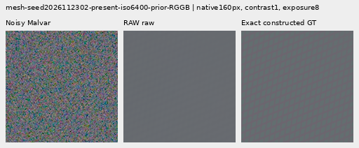

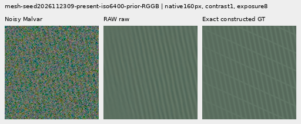

**RAW EMA: noisy → restored → exact constructed GT.**

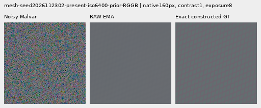

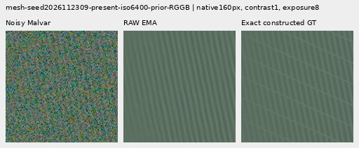

**Innovation raw: noisy → restored → exact constructed GT.**

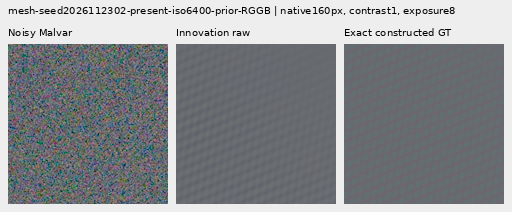

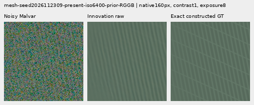

**Innovation EMA: noisy → restored → exact constructed GT.**

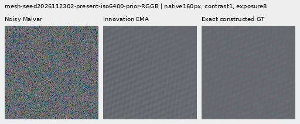

## Real cab gain and visible building failure

The main GFX100S scene is **DSCF3879 ISO6400 f/1.7 1/240s**, with **DSCF3880 ISO100 f/5.6 3s** as an independently demosaiced qualitative reference. Sky, building, foliage and coarse-fence crops use exposure4. Sky remains smooth at that display, foliage stays soft and coarse fence geometry is retained. Innovation adds a pronounced red/cyan artifact beside the lower-left building pillar/wires; it is absent in the V195 and RAW-control panels. This ordinary-display regression is more consequential than the small mean flat-error changes suggest.

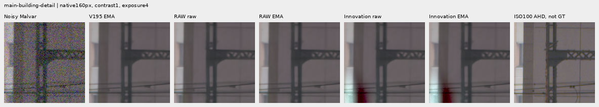

The difficult cab mesh is **DSCF3842 ISO6400 f/1.7 1/300s**, with **DSCF3835 ISO100 f/5.6 2.5s** plus both SOOC JPEGs. The cached 768px context begins at sensor `[600,6260]`; fixed relative ROIs are `[206,229,160,160]` and `[426,189,160,160]`. Both noise profiles and both ROIs are shown at exposure16 (+4EV). Raw-based method panels share the same transform; the native camera JPEGs retain their own rendering.

Innovation produces visibly stronger periodic mesh modulation in both ROIs/profiles. Crossings remain incomplete/soft compared with the independent ISO100 view, and the absent/flat tests show that extra periodic texture can also be false. **Aperture, exposure time, depth of field and moving subjects differ; ISO100/AHD/JPEG references are qualitative, not exact GT.** No real-reference pixel scoring occurs. [Source geometry and conditioning](../configs/gfx-green-mesh-20231231.json) · [Main scene coordinates](../configs/gfx-qualitative-20231231.json).

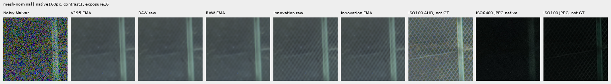

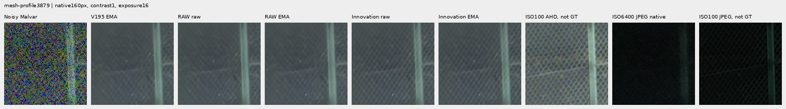

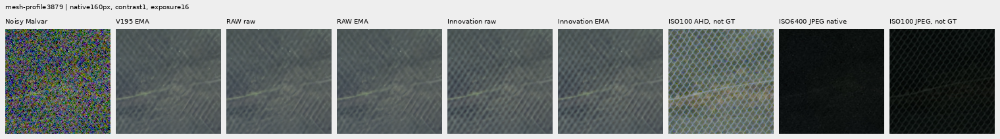

Stress40 flat/quiet views retain broad colored mottle and show added diagonal/corrugated waves in innovation fields. Ordinary synthetic steps/bars/striped geometry stays aligned; those cases do not expose the severe real-building color failure. ADC-only bark, fur and planes are unchanged through the zero-variance bypass.

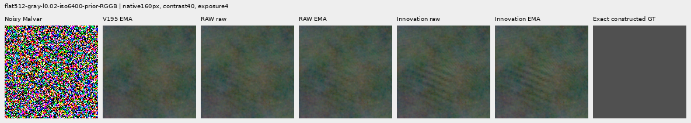

## State provenance and verification

| State | Source checkpoint SHA256 | Full module-state SHA256 |
| --- | --- | --- |
| RAW raw | `35846da4253926793b54a1a8453db3d6bb361e45ba7d5ab1dbe84eff9c89226e` | `10f1efb790556088c92ec4eba37547338445a278027709a906e3be7b506e7f57` |
| RAW EMA | `35846da4253926793b54a1a8453db3d6bb361e45ba7d5ab1dbe84eff9c89226e` | `e595d29ad15b23880d31bf6f867eed91f7de419333140bef17c8e8ef5b330860` |
| Innovation raw | `dc48808544efeb0d24e556c4eb01d7057c9a53f61e40ce889c169b5589f7311c` | `19110ff6af7535ba197f32a2fdcf6847960fbc986386dbbaac19e6dec31ae37f` |
| Innovation EMA | `dc48808544efeb0d24e556c4eb01d7057c9a53f61e40ce889c169b5589f7311c` | `2c15861fc2dd3bb50cae8ac6dcb92ffc3b3d582895abbaba1eac1424087afa27` |

All four strict standalone exports include `measurement` and `lower` configuration, 197 state tensors, frozen-anchor binding, fresh head clocks and separate prior-anchor training history. The [manifest](images/v197-innovation-wave-v1/manifest-v1.json) also records full-export file hashes. No new 100MP timing or general inference-quality claim is made.

The independent training audit checks all ten checkpoints and both complete traces. Evaluation covers **3,288 predictions**, with exact V195/V183/V169 replays, 288 ADC outputs, 3,000 calls to each wave head and **2,373,451,776** checked in-process addition channels. Only the **36 preselected native contexts per endpoint** retain complete new RGB/correction arrays. Posthoc checks cover all **144 RGB +144 correction encodings**, **107,544,576** native addition channels, 1,020 metric scalars, 144 correction RMS values and 556 independent Decimal means. The seven-method table has 973 independently checked summary means and 1,370 paired metric groups.

All **72 native figures /24 triplets** were actually inspected in eighteen original-detail sheets. Actual browser verification checks **480 native captures /36,864,000 RGB channels**, both raw/EMA matched pairs, state hashes, flip controls and navigation. Final publication verification independently checks all 854 CSV, 98 main-table and 36 directional-table values, exports and every public panel.

The cohort is adaptively reused development data. Related recipe/CFA observations are not independent replications, and there is no blind-generalization or training-seed confidence claim. No new source/noise draws, parent/DINO inference, RAW decode or original/dataz reads occur. All104 neural source files preserve their sealed bytes, all older reports/receipts/arrays stay in place, and external storage receives no writes. [Completed execution record](results/v197-completed-execution-v1.json) · [Timestamped interpretation](../diary/2026-11-08-15-19-38-innovation-quality-tradeoff.md).

The next architectural work must address strong-edge color stability and false flat/photographic waves while retaining this newly visible weak-detail response. The requested fine-detail/clean-flat combination remains unresolved.
