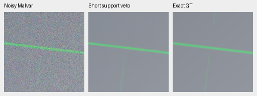
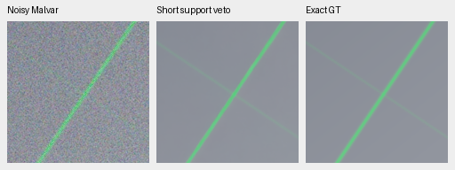

# Local RAW support for an isolated distant line

Fitting an isolated line to disjoint RAW measurements recovers much of
the faint crossing in the constructed ISO400 test. The whole-query fit
also extends the line into true gaps. A 24-pixel support check reduces
this extension while keeping most of the recovery. The gain is much
smaller at ISO6400. Both standing GFX scenes fall back to their local
parent because the exterior contains no accepted isolated line.
[Executed trials and native crops](results/isolated-raw-line-v1/publication.json).

The [multi-line follow-up](multiple-raw-line-guides.md) tests competing
exterior ridges, interrupted wires and a misleading guide beside a step.

## Exterior proposal and query evidence

The [earlier context intervention](scene-wire-gap.md) only changed what
the spatial model saw outside its native RAW tile. This experiment
fits an explicit straight line in the noisy Bayer data outside the
256×256 query and a 32-pixel margin. It uses a band-pass image for the
ridge location, then fits signed red, green, and blue amplitudes at
the actual sensor coordinates. The detector requires a compact ridge
with support on both sides of the query.

The candidate uses a tapered 1.2-pixel Gaussian cross-section and the
exterior color ratios. The two local checkerboard sets each fit its
amplitude jointly with a separate affine background for every color.
Each set must support the same signed line. The fitted full-query or
64-pixel amplitude replaces the corresponding component of the parent
in proportion to the observed support. The thresholds are empirical
scores from the supplied noise variance. The 24-pixel check further
attenuates delivery where short segments lack measured support.
[Experimental implementation](../src/demosaic/isolated_line.py).

The two studies contain 96 exact paired observations each across
12 geometries, four Bayer layouts, two independent repeats, two noise
priors, and continuous or partially interrupted wires. A separate
corruption supplies each matching, orthogonal, or quiet exterior.
Within a pair the full and absent roles share coupled counts and
read noise with valid physical marginals. The synthetic parent is the
trained trunk of the spatial 2k EMA with scene conditioning disabled,
SHA256 `97fd551bd0ae0b7aa97c67e1f6e8b513b722f70d5ad8b8814a96586b934eafac`.

## Measured wire and gap results

On the initial ISO400 continuous cases, the whole fit increases weak
response from **12.24% to 92.85%** of the exact signed RGB increment
and lowers wire-support error from **100.30 to 21.62 DN16**. The
64-pixel fit reaches 99.43% response with 27.21 DN16 error. On the
initial partial case set, it lowers added gap RMS from 75.74 to
15.44 DN16 versus the whole fit. The fresh panel varies gap lengths
from 28 to 58 pixels, uses off-center gaps, and uses new orientations
and noise seeds.

| Fresh ISO400 panel | Method | Weak response | Wire-support increment RMS DN16 | Added gap RMS DN16 |
| --- | --- | ---: | ---: | ---: |
| Continuous | Parent | 12.52% | 99.94 | — |
| Continuous | Whole fit | 93.67% | 21.97 | — |
| Continuous | 64-pixel fit | 102.47% | 27.20 | — |
| Continuous | 64-pixel fit with short support | 102.36% | 27.33 | — |
| Partial gap | Parent | 11.12% | 98.11 | 0 |
| Partial gap | Whole fit | 77.15% | 34.13 | 73.40 |
| Partial gap | 64-pixel fit | 81.15% | 41.62 | 8.70 |
| Partial gap | 64-pixel fit with short support | **80.58%** | **42.46** | **2.40** |

The short check keeps some gap error, with a worst-case added gap
RMS of 11.26 DN16 versus 18.90 for the 64-pixel fit. It also weakens
some true wire near gap boundaries. The continuous response above
100% reflects amplitude overshoot. Increment RMS includes shape,
amplitude, and position errors. Across both panels all fully absent
roles keep their original parent prediction, as do the orthogonal
and quiet exterior controls. This includes the original quiet-region
error from the parent.

At ISO6400 on the fresh continuous wires, the whole fit reaches
21.56% response versus 5.55% for the parent. The short support fit
reaches 6.35%. On fresh partial wires the short support fit returns
the parent identically. In these conditions pooling all available
query measurements helps more than the shorter support fits.
[Raw and aggregated scores](results/isolated-raw-line-v1/publication.json).

## Native detail and standing cameras

The two triplets show noisy Malvar, the short support refinement, and
exact GT at ISO400. Case 20 uses RGGB and case 29 uses BGGR, both
draw 0 at `8e-5/2.56e-8` shot/read, ADC16 black fraction 0.03,
identity WB/matrix, native ROI `[48,48,160,160]`, and exposure ×1.
The shared contrast ×8 display makes the weak line and the gap
visible. The partial case preserves the gap and attenuates part of
the real segment above it.
[Native rendering and checkpoint bindings](images/isolated-raw-line-v1/manifest.json).

The eight GFX boards retain V120, the matched local-only 2k parent
`ceb5ddaf23fce47806a01045bd86d34bb48d1f64031e382b0d5cfbabf0716880`,
and the composed results. This replay searches the cached 512- and
768-pixel RAW contexts outside each fixed native query. Neither
photograph supplies an eligible isolated ridge in these searches.
The sky stays smooth, small building hardware and darker foliage stay
soft, and the cab crossings remain incomplete. All eight camera
boards and all twenty synthetic boards were viewed.

The main DSCF3879 crops use exposure ×4 and
`.00128/6.5536e-6` shot/read. The cab DSCF3842 uses exposure ×16 and
both established priors. The independently demosaiced ISO100
captures and both cab camera JPEGs are qualitative references.
[Sky](images/isolated-raw-line-v1/standing/main-overcast-sky-main-overcast-sky.png) ·
[Building](images/isolated-raw-line-v1/standing/main-building-detail-main-building-detail.png) ·
[Foliage](images/isolated-raw-line-v1/standing/main-foliage-main-foliage.png) ·
[Coarse fence](images/isolated-raw-line-v1/standing/main-chain-link-fence-main-chain-link-fence.png).

| Cab prior | Shot/read | Boards |
| --- | --- | --- |
| Nominal | `.00128/6.5536e-6` | [Left](images/isolated-raw-line-v1/standing/mesh-nominal-fine-green-mesh-left.png) · [Right](images/isolated-raw-line-v1/standing/mesh-nominal-fine-green-mesh-right.png) |
| Transferred DSCF3879 | `.0014635775921166604/1.0715704128646712e-6` | [Left](images/isolated-raw-line-v1/standing/mesh-profile3879-fine-green-mesh-left.png) · [Right](images/isolated-raw-line-v1/standing/mesh-profile3879-fine-green-mesh-right.png) |

## Experimental API

`demosaic.isolated_line.refine_isolated_raw_line` accepts the
camera-linear parent crop, complete packed Bayer RAW and variance,
actual Bayer indices, and the even-origin native 256×256 query box.
It requires the evaluation extra for SciPy. The API matches the
prototype exactly in all 24 retained role-prediction checks and
returns the parent object for all eight standing replays. The
isolated-line geometry limits its application to these scoped
measurements. The general recommendation remains V120, and this
component study supplies no comparable full427 or camera-history
scores.
