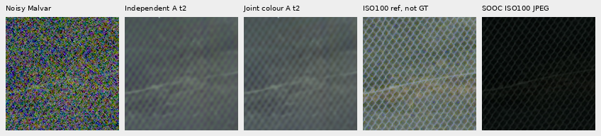
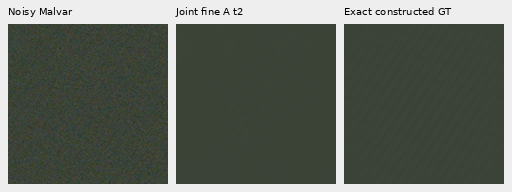
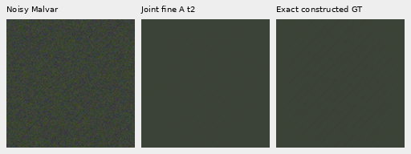

# Joint colour support for independently fitted fine carriers

**Complete: substantially less purple/green cab tint with the lattice retained,
at the cost of the extra synthetic1600/far weak-response gain.** This is a
useful optional real-mesh colour operating point above the
[sinusoidal fine control](fine-sinusoidal-carriers.md). The mesh is still soft,
overly regular and incomplete; building bands remain. V120 stays the general
baseline. Earlier response/error alternatives remain available.

[All46 native figures](images/neural-nuisance-joint-fine129-v1/native-viewer.html)
were actually inspected on14 unresized sheets.
[210 exact receipt archives and168 executed sources](results/neural-nuisance-joint-fine129-v1/publication.json)
preserve the source, complete48-case run, original preparation and queue
correction. This is an adaptive two-source development comparison, not a
camera-generalization or calibrated-risk result.
[Independent source/pixel/summary/link verification](results/joint-fine129-publication-verification-v1.json).
[Exact verifier source/log](results/joint-fine129-publication-verification-artifacts-v1.json)
and [all-field400/6400 preservation check](results/joint-fine129-preservation-check-v1.json).

The RAW-only diagnostic identifies a specific colour imbalance. In the
nominal cab right ROI's dominant upper-right512 tile, the first analytic fine
family has RAW-fit amplitudes R32.9/34.1, G70.4/76.9 and B32.1/30.7 DN16 in
the two folds. Yet mean independent-colour threshold2 support is
R0.1405/G0.8557/B0.0363. The second family has support approximately
R0.00063/G0.66869/B0.00195. Unequal shrinkage can change the carrier's colour
even with nonzero R/B fits. These are RAW coefficients, not exact wire colours
or final parent-innovation coefficients.

Both input-only diagnostics check144 colour rows across both retained
profiles, all four512 tiles, both nuisance arms and left/right ROIs. They
load RAW and genuine cached A-only fields only: **no parent, GT or reference**.
The complete local/global linear query map reproduces the coefficient fits
within1.07e-17. Propagated fixed-design variance is an A-only physical-noise
proxy; data-dependent frequency/weight selection prevents a calibrated SNR
or confidence interpretation. The two diagnostics' phasors, phases and noise
maps are identical. Only support changes. The second tool session reported143
after its complete atomic result and final log rows existed; that terminal
observation is preserved without retry or inference replay.

The implementation sums held-out full/null gains and energies across **actual
CFA samples of all colours before normalization**:

`score = sum(((B-null)^2 - (B-full)^2)/variance) /
(2*sqrt(sum((full-null)^2/variance)))`.

Native129 local boxes/stride32 and the global score use the same formula;
both fold scores and original A/B geometry matching are required. One scalar
support per direction/pixel multiplies independently fitted RGB amplitudes
and phases. The score is not a green score copied to R/B, a sum of colour
Z-scores, or forced neutral RGB. Adverse R/B predictions can reduce or reject
a direction. A strong joint gain can nevertheless admit noisy weak-colour
coefficients; it does not validate missing-colour pixels or guarantee fidelity.

Fine proposals, full-fit sine/cosine coefficients, full/null predictors,
variance, global nuisance and RAW/parent projection are unchanged from the
independent-colour sinusoidal control. Only fine support changes. The original
broad guided-phase support and raw-H1 controls stay unchanged. This contrast
isolates the support aggregation rule in the delivered model; it does not
establish a universal cause for every real colour artifact.

In the same dominant nominal right query, analytic first-family support now
has one common value across R/G/B; the NN first/second families have common
mean support0.90135/0.67249. Actual native viewing shows much less magenta/
green periodic tint with both fine directions retained in both profiles and
both ROIs. Remaining soft/regular lines still differ from the independent
reference. This qualitative colour gain is useful without claiming exact
wire recovery.

[Nominal left](images/neural-nuisance-joint-fine129-v1/cab-before-after/mesh-nominal-left-before-after.png),
[nearby-profile left](images/neural-nuisance-joint-fine129-v1/cab-before-after/mesh-profile3879-left-before-after.png)
and [right](images/neural-nuisance-joint-fine129-v1/cab-before-after/mesh-profile3879-right-before-after.png)
retain identical coordinates/transforms across methods. The original
seven-cell boards in the viewer retain both SOOC JPEGs and both nuisance arms.

The unchanged cohort comprises36 finite roles, sources0/1, RGGB/repeat0,
near/far, three original priors, plus12 material/protected contexts. All88
fields are adopted, zero new neural/DINO calls or RAW/noise/weight updates
**in this comparison**. All48 corrections closed before new quality analysis.
Analytic localt2 versus independent-colour fine H1 remains primary; NN and all
six methods/fixed0/2/4 controls are retained. No threshold was selected from
these outcomes.

Mean projected amplitude response and DN16 errors across the two sources:

|1600/far variant | Weak response | Quiet RMS | Weak-increment RMS | Full role2 RGB RMS |
| --- | ---: | ---: | ---: | ---: |
| Parent V143 |0.98266% |5.550811 |15.538719 |29.283769 |
| Independent fine H1, analytic |1.49991% |5.551996 |15.618608 |28.472396 |
| Joint fine H1, analytic |0.98935% |5.551996 |15.621053 |28.473860 |
| Independent fine H1, NN |1.24737% |5.595156 |16.034092 |28.561320 |
| Joint fine H1, NN |0.98711% |5.595185 |16.035306 |28.562097 |

The primary analytic arm returns exactly to broad-only's1600/far metrics,
losing the small extra fine gain. Strong response stays49.75416%. The NN arm
also loses the extra weak response, with slightly higher quiet/increment/full
errors than independent support. This is a real cost, not an across-the-board
quality promotion.1600/near errors also change slightly; exact per-source
values and all0/2/4 curves remain in the publication.400/6400 localt2 results
are retained, including analytic400/far weak28.70178%, quiet4.030275 and
increment11.677129 DN16. Response percentages are projected amplitude,
not restoration accuracy.

Noisy Malvar → joint-support analytic reconstruction → exact constructed GT:

The retained400/far result has matching exact-GT triplets for
[source0](images/neural-nuisance-joint-fine129-v1/triplets/iso400-index0008-role2-analytic-triplet.png)
and [source1](images/neural-nuisance-joint-fine129-v1/triplets/iso400-index0024-role2-analytic-triplet.png).
NN1600 counterexamples retain
[source0](images/neural-nuisance-joint-fine129-v1/triplets/iso1600-index0008-role2-triplet.png)
and [source1](images/neural-nuisance-joint-fine129-v1/triplets/iso1600-index0024-role2-triplet.png).
All are512-native RGGB/repeat0/role2, recipe seed202611160500,
ROI`[176,176,160,160]`, unresized160 crops, source exposure1, display exposure2/
contrast1, identical saved WB/matrix.1600 shot/read`0.00032/4.096e-7`;
400 uses`8e-5/2.56e-8`.

Exhaustive native160 maximum **correction RMS from V120**, not reference error:

| Scene | Analytic independent → joint DN16 | NN independent → joint DN16 |
| --- | ---: | ---: |
| Building |154.781→153.657 |65.109→59.704 |
| Foliage |8.277→8.795 |4.151→4.136 |
| Coarse fence |64.659→65.077 |64.793→65.033 |
| Cab nominal |22.921→27.736 |22.135→26.550 |
| Cab nearby profile |17.415→20.376 |16.139→18.753 |

Restoring more colour components increases cab correction power despite the
cleaner observed hue. Maxima are selected independently per method after
inference without reference arrays and can move. Analytic building bands
remain severe; NN bands are smaller. Sky stays unchanged and foliage/bark/
fur soft. Both the analytic maximum and historical building ROI remain in
the native stress review.

Both standing families remain: DSCF3879/3880 sky/building/foliage/coarse fence,
DSCF3842/3835 fine mesh, both profiles/ROIs/JPEGs. Cab ROIs left
`[206,229,160,160]`, right`[426,189,160,160]`, display exposure16/contrast1.
Nominal shot/read`0.00128/6.5536e-6`; fixed nearby-DSCF3879 input-Haar profile
`0.0014635775921166604/1.0715704128646712e-6`. Neither is a dedicated camera
calibration. ISO100/AHD/JPEG references differ in aperture, exposure time and
moving subjects: qualitative, **not exact GT**, never pixelwise scored.
Cached media only; originals read-only and all captures/JPEGs/siblings outside
training.

Use `restore_neural_nuisance(..., aggregation_config=PhaseAggregateConfig(
bins=32, window=129, query_stride=32), phase_guide=True,
reselect_frequencies=False, add_fine_carriers=True,
fine_reconstruction="sinusoidal", fine_support="joint")` with Hann512/
full-frame geometry and two genuine A-only neural fields. Independent colour
support remains the API default. Both nuisance arms require neural fields for
the retained broad guidance; “analytic” names its nuisance basis.

All217 relevant regression tests pass, including direct pooled-CFA sums on all
four CFAs, non-validation NaNs, colour-label invariance, adverse red evidence,
zero-energy nulls, actual nonzero delivery and unchanged broad/H1 controls.
All288 raw-H1 outputs match the original guided run. All48 input/parent
fingerprints,50 tiles/100 broad diagnostic arms and100 fine geometry/predictor
diagnostics match the independent control. Independent output audit:
3819 fields/228 finite/114 material rows/14,131,200 encoded channels, maximum
discrepancy2.89e-15. Two-thread correction561.92s versus566.97s independent;
this is not a100MP speed benchmark.

Frozen plan:
`29d510e2258cb88c34c46811b662c4cb2039f50ba9c6f8f820e23bc018f9d5cd`.
Configuration/source:
`a13cfe5710640014e07f2997955c3fe02fa7ad42f8e56f85cb3b7b92094fd903`.
Procedural V143 checkpoint:
`96d146d017c54196288c585f8b7eddcf030e8a235061049c31e985b9380b7ce4`.
Photographic V120/frozen A-only teacher checkpoint:
`a9d9b6b4f974e24a6b11e5e740aab32314233a7f53c056cf37c7d2aac1c589fb`.
DINO backbone:
`691963f0f796aac860d818d59d9d14287a4675612829fbe9467c7f5df8ce5b14`.

The [new coloured-wire benchmark](coloured-fine-wire-benchmark.md) separately
adds48 fresh synthetic observations and144 explicitly counted neural calls.
It includes a signed green contrast and all four CFAs, so an achromatic-looking
result cannot by itself count as recovery. All192 corrections are closed,
scoring/rendering complete;40 actual native views/final audit are pending,
so no new-cohort quality outcome is claimed here. The original
[full broad-only guided study](neural-guided-phase-full-panel.md) remains a
separate frozen comparison.
