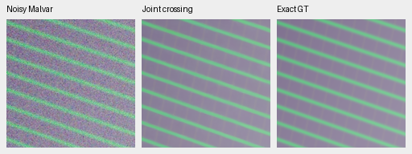
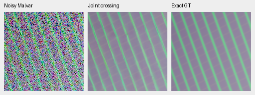

# Joint Bayer evidence at repeating wire crossings

When one wire occludes the other, an additive fit can leave too much of
the rear wire visible at the junction. On the constructed ISO400
occlusions, selecting a joint crossing model lowers junction increment
error from **44.44 to 9.03 DN16** against the additive fit. At ISO6400
the same selection lowers the additive error to 28.72 DN16, with the
local trunk at 18.56 DN16. Accurate geometry and a strong outside
pattern make the synthetic gains possible. Both standing GFX scenes
still lack supported pairs of exterior phases under these checks.
[Executed evidence and native crops](results/joint-mesh-phase-v1/publication.json).

The [local donor follow-up](local-donor-mesh.md) uses phase-independent
frequency proposals from smaller windows and validates phase on the query.
It exposes measurable support for two directions in the left cab crop.

## Two linked phase profiles

The fresh panel has 72 exact-reference pairs, six geometries, two
noise priors and two independent draws per geometry and layout. The
three layouts use additive wires, a front wire occluding the rear,
and an occluded rear wire with a missing band next to a step edge.
Each pair shares coupled RAW noise. One role has the rear wire and
one has only the front wire. A separate flat control receives the
same guide and independent RAW noise.

For each actual Bayer color, the fit uses an affine background and
the stronger periodic profile as nuisance terms. The paired model
weights the rear profile by the uncovered fraction of the stronger
one. The alternative adds the rear profile across the whole pattern.
A third fit estimates an independent interaction coefficient. Each
model is fitted on one checkerboard subset and forecast on the other,
then reversed. Both held-out tests must support the rear component.
The adaptive fit uses the occlusion model only when both directions
show lower held-out loss than the additive fit by the specified
margin. This is an empirical model selection rule. The local variant
fits four overlapping sections and tapers their corrections. It has
fewer samples per estimate.

The principal synthetic comparison supplies the carrier directions,
center frequencies, widths and perspective. It estimates their two
phase offsets from a separately corrupted 768×768 Bayer field, with
the local 256×256 query and 32-pixel margin masked. A second replay
moves each initial frequency by one native frequency bin along one
or both axes. Each exterior side ranks and fits a small frequency
bank and predicts the other. Their supported frequencies and phases
must agree. The deliberate offsets put the original frequencies on
the search grid. The replay tests correction of a stated error with
known perspective.
[Geometry, seeds and frequency error records](results/joint-mesh-phase-v1/publication.json).

## Junction detail and false extension

Junction error is the RMS error in the signed present-minus-absent
increment, on rear-wire support where the front profile exceeds
0.45. The rest of the large clean wire support is measured separately.
Each row averages 12 pairs. The additive model raises junction
response above 200% where an occluded wire should fade. Adaptive
selection varies with noise.

| Occluded layout | Local trunk | Additive fit | Adaptive crossing | Fixed occlusion with exact geometry |
| --- | ---: | ---: | ---: | ---: |
| ISO400 junction RMS, DN16 | 14.45 | 44.44 | **9.03** | 9.03 |
| ISO6400 junction RMS, DN16 | **18.56** | 43.73 | 28.72 | 14.29 |
| ISO400 full weak support RMS, DN16 | 45.28 | 24.41 | 17.24 | 17.24 |
| ISO6400 full weak support RMS, DN16 | 47.34 | 27.89 | 25.43 | 23.15 |

The whole-query selector chooses occlusion on 12/12 ISO400 occluded
pairs and 6/12 ISO6400 pairs. It stays additive on all 24 genuinely
additive pairs. The ISO400 improvement at occluded junctions comes
with higher error between junctions, from 11.74 to 18.66 DN16. The
periodic model also fills some genuine gaps. At ISO400, the adaptive
fit adds 39.66 DN16 RMS inside the broken rear wire's gap. Local
pooling reduces that to 31.16 DN16, with higher error on the visible
rear wire. The global adaptive correction leaves all 72 front-only
roles exact to their parent. It changes four of 72 untextured controls,
with at most 1.44 DN16 added RMS inside a displayed crop. The shifted
guides and control corrections are recorded with the wire results.

The frequency refinement accepts both exterior carriers on all 72
constructed pairs with the intentionally biased starts. On the
occluded ISO400 panel the refined adaptive fit reaches 9.03 DN16
junction error versus 14.45 DN16 for the perturbed additive arm,
which leaves the rear wire largely missing. The synthetic outer
patterns have strong repeated support and a known phase field.
[Full errors, controls and method choices](results/joint-mesh-phase-v1/publication.json).

## Native synthetic comparisons

Both triplets show noisy Malvar, adaptive joint crossing and exact GT
at 160×160 native pixels in query ROI `[48,48,160,160]`. Case 80
uses RGGB at ISO400 with shot/read `8e-5/2.56e-8`. Case 83 uses
GBRG at ISO6400 with `0.00128/6.5536e-6`. Both use draw 0, ADC16
black fraction 0.03, identity WB and color matrix, exposure ×1 and
shared contrast ×8. The local trunk is the spatial 2k EMA with context
disabled, SHA256
`97fd551bd0ae0b7aa97c67e1f6e8b513b722f70d5ad8b8814a96586b934eafac`.
The native ISO6400 example gains the rear direction. The panel
average still has imperfect junctions and missing sections.

[ISO400 additive board](images/joint-mesh-phase-v1/iso400-additive-g80-r0-comparison.png) ·
[ISO400 broken board](images/joint-mesh-phase-v1/iso400-broken-g83-r0-comparison.png) ·
[ISO6400 occluded board](images/joint-mesh-phase-v1/iso6400-occluded-g83-r0-comparison.png).

## Standing GFX100S checks

The initial replay takes a pair of previously proposed exterior
frequencies. A wider search ranks the retained candidate banks on
opposite sides of the query and recalibrates up to 12 candidates
per view. After deduplication and frequency limits, the views have
0–8,025 candidates. The search rejects all eight views before local
fitting. Matching strong periodic geometry in the synthetic panels
is easier than finding two globally coherent directions around the
real query. The wider replay does not establish that the local RAW
lacks a mesh signal.

All eight boards were viewed. Every fit returns the local-only 2k
parent, SHA256
`ceb5ddaf23fce47806a01045bd86d34bb48d1f64031e382b0d5cfbabf0716880`.
The overcast sky stays smooth, the coarse fence keeps its visible
lattice, and fine building and foliage details remain soft.
DSCF3879 uses shot/read `0.00128/6.5536e-6` and exposure ×4.
[Sky](images/joint-mesh-phase-v1/standing/main-overcast-sky-main-overcast-sky.png) ·
[Building](images/joint-mesh-phase-v1/standing/main-building-detail-main-building-detail.png) ·
[Foliage](images/joint-mesh-phase-v1/standing/main-foliage-main-foliage.png) ·
[Coarse fence](images/joint-mesh-phase-v1/standing/main-chain-link-fence-main-chain-link-fence.png).

The DSCF3842 cab crops use exposure ×16 and retain the two JPEGs and
the independently demosaiced DSCF3835 ISO100 reference. Those references
differ in capture conditions and provide qualitative comparisons.
Fine green crossings remain incomplete under both priors.

| Cab prior, shot/read | Native boards |
| --- | --- |
| Nominal, `0.00128/6.5536e-6` | [Left](images/joint-mesh-phase-v1/standing/mesh-nominal-fine-green-mesh-left.png) · [Right](images/joint-mesh-phase-v1/standing/mesh-nominal-fine-green-mesh-right.png) |
| Transferred, `0.0014635775921166604/1.0715704128646712e-6` | [Left](images/joint-mesh-phase-v1/standing/mesh-profile3879-fine-green-mesh-left.png) · [Right](images/joint-mesh-phase-v1/standing/mesh-profile3879-fine-green-mesh-right.png) |

This scoped restoration comparison has no new trained endpoint or comparable
[full427 and camera-history scores](performance-history.md).
