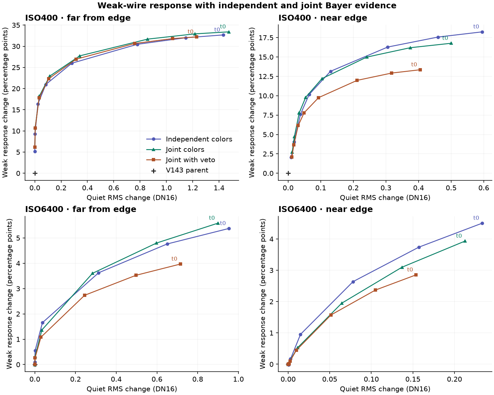
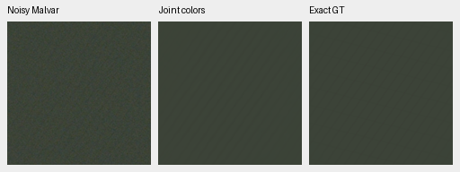
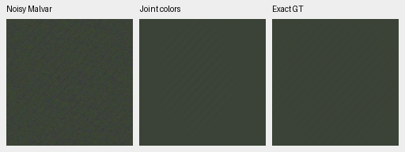

# Joint Bayer evidence for weak phase profiles

Sharing evidence across CFA colors gives a small ISO400 near-edge
response gain and lower far-edge response at both noise levels under
the tight quiet-error budget. The per-color veto further attenuates
recovery in most cells. The main sky matches V120, and the cab
reference crossings remain unresolved. The independent gate remains
the baseline.
[Complete metrics, native crops, and executed sources](results/joint-profile-support-v1/publication.json).

## Validation

The [oriented-window comparison](oriented-raw-support.md) favors the
129×129 square at the tight quiet-error budget. Here the square stays
fixed while the channels share evidence. The earlier
[joint-color test](joint-fine-colour-support.md) uses a different
fine-frequency proposal and delivery path.

- **Independent colors.** Normalize the prediction error reduction
  by the predicted correction energy for each color separately, then
  pool the two folds where both reduce error in that color.
- **Joint colors.** Sum the variance-normalized error reductions and
  correction energies across actual CFA samples before normalizing.
  Both folds must independently reduce joint error for that direction.
  The score weights the existing fitted correction in all three colors.
- **Joint with veto.** Apply the same joint weight in a color only
  where the measured samples in that color improve in both folds.

Every arm uses the corrected donor frequencies, eight-knot phase
profiles, discovery-only reliability weights, and the same square
support, parent and correction coefficients. At each validation
anchor the score is the sum of the full-versus-null squared error
reductions divided by twice the square root of the summed correction
energy. Both sums weight each RAW site by inverse estimated noise
variance. The joint sum uses the measured Bayer sampling density.
The coefficients stay color-specific, including their phase and sign.
[Validation operator](../src/demosaic/joint_colour_evidence.py) ·
[Phase restoration](../src/demosaic/local_validated_waves.py).

The sweep uses 384 query views, covering eight geometries, four CFAs,
two noise profiles, two edge placements and three paired roles.
For each held-out geometry the other seven select the threshold and
correction amplitude under the quiet-error budget. All three budgets
and eight fixed thresholds are recorded. The eight real cases use
fixed threshold 2.

## Held-out quiet-budget results

The tight budget allows 0.02 DN16 more quiet RMS than V143 on the seven
calibration geometries. The table reports actual error and recovery on
the eighth, averaged over the eight held-out geometries. Within each
geometry RMS pools the four CFAs in squared-error units. Weak response
is the projection of the restored weak increment onto the exact
constructed target increment.

| Noise and edge | Gate | Weak response | Quiet RMS DN16 | Weak-increment RMS DN16 |
| --- | --- | ---: | ---: | ---: |
| ISO400 far | Independent | 17.536% | 2.51694 | 10.02081 |
| ISO400 far | Joint | 16.515% | 2.52289 | 10.02096 |
| ISO400 far | Joint with veto | 16.484% | 2.52202 | 10.02355 |
| ISO400 near | Independent | 9.481% | 6.11456 | 13.02156 |
| ISO400 near | Joint | 10.003% | 6.11659 | 13.02811 |
| ISO400 near | Joint with veto | 9.075% | 6.11746 | 13.03030 |
| ISO6400 far | Independent | 2.294% | 6.74949 | 22.46433 |
| ISO6400 far | Joint | 2.110% | 6.75472 | 22.46390 |
| ISO6400 far | Joint with veto | 1.957% | 6.74965 | 22.48019 |
| ISO6400 near | Independent | 3.973% | 22.92022 | 30.82640 |
| ISO6400 near | Joint | 4.026% | 22.91920 | 30.82512 |
| ISO6400 near | Joint with veto | 3.723% | 22.91892 | 30.83037 |

The small near-edge ISO400 response gain comes with higher increment
error. At the looser 0.10 DN16 budget the joint ISO400 far arm raises
response from 22.73% to 23.67% and raises the achieved quiet RMS
from 2.578 to 2.602 DN16. At the same budget, the joint ISO6400 far
arm raises response from 3.13% to 3.23%, with worse increment error
and larger absolute weak projection when the wire is absent.
At fixed threshold 2, ISO6400 far reaches 1.085% with the joint gate
and 1.175% with the independent gate, at 6.7284 DN16 quiet RMS in
both cases.
[Fixed sweeps and paired held-out results](results/joint-profile-support-v1/summary.json).

## Color-specific recovery

At the tight budget in ISO400 far crops, joint evidence recovers a
greater fraction of the weaker red and blue increments. Green has
the strongest true increment in these fixtures. Its recovery falls
from 20.60% to 17.40%, and weak chroma increment RMS rises from 5.059
to 5.072 DN16. The ISO6400 far mean also shifts toward red and blue,
while the chroma increment error changes by only −0.003 DN16. The
quiet centered chroma error of the wire-free role is nearly identical.

| Far-edge profile | Gate | Red response | Green response | Blue response |
| --- | --- | ---: | ---: | ---: |
| ISO400 | Independent | 4.08% | 20.60% | 2.99% |
| ISO400 | Joint | 11.90% | 17.40% | 10.02% |
| ISO400 | Joint with veto | 8.81% | 17.73% | 7.86% |
| ISO6400 | Independent | 1.65% | 2.48% | 0.98% |
| ISO6400 | Joint | 2.30% | 2.12% | 1.41% |
| ISO6400 | Joint with veto | 2.02% | 2.04% | 0.92% |

Each projection uses the exact increment in that camera-linear color
and averages layouts and geometries. Chroma removes the pixel RGB mean.
The green-dominant fixtures leave recovery on signed color structures
open. [Per-channel projections and chroma errors](results/joint-profile-support-v1/chroma-diagnostics.json) ·
[Separate signed-color benchmark](coloured-fine-wire-benchmark.md).

## Native comparisons

The synthetic triplets show noisy Malvar, the joint-color gate at
threshold 2, and exact constructed GT. Every cell is 160×160 pixels.
They use geometries 0 and 1, RGGB draw 1, the far two-wire role and
ROI `[176,176,160,160]`. Exposure is 2 with shared white balance,
matrix and clipped-sRGB display. Noise uses ADC16 black fraction
0.03 and shot/read `8e-5/2.56e-8` at ISO400 and
`0.00128/6.5536e-6` at ISO6400. Synthetic parent V143 EMA SHA256
is `96d146d017c54196288c585f8b7eddcf030e8a235061049c31e985b9380b7ce4`.

The real parent is V120 EMA, SHA256
`a9d9b6b4f974e24a6b11e5e740aab32314233a7f53c056cf37c7d2aac1c589fb`.
Main DSCF3879/3880 crops use exposure 4. The DSCF3842/3835 cab
mesh uses exposure 16 and the nominal and transferred noise profiles.
The ISO100 AHD and camera JPEG panels are qualitative references
from a separate exposure with different aperture and subject motion.

The lower-noise crops retain visible diagonal modulation, with clearer
crossings in the exact targets. The ISO6400 outputs remain nearly flat.
The real building and foliage remain soft, and the coarse fence retains
its crossings. The cab correction differs most from the independent
gate on the left at the transferred profile, by 2.80 DN16 RMS. It
changes the faint diagonal modulation, with no convincing new fine
crossings on either side under either profile.
[ISO6400 comparison](images/joint-profile-support-v1/iso6400-index0009-comparison.png) ·
[Sky](images/joint-profile-support-v1/main-overcast-sky.png) ·
[Building](images/joint-profile-support-v1/main-building-detail.png) ·
[Foliage](images/joint-profile-support-v1/main-foliage.png) ·
[Coarse fence](images/joint-profile-support-v1/main-chain-link-fence.png) ·
[Cab left](images/joint-profile-support-v1/mesh-nominal-left.png) ·
[Cab right](images/joint-profile-support-v1/mesh-nominal-right.png) ·
[Transferred profile left](images/joint-profile-support-v1/mesh-profile3879-left.png) ·
[Transferred profile right](images/joint-profile-support-v1/mesh-profile3879-right.png).

The collector took 290.72 seconds on two CPU threads. It reran all
392 independent threshold-2 controls bit exactly from the adopted
inputs. The independent audit checks 1,728 reductions across 288
held-out rows, all 80 retained GFX cells, and four exact native
triplet subsets. All twelve comparison boards were opened.
[Independent audit](results/joint-profile-support-v1/independent-audit.json) ·
[Native coordinates, noise conditioning, and viewing](images/joint-profile-support-v1/manifest.json).
