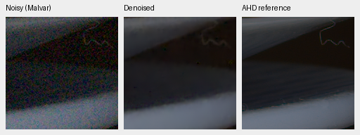
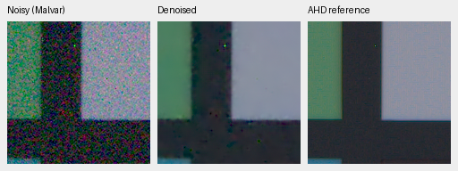

# Joint tuning versus refiner-only continuation

Both controlled continuations completed 5000 steps from identical V16 step5000
EMA weights, architecture, seed 43, 50/50 paired/synthetic data, losses and LR 3e-5
schedule. V18 updates restoration and fine RGB correction; V19 updates only the
fine correction. DINO stays frozen and the coarse branch is disabled.

All **202 sampled observation/target hashes** match through step5000, along with
checkpoint CPU/Python/CUDA RNG states, training source hash and initialization.
These checks cover logged batches, not every batch; CUDA optimization need not
be bit-identical. [Trace evidence](results/joint-control-observations-5k.json).
The [first 1000-step receipt](results/joint-control-1k-review.json) remains archived.

| Method | Known CFA PSNR | Unseen CFA PSNR | Known AHD sRGB PSNR | Unseen AHD sRGB PSNR |
| --- | ---: | ---: | ---: | ---: |
| Parent V16 step5000 | 53.27466 | 53.07857 | 39.15836 | 37.65963 |
| V18 joint step5000 | 53.13418 | 53.12165 | 39.01083 | 37.67221 |
| V19 refiner-only step5000 | 53.29175 | 53.10137 | 39.17048 | 37.68853 |
| RawNIND CFA-LS | 54.06860 | 53.56220 | 39.67805 | 38.14484 |

Primary scores average noisy captures within scenes, then four known-camera or
five unseen-camera development scenes. V18 versus V19 is −0.15757/+0.02028 dB;
scene-bootstrap 95% intervals are [−0.43195,−0.00130]/[−0.01545,+0.05601].
Auxiliary SSIM is 0.921633/0.908315 for V18 and 0.921593/0.907932 for V19.
The small number of scenes limits generalization claims.

V19's gains over V16 are only +0.01709/+0.02280 dB. Its known-camera gain is
uneven: scene-bootstrap interval [−0.00114,+0.05062]; the unseen-camera interval
is [+0.01702,+0.02859]. RawNIND still leads V19 by 0.77685/0.46083 dB.
The crops retain color variation, smoothing and lost fine structure. Neither
candidate established a clear qualitative improvement over V16 in this study.
The README now follows the [current models](current-model.md); these historical
comparisons do not select the current baseline.

The matched **64-photo** synthetic screen favors V18: PSNR/SSIM
32.05204/0.925757 versus V19 31.97551/0.924235. Eight procedural sources give
29.27696/0.912527 versus 29.23331/0.911328. This screen is distinct from the full
427-photo panel. V19's **full 427** result is 31.49630/0.923228, versus V16
31.48800/0.923018; sixteen procedural sources give 30.57856/0.923066, versus
30.56577/0.922656. V18 has only the smaller screen at step5000.

Fixed native 160×160 crop triplets, selected before inspecting outputs, retain
identical locations and display settings. Left: noisy Malvar; middle: candidate;
right: calibrated low-noise AHD reference, **not exact RGB GT**. Open at 100%.
V18:

V19 on the same inputs:

[Complete score, weight, ROI, conditioning and display receipts](results/joint-control-5k-review.json).
Synthetic source reports also contain exact synthetic-GT triplets. Protected
final targets and the user's GFX captures remain outside training; final test
metrics remain unused. The quality and speed goals are still open.

Sources: Benoit Brummer and Christophe De Vleeschouwer, *Raw Natural Image Noise
Dataset (2025)*, [dataset](https://doi.org/10.14428/DVN/DEQCIM),
[CC BY-SA 4.0](https://creativecommons.org/licenses/by-sa/4.0/), with additional
scene permissions (`7D-1`: Peter Wemmert, CC0). Modified by registration,
calibration, demosaicing/restoration, crop and shared display.
