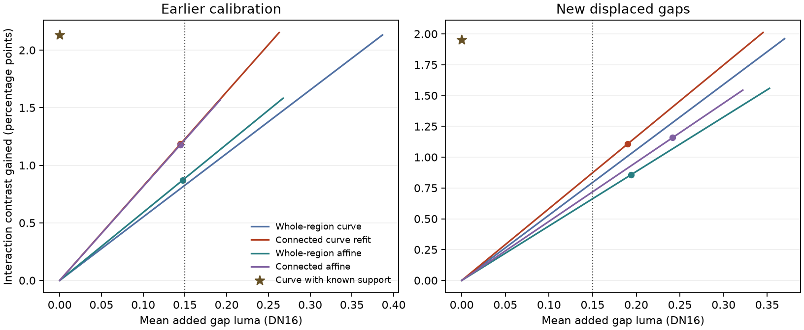
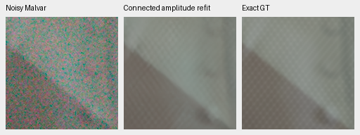
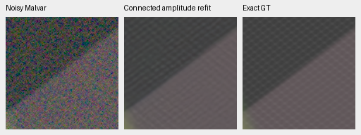

# Checking connected gaps before restoring weak crossings

Grouping nearby Bayer samples into a candidate gap improves the
pooled crossing fit at the same measured gap texture. On 24 new
variable-phase photo fixtures, the connected refit recovers an
extra **0.100 percentage points** of interaction contrast and
lowers junction error by **0.053 DN16** relative to a whole-region
curve with the same mean gap luma. The result is similar over
Local 50k and Corpus 100k on the same mosaics.

The calibrated strength exceeds the gap limit on the new photos.
The fit also changes three stationary-interaction draws. Real
right-cab changes remain subtle, with incomplete fine crossings.
The fit remains experimental.

## Infer gap support from a stronger wire

The [independent phase selection study](adaptive-junction-phase.md)
checked for the weak interaction itself near each delivery station.
The new fit instead asks whether one of the two fundamental wire
directions loses strength across a connected area. The fundamental
can be easier to measure than the crossing. The correction still
uses the signed interaction measured in the recipient Bayer crop.

Q0 fits each wire's phase, then nominates one direction and one
attenuation shape. The search uses 651 overlapping tapered ovals
and strips, with several widths, orientations and offsets. The
fit jointly accounts for smooth brightness, the measured step
when present, gradual amplitude trends in both wires and both
stationary and varying interactions. Eight-pixel sufficient
statistics allow the shapes to be evaluated against the same
weighted nuisance fit. A candidate needs a Q0 score of at least
3.5 and a positive Q1 repeat score of at least 1.25 or 2.25.
The weaker of the independently measured taper depths caps the
strength of the proposed attenuation.

Q2 and Q3 still check the two original fundamentals and the
signed difference band before any correction. A confirmed
attenuation lowers the pooled amplitude where the wire fades.
The refit variant also estimates the difference amplitude in
that predicted footprint. The existing 16-pixel two-wire gate
continues to control delivery. The support search uses a
192-pixel neighborhood and the matched exterior frequency
donors from the earlier studies.

On all four Bayer layouts at an odd crop origin, replacing Q1
through Q3 leaves the nominated shape and direction bit-identical.
Replacing Q2 and Q3 leaves the Q1 check bit-identical as well.
The audit reproduces the binned score by an explicit weighted
projection and locates an offset oval on the intended wire.

## Displaced-gap test

The 32 backgrounds from the prior adaptive holdout are calibration
for this study. The new panel contains 32 other Commons backgrounds,
source-disjoint by ID and cached-pixel hash. Twelve use an affine
difference phase, 12 a curved phase and eight stationary
interactions with moving fundamentals. The new gap and smooth-dip
centers are displaced by 20 to 43 pixels on each axis. Half of
each phase class has an exact gap. The two matched draws per photo
retain pre-Bayer blur σ 0.85, capture exposure ×0.33, black 0.03,
ADC16 and ISO6400 shot/read `0.00128/6.5536e-6`. Each
present/additive pair shares Poisson counts at the lower rate and
shares read noise.

Calibration compares blends in five-percentage-point increments
under the earlier 0.150 DN16 mean-gap limit and the same additive,
quiet and stationary limits. It selects 55% whole-region affine,
75% connected affine, and 55% connected curved refit. The phases
and strengths stay fixed for the independent photos and the
Corpus 100k transfer.

| Local 50k composition | Interaction response, 24 variable photos | Junction increment RMS, DN16 | Mean gap luma added, 16 gapped photos | Peak gap luma added, DN16 |
| --- | ---: | ---: | ---: | ---: |
| Regional RAW refit | 16.502% | 45.186 | 0.000 | 0.000 |
| Earlier curve with local amplitude | 16.946% | 44.961 | 0.054 | 1.604 |
| Locked whole-region affine | 17.359% | 44.750 | 0.194 | 1.811 |
| Locked connected affine | 17.660% | 44.611 | 0.242 | 2.054 |
| Locked connected curved refit | 17.608% | 44.625 | 0.190 | 1.610 |
| Full whole-region curve | 18.463% | 44.251 | 0.370 | 3.161 |
| Full curve with supplied support | 18.455% | 44.254 | 0.000 | 0.000 |

The locked curved refit adds **1.106 points** `[+0.423,+1.932]`
and lowers junction error **0.562 DN16** `[−0.964,−0.214]`
over regional RAW refit. Relative to its whole-region curve
at the same mean gap luma, it gains **0.100 points**
`[+0.032,+0.181]` and lowers junction error **0.053 DN16**
`[−0.103,−0.015]`. Connected affine gains **0.090 points**
`[+0.023,+0.179]` over dose-matched whole-region affine. At
the 0.150 DN16 budget, retrospective scaling gives **0.874**
contrast points for the connected curve and **0.795** for the
whole-region curve. These comparisons use the measured gap
cost from the independent panel. The intervals resample whole
photos within fixture geometry.

The connected curve reweights four of 48 variable draws. Its
locked dose leaves 0.190 DN16 mean gap residue. It adds up to
0.153 DN16 on the matched additive control and changes three of
16 stationary-interaction draws, with up to 3.860 DN16 of added
luma RMS in the scored interior. Strong-only, flat-core, edge-only
and uniform inputs reproduce regional RAW refit. All 48 ordinary
photos reproduce the refit with both authentic and incompatible
exterior guidance. The supplied-support control retains **1.953**
points of recovery with zero measured gap addition. It uses the
known optical mask and establishes how much improvement remains
available through better localization on these fixtures.

With the same lock and mosaics over Corpus 100k EMA, the
connected curve gains **1.120 points** over the corresponding
regional refit. It gains **0.100 points** `[+0.032,+0.181]`
over the equal-gap whole-region curve, with **0.189 DN16** mean
gap residue. The RAW support check selects the same four
variable draws over both checkpoints.

Dots mark strengths selected on calibration. The dotted vertical
line marks the 0.150 DN16 gap limit. The star is the diagnostic
with the supplied optical mask.

## Native exact comparisons

The triplets show noisy Malvar, the locked connected curved refit
and exact optical GT. Each 160×160 tile uses `[48,48,160,160]`
inside the 256-pixel query at `[128,128]`, display exposure ×2
and a common sRGB transform. The Local 50k EMA SHA256 is
`62f4e9ce84075c8df1a254a1889033b5787133e8c98c63e0ec3d174a94734959`.
The fixtures were adapted by binning the source photos, adding
simulated wires and rendering the same camera observation.
The examples were selected for lower junction error than the
locked whole-region fit, with no increase in gap residue for the
ellipse example.

Anna.Massini, *Busto di Tommaso Crudeli — Castello di Poppi*,
bin-four crop `[64,362,512,512]`, BGGR, draw one. The softer
section near the lower right marks the underlying gap. Weak
crossings around it remain smoother than in the exact target.
[All methods](assets/junction-occlusion-v1/occlusion-09-comparison.png) ·
[Source photo](https://commons.wikimedia.org/wiki/File:Busto_di_Tommaso_Crudeli_-_Castello_di_Poppi.jpg) ·
[CC BY 4.0](https://creativecommons.org/licenses/by/4.0/).

Sandipoutsider, *Zebra Blue (female)*, bin-four crop
`[28,550,512,512]`, GRBG, draw one. Crossing modulation is
clearer on the darker half. The faint lattice is still less
defined than the target through the contrast dip.
[All methods](assets/junction-occlusion-v1/occlusion-18-comparison.png) ·
[Source photo](https://commons.wikimedia.org/wiki/File:Close_wing_resting_posture_of_Leptotes_plinius_(Fabricius,_1793)_-_Zebra_Blue_(Female)_WLB_DSC_5804.jpg) ·
[CC BY-SA 4.0](https://creativecommons.org/licenses/by-sa/4.0/).

## Standing GFX100S comparisons

Both checkpoint compositions return their regional refits on
sky, building and foliage. The connected affine fit changes
the coarse fence by **2.373 DN16 RGB RMS** above Local 50k's
regional refit and **2.471** above the corresponding Corpus 100k
refit. The connected curved refit changes it by 1.749 and 1.820
DN16 respectively. The coarse intersections stay connected.

Both left crops reproduce their regional refits. On the right
cab the connected affine fit has the same spatial support as
whole-region affine, and its higher locked dose produces
**0.675/0.708 DN16 RGB RMS** change above Local 50k and
**0.606/0.732** above Corpus 100k in the nominal/transferred
profiles. The connected curved refit returns the ancestor
there because the curved phase fails the held Bayer check.
At ×16 we see subtle modulation and retained mottle, with
uneven crossings and no clear new color ripple.

The native main crop origins for sky, building, foliage and
coarse fence are `[5800,1400]`, `[5790,2690]`, `[8890,5570]`
and `[2240,6000]`. Fine cab origins are `[806,6489]` and
`[1026,6449]`. The nominal shot/read is `0.00128/6.5536e-6`
and the transferred setting is
`0.0014635775921166604/1.0715704128646712e-6`. Boards include
Corpus 100k EMA SHA256
`87b96f3c487b9edaf1c477742b6c38f2a82cc6b20a94716d51cc8cf46a17a760`
and V120 Small EMA SHA256
`a9d9b6b4f974e24a6b11e5e740aab32314233a7f53c056cf37c7d2aac1c589fb`.
The ISO100 AHD and camera JPEG displays are qualitative
references. Aperture, exposure time and motion differ between
the captures.

| RAW and conditioning | Native comparisons |
| --- | --- |
| DSCF3879 nominal ×4 | [Sky](assets/junction-occlusion-v1/main-overcast-sky-main-overcast-sky-x4.png) · [Building](assets/junction-occlusion-v1/main-building-detail-main-building-detail-x4.png) · [Foliage](assets/junction-occlusion-v1/main-foliage-main-foliage-x4.png) · [Coarse fence](assets/junction-occlusion-v1/main-chain-link-fence-main-chain-link-fence-x4.png) |
| DSCF3842 nominal | [Left ×4](assets/junction-occlusion-v1/mesh-nominal-fine-green-mesh-left-x4.png) · [Right ×4](assets/junction-occlusion-v1/mesh-nominal-fine-green-mesh-right-x4.png) · [Left ×16](assets/junction-occlusion-v1/mesh-nominal-fine-green-mesh-left-x16.png) · [Right ×16](assets/junction-occlusion-v1/mesh-nominal-fine-green-mesh-right-x16.png) |
| DSCF3842 transferred | [Left ×4](assets/junction-occlusion-v1/mesh-profile3879-fine-green-mesh-left-x4.png) · [Right ×4](assets/junction-occlusion-v1/mesh-profile3879-fine-green-mesh-right-x4.png) · [Left ×16](assets/junction-occlusion-v1/mesh-profile3879-fine-green-mesh-left-x16.png) · [Right ×16](assets/junction-occlusion-v1/mesh-profile3879-fine-green-mesh-right-x16.png) |

The numeric review and native viewing are complete for this
frozen-model crop study. The fixed 427-photo and measured-camera
panels measure the underlying full models.
[Summary](results/junction-occlusion-v1/summary.json) ·
[Native provenance](assets/junction-occlusion-v1/manifest.json) ·
[Publication hashes](results/junction-occlusion-v1/publication.json) ·
[Sources and receipts](results/junction-occlusion-v1/evidence.tar.xz).
