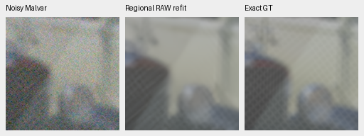
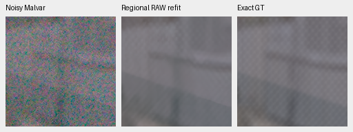

# Refitting weak junction contrast from local Bayer samples

The opt-in `weak-junction-refit` crop mode recovers **0.724 percentage
points** more crossing contrast on 24 new exact-target photos and lowers
junction error by **0.216 DN16**. It adds **0.015 DN16** mean luma RMS in
known gaps. A second forward at lower noise conditioning proposes
slightly less recoverable contrast. At the same recovered contrast, its
junction error is nearly identical to the RAW-only refit. On the real
right cab the refit slightly changes crossing modulation, with incomplete
intersections and retained mottle.

## What the sharper prediction contributes

[Lower noise conditioning](context-conditioned-detail.md) reveals more cab
diagonals and leaves grain in exact flats. This test first passes the
normal Local 50k output through [weak-junction-phase](local-junction-support.md).
The first Bayer fold fixes the two fundamental phases and the difference-band
sign. The third and fourth folds confirm the fundamentals and signed
difference term. The existing 16×16 station check bounds delivery to
pixels where both wires have local support. The refit retains those checks,
the same phase and the 48-pixel halo.

For each of the existing 4×4 amplitude nodes, a narrower Gaussian fit
uses σ 30 native pixels and radius 72, compared with σ 35 and radius 80
in the first pass. The first pass output supplies the already recovered
green amplitude at the actual CFA positions. The last three folds
estimate residual amplitude after fitting the smooth nuisance and all
eligible competing terms. The estimator discounts excess that is weak
or inconsistent across folds, subtracts the aligned amplitude already
present and caps delivery at 1.5 times the discovery amplitude.

The alternate neural branch uses the same RAW with both noise
coefficients and the variance map scaled to **0.65× or 0.90×**. Its
only contribution is a tighter amplitude ceiling where it proposes
less aligned excess than the Bayer fit. The projected branch uses
camera green, while the delivered correction has neutral display
chroma. A separate control also requires the difference band itself
on the held samples inside each 16×16 station. It gives lower gap
addition with less contrast recovery. At inference the packaged RAW
refit uses one neural forward.

## Paired exact-target evidence

Calibration reuses 24 sources from the preceding junction study. It
chooses the largest recovery with at most 0.15 DN16 mean added gap
luma, 0.075 on each additive control and 0.50 peak on the quiet
controls. It selects the standard two-wire gate at full dose for
both the RAW-only and 0.65× alternatives.

The 24 new Commons sources are disjoint by ID and bin-four cache
hash from calibration and were checked against 559,808 photographic
training visits. Each source has two ISO6400 draws. A smooth contrast
dip changes the strength of the planted interaction across the crop while
the exact rear-wire gaps remain in place. The interaction and matched
additive roles share Poisson counts at the lower per-site rate and
read noise. The pre-Bayer blur is σ 0.85 pixels, capture exposure ×0.33,
ADC16 black fraction 0.03 and shot/read `0.00128/6.5536e-6`.

| 24 new sources | Recovered interaction | Junction increment RMS, DN16 | Added gap luma RMS, DN16 |
| --- | ---: | ---: | ---: |
| Checked sideband | 12.803% | 27.858 | 0.000 |
| Repeat the wider RAW fit | 13.682% | 27.595 | 0.024 |
| Narrower RAW refit | 13.527% | 27.642 | 0.015 |
| Screened 0.65× prediction | 13.410% | 27.671 | 0.015 |
| Narrower RAW refit, matched to the neural branch | 13.410% | 27.673 | 0.013 |

The narrower RAW refit improves contrast by **0.724 points**
`[+0.062,+1.458]` and junction increment RMS by **−0.216 DN16**
`[−0.447,−0.015]` against checked sideband. At the same contrast
as the neural branch, the two junction errors are 27.673 and
27.671 DN16. The paired difference interval spans zero. Dose matching
here uses the held panel as a descriptive comparison. Repeating the
wider fit also adds contrast. At equal recovery, narrowing lowers
mean gap addition by 0.0047 DN16 `[−0.0140,0.0000]`.
Peak gap addition for the narrower fit is 0.363 DN16 on one ellipse.
Intervals resample photos within geometry, keeping the two draws
together. Every additive, continuous additive, one-direction,
flat-core, edge-only and uniform crop reproduces the checked sideband
on the held panel. The refit also reproduces the earlier outputs on 48
ordinary photos with both authentic and incompatible distant context.

## Native exact comparisons

Each 160×160 cell uses ROI `[48,48,160,160]` in the recipient at
`[128,128,256,256]`. The triplets show noisy Malvar, the regional RAW
refit over Local 50k EMA, and exact post-optics GT, with common display
exposure ×2 followed by sRGB. The Local 50k EMA has SHA256
`62f4e9ce84075c8df1a254a1889033b5787133e8c98c63e0ec3d174a94734959`.
Both sources are adapted by binning, adding carriers and simulating
capture with the physical noise above.

Berthold Werner, *Opel 1290 Spezial*, bin-four source
`[342,12,512,512]`, GBRG, draw one. This is the largest gap addition.
The darker area keeps the diagonal pattern, with little visible change
inside the ellipse at this exposure. [All methods](assets/phase-screened-conditioning-v1/screened-11-comparison.png) ·
[Source](https://commons.wikimedia.org/wiki/File:Opel_1290_Spezial_2013-07-21_13-45-13.JPG) ·
[CC BY-SA 3.0](https://creativecommons.org/licenses/by-sa/3.0/).

mattbuck, *King’s Cross railway station MMB B5 67024*, bin-four
source `[442,62,512,512]`, BGGR, draw zero. This continuous dip has the
largest junction-error reduction, 3.625 DN16. The refit slightly
strengthens the central modulation. Exact crossings remain clearer.
[All methods](assets/phase-screened-conditioning-v1/screened-13-comparison.png) ·
[Source](https://commons.wikimedia.org/wiki/File:King%27s_Cross_railway_station_MMB_B5_67024.jpg) ·
[CC BY-SA 3.0](https://creativecommons.org/licenses/by-sa/3.0/).

## Standing GFX100S comparisons

Sky, building and foliage reproduce the checked sideband. The coarse
fence retains connected intersections and changes by 0.839 DN16 RGB
RMS. The refit changes the nominal and transferred right crops by
**1.903 and 1.986 DN16**, compared with **0.194 and 0.740 DN16** for
the screened sharper branch. Some lower-right crossing modulation
strengthens at ×16. Both fine crops retain incomplete crossings and
mottle. The boards show no clear new color ripple.

The origins for sky, building, foliage and coarse wire are
`[5800,1400]`, `[5790,2690]`, `[8890,5570]` and `[2240,6000]`.
Cab origins are `[806,6489]` and `[1026,6449]`. The transferred
shot/read profile is `0.0014635775921166604/1.0715704128646712e-6`.
V120 Small uses EMA SHA256
`a9d9b6b4f974e24a6b11e5e740aab32314233a7f53c056cf37c7d2aac1c589fb`.
Independent ISO100 AHD and both in-camera JPEGs are qualitative
references with exposure, aperture and subject-position differences.

| RAW and profile | Native boards |
| --- | --- |
| DSCF3879 nominal ×4 | [Sky](assets/phase-screened-conditioning-v1/main-overcast-sky-main-overcast-sky-x4.png) · [Building](assets/phase-screened-conditioning-v1/main-building-detail-main-building-detail-x4.png) · [Foliage](assets/phase-screened-conditioning-v1/main-foliage-main-foliage-x4.png) · [Coarse fence](assets/phase-screened-conditioning-v1/main-chain-link-fence-main-chain-link-fence-x4.png) |
| DSCF3842 nominal | [Left ×4](assets/phase-screened-conditioning-v1/mesh-nominal-fine-green-mesh-left-x4.png) · [Right ×4](assets/phase-screened-conditioning-v1/mesh-nominal-fine-green-mesh-right-x4.png) · [Left ×16](assets/phase-screened-conditioning-v1/mesh-nominal-fine-green-mesh-left-x16.png) · [Right ×16](assets/phase-screened-conditioning-v1/mesh-nominal-fine-green-mesh-right-x16.png) |
| DSCF3842 transferred | [Left ×4](assets/phase-screened-conditioning-v1/mesh-profile3879-fine-green-mesh-left-x4.png) · [Right ×4](assets/phase-screened-conditioning-v1/mesh-profile3879-fine-green-mesh-right-x4.png) · [Left ×16](assets/phase-screened-conditioning-v1/mesh-profile3879-fine-green-mesh-left-x16.png) · [Right ×16](assets/phase-screened-conditioning-v1/mesh-profile3879-fine-green-mesh-right-x16.png) |

## Packaged crop fit

Use `method="weak-junction-refit"` with a 160×160 parent crop and its
256×256 RGB context, including the 48-pixel halo. The public method
matches the research replay bit for bit on 336 synthetic role crops
and eight standing GFX crops. The prior `weak-junction-phase` output
matches its previous implementation on those same inputs. Median
single-thread CPU time after the neural forward is about 45 ms per crop
with either method across the full paired sample. On the ten crops
with pixel changes, median time rises from **87.5 to 107.8 ms**.
All 97 focused tests pass. [Crop usage](usage.md#repeating-mesh-crops).

This study uses existing EMA weights. Its completed exact and native
reviews are scoped to the crop fit. The fixed 427-photo and measured
camera panels score the underlying full models.
[Scores, paired intervals and timing](results/phase-screened-conditioning-v1/summary.json) ·
[Native provenance](assets/phase-screened-conditioning-v1/manifest.json) ·
[Publication hashes](results/phase-screened-conditioning-v1/publication.json) ·
[Executed sources and receipts](results/phase-screened-conditioning-v1/evidence.tar.xz).
