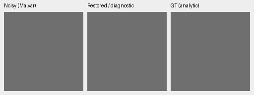

# Detail loss is already present before the late RGB head

The large V91-versus-V90 ADC gain losses are almost entirely present in
their adapted pre-head outputs. Removing the late head or pooling V91's
frozen prompts barely changes them. The dark noisy carrier is also nearly
absent before the new head. An inference-time head change therefore does
not recover the measured losses in this fixed diagnostic.

This identifies where the losses appear in the current forward. It does
**not** exclude head-training gradients as a cause of shared-path adaptation,
or identify which common CNN/adapters/earlier-guidance parameters changed
responsibly. Pre-head outputs come from jointly trained models; they are
not models trained without the head. No new model, policy or default is
promoted. The [complete V90/V91 quality result](late-rgb-original4k-review.md)
and V43 working reference remain unchanged.

[Fixed protocol](late-rgb-detail-decomposition.md),
[final diagnosis](results/late-rgb-components-final-review-v1.json),
[all case metrics](results/late-rgb-components-per-case-v1.jsonl),
[all 90 method/signal group means](results/late-rgb-components-all-group-means-v1.json).

## What was compared

The genuine immutable V63 original20k parent and V90/V91 original4000 EMAs
use the same 47 actual training modules and pinned frozen DINO. No optimizer
or new checkpoint is involved.

| Checkpoint | SHA256 |
| --- | --- |
| V63 parent | `ed70952dd33c5d7da39199bf1306b58b579862920fb0cccd6b222f19871bc9b5` |
| V90 global | `ba40d88149726c48f90d33399cf6ee4666daad470bff82bdfddf994a5e5eb3c4` |
| V91 spatial | `80ade7b792a8621c214d4450b9e0befa7d06be2d4797ecfaaa7227def9b609e7` |

One actual common forward captures the headed model's normalized prediction,
decoder/physical inputs and DINO fields. The physical inverse must replay
the complete actual output exactly. Direct head replay must also be exact.
Reuse those inputs for head bypass and V91 prompt pooling. Pooling the
already-global V90 head must be an identity. Targets never enter these
forward arguments.

The six methods are V63 full; V90 full/pre-head; V91 full/pre-head/pooled.
All 12 ADC groups remain: two means, two contrasts, three periods, four CFAs.
The original four ADC draw labels are exact duplicates, so this uses 48
unique measurements. Two fixed noisy carriers and a flat add 48 original
CPU-seeded CFA/draw observations. All 96 observations enter every method:
576 metric rows. No source, group or unfavorable case is discarded.

## Signed carrier results

Signed gain 1 matches the true carrier. These are dimensionless projection
gains, not PSNR or ordinary photographic quality scores.

| Mean / contrast / period | Noise | V63 | V90 full | V91 full |
| --- | --- | ---: | ---: | ---: |
| .01 / .02 / 4px | ADC only | .752261 | .541928 | .428783 |
| .18 / .02 / 4px | ADC only | .787508 | .697871 | .643761 |
| .01 / .10 / 8px | highest prior | .004005 | .004418 | .005035 |
| .18 / .02 / 16px | highest prior | .332968 | .295638 | .315842 |

For the two main ADC gaps:

| Mean / contrast / period | V91−V90 full | Pre-head path term | Late-head term | V91 pooled−spatial |
| --- | ---: | ---: | ---: | ---: |
| .01 / .02 / 4px | −.11314567 | −.11314546 | −2.10e−7 | +.00001415 |
| .18 / .02 / 4px | −.05411034 | −.05411798 | +7.64e−6 | +.00000767 |

The dark ADC pre-head gains are .541930/.428784 for V90/V91; the full
values are .541928/.428783. The brighter ADC pre-head gains are
.697864/.643746, also close to the full outputs. Relative to V63, both
adapted paths already lose substantial low-contrast 4px response.

The noisy bright-carrier difference is likewise mostly pre-head:
+.02016093 of the full +.02020463; the late-head difference is +.00004370.
Pooling changes it −.00000338. The dark noisy carrier remains nearly absent
in every variant. Removing the new head does not provide a general texture
recovery in these observations.

The flat control is retained. Full V90/V91 spatial-luma RMS is
.00051590/.00051468 versus parent .00052223. Their pre-head RMS is
.00051620/.00051513. Mean absolute RGB DC bias instead rises from
.00072110/.00072794 pre-head to .00078899/.00079638 full. Error/RMS terms
are not added as if they were signed linear components.

## Independent checks and work reuse

All 32 native cells were actually viewed before new component statistics.
[Manual record](results/late-rgb-components-native-review-v1.json).
Full V90/V91 metrics replay the prior closed analytic rows within the
predeclared 1e−6 gain / 1e−8 error limits: maximum gain-family difference
1.85e−7, absolute RGB-error difference 3.73e−10. This is scalar replay within
bounds, distinct from the exact within-run capture/inverse/head checks.

The independent NumPy reader checks the physical RGB identity
`F91−F90 = (B91−B90) + [(F91−B91)−(F90−B90)]` with zero error.
A separate explicit least-squares auditor projects those actual RGB
differences, rather than merely subtracting the reported gains. All 80
carrier observations / 320 projection fields agree within 7.40e−15.
[Scalar accounting](results/late-rgb-components-scalar-review-v1.json),
[direct RGB projection audit](results/late-rgb-components-projection-audit-v1.json).

The GPU run uses 75 common trunk/DINO forwards, including three extra
unhooked parity controls. Diagnostic variants add no common-network passes.
Both states, parameter identities, measurement inputs and CPU/CUDA RNG remain
unchanged. All three DINO states match the original hash
`370a84c2d9e1d216757422c0a25ceb82a0a106083ba8ca545d9b267e704540fd`.
On all five stored B4 capture batches, DINO fields and physical
condition/offset/span values are byte-identical between arms. Complete head
inputs/outputs and strides remain cached for later precision work.

[Genuine CPU preflight](results/late-rgb-components-CPU-preflight-v1.json)
checks six small real-weight cases, 12 forwards, without initializing CUDA.
[Actual GPU capture](results/late-rgb-components-GPU-capture-v1.json)
then retains all 72 model/fixture records and ten complete head-input batches.
The new tools and existing head suite pass 28 tests; Ruff passes. No
production model implementation or inference default changes.
[Executed-source and engineering index](results/late-rgb-components-engineering-v1.json).

## Native comparisons

Each panel is an unchanged 160px crop: noisy Malvar, restored diagnostic,
exact analytic GT. ROI [48,48,160,160], native256, RGGB/draw0, WB [2,1,1.5],
unchanged evaluation matrix. Dark cases use display16× and bright cases1×,
identically across every method/noisy/GT. ADC conditioning is shot=read=0;
the noisy carriers use shot .00256/read variance .0000262144. These are
viewing transforms only; metrics use unquantized arrays at the declared ROI.

V90 full, two ADC means:

V90 pre-head counterfactual, identical observations:

V91 full, two ADC means:

V91 pre-head counterfactual:

[Complete native board](images/late-rgb-components-all-native.png) includes
parent, pooled V91 and both noisy carriers. The
[full asset index](results/late-rgb-components-published-native-assets-v1.json)
preserves all 24 triplets, source/ROI/checkpoint/noise/exposure/policy details
and every original pixel. No photographic/GFX improvement follows from
these known synthetic horizontal patterns. The standing real scene remains
represented in the completed full-model review, with ISO100 accurately not GT.

The evidence motivates a separate training-scope comparison that protects
the mature common path while learning refinement. That would need common
model **and EMA** tensors held exact, followed by all existing camera/detail/
photo/native checks. Freezing is not yet shown to improve quality; the
current head-bypass/pooling diagnostics are not qualified deployment policies.
SOTA, decisive native superiority and 100MP/10s remain unmet/unproven.
