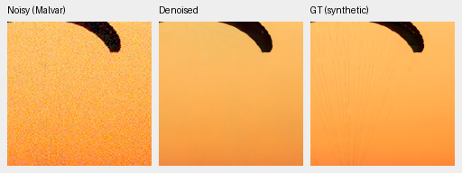
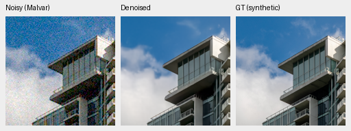
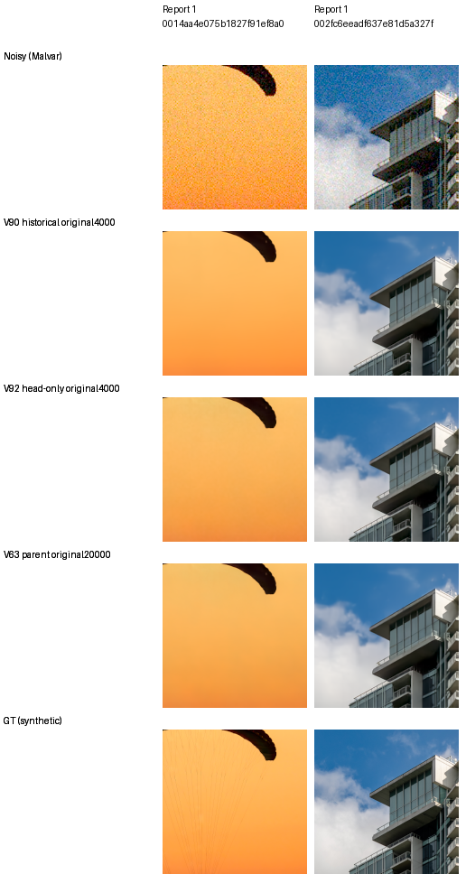
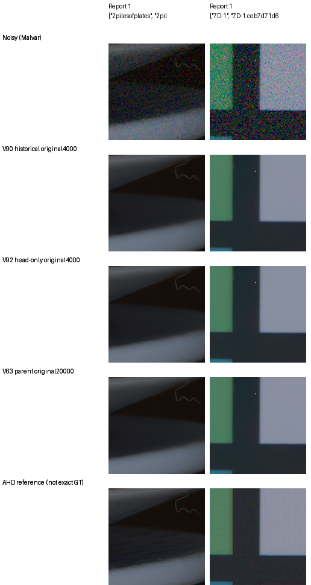
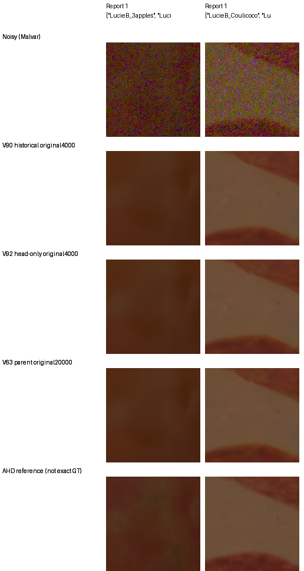

# V92 first fixed native views: detail loss remains

This dated interim observation is superseded by the
[completed full review](late-rgb-head-only-original4k-review.md), which rejects
V92 after all125 native cells and numerical criteria are evaluated.

V92 looks close to its V63 parent in the first fixed native photo and camera
examples. All three neural methods remove much of the displayed noise, but the
fine canopy cords visible in exact synthetic GT remain missing. These views
do not establish a clear V92 advantage. The complete quality evaluation is
still running; no model is promoted or extended.

All30 cells in the three boards below were actually viewed at original pixel
scale. They cover18 triplets: two exact-GT photos, two known-camera examples
and two unseen-camera examples, for V90, V92 and V63. These are the existing
fixed examples emitted by the live review, without selecting new ROIs from
model errors. Another95 of the required125 native cells remain pending,
including GFX, analytic, hue and highlight views. New numerical quality and
timing summaries remain uninterpreted until the full native review.

[Source PNGs, full crop metadata, actual viewing notes and live-owner evidence](results/late-rgb-head-only-interim-native-v1.json),
[fixed protocol](late-rgb-head-only-v92.md),
[full review preparation](late-rgb-head-only-review-preparation.md).

| Board label | Checkpoint SHA256 |
| --- | --- |
| V90 historical original4000 | `ba40d88149726c48f90d33399cf6ee4666daad470bff82bdfddf994a5e5eb3c4` |
| V92 head-only original4000 | `fa0825f7b5f33482953714a99741eec30d21362b81d9574d836086cabfb81908` |
| V63 parent original20000 | `ed70952dd33c5d7da39199bf1306b58b579862920fb0cccd6b222f19871bc9b5` |

V90 is a fixed historical exploratory reference whose outcomes informed V92;
this is not a newly randomized two-arm study. All displayed predictions are
fresh FP32 outputs from the running frozen evaluation. The copied PNGs are
byte-identical to their producer files, and every board cell matches its
original native160px panel exactly. No inference was added for this report.

## Two exact-GT photo triplets

Noisy Malvar → V92 restoration → exact synthetic clean target. These are
native160×160 pixels at the8×-binned evaluation resolution, with ROI
`[48,48,160,160]` inside each native256 evaluation tile. Neither the crop pixels
nor the displayed references were resized. Both use RGGB, fixed ISO12800-prior
shot `.00256`, read variance `.0000262144`, display exposure1/0EV,
WB`[2,1,1.5]`, validation seed42 and the unchanged common camera matrix recorded
in the receipts. Noise draws are the existing source/condition/CFA-keyed GPU
observations shared by all three methods.

Swiss Riviera canopy, source`0014aa4e075b1827f91ef8a02069e1e318f040ba`:

Vancouver building/sky, source`002fc6eeadf637e81d5a327f117b79abb86becd9`:

Sources: [Roy Egloff](https://commons.wikimedia.org/wiki/File:CH.VD.Villeneuve_2007-08-25_Vertigo-Swiss-Riviera_2392_3x2-R_4K.jpg)
and [Dietmar Rabich](https://commons.wikimedia.org/wiki/File:Vancouver_(BC,_Canada),_Coal_Harbour_Seaside_Park,_Blick_in_den_Himmel_--_2022_--_2158.jpg),
[CC BY-SA4.0](https://creativecommons.org/licenses/by-sa/4.0/); modified by
binning, cropping, synthetic noise and restoration.

The complete10-cell board makes the common noisy/GT pixels explicit. All
methods lose the thin canopy structure. Small tone and cloud-edge differences
are visible, with V92 close to its parent; these selected views cannot determine
the full photographic ranking.

## Registered camera examples

Each board uses two existing512px prepared contexts and native160px ROI
`[176,176,160,160]`. Display exposure and variance multiplier are both1 for
every method. Conditioning comes from the unchanged input-only Haar fit, not
the reference. The rendered low-noise RAW uses independent LibRaw AHD and is
**not exact GT**; primary numerical camera scores use registered CFA samples.
See the [evaluation conventions and source attribution](evaluation.md).

| Panel | Scene | Prepared context xywh | Shot | Read variance |
| --- | --- | --- | ---: | ---: |
| Known | 2pilesofplates | `[2756,1756,512,512]` | .001425164 | .000001570807 |
| Known | 7D-1 | `[2344,1476,512,512]` | .004811973 | .000066214510 |
| Unseen | LucieB_3apples | `[2756,1754,512,512]` | .002302015 | .000050209101 |
| Unseen | LucieB_Coulicoco | `[2756,1754,512,512]` | .002348259 | .000170381574 |

The known examples retain similar soft edges and small color differences.
The faint pale thread/edge remains visible in the plate crop. No clear new
V92-specific grid or ringing is visible in these two selected views.

Both unseen fruit examples remain strongly smoothed. V92 and V63 look close;
the small tone changes against V90 do not establish a native-detail gain. The
AHD references retain grain and do not provide exact pixel truth.

The [full427 inference stage has now completed](results/late-rgb-head-only-full427-completion-v1.json):
its exact worker exited successfully and all74,424 expected rows are present.
At that interim boundary, the workflow continued through statistics and the
remaining review stages, with95 native cells pending. The subsequent final
report completes those checks and rejects V92. V43 and the README examples
remain the working experimental reference.
