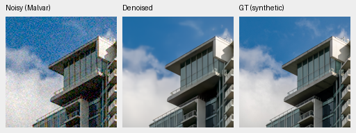
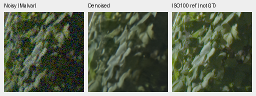
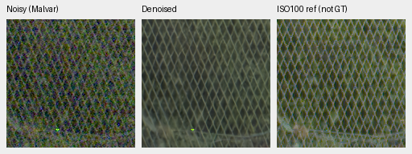

# V92 original4000: freezing the common path does not improve overall quality

V92 fails all seven primary criteria and the separate weak-detail criteria.
Against its V63 parent, photo PSNR falls **.16213dB**, unseen-camera CFA PSNR
falls **.34470dB**, and photo SSIM falls **.001057**. The original4000-update
run stops here, without promotion, extension or a V92 full-frame run.
V43 and the README examples remain the working experimental reference.

Freezing preserves ADC response better than historical V90: all192 original
ADC layout/draw slots pass the individual loss limit. That does not translate
into better high-noise detail. Both required carrier gains miss+.05, while
their associated flat-luma RMS ratios exceed1.25. Native views retain lost
canopy cords, soft foliage and saturated-field mottling.

All ten inference stages, independent scalar/coverage audits and **125 actual
native cells /81 triplets** are complete. Every published PNG matches the
viewed bytes. [Complete decision and evidence](results/late-rgb-head-only-original4k-complete-v1.json),
[actual pre-statistics native viewing](results/late-rgb-head-only-original4k-native-review-v1.json),
[full crop/source/ROI/noise/exposure index](results/late-rgb-head-only-original4k-published-native-v1.json),
and [original fixed protocol](late-rgb-head-only-v92.md).

## Training and comparison boundary

V92 completes its original4000 updates /64,000 examples at native256/B16,
seed55, with the reviewed88,508 Commons sources, native128/106 groups and
paired32. It learns only the24 global late-head tensors /100,547 parameters.
All91 common model and91 common EMA tensors remain byte-identical to V63.
The independent final-state audit verifies finite115/115/24 states, AdamW
counters4000,176 recorded input pairs,161 source/LR logs and final RNG against
V90. These are execution facts, not quality evidence.

| Model | Checkpoint SHA256 |
| --- | --- |
| V92 head-only original4000 | `fa0825f7b5f33482953714a99741eec30d21362b81d9574d836086cabfb81908` |
| V90 historical original4000 | `ba40d88149726c48f90d33399cf6ee4666daad470bff82bdfddf994a5e5eb3c4` |
| V63 original20000 parent | `ed70952dd33c5d7da39199bf1306b58b579862920fb0cccd6b222f19871bc9b5` |

V90 is a fixed historical exploratory reference chosen after observing its
outcomes. This is not a newly randomized two-arm study. Fresh FP32 inference
uses all three checkpoints and the unchanged observations/protocol. V43 and
RawNIND supplements retain exact source/control witnesses. All339,282 witness
metric-case comparisons replay exactly in this review, without needing the
reader's posthoc4-ULP allowance. This count includes repeated comparisons and
does not represent339,282 independent observations.

## Complete primary results

All427 photos use seven conditions and four Bayer patterns;16 procedural
sources remain separate. Camera panels contain432 known and540 unseen rows;
the photo/procedural panel contains74,424 rows. Source/scene balancing and
registered-CFA camera scoring remain unchanged. AHD renderings are not GT.

| Model | Photo sRGB PSNR | Photo SSIM | Camera-linear photo PSNR | Known CFA PSNR | Unseen CFA PSNR |
| --- | ---: | ---: | ---: | ---: | ---: |
| V90 historical |36.18643|.964026|39.29609|54.19441|53.88461|
| V92 head-only |35.77085|.962233|40.21931|54.20873|53.49849|
| V63 parent |35.93298|.963290|41.35986|54.20368|53.84318|

| V92 minus V63 | Mean difference |95% source/scene interval|
| --- | ---: | --- |
| Photo sRGB PSNR |−.162127dB|[−.200335,−.111861]|
| Photo SSIM |−.001057|[−.001399,−.000807]|
| Camera-linear photo PSNR |−1.140551dB|[−1.226212,−1.049824]|
| Known CFA PSNR |+.005056dB|[−.288447,+.400408]|
| Unseen CFA PSNR |−.344697dB|[−.411771,−.271314]|

The required+.05dB/positive-lower-bound checks fail on photo, known and unseen;
the SSIM loss limit.0001 also fails. V92−V90 photo PSNR is−.415584dB,
interval[−.496347,−.355474], and unseen CFA is−.386125dB,
[−.484744,−.280927]. Its camera-linear photo PSNR recovers+.923219dB over V90
while remaining1.140551dB below V63. Rendered and camera-linear scores are
different outcomes and both are retained.

Per-condition photo sRGB PSNR explains why an overall negative result can
include small gains at selected noise levels:

| Condition | V90 | V92 | V63 | V92−V63 |
| --- | ---: | ---: | ---: | ---: |
| ADC-only |36.23196|35.77225|36.02426|−.25201|
| ISO100 prior |38.08460|37.59766|37.62729|−.02963|
| ISO1600 prior |36.79952|36.47078|36.46162|+.00916|
| ISO12800 prior |33.50452|33.36033|33.34191|+.01842|
| Legacy noise |35.45246|35.15966|35.12735|+.03231|
| Shadows |39.92135|39.88309|39.91378|−.03070|
| Highlights |33.31061|32.15217|33.03461|−.88244|

The separate16 procedural sources also regress: V92 reaches34.61105dB/
.972995 SSIM versus V63's35.07531/.976318. They do not substitute for photos.

Both fixed source-exclusion sensitivities retain the photographic loss:
418 sources,−.16160dB,[−.19766,−.10890];416 sources,−.16147dB,
[−.19904,−.10818]. The independent Decimal/scalar audit reaggregates215,208
metric values,7,686 source scalars and540 comparison-statistic scalars, with
zero source discrepancy and maximum comparison discrepancy3.55e−15.
Intervals use1,000 source/scene bootstrap draws, seed42; they do not estimate
training-run or post-selection uncertainty. Source exclusions do not undo
ancestor exposure or establish complete scene independence.

[Primary statistics](results/late-rgb-head-only-original4k-primary-statistics-v1.json),
[all source sensitivities](results/late-rgb-head-only-original4k-source-sensitivity-v1.json),
[independent sensitivity audit](results/late-rgb-head-only-original4k-source-sensitivity-audit-v1.json).

## Native noisy/restored/GT photographs

Each triplet is native160×160 at the8×-binned evaluation resolution, with
ROI`[48,48,160,160]` inside the native256 tile. All methods use RGGB, the same
source/condition/CFA-keyed GPU observation, ISO12800-prior shot`.00256`/
read variance`.0000262144`, WB`[2,1,1.5]`, the common recorded matrix and
display exposure1/0EV. Crop seed42 and full source/cache/checkpoint hashes are
retained in the asset index. Pixels are never resized.

V92, canopy and building/sky:

V90 historical reference, identical measurements and transforms:

Sources: [Roy Egloff](https://commons.wikimedia.org/wiki/File:CH.VD.Villeneuve_2007-08-25_Vertigo-Swiss-Riviera_2392_3x2-R_4K.jpg)
and [Dietmar Rabich](https://commons.wikimedia.org/wiki/File:Vancouver_(BC,_Canada),_Coal_Harbour_Seaside_Park,_Blick_in_den_Himmel_--_2022_--_2158.jpg),
[CC BY-SA4.0](https://creativecommons.org/licenses/by-sa/4.0/); modified by
binning, cropping, synthetic noise and restoration. The
[complete photo board](images/late-rgb-head-only-original4k-full427-all-methods-native.png)
includes fresh V63 and retained V43. Fine cords remain absent. The
[known](images/late-rgb-head-only-original4k-known-all-methods-native.png) and
[unseen](images/late-rgb-head-only-original4k-unseen-all-methods-native.png)
boards show similar soft boundaries; their AHD references are independently
demosaiced low-noise captures, not exact GT.

## Standing GFX foliage, fence and highlights

The cached DSCF3879 ISO6400/DSCF3880 ISO100 pair remains outside training.
Four native512 contexts use original sky/building/foliage/fence ROIs, native160
panels, shot`.0014635775921166604`, read variance`1.0715704128646712e-6`
and shared display exposure4/+2EV. The separate ISO100 f/5.6 exposure differs
in optics, time and moving subjects; it is a qualitative reference, **not GT**.
No GFX pixelwise reference score is computed.

V92 foliage and fence:

The [complete28-cell GFX board](images/late-rgb-head-only-original4k-gfx-all-methods-native.png)
also includes sky/building, V90, V63, V43 and RawNIND. All neural variants keep
fence lines more continuous than RawNIND in this selected scene, while foliage
remains soft and no decisive V92 gain is visible. All four regions and both
endpoint triplets remain in the asset index. The
[neon/platform board](images/late-rgb-head-only-original4k-highlights-all-methods-native.png)
retains similar lost sign texture and boundary softness; its ISO100 AHD panels
are also not exact GT. These are512-context views, not new full-frame outputs.

## Coherent detail and flat/color failures

The full analytic audit retains1,344 rows,448 distinct observations per model,
84 groups and2,256 scalar fields; maximum arithmetic discrepancy is2.22e−16.
Both required highest-noise carrier contrasts fail:

| Carrier level / contrast / period | V90 signed gain | V92 signed gain | Gain change | Flat-luma RMS ratio |
| --- | ---: | ---: | ---: | ---: |
| .01 / .10 /8px |.004418|.044446|+.040029|1.81032×|
| .18 / .02 /16px |.295638|.337559|+.041921|1.67896×|

The limits remain+.05 gain and at most1.25× flat RMS. Larger noncarrier RMS
also accompanies these changes. Native dark stripes remain largely absent in
the [analytic board](images/late-rgb-head-only-original4k-analytic-all-methods-native.png).

All192 original ADC slots pass the individual−.05 limit; the worst V92−V90
gain change is−.00082721. Retain all12 group means below. Four deterministic
draw labels duplicate each actual ADC observation; they are not independent
noise realizations.

| Level | Contrast | Gain change4px | Gain change8px | Gain change16px |
| --- | --- | ---: | ---: | ---: |
| .01 | .02 |+.232084|+.011037|+.038519|
| .01 | .10 |+.022730|+.000981|+.002523|
| .18 | .02 |+.110455|+.041074|+.040887|
| .18 | .10 |+.033451|+.007139|+.002855|

The frozen path therefore preserves ADC detail relative to historical V90,
while failing the high-noise and overall quality requirements. It does not
identify which particular common-path module or training gradients caused the
previous adaptation's losses.

All3,528 hue predictions /1,176 observations per model are independently
audited. Mean per-field camera-RGB RMSE is.000520 for V90,.002904 for V92 and
.002850 for V63. Mean centered camera-RGB RMS is.000367/.000871/.000608.
V92 retains the parent's visible saturated magenta and dark-purple mottling;
V90 is often smoother. All fixed
[main palettes](images/late-rgb-head-only-original4k-hue-all-methods-native.png) and
[additional palettes](images/late-rgb-head-only-original4k-hue-extra-all-methods-native.png)
are included, rather than selecting favorable fields.

[Every individual ADC/carrier gate](results/late-rgb-head-only-original4k-numerical-criteria-v1.json)
and the complete audit references remain in the decision record. This closes
V92's original budget. No training extension, default change or full-frame
qualification follows. The separate mature V43/V63 precision pilot proceeds
under its own fixed protocol; the broad quality and100MP/10s goals remain open.
