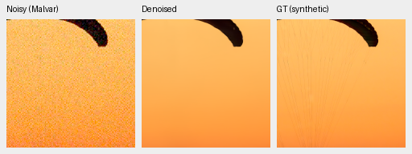
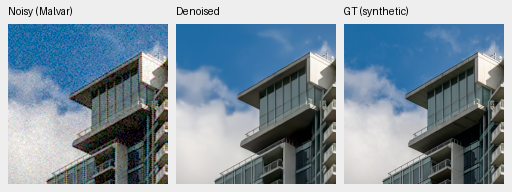
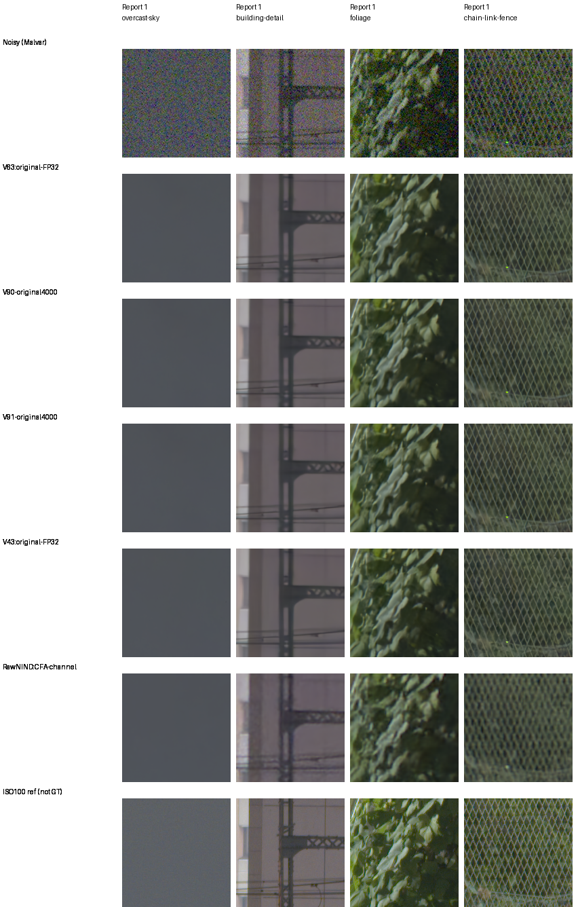
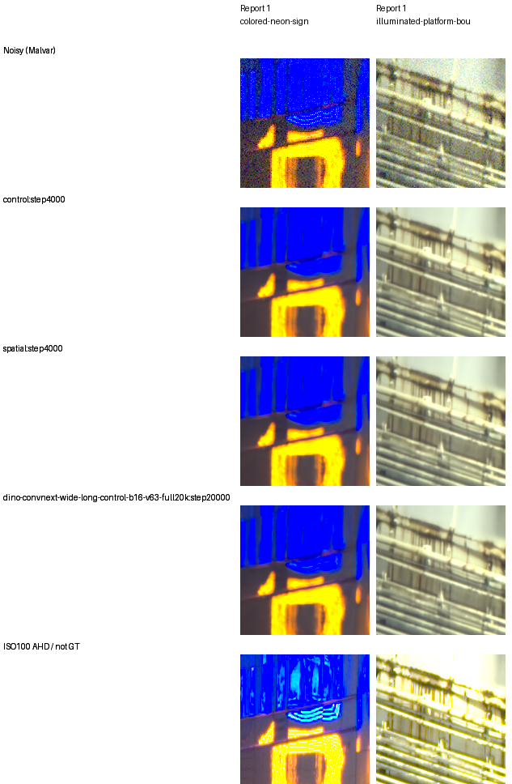

# Late RGB4k: tiny spatial gain; camera and detail requirements fail

Current architecture and recommendations: [current model guide](current-model.md).
The versioned study below retains its measured results and original protocol.

Both original4,000-update runs and the full review are complete. Spatial
DINO access adds **+.00217dB** photo PSNR over the matched global head,
source-bootstrap95% interval **[+.00129,+.00314]**. Neither endpoint meets
the camera promotion requirements. Weak-carrier improvements miss their
minimum, and24 of192 ADC draw/layout slots exceed the allowed gain loss.
Neither arm is promoted or extended. V43 was the reference for this experiment.

All eight fixed native boards were actually viewed before new numerical
interpretation:81 source triplets/125 unchanged160px cells. Final packaged
PNGs match the viewed bytes exactly. [Actual pre-statistics viewing record](results/late-rgb-original4k-native-review-v1.json),
[final decision](results/late-rgb-original4k-final-review-v1.json),
[complete crop/source/ROI/noise/color/exposure index](results/late-rgb-original4k-published-native-assets-v1.json).

## Fixed training and evaluation

| Endpoint | Checkpoint SHA256 |
| --- | --- |
| V90 global4000 | `ba40d88149726c48f90d33399cf6ee4666daad470bff82bdfddf994a5e5eb3c4` |
| V91 spatial4000 | `80ade7b792a8621c214d4450b9e0befa7d06be2d4797ecfaaa7227def9b609e7` |
| V63 original20k parent | `ed70952dd33c5d7da39199bf1306b58b579862920fb0cccd6b222f19871bc9b5` |

Each arm draws64,000 native256/B16 examples, seed55, BF16/channels-last,
strict execution and the original4k LR horizon. Both add the same100,547-
parameter learned RGB head after the common trunk. V90 pools four DINO
prompt fields globally; V91 retains their spatial fields. Earlier DINO
guidance remains in both, with one frozen encoder pass. Both use88,508
reviewed Commons sources, native128 captures/106 groups, paired32 scenes,
sensor-valid targets and4×→geometry/PSF→area2 augmentation.

The [unchanged protocol](late-dino-rgb-v90-v91.md) and
[independent training boundary](late-rgb-original4k-boundary.md) retain
original1000/4000 checkpoints, finite115/115/113 model/EMA/AdamW states,
all176 recorded source/forward/loss-input pairs,161 logged domain/LR records,
final Python/CPU/CUDA RNG and all47 actual source modules. Neither run resumed
or extended its horizon. Absolute gains versus V63 also change training time,
head and data recipe; they do not isolate a head-only or corpus-size effect.

## Primary results

Source-balanced differences; camera panels score measured CFA against
registered low-noise RAW. Their auxiliary AHD RGB is not exact RGB GT.

| Metric | V90−V63 | V91−V63 | V91−V90 |
| --- | ---: | ---: | ---: |
|427-photo sRGB PSNR, dB|+.253457|+.255630|+.002173|
|427-photo sRGB SSIM|+.0007358|+.0007259|−.0000099|
|Known-camera CFA PSNR, dB|−.009266|−.014969|−.005702|
|Unseen-camera CFA PSNR, dB|+.041429|+.042852|+.001424|
|Original canonical camera-linear PSNR, dB|−2.063770|−2.062309|+.001460|

Both known-camera means miss the required+.05dB gain. Both unseen-camera
means also miss+.05dB, and their95% intervals cross zero. V91's known-camera
interval is entirely negative:[−.02369,−.00677]dB. The canonical camera-linear
loss remains under the original target convention; it is not relabeled as a
physical sensor score or hidden behind rendered gains.

The narrow matched photo/camera-nonregression/SSIM numerical screen passes.
Most of its photo gain is in the synthetic highlights condition:+.01196dB.
Highest-noise photo PSNR instead changes−.00017dB; this is not a uniform
detail gain. All fourteen photo/procedural condition means are retained with
the [complete color groups](results/late-rgb-original4k-condition-and-color-review-v1.json).

The primary review checks74,424 scalar rows,427 photos+16 procedurals,
seven conditions/four CFAs/six methods, plus432 known/540 unseen camera
rows. Maximum independent summary difference is1.42e−14; all27 classical
metric witnesses match exactly despite the reader's explicitly retained
posthoc4-ULP bound. [Primary statistics and provenance](results/late-rgb-original4k-primary-statistics-v1.json).

Known-series/site exclusions preserve the tiny matched photo effect:

| Photo cohort | PSNR difference, dB |95% source interval|SSIM difference|
| --- | ---: | --- | ---: |
|427 original|+.002173|[+.001286,+.003145]|−.00000986|
|418 series excluded|+.002129|[+.001271,+.003108]|−.00001055|
|416 series/sites excluded|+.002133|[+.001316,+.003111]|−.00001011|

All81 contrasts and the [independent Decimal/scalar-bootstrap audit](results/late-rgb-original4k-source-sensitivity-audit-v1.json)
are retained with the [source sensitivities](results/late-rgb-original4k-source-sensitivity-v1.json).
These intervals describe source resampling for one matched training seed;
they do not estimate repeat-training, unknown capture-family or foundation/
ancestor-pretraining uncertainty. Protected-final scenes remain untouched.

## Weak signal, ADC and color

| Mean/contrast/period | V90 signed gain | V91 signed gain | Difference | Flat RMS ratio |
| --- | ---: | ---: | ---: | ---: |
|.01/.10/8px|.004418|.005035|+.000617|1.000115|
|.18/.02/16px|.295638|.315842|+.020205|.997635|

Both changes miss+.05; both flat-noise ratios pass. The viewed dark carrier
is still nearly absent. Across all192 ADC slots, spatial-minus-global gain
ranges[−.163759,+.013467]. Twenty-four slots fail the−.05 limit, representing
six distinct signal/CFA cases; the four deterministic ADC draw labels are
not independent observations. The low-contrast4px group means are−.113146
at mean.01 and−.054110 at mean.18. All12 group means and every individual
slot remain in the [numerical criteria](results/late-rgb-original4k-numerical-criteria-v1.json).
The [analytic audit](results/late-rgb-original4k-analytic-audit-v1.json)
checks1,344 rows/2,256 scalar fields, maximum arithmetic difference2.22e−16.

At highest noise/peak.9, mean maximum channel bias is mixed:

| Saturation | V90 | V91 | V63 |
| --- | ---: | ---: | ---: |
|0 / bright gray|.001087|.003431|.001342|
|.5|.001598|.001637|.014350|
|.98|.001179|.001156|.005739|

Both heads improve the selected saturated-color behavior, while spatial
bright gray is worse. Native magenta fields look smoother, without a clear
spatial advantage. These are descriptive finite-grid summaries, not real-photo
confidence bounds. All3,528 saved predictions/21,168 metric fields pass the
[independent array/render audit](results/late-rgb-original4k-color-array-audit-v1.json),
maximum4.44e−16. All54 groups/648 summary fields pass the separate
[summary audit](results/late-rgb-original4k-color-summary-audit-v1.json).

## Native synthetic triplets

Each panel retains160×160 image pixels. Left: noisy Malvar; middle: restored;
right: exact synthetic clean target. PNGs are viewing copies; scores use
unquantized predictions. Both sources use RGGB, shot.00256/read
variance.0000262144, display exposure1×, WB[2,1,1.5] and the identical matrix
recorded in the index. Displayed8× cache ROIs are[237,51,160,160] for the
canopy and[243,137,160,160] for the building; both use tile ROI[48,48,160,160].

V90/global, canopy and building:

V91/spatial, identical sources/ROIs/display:

Canopy source: Roy Egloff,
[Vertigo Swiss Riviera](https://commons.wikimedia.org/wiki/File:CH.VD.Villeneuve_2007-08-25_Vertigo-Swiss-Riviera_2392_3x2-R_4K.jpg).
Building source: Dietmar Rabich,
[Coal Harbour Seaside Park](https://commons.wikimedia.org/wiki/File:Vancouver_(BC,_Canada),_Coal_Harbour_Seaside_Park,_Blick_in_den_Himmel_--_2022_--_2158.jpg).
Both are CC BY-SA4.0; these are binned/cropped synthetic-noise/restoration
derivatives. Original attribution/license links and source/cache hashes are
preserved in the complete asset index.

All learned references still remove fine suspension lines and canopy ribs.
Major building edges survive, while clouds remain smoother than GT. The
new heads look close to one another. All comparison methods are retained in
the [complete photo board](images/late-rgb-original4k-full427-all-methods-native.png).

## Standing GFX and highlights

The cached DSCF3879 ISO6400 / DSCF3880 ISO100 f/5.6 pair remains excluded
from training with its siblings. The four standard crops use4× display
exposure and the common shot.0014635775921166604/read
variance.0000010715704128646712 conditioning. Source/context/ROI, calibration
and reference details are in the index. ISO100 differs in aperture/time and
moving subjects; it is a qualitative reference, not pixelwise GT.

Both new heads produce smooth sky and preserve major building/fence geometry.
Fine foliage remains soft relative to the independent sharper reference, and
there is no decisive global/spatial detail advantage. RawNIND shows stronger
uneven/periodic fence texture in this selected crop; it does not establish
broad camera superiority.

The blue sign still loses substantial internal detail, and bright platform
bars remain soft with a green/yellow cast. Neither head visibly solves this
limitation. No GFX-to-ISO100 quality score is computed. Camera, analytic and
all color boards are retained in the asset index, including unfavorable views.

## Closure and remaining work

The interrupted waiting package owner and its explicit queue recovery are
[documented separately](late-rgb-queue-recovery.md); no training or quality
inference was repeated. A photo-board helper's over-strict no-Torch-import
check also stopped after assembly; the corrected helper allows the existing
CPU cache-slice check, keeps CUDA uninitialized and reproduces the PNG bytes.
All failed source/output provenance remains retained.

This fixed late-spatial intervention has not solved weak detail or met endpoint
camera requirements. Original budgets are closed, with no new-head full-frame
export, README replacement or inference default change. The separate
unchanged-weight physics batching probe is an inference implementation study,
not a promotion of these heads. SOTA, decisive native superiority and100MP/10s
remain unmet/unproven.
